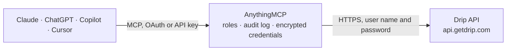

<!-- Generated by scripts/export-github-catalog.mjs in the anythingmcp-website repository. Do not edit by hand. -->

# Drip MCP connector

Drive Drip (e-commerce-focused email + SMS automation) from any AI agent: subscribers, tags, campaigns, events, orders. 12 tools, Basic-auth + account_id in URL. The AnythingMCP connector gives Claude, ChatGPT, Microsoft Copilot, Cursor and Gemini 12 MCP tools for Drip: 5 read and 7 can change data.

**Category:** [Marketing Automation](../marketing-automation.md) · **Tools:** 12 · **Setup guide:** [anythingmcp.com](https://anythingmcp.com/guides/drip-to-mcp) · [Deutsch](https://anythingmcp.com/de/guides/drip-to-mcp) · [Italiano](https://anythingmcp.com/it/guides/drip-to-mcp) · [Español](https://anythingmcp.com/es/guides/drip-to-mcp) · [日本語](https://anythingmcp.com/ja/guides/drip-to-mcp) · [Русский](https://anythingmcp.com/ru/guides/drip-to-mcp) · [中文](https://anythingmcp.com/zh/guides/drip-to-mcp)

## Start without code

No installation and no terminal: AnythingMCP Cloud runs the Drip connector for you, operated by helpcode.ai in Frankfurt, Germany.

1. **Click the button above** and create an account or sign in. The Drip connector opens, ready to install.
2. **Paste the API key or token from your Drip account.** Every click is in the [step-by-step guide](https://anythingmcp.com/guides/drip-to-mcp).
3. **Click Install.** AnythingMCP shows the address of your MCP server.
4. **Add that address to your assistant:** [Claude](https://anythingmcp.com/guides/connect-drip-to-claude) · [ChatGPT](https://anythingmcp.com/guides/connect-drip-to-chatgpt) · [Microsoft Copilot](https://anythingmcp.com/guides/connect-drip-to-copilot) · [Cursor](https://anythingmcp.com/guides/connect-drip-to-cursor) · [Gemini CLI](https://anythingmcp.com/guides/connect-drip-to-gemini) · [Meta Muse](https://anythingmcp.com/guides/connect-drip-to-muse).
5. **Ask your first question**, for example: *Show me the Drip subscriber record for emma.jones@brightleaf.co.uk — tags, signup date and lifetime_value.*

Prefer help with the setup? [Talk to us](https://anythingmcp.com/contact).

## How it works

- **The AI client** speaks MCP (Streamable HTTP) to AnythingMCP and only sees tool names, descriptions and results. It never gets the Drip credentials.
- **AnythingMCP** checks the client's role, builds the call from the tool definition, adds the credentials (user name and password), calls Drip, logs the call and returns the result.
- **Drip** sees an ordinary API client with the rights of the account the credentials belong to.

## Tools

| Tool | What it does | Access |
|---|---|---|
| [`drip_list_subscribers`](#drip_list_subscribers) | List subscribers with filters. | read |
| [`drip_get_subscriber`](#drip_get_subscriber) | Fetch subscriber by ID OR email (URL-encoded). | read |
| [`drip_create_or_update_subscriber`](#drip_create_or_update_subscriber) | Upsert subscriber by email. | write |
| [`drip_unsubscribe`](#drip_unsubscribe) | Unsubscribe by email or ID. | write |
| [`drip_tag_subscriber`](#drip_tag_subscriber) | Add a single tag to a subscriber. | write |
| [`drip_remove_tag`](#drip_remove_tag) | Remove a tag from a subscriber. | write |
| [`drip_create_event`](#drip_create_event) | Send a behavioral event for a subscriber. | write |
| [`drip_list_campaigns`](#drip_list_campaigns) | List campaigns (active workflows / autoresponders). | read |
| [`drip_subscribe_to_campaign`](#drip_subscribe_to_campaign) | Subscribe a contact to a campaign (enrolls in the workflow). | write |
| [`drip_record_order`](#drip_record_order) | Record an e-commerce order (used by Drip for revenue attribution and shopper segmentation). | write |
| [`drip_list_tags`](#drip_list_tags) | List all tags in the account with usage counts. | read |
| [`drip_list_custom_fields`](#drip_list_custom_fields) | List custom field names defined on subscribers. | read |

## Tool reference

Every parameter as the AI client sees it in `tools/list`. Source: [`packages/backend/src/adapters/intl/drip.json`](../../../packages/backend/src/adapters/intl/drip.json).

### `drip_list_subscribers`

List subscribers with filters.

**Access:** read · **Call:** `GET /subscribers`

| Parameter | Type | Required | Description |
|---|---|---|---|
| `status` | string | no | active, unsubscribed, all. |
| `tags` | string | no | Comma-separated tag names. |
| `subscribed_before` | string | no | ISO 8601. |
| `subscribed_after` | string | no | ISO 8601. |
| `page` | integer | no | Page (1-based). |
| `per_page` | integer | no | Per page (max 1000). |

### `drip_get_subscriber`

Fetch subscriber by ID OR email (URL-encoded). Returns all fields including tags, custom_fields.

**Access:** read · **Call:** `GET /subscribers/{identifier}`

| Parameter | Type | Required | Description |
|---|---|---|---|
| `identifier` | string | yes | Subscriber ID or URL-encoded email. |

### `drip_create_or_update_subscriber`

Upsert subscriber by email. Drip auto-creates if missing, updates if exists.

**Access:** write · **Call:** `POST /subscribers`

| Parameter | Type | Required | Description |
|---|---|---|---|
| `subscribers` | any[] | yes | [{email, user_id?, first_name?, last_name?, status?:'active'\|'unsubscribed', address1?, city?, state?, country?, postal_code?, time_zone?, lifetime_value?, custom_fields?:{...}, tags?:[], remove_tags?:[]}]. Wrap inside array. |

### `drip_unsubscribe`

Unsubscribe by email or ID.

**Access:** write · **Call:** `POST /subscribers/{identifier}/unsubscribe_all`

| Parameter | Type | Required | Description |
|---|---|---|---|
| `identifier` | string | yes | ID or URL-encoded email. |

### `drip_tag_subscriber`

Add a single tag to a subscriber.

**Access:** write · **Call:** `POST /tags`

| Parameter | Type | Required | Description |
|---|---|---|---|
| `tags` | any[] | yes | [{email, tag:'TagName'}]. |

### `drip_remove_tag`

Remove a tag from a subscriber.

**Access:** write · **Call:** `DELETE /subscribers/{email}/tags/{tag}`

| Parameter | Type | Required | Description |
|---|---|---|---|
| `email` | string | yes | URL-encoded email. |
| `tag` | string | yes | Tag name. |

### `drip_create_event`

Send a behavioral event for a subscriber. Triggers Drip workflows. Common: 'Placed Order', 'Browsed Category', 'Watched Video'.

**Access:** write · **Call:** `POST /events`

| Parameter | Type | Required | Description |
|---|---|---|---|
| `events` | any[] | yes | [{email OR user_id, action:'EventName', properties?:{...}, occurred_at?:ISO 8601}]. Wrap inside array. |

### `drip_list_campaigns`

List campaigns (active workflows / autoresponders). Each has id, name, status, from_email, from_name.

**Access:** read · **Call:** `GET /campaigns`

| Parameter | Type | Required | Description |
|---|---|---|---|
| `status` | string | no | active, draft, paused, all. |
| `page` | integer | no | Page. |
| `per_page` | integer | no | Per page. |

### `drip_subscribe_to_campaign`

Subscribe a contact to a campaign (enrolls in the workflow).

**Access:** write · **Call:** `POST /campaigns/{campaignId}/subscribers`

| Parameter | Type | Required | Description |
|---|---|---|---|
| `campaignId` | integer | yes | Campaign ID. |
| `subscribers` | any[] | yes | [{email, double_opt_in?:false, reactivate_if_removed?:true, ...subscriber fields...}]. |

### `drip_record_order`

Record an e-commerce order (used by Drip for revenue attribution and shopper segmentation). Required: order with email + provider + identifier.

**Access:** write · **Call:** `POST /orders`

| Parameter | Type | Required | Description |
|---|---|---|---|
| `orders` | any[] | yes | [{email, provider:'shopify'\|'woocommerce'\|..., identifier:'#1001', amount:9999 (cents), items:[{product_id, sku, name, quantity, price, ...}], occurred_at?:ISO, currency?:'USD'}]. |

### `drip_list_tags`

List all tags in the account with usage counts.

**Access:** read · **Call:** `GET /tags`

No parameters.

### `drip_list_custom_fields`

List custom field names defined on subscribers.

**Access:** read · **Call:** `GET /custom_field_identifiers`

No parameters.

## Run it yourself

AnythingMCP is open source (AGPL-3.0). [Run it with Docker](../../../README.md#run-it-yourself), open **Connectors → Store**, pick **Drip** and enter `DRIP_API_TOKEN`, `DRIP_ACCOUNT_ID`, then add your MCP server URL to the AI client.

[← Marketing Automation connectors](../marketing-automation.md) · [All categories](../README.md)
