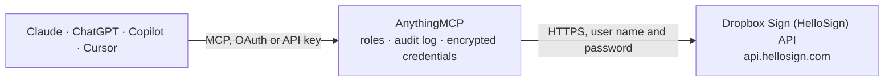

<!-- Generated by scripts/export-github-catalog.mjs in the anythingmcp-website repository. Do not edit by hand. -->

# Dropbox Sign (HelloSign) MCP connector

Drive Dropbox Sign (e-signature, formerly HelloSign) from any AI agent: signature requests, templates, signature embeds, downloads. 10 tools, API-key Basic auth. The AnythingMCP connector gives Claude, ChatGPT, Microsoft Copilot, Cursor and Gemini 10 MCP tools for Dropbox Sign (HelloSign): 6 read and 4 can change data.

**Category:** [E-Signature](../e-signature.md) · **Tools:** 10 · **Setup guide:** [anythingmcp.com](https://anythingmcp.com/guides/dropbox-sign-to-mcp) · [Deutsch](https://anythingmcp.com/de/guides/dropbox-sign-to-mcp) · [Italiano](https://anythingmcp.com/it/guides/dropbox-sign-to-mcp) · [Español](https://anythingmcp.com/es/guides/dropbox-sign-to-mcp) · [日本語](https://anythingmcp.com/ja/guides/dropbox-sign-to-mcp) · [Русский](https://anythingmcp.com/ru/guides/dropbox-sign-to-mcp) · [中文](https://anythingmcp.com/zh/guides/dropbox-sign-to-mcp)

## Start without code

No installation and no terminal: AnythingMCP Cloud runs the Dropbox Sign (HelloSign) connector for you, operated by helpcode.ai in Frankfurt, Germany.

1. **Click the button above** and create an account or sign in. The Dropbox Sign (HelloSign) connector opens, ready to install.
2. **Paste the API key or token from your Dropbox Sign (HelloSign) account.** Every click is in the [step-by-step guide](https://anythingmcp.com/guides/dropbox-sign-to-mcp).
3. **Click Install.** AnythingMCP shows the address of your MCP server.
4. **Add that address to your assistant:** [Claude](https://anythingmcp.com/guides/connect-dropbox-sign-to-claude) · [ChatGPT](https://anythingmcp.com/guides/connect-dropbox-sign-to-chatgpt) · [Microsoft Copilot](https://anythingmcp.com/guides/connect-dropbox-sign-to-copilot) · [Cursor](https://anythingmcp.com/guides/connect-dropbox-sign-to-cursor) · [Gemini CLI](https://anythingmcp.com/guides/connect-dropbox-sign-to-gemini) · [Meta Muse](https://anythingmcp.com/guides/connect-dropbox-sign-to-muse).
5. **Ask your first question**, for example: *Show signature request for invoice INV-2026-084 sent to maria@novus-logistics.de*

Prefer help with the setup? [Talk to us](https://anythingmcp.com/contact).

## How it works

- **The AI client** speaks MCP (Streamable HTTP) to AnythingMCP and only sees tool names, descriptions and results. It never gets the Dropbox Sign (HelloSign) credentials.
- **AnythingMCP** checks the client's role, builds the call from the tool definition, adds the credentials (user name and password), calls Dropbox Sign (HelloSign), logs the call and returns the result.
- **Dropbox Sign (HelloSign)** sees an ordinary API client with the rights of the account the credentials belong to.

## Tools

| Tool | What it does | Access |
|---|---|---|
| [`dropbox_sign_get_account`](#dropbox_sign_get_account) | Return account info: email, role, quotas, callback_url. | read |
| [`dropbox_sign_list_signature_requests`](#dropbox_sign_list_signature_requests) | List signature requests, optionally filtered by account/query. | read |
| [`dropbox_sign_get_signature_request`](#dropbox_sign_get_signature_request) | Fetch a signature request by ID with full signer state. | read |
| [`dropbox_sign_create_signature_request_with_template`](#dropbox_sign_create_signature_request_with_template) | Create a signature request from a template. | write |
| [`dropbox_sign_send_signature_request`](#dropbox_sign_send_signature_request) | Create a signature request from file URLs or uploaded files. | write |
| [`dropbox_sign_send_reminder`](#dropbox_sign_send_reminder) | Send a reminder email to a pending signer. | write |
| [`dropbox_sign_cancel_signature_request`](#dropbox_sign_cancel_signature_request) | Cancel an incomplete signature request. | write |
| [`dropbox_sign_download_files`](#dropbox_sign_download_files) | Download the final signed PDF (or zip of all docs). | read |
| [`dropbox_sign_list_templates`](#dropbox_sign_list_templates) | List templates available on the account. | read |
| [`dropbox_sign_get_template`](#dropbox_sign_get_template) | Fetch a template's details — roles, custom fields, files. | read |

## Tool reference

Every parameter as the AI client sees it in `tools/list`. Source: [`packages/backend/src/adapters/intl/dropbox-sign.json`](../../../packages/backend/src/adapters/intl/dropbox-sign.json).

### `dropbox_sign_get_account`

Return account info: email, role, quotas, callback_url.

**Access:** read · **Call:** `GET /account`

No parameters.

### `dropbox_sign_list_signature_requests`

List signature requests, optionally filtered by account/query.

**Access:** read · **Call:** `GET /signature_request/list`

| Parameter | Type | Required | Description |
|---|---|---|---|
| `account_id` | string | no | Filter by account. |
| `page` | integer | no | Page (1-based). |
| `page_size` | integer | no | Per page (max 100). |
| `query` | string | no | Full-text search query. |

### `dropbox_sign_get_signature_request`

Fetch a signature request by ID with full signer state.

**Access:** read · **Call:** `GET /signature_request/{signature_request_id}`

| Parameter | Type | Required | Description |
|---|---|---|---|
| `signature_request_id` | string | yes | Signature request ID. |

### `dropbox_sign_create_signature_request_with_template`

Create a signature request from a template. Required: template_ids + signers (with role) + subject. Always set test_mode=1 for testing.

**Access:** write · **Call:** `POST /signature_request/send_with_template`

| Parameter | Type | Required | Description |
|---|---|---|---|
| `template_ids` | any[] | yes | Array of template IDs. |
| `subject` | string | no | Email subject. |
| `message` | string | no | Email body. |
| `signers` | any[] | yes | [{role:'Client', name:'Jane Doe', email_address:'jane@acme.com'}]. Role must match template role names. |
| `ccs` | any[] | no | [{role:'Manager', email_address:'mgr@acme.com'}]. |
| `custom_fields` | any[] | no | [{name:'company', value:'ACME', editor:'role-name', required:true}]. |
| `test_mode` | integer | no | 1 for test (no credits, no real emails). 0 for live. |
| `client_id` | string | no | If using embedded signing. |
| `signing_options` | object | no | {draw, type, upload, phone, default:'draw'}. |
| `metadata` | object | no | Free-form metadata, max 10 keys. |

### `dropbox_sign_send_signature_request`

Create a signature request from file URLs or uploaded files. Pass file_urls (publicly accessible PDF URLs) or file (multipart — NOT supported here, use file_urls).

**Access:** write · **Call:** `POST /signature_request/send`

| Parameter | Type | Required | Description |
|---|---|---|---|
| `title` | string | no | Internal title. |
| `subject` | string | no | Email subject. |
| `message` | string | no | Email body. |
| `signers` | any[] | yes | [{name, email_address, order?}]. |
| `ccs` | any[] | no | [{email_address}]. |
| `file_urls` | any[] | yes | Array of publicly-accessible PDF URLs. |
| `test_mode` | integer | no | 1 for test. |
| `use_text_tags` | boolean | no | If true, parse [sig\|...\|...] text-tags in the PDF. |
| `hide_text_tags` | boolean | no | Hide text tags in final PDF. |
| `metadata` | object | no | Free metadata. |

### `dropbox_sign_send_reminder`

Send a reminder email to a pending signer.

**Access:** write · **Call:** `POST /signature_request/remind/{signature_request_id}`

| Parameter | Type | Required | Description |
|---|---|---|---|
| `signature_request_id` | string | yes | Signature request ID. |
| `email_address` | string | yes | Signer email to remind. |
| `name` | string | no | Signer name (if multiple signers share email). |

### `dropbox_sign_cancel_signature_request`

Cancel an incomplete signature request. Irreversible.

**Access:** write · **Call:** `POST /signature_request/cancel/{signature_request_id}`

| Parameter | Type | Required | Description |
|---|---|---|---|
| `signature_request_id` | string | yes | Signature request ID. |

### `dropbox_sign_download_files`

Download the final signed PDF (or zip of all docs). Returns binary.

**Access:** read · **Call:** `GET /signature_request/files/{signature_request_id}`

| Parameter | Type | Required | Description |
|---|---|---|---|
| `signature_request_id` | string | yes | Signature request ID. |
| `file_type` | string | no | pdf (default) or zip. |
| `get_url` | boolean | no | If true, return a temp URL instead of binary. |

### `dropbox_sign_list_templates`

List templates available on the account.

**Access:** read · **Call:** `GET /template/list`

| Parameter | Type | Required | Description |
|---|---|---|---|
| `page` | integer | no | Page. |
| `page_size` | integer | no | Per page (max 100). |
| `query` | string | no | Search query. |

### `dropbox_sign_get_template`

Fetch a template's details — roles, custom fields, files.

**Access:** read · **Call:** `GET /template/{template_id}`

| Parameter | Type | Required | Description |
|---|---|---|---|
| `template_id` | string | yes | Template ID. |

## Run it yourself

AnythingMCP is open source (AGPL-3.0). [Run it with Docker](../../../README.md#run-it-yourself), open **Connectors → Store**, pick **Dropbox Sign (HelloSign)** and enter `DROPBOX_SIGN_API_KEY`, then add your MCP server URL to the AI client.

[← E-Signature connectors](../e-signature.md) · [All categories](../README.md)
