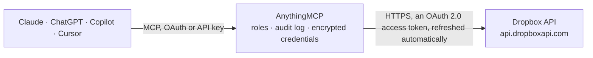

<!-- Generated by scripts/export-github-catalog.mjs in the anythingmcp-website repository. Do not edit by hand. -->

# Dropbox MCP connector

Manage Dropbox (file storage: list, download, upload, move, copy, delete, search, share, metadata) from any AI agent. 10 tools, OAuth2 token. The AnythingMCP connector gives Claude, ChatGPT, Microsoft Copilot, Cursor and Gemini 10 MCP tools for Dropbox: 5 read and 5 can change data.

**Category:** [File Storage](../storage.md) · **Tools:** 10 · **Setup guide:** [anythingmcp.com](https://anythingmcp.com/guides/dropbox-to-mcp) · [Deutsch](https://anythingmcp.com/de/guides/dropbox-to-mcp) · [Italiano](https://anythingmcp.com/it/guides/dropbox-to-mcp) · [Español](https://anythingmcp.com/es/guides/dropbox-to-mcp) · [日本語](https://anythingmcp.com/ja/guides/dropbox-to-mcp) · [Русский](https://anythingmcp.com/ru/guides/dropbox-to-mcp) · [中文](https://anythingmcp.com/zh/guides/dropbox-to-mcp)

## Start without code

No installation and no terminal: AnythingMCP Cloud runs the Dropbox connector for you, operated by helpcode.ai in Frankfurt, Germany.

1. **Click the button above** and create an account or sign in. The Dropbox connector opens, ready to install.
2. **Sign in with your Dropbox account** when AnythingMCP asks. The first time, an admin creates a small app in the Dropbox developer console. Every click is in the [step-by-step guide](https://anythingmcp.com/guides/dropbox-to-mcp).
3. **Click Install.** AnythingMCP shows the address of your MCP server.
4. **Add that address to your assistant:** [Claude](https://anythingmcp.com/guides/connect-dropbox-to-claude) · [ChatGPT](https://anythingmcp.com/guides/connect-dropbox-to-chatgpt) · [Microsoft Copilot](https://anythingmcp.com/guides/connect-dropbox-to-copilot) · [Cursor](https://anythingmcp.com/guides/connect-dropbox-to-cursor) · [Gemini CLI](https://anythingmcp.com/guides/connect-dropbox-to-gemini) · [Meta Muse](https://anythingmcp.com/guides/connect-dropbox-to-muse).
5. **Ask your first question**, for example: *Show me the contract file for NordWest Solar GmbH signed in 2026 in /Contracts folder.*

Prefer help with the setup? [Talk to us](https://anythingmcp.com/contact).

## How it works

- **The AI client** speaks MCP (Streamable HTTP) to AnythingMCP and only sees tool names, descriptions and results. It never gets the Dropbox credentials.
- **AnythingMCP** checks the client's role, builds the call from the tool definition, adds the credentials (an OAuth 2.0 access token, refreshed automatically), calls Dropbox, logs the call and returns the result.
- **Dropbox** sees an ordinary API client with the rights of the account the credentials belong to.

## Tools

| Tool | What it does | Access |
|---|---|---|
| [`dropbox_get_current_account`](#dropbox_get_current_account) | Return the authenticated user's account (account_id, name, email, country, locale, account_type). | read |
| [`dropbox_list_folder`](#dropbox_list_folder) | List contents of a folder. | read |
| [`dropbox_list_folder_continue`](#dropbox_list_folder_continue) | Continue a list_folder cursor. | read |
| [`dropbox_get_metadata`](#dropbox_get_metadata) | Get metadata for a single file/folder at a path. | read |
| [`dropbox_search`](#dropbox_search) | Search files by query within a path. | read |
| [`dropbox_create_folder`](#dropbox_create_folder) | Create a folder at a path. | write |
| [`dropbox_move`](#dropbox_move) | Move a file/folder to a new path. | write |
| [`dropbox_copy`](#dropbox_copy) | Copy a file/folder to a new path. | write |
| [`dropbox_delete`](#dropbox_delete) | Delete a file/folder. | write |
| [`dropbox_create_shared_link`](#dropbox_create_shared_link) | Create a public shared link for a file/folder. | write |

## Tool reference

Every parameter as the AI client sees it in `tools/list`. Source: [`packages/backend/src/adapters/intl/dropbox.json`](../../../packages/backend/src/adapters/intl/dropbox.json).

### `dropbox_get_current_account`

Return the authenticated user's account (account_id, name, email, country, locale, account_type).

**Access:** read · **Call:** `POST /users/get_current_account`

No parameters.

### `dropbox_list_folder`

List contents of a folder. Use `recursive=true` to walk subfolders.

**Access:** read · **Call:** `POST /files/list_folder`

| Parameter | Type | Required | Description |
|---|---|---|---|
| `path` | string | yes | Path like '/My Folder' or '' for root. |
| `recursive` | boolean | no | Walk subfolders. |
| `limit` | integer | no | Max per page (default 2000). |
| `include_deleted` | boolean | no | Include deleted entries. |

### `dropbox_list_folder_continue`

Continue a list_folder cursor.

**Access:** read · **Call:** `POST /files/list_folder/continue`

| Parameter | Type | Required | Description |
|---|---|---|---|
| `cursor` | string | yes | Cursor from previous response. |

### `dropbox_get_metadata`

Get metadata for a single file/folder at a path.

**Access:** read · **Call:** `POST /files/get_metadata`

| Parameter | Type | Required | Description |
|---|---|---|---|
| `path` | string | yes | Path. |
| `include_deleted` | boolean | no | Include if deleted. |

### `dropbox_search`

Search files by query within a path. Filter by file extension, category.

**Access:** read · **Call:** `POST /files/search_v2`

| Parameter | Type | Required | Description |
|---|---|---|---|
| `query` | string | yes | Search query. |
| `path` | string | no | Restrict to this folder ('' for root). |
| `max_results` | integer | no | Default 100, max 1000. |
| `file_extensions` | any[] | no | Array of extensions like ['pdf','docx']. |
| `file_categories` | any[] | no | Array: image, document, pdf, spreadsheet, presentation, audio, video, folder, ... |

### `dropbox_create_folder`

Create a folder at a path.

**Access:** write · **Call:** `POST /files/create_folder_v2`

| Parameter | Type | Required | Description |
|---|---|---|---|
| `path` | string | yes | Folder path to create. |
| `autorename` | boolean | no | If true, append a counter on conflict. |

### `dropbox_move`

Move a file/folder to a new path.

**Access:** write · **Call:** `POST /files/move_v2`

| Parameter | Type | Required | Description |
|---|---|---|---|
| `from_path` | string | yes | Source path. |
| `to_path` | string | yes | Destination path. |
| `autorename` | boolean | no | Append counter on conflict. |

### `dropbox_copy`

Copy a file/folder to a new path.

**Access:** write · **Call:** `POST /files/copy_v2`

| Parameter | Type | Required | Description |
|---|---|---|---|
| `from_path` | string | yes | Source path. |
| `to_path` | string | yes | Destination path. |

### `dropbox_delete`

Delete a file/folder.

**Access:** write · **Call:** `POST /files/delete_v2`

| Parameter | Type | Required | Description |
|---|---|---|---|
| `path` | string | yes | Path to delete. |

### `dropbox_create_shared_link`

Create a public shared link for a file/folder.

**Access:** write · **Call:** `POST /sharing/create_shared_link_with_settings`

| Parameter | Type | Required | Description |
|---|---|---|---|
| `path` | string | yes | Path to share. |
| `settings` | object | no | {requested_visibility:'public'\|'team_only'\|'password', link_password:'...', expires:'<ISO>'}. |

## Run it yourself

AnythingMCP is open source (AGPL-3.0). [Run it with Docker](../../../README.md#run-it-yourself), open **Connectors → Store**, pick **Dropbox** and enter `DROPBOX_CLIENT_ID`, `DROPBOX_CLIENT_SECRET`, then add your MCP server URL to the AI client.

[← File Storage connectors](../storage.md) · [All categories](../README.md)
