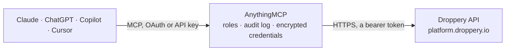

<!-- Generated by scripts/export-github-catalog.mjs in the anythingmcp-website repository. Do not edit by hand. -->

# Droppery MCP connector

Droppery dropshipping from an AI agent: the supplier products connected to your webshop with purchase and retail prices, stock and delivery times, shipping rates per country, and orders with payment … The AnythingMCP connector gives Claude, ChatGPT, Microsoft Copilot, Cursor and Gemini 3 MCP tools for Droppery, all read-only.

**Category:** [E-commerce](../e-commerce.md) · **Tools:** 3 · **Setup guide:** [anythingmcp.com](https://anythingmcp.com/guides/droppery-to-mcp) · [Deutsch](https://anythingmcp.com/de/guides/droppery-to-mcp) · [Italiano](https://anythingmcp.com/it/guides/droppery-to-mcp) · [Español](https://anythingmcp.com/es/guides/droppery-to-mcp) · [日本語](https://anythingmcp.com/ja/guides/droppery-to-mcp) · [Русский](https://anythingmcp.com/ru/guides/droppery-to-mcp) · [中文](https://anythingmcp.com/zh/guides/droppery-to-mcp)

## Start without code

No installation and no terminal: AnythingMCP Cloud runs the Droppery connector for you, operated by helpcode.ai in Frankfurt, Germany.

1. **Click the button above** and create an account or sign in. The Droppery connector opens, ready to install.
2. **Paste the API key or token from your Droppery account.** Every click is in the [step-by-step guide](https://anythingmcp.com/guides/droppery-to-mcp).
3. **Click Install.** AnythingMCP shows the address of your MCP server.
4. **Add that address to your assistant:** [Claude](https://anythingmcp.com/guides/connect-droppery-to-claude) · [ChatGPT](https://anythingmcp.com/guides/connect-droppery-to-chatgpt) · [Microsoft Copilot](https://anythingmcp.com/guides/connect-droppery-to-copilot) · [Cursor](https://anythingmcp.com/guides/connect-droppery-to-cursor) · [Gemini CLI](https://anythingmcp.com/guides/connect-droppery-to-gemini) · [Meta Muse](https://anythingmcp.com/guides/connect-droppery-to-muse).
5. **Ask your first question**, for example: *Get Droppery order 102345 details — I need payment and supplier shipping status and tracking.*

Prefer help with the setup? [Talk to us](https://anythingmcp.com/contact).

## How it works

- **The AI client** speaks MCP (Streamable HTTP) to AnythingMCP and only sees tool names, descriptions and results. It never gets the Droppery credentials.
- **AnythingMCP** checks the client's role, builds the call from the tool definition, adds the credentials (a bearer token), calls Droppery, logs the call and returns the result.
- **Droppery** sees an ordinary API client with the rights of the account the credentials belong to.

## Tools

| Tool | What it does | Access |
|---|---|---|
| [`droppery_browse_products`](#droppery_browse_products) | List the supplier products connected to your Droppery shop, size per page (at most 100) from row start: id, name, brand, supplier, SKU, EAN, stock, purchase… | read |
| [`droppery_get_product`](#droppery_get_product) | Get one Droppery product by its id: name, brand, supplier, SKU, EAN, HS code, full and long description, dimensions and weight, prices, tax rate, delivery… | read |
| [`droppery_get_order_details`](#droppery_get_order_details) | Get one Droppery order by its Droppery order id (the number Droppery shows, e.g. 102057; not the webshop or marketplace order number): order date, payment… | read |

## Tool reference

Every parameter as the AI client sees it in `tools/list`. Source: [`packages/backend/src/adapters/nl/droppery.json`](../../../packages/backend/src/adapters/nl/droppery.json).

### `droppery_browse_products`

List the supplier products connected to your Droppery shop, size per page (at most 100) from row start: id, name, brand, supplier, SKU, EAN, stock, purchase price excl. VAT and suggested retail price incl. VAT (also discounted), tax rate, delivery days, visibility, categories, attributes and variants; total is the product count. No search: page through.

**Access:** read · **Call:** `GET /product`

| Parameter | Type | Required | Description |
|---|---|---|---|
| `start` | integer | no | Row to start at, 0 for the first page. |
| `size` | integer | no | Products per page, 1 to 100. |

### `droppery_get_product`

Get one Droppery product by its id: name, brand, supplier, SKU, EAN, HS code, full and long description, dimensions and weight, prices, tax rate, delivery time, country of origin, stock, images, categories, attributes, variants and shipping_rates per country (cost type, price excl. VAT, tax rate, rules).

**Access:** read · **Call:** `GET /product/{product_id}`

| Parameter | Type | Required | Description |
|---|---|---|---|
| `product_id` | integer | yes | Droppery product id from droppery_browse_products. |

### `droppery_get_order_details`

Get one Droppery order by its Droppery order id (the number Droppery shows, e.g. 102057; not the webshop or marketplace order number): order date, payment status, shipping address, order lines with price and quantities, and per supplier the status (in_progress, shipped), carrier code, track and trace code and tracking link.

**Access:** read · **Call:** `GET /order/{order_id}`

| Parameter | Type | Required | Description |
|---|---|---|---|
| `order_id` | integer | yes | Droppery order id. |

## Run it yourself

AnythingMCP is open source (AGPL-3.0). [Run it with Docker](../../../README.md#run-it-yourself), open **Connectors → Store**, pick **Droppery** and enter `DROPPERY_API_TOKEN`, then add your MCP server URL to the AI client.

[← E-commerce connectors](../e-commerce.md) · [All categories](../README.md)
