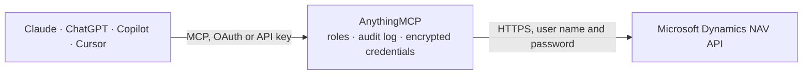

<!-- Generated by scripts/export-github-catalog.mjs in the anythingmcp-website repository. Do not edit by hand. -->

# Microsoft Dynamics NAV MCP connector

Microsoft Dynamics NAV on-premises over OData v4: query and update any published page or query web service — customers, items, sales orders, vendors — in one company. The AnythingMCP connector gives Claude, ChatGPT, Microsoft Copilot, Cursor and Gemini 6 MCP tools for Microsoft Dynamics NAV: 4 read and 2 can change data.

**Category:** [ERP](../erp.md) · **Tools:** 6 · **Setup guide:** [anythingmcp.com](https://anythingmcp.com/guides/dynamics-nav-to-mcp) · [Deutsch](https://anythingmcp.com/de/guides/dynamics-nav-to-mcp) · [Italiano](https://anythingmcp.com/it/guides/dynamics-nav-to-mcp) · [Español](https://anythingmcp.com/es/guides/dynamics-nav-to-mcp) · [日本語](https://anythingmcp.com/ja/guides/dynamics-nav-to-mcp) · [Русский](https://anythingmcp.com/ru/guides/dynamics-nav-to-mcp) · [中文](https://anythingmcp.com/zh/guides/dynamics-nav-to-mcp)

## Start without code

No installation and no terminal: AnythingMCP Cloud runs the Microsoft Dynamics NAV connector for you, operated by helpcode.ai in Frankfurt, Germany.

1. **Click the button above** and create an account or sign in. The Microsoft Dynamics NAV connector opens, ready to install.
2. **Paste the API key or token from your Microsoft Dynamics NAV account.** Every click is in the [step-by-step guide](https://anythingmcp.com/guides/dynamics-nav-to-mcp).
3. **Click Install.** AnythingMCP shows the address of your MCP server.
4. **Add that address to your assistant:** [Claude](https://anythingmcp.com/guides/connect-dynamics-nav-to-claude) · [ChatGPT](https://anythingmcp.com/guides/connect-dynamics-nav-to-chatgpt) · [Microsoft Copilot](https://anythingmcp.com/guides/connect-dynamics-nav-to-copilot) · [Cursor](https://anythingmcp.com/guides/connect-dynamics-nav-to-cursor) · [Gemini CLI](https://anythingmcp.com/guides/connect-dynamics-nav-to-gemini) · [Meta Muse](https://anythingmcp.com/guides/connect-dynamics-nav-to-muse).
5. **Ask your first question**, for example: *Show customer CUST-4021 record (need billing email and current balance).*

Prefer help with the setup? [Talk to us](https://anythingmcp.com/contact).

## How it works

- **The AI client** speaks MCP (Streamable HTTP) to AnythingMCP and only sees tool names, descriptions and results. It never gets the Microsoft Dynamics NAV credentials.
- **AnythingMCP** checks the client's role, builds the call from the tool definition, adds the credentials (user name and password), calls Microsoft Dynamics NAV, logs the call and returns the result.
- **Microsoft Dynamics NAV** sees an ordinary API client with the rights of the account the credentials belong to.

## Tools

| Tool | What it does | Access |
|---|---|---|
| [`dynamics_nav_list_services`](#dynamics_nav_list_services) | List the published web services (the OData service document at the service root) — the entity set names every other tool needs. | read |
| [`dynamics_nav_query`](#dynamics_nav_query) | Query any published entity set with OData v4. | read |
| [`dynamics_nav_get_by_key`](#dynamics_nav_get_by_key) | Read one record by its OData key. | read |
| [`dynamics_nav_get_metadata`](#dynamics_nav_get_metadata) | Read the OData $metadata document (EDMX, XML) at the service root: every published entity type, its properties and their data types. | read |
| [`dynamics_nav_create_record`](#dynamics_nav_create_record) | Create a record in a published entity set. | write |
| [`dynamics_nav_update_record`](#dynamics_nav_update_record) | Update one record by key. | write |

## Tool reference

Every parameter as the AI client sees it in `tools/list`. Source: [`packages/backend/src/adapters/de/dynamics-nav.json`](../../../packages/backend/src/adapters/de/dynamics-nav.json).

### `dynamics_nav_list_services`

List the published web services (the OData service document at the service root) — the entity set names every other tool needs. Start here: NAV exposes nothing that has not been published by hand.

**Access:** read · **Call:** `GET {{NAV_BASE_URL}}/`

No parameters.

### `dynamics_nav_query`

Query any published entity set with OData v4. The general-purpose read: pass the service name plus $filter, $select, $top and $orderby.

**Access:** read · **Call:** `GET /{service}`

| Parameter | Type | Required | Description |
|---|---|---|---|
| `service` | string | yes | Published web service name, e.g. Customer, Item, SalesOrder. |
| `filter` | string | no | OData $filter expression, e.g. Country_Region_Code eq 'DE'. Field names use underscores for spaces. |
| `select` | string | no | Comma-separated fields to return, e.g. No,Name,Balance_LCY. |
| `top` | number | no | Maximum rows to return. |
| `skip` | number | no | Rows to skip, for paging. |
| `orderby` | string | no | Sort expression, e.g. `Name asc` or `Order_Date desc`. |
| `expand` | string | no | Navigation properties to expand inline, e.g. SalesOrderSalesLines. |

### `dynamics_nav_get_by_key`

Read one record by its OData key. NAV keys are often composite, so pass the key exactly as it appears in a list response's `@odata.id`.

**Access:** read · **Call:** `GET /{service}({key})`

| Parameter | Type | Required | Description |
|---|---|---|---|
| `service` | string | yes | Published web service name, e.g. Customer. |
| `key` | string | yes | OData key literal, e.g. '10000' or Document_Type='Order',No='101005'. |
| `expand` | string | no | Navigation properties to expand inline. |

### `dynamics_nav_get_metadata`

Read the OData $metadata document (EDMX, XML) at the service root: every published entity type, its properties and their data types. The authoritative field list when a $filter keeps failing.

**Access:** read · **Call:** `GET {{NAV_BASE_URL}}/$metadata`

No parameters.

### `dynamics_nav_create_record`

Create a record in a published entity set. Writes to the live NAV company and triggers the page's own validation and business logic.

**Access:** write · **Call:** `POST /{service}`

| Parameter | Type | Required | Description |
|---|---|---|---|
| `service` | string | yes | Published web service name, e.g. Customer. |
| `record` | object | yes | Field values for the new record, keyed by OData field name, e.g. {"Name": "Muster GmbH", "Country_Region_Code": "DE"}. |

### `dynamics_nav_update_record`

Update one record by key. Sends If-Match: * — last writer wins — so read the row first if a concurrent edit would matter.

**Access:** write · **Call:** `PATCH /{service}({key})`

| Parameter | Type | Required | Description |
|---|---|---|---|
| `service` | string | yes | Published web service name. |
| `key` | string | yes | OData key literal of the record to update. |
| `record` | object | yes | Field values to set, keyed by OData field name. |

## Run it yourself

AnythingMCP is open source (AGPL-3.0). [Run it with Docker](../../../README.md#run-it-yourself), open **Connectors → Store**, pick **Microsoft Dynamics NAV** and enter `NAV_BASE_URL`, `NAV_COMPANY`, `NAV_USERNAME`, `NAV_PASSWORD`, then add your MCP server URL to the AI client.

[← ERP connectors](../erp.md) · [All categories](../README.md)
