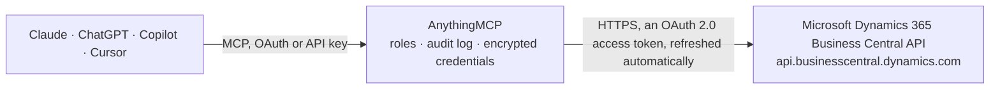

<!-- Generated by scripts/export-github-catalog.mjs in the anythingmcp-website repository. Do not edit by hand. -->

# Microsoft Dynamics 365 Business Central MCP connector

Let your AI work in Business Central: look up customers, vendors and items, read sales quotes, orders and invoices, purchase invoices, the general ledger, chart of accounts and dimensions, and create … The AnythingMCP connector gives Claude, ChatGPT, Microsoft Copilot, Cursor and Gemini 32 MCP tools for Microsoft Dynamics 365 Business Central: 22 read and 10 can change data.

**Category:** [ERP](../erp.md) · **Tools:** 32 · **Setup guide:** [anythingmcp.com](https://anythingmcp.com/guides/dynamics365-business-central-to-mcp) · [Deutsch](https://anythingmcp.com/de/guides/dynamics365-business-central-to-mcp) · [Italiano](https://anythingmcp.com/it/guides/dynamics365-business-central-to-mcp) · [Español](https://anythingmcp.com/es/guides/dynamics365-business-central-to-mcp) · [日本語](https://anythingmcp.com/ja/guides/dynamics365-business-central-to-mcp) · [Русский](https://anythingmcp.com/ru/guides/dynamics365-business-central-to-mcp) · [中文](https://anythingmcp.com/zh/guides/dynamics365-business-central-to-mcp)

## Start without code

No installation and no terminal: AnythingMCP Cloud runs the Microsoft Dynamics 365 Business Central connector for you, operated by helpcode.ai in Frankfurt, Germany.

1. **Click the button above** and create an account or sign in. The Microsoft Dynamics 365 Business Central connector opens, ready to install.
2. **Sign in with your Microsoft Dynamics 365 Business Central account** when AnythingMCP asks. The first time, an admin creates a small app in the Microsoft Dynamics 365 Business Central developer console. Every click is in the [step-by-step guide](https://anythingmcp.com/guides/dynamics365-business-central-to-mcp).
3. **Click Install.** AnythingMCP shows the address of your MCP server.
4. **Add that address to your assistant:** [Claude](https://anythingmcp.com/guides/connect-dynamics365-business-central-to-claude) · [ChatGPT](https://anythingmcp.com/guides/connect-dynamics365-business-central-to-chatgpt) · [Microsoft Copilot](https://anythingmcp.com/guides/connect-dynamics365-business-central-to-copilot) · [Cursor](https://anythingmcp.com/guides/connect-dynamics365-business-central-to-cursor) · [Gemini CLI](https://anythingmcp.com/guides/connect-dynamics365-business-central-to-gemini) · [Meta Muse](https://anythingmcp.com/guides/connect-dynamics365-business-central-to-muse).
5. **Ask your first question**, for example: *What's the balance and contact details for customer CR-20045 Nordvik Elektronikk AS?*

Prefer help with the setup? [Talk to us](https://anythingmcp.com/contact).

## How it works

- **The AI client** speaks MCP (Streamable HTTP) to AnythingMCP and only sees tool names, descriptions and results. It never gets the Microsoft Dynamics 365 Business Central credentials.
- **AnythingMCP** checks the client's role, builds the call from the tool definition, adds the credentials (an OAuth 2.0 access token, refreshed automatically), calls Microsoft Dynamics 365 Business Central, logs the call and returns the result.
- **Microsoft Dynamics 365 Business Central** sees an ordinary API client with the rights of the account the credentials belong to.

## Tools

| Tool | What it does | Access |
|---|---|---|
| [`bc_list_environments`](#bc_list_environments) | List the Business Central environments of the tenant: name, type (Production or Sandbox), country and web client URL. | read |
| [`bc_list_companies`](#bc_list_companies) | List the companies in the connected environment with their id, name and display name. | read |
| [`bc_list_customers`](#bc_list_customers) | List or search customers: number, name, address, phone, email, balance, credit limit, currency, blocked state. | read |
| [`bc_get_customer`](#bc_get_customer) | Read one customer with every field, including its @odata.etag for updates. | read |
| [`bc_create_customer`](#bc_create_customer) | Create a customer. | write |
| [`bc_update_customer`](#bc_update_customer) | Change fields of one customer; fields left out keep their values. | write |
| [`bc_delete_customer`](#bc_delete_customer) | Delete one customer. | write |
| [`bc_list_vendors`](#bc_list_vendors) | List or search vendors (suppliers): number, name, address, phone, email, balance, currency, blocked state. | read |
| [`bc_get_vendor`](#bc_get_vendor) | Read one vendor with every field: address, contact details, balance, payment terms and its @odata.etag. | read |
| [`bc_list_items`](#bc_list_items) | List or search items: number, name, type (Inventory, Service, Non-Inventory), category, inventory on hand, unit price, unit cost, base unit of measure,… | read |
| [`bc_get_item`](#bc_get_item) | Read one item with every field: prices, cost, inventory, units of measure, GTIN, category. | read |
| [`bc_list_sales_quotes`](#bc_list_sales_quotes) | List sales quotes: number, customer, dates, status (Draft, Sent, Accepted, Expired), amounts. | read |
| [`bc_get_sales_quote`](#bc_get_sales_quote) | Read one sales quote with every header field; expand=salesQuoteLines adds the lines. | read |
| [`bc_create_sales_quote`](#bc_create_sales_quote) | Create a sales quote for a customer, optionally with its lines in the same call. | write |
| [`bc_add_sales_quote_line`](#bc_add_sales_quote_line) | Add one line to an open sales quote: an item with quantity and optionally price and discount, a G/L account, a resource or a comment. | write |
| [`bc_make_order_from_quote`](#bc_make_order_from_quote) | Turn a sales quote into a sales order (Business Central's Make Order). | write |
| [`bc_delete_sales_quote`](#bc_delete_sales_quote) | Delete one sales quote with its lines. | write |
| [`bc_list_sales_orders`](#bc_list_sales_orders) | List sales orders: number, customer, order and delivery dates, status (Draft, In Review, Open), fully shipped flag, amounts. | read |
| [`bc_get_sales_order`](#bc_get_sales_order) | Read one sales order with every header field; expand=salesOrderLines adds the lines with shipped and invoiced quantities. | read |
| [`bc_create_sales_order`](#bc_create_sales_order) | Create a sales order for a customer, optionally with its lines in the same call. | write |
| [`bc_add_sales_order_line`](#bc_add_sales_order_line) | Add one line to an open sales order: an item with quantity and optionally price and discount, a G/L account, a resource or a comment. | write |
| [`bc_delete_sales_order`](#bc_delete_sales_order) | Delete one open sales order with its lines. | write |
| [`bc_list_sales_invoices`](#bc_list_sales_invoices) | List sales invoices: number, customer, invoice and due dates, status (Draft, In Review, Open, Paid, Canceled, Corrective), total and remaining amount. | read |
| [`bc_get_sales_invoice`](#bc_get_sales_invoice) | Read one sales invoice with every header field; expand=salesInvoiceLines adds the lines. | read |
| [`bc_list_purchase_invoices`](#bc_list_purchase_invoices) | List purchase invoices (vendor bills): number, vendor, vendor invoice number, invoice and due dates, status (Draft, In Review, Open, Paid, Canceled,… | read |
| [`bc_get_purchase_invoice`](#bc_get_purchase_invoice) | Read one purchase invoice with every header field; expand=purchaseInvoiceLines adds the lines. | read |
| [`bc_list_general_ledger_entries`](#bc_list_general_ledger_entries) | List posted general ledger entries: entry number, posting date, document type and number, G/L account, description, debit and credit amount. | read |
| [`bc_list_accounts`](#bc_list_accounts) | List the chart of accounts (G/L accounts): number, name, category (Assets, Liabilities, Equity, Income, Cost of Goods Sold, Expense), sub-category, account… | read |
| [`bc_list_dimensions`](#bc_list_dimensions) | List the dimensions (for example DEPARTMENT, PROJECT, AREA) with their codes. | read |
| [`bc_list_dimension_values`](#bc_list_dimension_values) | List the values of one dimension, e.g. the departments of DEPARTMENT, with code and name. | read |
| [`bc_list_employees`](#bc_list_employees) | List employees: number, name, job title, email, phone, status (Active, Inactive, Terminated), employment date. | read |
| [`bc_query`](#bc_query) | Read any other API v2.0 resource of a company that has no dedicated tool, e.g. contacts, purchaseOrders, salesCreditMemos, salesShipments,… | read |

## Tool reference

Every parameter as the AI client sees it in `tools/list`. Source: [`packages/backend/src/adapters/intl/dynamics365-business-central.json`](../../../packages/backend/src/adapters/intl/dynamics365-business-central.json).

### `bc_list_environments`

List the Business Central environments of the tenant: name, type (Production or Sandbox), country and web client URL. Use it when calls answer 404 because BC_ENVIRONMENT names no environment. Some tenants allow this list only to Business Central administrators.

**Access:** read · **Call:** `GET https://api.businesscentral.dynamics.com/environments/v1.2`

No parameters.

### `bc_list_companies`

List the companies in the connected environment with their id, name and display name. Call it first: every other tool needs a company_id from here. A sandbox usually holds the demo company CRONUS.

**Access:** read · **Call:** `GET /companies`

No parameters.

### `bc_list_customers`

List or search customers: number, name, address, phone, email, balance, credit limit, currency, blocked state. Filter by name, number, city or balance; for a name search use contains(displayName,'text').

**Access:** read · **Call:** `GET /companies({company_id})/customers`

| Parameter | Type | Required | Description |
|---|---|---|---|
| `company_id` | string | yes | Company id (a GUID) from bc_list_companies. Every business object lives in one company. |
| `filter` | string | no | OData $filter on the customer fields, e.g. "contains(displayName,'Adatum')", "number eq '10000'", "balanceDue gt 0". Text values in single quotes, dates bare (2026-01-31), GUIDs bare. |
| `select` | string | no | Comma-separated fields to return, e.g. "id,number,displayName,city,email,balanceDue". Without it every field comes back. |
| `orderby` | string | no | Sort order, e.g. "displayName". |
| `top` | integer | no | Maximum number of records to return (default 50). |
| `skip` | integer | no | Records to skip, for the next page: raise it by the number already read. |

### `bc_get_customer`

Read one customer with every field, including its @odata.etag for updates. Use expand for related data such as defaultDimensions or customerFinancialDetails.

**Access:** read · **Call:** `GET /companies({company_id})/customers({customer_id})`

| Parameter | Type | Required | Description |
|---|---|---|---|
| `company_id` | string | yes | Company id (a GUID) from bc_list_companies. Every business object lives in one company. |
| `customer_id` | string | yes | Customer id (GUID) from bc_list_customers. |
| `select` | string | no | Comma-separated fields to return. Without it every field comes back. |
| `expand` | string | no | Related data to include, e.g. "customerFinancialDetails,defaultDimensions". |

### `bc_create_customer`

Create a customer. Business Central assigns the number from its number series and fills posting groups from the customer template. Returns the new customer. Check with bc_list_customers that the customer does not exist yet, and confirm the details with the user before creating.

**Access:** write · **Call:** `POST /companies({company_id})/customers`

| Parameter | Type | Required | Description |
|---|---|---|---|
| `company_id` | string | yes | Company id (a GUID) from bc_list_companies. Every business object lives in one company. |
| `displayName` | string | yes | Customer name. |
| `type` | `Company` \| `Person` | no | Company (default) or Person. |
| `email` | string | no | Email address. |
| `phoneNumber` | string | no | Phone number. |
| `website` | string | no | Website. |
| `addressLine1` | string | no | Street and number. |
| `addressLine2` | string | no | Second address line. |
| `city` | string | no | City. |
| `state` | string | no | State or county. |
| `postalCode` | string | no | Postal code. |
| `country` | string | no | Country or region code, e.g. DE, US. |
| `currencyCode` | string | no | Currency code when it differs from the company's local currency, e.g. USD. |
| `taxRegistrationNumber` | string | no | VAT or tax registration number. |
| `fields` | object | no | Further fields of the API object to set, by their API names, e.g. {"creditLimit": 5000, "blocked": " "}. |

### `bc_update_customer`

Change fields of one customer; fields left out keep their values. Returns the updated customer. Read it first (bc_get_customer) and confirm the change with the user.

**Access:** write · **Call:** `PATCH /companies({company_id})/customers({customer_id})`

| Parameter | Type | Required | Description |
|---|---|---|---|
| `company_id` | string | yes | Company id (a GUID) from bc_list_companies. Every business object lives in one company. |
| `customer_id` | string | yes | Customer id (GUID). |
| `fields` | object | yes | Fields to change by API name, e.g. {"phoneNumber": "+49 761 1234", "creditLimit": 10000}. |
| `etag` | string | no | The record's @odata.etag from the last read, so the change is refused (412) if someone else changed the record meanwhile. Default * overwrites whatever version is current. |

### `bc_delete_customer`

Delete one customer. Business Central refuses when the customer has open entries or documents. Installed switched off; turn it on only if the AI should delete customers, and confirm every deletion with the user.

**Access:** write · **Call:** `DELETE /companies({company_id})/customers({customer_id})`

| Parameter | Type | Required | Description |
|---|---|---|---|
| `company_id` | string | yes | Company id (a GUID) from bc_list_companies. Every business object lives in one company. |
| `customer_id` | string | yes | Customer id (GUID) of the customer to delete. |

### `bc_list_vendors`

List or search vendors (suppliers): number, name, address, phone, email, balance, currency, blocked state.

**Access:** read · **Call:** `GET /companies({company_id})/vendors`

| Parameter | Type | Required | Description |
|---|---|---|---|
| `company_id` | string | yes | Company id (a GUID) from bc_list_companies. Every business object lives in one company. |
| `filter` | string | no | OData $filter on the vendor fields, e.g. "contains(displayName,'Fabrikam')", "number eq '20000'", "balance gt 0". Text values in single quotes, dates bare (2026-01-31), GUIDs bare. |
| `select` | string | no | Comma-separated fields to return, e.g. "id,number,displayName,city,email,balance". Without it every field comes back. |
| `orderby` | string | no | Sort order, e.g. "displayName". |
| `top` | integer | no | Maximum number of records to return (default 50). |
| `skip` | integer | no | Records to skip, for the next page: raise it by the number already read. |

### `bc_get_vendor`

Read one vendor with every field: address, contact details, balance, payment terms and its @odata.etag.

**Access:** read · **Call:** `GET /companies({company_id})/vendors({vendor_id})`

| Parameter | Type | Required | Description |
|---|---|---|---|
| `company_id` | string | yes | Company id (a GUID) from bc_list_companies. Every business object lives in one company. |
| `vendor_id` | string | yes | Vendor id (GUID) from bc_list_vendors. |
| `select` | string | no | Comma-separated fields to return. Without it every field comes back. |
| `expand` | string | no | Related data to include, e.g. "defaultDimensions". |

### `bc_list_items`

List or search items: number, name, type (Inventory, Service, Non-Inventory), category, inventory on hand, unit price, unit cost, base unit of measure, blocked state.

**Access:** read · **Call:** `GET /companies({company_id})/items`

| Parameter | Type | Required | Description |
|---|---|---|---|
| `company_id` | string | yes | Company id (a GUID) from bc_list_companies. Every business object lives in one company. |
| `filter` | string | no | OData $filter on the item fields, e.g. "contains(displayName,'Chair')", "number eq '1896-S'", "inventory gt 0", "itemCategoryCode eq 'TABLE'". Text values in single quotes, dates bare (2026-01-31), GUIDs bare. |
| `select` | string | no | Comma-separated fields to return, e.g. "id,number,displayName,inventory,unitPrice,baseUnitOfMeasureCode". Without it every field comes back. |
| `orderby` | string | no | Sort order, e.g. "number". |
| `top` | integer | no | Maximum number of records to return (default 50). |
| `skip` | integer | no | Records to skip, for the next page: raise it by the number already read. |

### `bc_get_item`

Read one item with every field: prices, cost, inventory, units of measure, GTIN, category.

**Access:** read · **Call:** `GET /companies({company_id})/items({item_id})`

| Parameter | Type | Required | Description |
|---|---|---|---|
| `company_id` | string | yes | Company id (a GUID) from bc_list_companies. Every business object lives in one company. |
| `item_id` | string | yes | Item id (GUID) from bc_list_items. |
| `select` | string | no | Comma-separated fields to return. Without it every field comes back. |
| `expand` | string | no | Related data to include, e.g. "itemCategory,itemVariants". |

### `bc_list_sales_quotes`

List sales quotes: number, customer, dates, status (Draft, Sent, Accepted, Expired), amounts. Use expand=salesQuoteLines to include the lines.

**Access:** read · **Call:** `GET /companies({company_id})/salesQuotes`

| Parameter | Type | Required | Description |
|---|---|---|---|
| `company_id` | string | yes | Company id (a GUID) from bc_list_companies. Every business object lives in one company. |
| `filter` | string | no | OData $filter on the quote fields, e.g. "customerNumber eq '10000'", "status eq 'Draft'", "documentDate ge 2026-01-01". Text values in single quotes, dates bare (2026-01-31), GUIDs bare. |
| `select` | string | no | Comma-separated fields to return, e.g. "id,number,customerName,documentDate,status,totalAmountIncludingTax". Without it every field comes back. |
| `orderby` | string | no | Sort order, e.g. "documentDate desc". |
| `top` | integer | no | Maximum number of records to return (default 50). |
| `skip` | integer | no | Records to skip, for the next page: raise it by the number already read. |
| `expand` | string | no | Related data to include, e.g. "salesQuoteLines". |

### `bc_get_sales_quote`

Read one sales quote with every header field; expand=salesQuoteLines adds the lines.

**Access:** read · **Call:** `GET /companies({company_id})/salesQuotes({quote_id})`

| Parameter | Type | Required | Description |
|---|---|---|---|
| `company_id` | string | yes | Company id (a GUID) from bc_list_companies. Every business object lives in one company. |
| `quote_id` | string | yes | Sales quote id (GUID). |
| `select` | string | no | Comma-separated fields to return. Without it every field comes back. |
| `expand` | string | no | Related data to include, e.g. "salesQuoteLines". |

### `bc_create_sales_quote`

Create a sales quote for a customer, optionally with its lines in the same call. The document stays open (not released, shipped or posted). Use validUntilDate in fields to set how long the offer holds. Returns the document with its lines. Read the customer first and confirm customer, items, quantities and prices with the user before creating.

**Access:** write · **Call:** `POST /companies({company_id})/salesQuotes`

| Parameter | Type | Required | Description |
|---|---|---|---|
| `company_id` | string | yes | Company id (a GUID) from bc_list_companies. Every business object lives in one company. |
| `customerNumber` | string | no | Customer number, e.g. "10000" (bc_list_customers). |
| `customerId` | string | no | Customer id (GUID), instead of customerNumber. |
| `documentDate` | string | no | Document date, YYYY-MM-DD. Defaults to today (the work date). |
| `externalDocumentNumber` | string | no | The customer's own reference, e.g. their PO number. |
| `currencyCode` | string | no | Currency code; defaults to the customer's currency. |
| `lines` | object[] | no | Lines to create with the document, each with lineType, lineObjectNumber (or itemId), quantity and optionally unitPrice, description, discountPercent. Lines can also be added afterwards with bc_add_sales_quote_line. |
| `fields` | object | no | Further header fields by API name, e.g. {"salesperson": "JO", "shipToName": "Warehouse 2"}. |

### `bc_add_sales_quote_line`

Add one line to an open sales quote: an item with quantity and optionally price and discount, a G/L account, a resource or a comment. Returns the line with its amounts. Confirm with the user before adding.

**Access:** write · **Call:** `POST /companies({company_id})/salesQuotes({quote_id})/salesQuoteLines`

| Parameter | Type | Required | Description |
|---|---|---|---|
| `company_id` | string | yes | Company id (a GUID) from bc_list_companies. Every business object lives in one company. |
| `quote_id` | string | yes | Id (GUID) of the sales quote. |
| `lineType` | string | no | Item (default), Account, Resource, Comment or Charge. |
| `lineObjectNumber` | string | no | Number of the item, G/L account or resource, e.g. "1896-S". Leave out for a Comment line. |
| `itemId` | string | no | Item id (GUID), instead of lineObjectNumber. |
| `description` | string | no | Line text; defaults to the item's name. The only field of a Comment line. |
| `quantity` | number | no | Quantity. |
| `unitPrice` | number | no | Unit price; defaults to the price Business Central finds for the sales quote's customer. |
| `discountPercent` | number | no | Line discount in percent. |
| `unitOfMeasureCode` | string | no | Unit of measure code, e.g. PCS. Defaults to the item's sales unit. |

### `bc_make_order_from_quote`

Turn a sales quote into a sales order (Business Central's Make Order). The quote is removed and an open order with the same lines is created; nothing is shipped or posted. Installed switched off. Confirm with the user before converting, then find the new order with bc_list_sales_orders.

**Access:** write · **Call:** `POST /companies({company_id})/salesQuotes({quote_id})/Microsoft.NAV.makeOrder`

| Parameter | Type | Required | Description |
|---|---|---|---|
| `company_id` | string | yes | Company id (a GUID) from bc_list_companies. Every business object lives in one company. |
| `quote_id` | string | yes | Sales quote id (GUID). |

### `bc_delete_sales_quote`

Delete one sales quote with its lines. Installed switched off; turn it on only if the AI should delete quotes, and confirm every deletion with the user.

**Access:** write · **Call:** `DELETE /companies({company_id})/salesQuotes({quote_id})`

| Parameter | Type | Required | Description |
|---|---|---|---|
| `company_id` | string | yes | Company id (a GUID) from bc_list_companies. Every business object lives in one company. |
| `quote_id` | string | yes | Sales quote id (GUID). |

### `bc_list_sales_orders`

List sales orders: number, customer, order and delivery dates, status (Draft, In Review, Open), fully shipped flag, amounts. Use expand=salesOrderLines to include the lines.

**Access:** read · **Call:** `GET /companies({company_id})/salesOrders`

| Parameter | Type | Required | Description |
|---|---|---|---|
| `company_id` | string | yes | Company id (a GUID) from bc_list_companies. Every business object lives in one company. |
| `filter` | string | no | OData $filter on the order fields, e.g. "customerNumber eq '10000'", "status eq 'Open'", "status eq 'In_x0020_Review'", "orderDate ge 2026-01-01", "fullyShipped eq false". Text values in single quotes, dates bare (2026-01-31), GUIDs bare. |
| `select` | string | no | Comma-separated fields to return, e.g. "id,number,customerName,orderDate,status,totalAmountIncludingTax". Without it every field comes back. |
| `orderby` | string | no | Sort order, e.g. "orderDate desc". |
| `top` | integer | no | Maximum number of records to return (default 50). |
| `skip` | integer | no | Records to skip, for the next page: raise it by the number already read. |
| `expand` | string | no | Related data to include, e.g. "salesOrderLines". |

### `bc_get_sales_order`

Read one sales order with every header field; expand=salesOrderLines adds the lines with shipped and invoiced quantities.

**Access:** read · **Call:** `GET /companies({company_id})/salesOrders({order_id})`

| Parameter | Type | Required | Description |
|---|---|---|---|
| `company_id` | string | yes | Company id (a GUID) from bc_list_companies. Every business object lives in one company. |
| `order_id` | string | yes | Sales order id (GUID). |
| `select` | string | no | Comma-separated fields to return. Without it every field comes back. |
| `expand` | string | no | Related data to include, e.g. "salesOrderLines". |

### `bc_create_sales_order`

Create a sales order for a customer, optionally with its lines in the same call. The document stays open (not released, shipped or posted). Set requestedDeliveryDate in fields when the customer named one. Returns the document with its lines. Read the customer first and confirm customer, items, quantities and prices with the user before creating.

**Access:** write · **Call:** `POST /companies({company_id})/salesOrders`

| Parameter | Type | Required | Description |
|---|---|---|---|
| `company_id` | string | yes | Company id (a GUID) from bc_list_companies. Every business object lives in one company. |
| `customerNumber` | string | no | Customer number, e.g. "10000" (bc_list_customers). |
| `customerId` | string | no | Customer id (GUID), instead of customerNumber. |
| `orderDate` | string | no | Order date, YYYY-MM-DD. Defaults to today (the work date). |
| `externalDocumentNumber` | string | no | The customer's own reference, e.g. their PO number. |
| `currencyCode` | string | no | Currency code; defaults to the customer's currency. |
| `lines` | object[] | no | Lines to create with the document, each with lineType, lineObjectNumber (or itemId), quantity and optionally unitPrice, description, discountPercent. Lines can also be added afterwards with bc_add_sales_order_line. |
| `fields` | object | no | Further header fields by API name, e.g. {"salesperson": "JO", "shipToName": "Warehouse 2"}. |

### `bc_add_sales_order_line`

Add one line to an open sales order: an item with quantity and optionally price and discount, a G/L account, a resource or a comment. Returns the line with its amounts. Confirm with the user before adding.

**Access:** write · **Call:** `POST /companies({company_id})/salesOrders({order_id})/salesOrderLines`

| Parameter | Type | Required | Description |
|---|---|---|---|
| `company_id` | string | yes | Company id (a GUID) from bc_list_companies. Every business object lives in one company. |
| `order_id` | string | yes | Id (GUID) of the sales order. |
| `lineType` | string | no | Item (default), Account, Resource, Comment or Charge. |
| `lineObjectNumber` | string | no | Number of the item, G/L account or resource, e.g. "1896-S". Leave out for a Comment line. |
| `itemId` | string | no | Item id (GUID), instead of lineObjectNumber. |
| `description` | string | no | Line text; defaults to the item's name. The only field of a Comment line. |
| `quantity` | number | no | Quantity. |
| `unitPrice` | number | no | Unit price; defaults to the price Business Central finds for the sales order's customer. |
| `discountPercent` | number | no | Line discount in percent. |
| `unitOfMeasureCode` | string | no | Unit of measure code, e.g. PCS. Defaults to the item's sales unit. |

### `bc_delete_sales_order`

Delete one open sales order with its lines. Business Central refuses orders that are partly shipped or invoiced. Installed switched off; turn it on only if the AI should delete orders, and confirm every deletion with the user.

**Access:** write · **Call:** `DELETE /companies({company_id})/salesOrders({order_id})`

| Parameter | Type | Required | Description |
|---|---|---|---|
| `company_id` | string | yes | Company id (a GUID) from bc_list_companies. Every business object lives in one company. |
| `order_id` | string | yes | Sales order id (GUID). |

### `bc_list_sales_invoices`

List sales invoices: number, customer, invoice and due dates, status (Draft, In Review, Open, Paid, Canceled, Corrective), total and remaining amount. Open with remainingAmount gt 0 are the unpaid ones.

**Access:** read · **Call:** `GET /companies({company_id})/salesInvoices`

| Parameter | Type | Required | Description |
|---|---|---|---|
| `company_id` | string | yes | Company id (a GUID) from bc_list_companies. Every business object lives in one company. |
| `filter` | string | no | OData $filter on the invoice fields, e.g. "status eq 'Open'", "dueDate lt 2026-10-01 and remainingAmount gt 0", "customerNumber eq '10000'". Text values in single quotes, dates bare (2026-01-31), GUIDs bare. |
| `select` | string | no | Comma-separated fields to return, e.g. "id,number,customerName,invoiceDate,dueDate,status,totalAmountIncludingTax,remainingAmount". Without it every field comes back. |
| `orderby` | string | no | Sort order, e.g. "invoiceDate desc". |
| `top` | integer | no | Maximum number of records to return (default 50). |
| `skip` | integer | no | Records to skip, for the next page: raise it by the number already read. |
| `expand` | string | no | Related data to include, e.g. "salesInvoiceLines". |

### `bc_get_sales_invoice`

Read one sales invoice with every header field; expand=salesInvoiceLines adds the lines.

**Access:** read · **Call:** `GET /companies({company_id})/salesInvoices({invoice_id})`

| Parameter | Type | Required | Description |
|---|---|---|---|
| `company_id` | string | yes | Company id (a GUID) from bc_list_companies. Every business object lives in one company. |
| `invoice_id` | string | yes | Sales invoice id (GUID). |
| `select` | string | no | Comma-separated fields to return. Without it every field comes back. |
| `expand` | string | no | Related data to include, e.g. "salesInvoiceLines". |

### `bc_list_purchase_invoices`

List purchase invoices (vendor bills): number, vendor, vendor invoice number, invoice and due dates, status (Draft, In Review, Open, Paid, Canceled, Corrective), amounts.

**Access:** read · **Call:** `GET /companies({company_id})/purchaseInvoices`

| Parameter | Type | Required | Description |
|---|---|---|---|
| `company_id` | string | yes | Company id (a GUID) from bc_list_companies. Every business object lives in one company. |
| `filter` | string | no | OData $filter on the invoice fields, e.g. "status eq 'Open'", "vendorNumber eq '20000'", "invoiceDate ge 2026-01-01". Text values in single quotes, dates bare (2026-01-31), GUIDs bare. |
| `select` | string | no | Comma-separated fields to return, e.g. "id,number,vendorName,vendorInvoiceNumber,invoiceDate,dueDate,status,totalAmountIncludingTax". Without it every field comes back. |
| `orderby` | string | no | Sort order, e.g. "invoiceDate desc". |
| `top` | integer | no | Maximum number of records to return (default 50). |
| `skip` | integer | no | Records to skip, for the next page: raise it by the number already read. |
| `expand` | string | no | Related data to include, e.g. "purchaseInvoiceLines". |

### `bc_get_purchase_invoice`

Read one purchase invoice with every header field; expand=purchaseInvoiceLines adds the lines.

**Access:** read · **Call:** `GET /companies({company_id})/purchaseInvoices({invoice_id})`

| Parameter | Type | Required | Description |
|---|---|---|---|
| `company_id` | string | yes | Company id (a GUID) from bc_list_companies. Every business object lives in one company. |
| `invoice_id` | string | yes | Purchase invoice id (GUID). |
| `select` | string | no | Comma-separated fields to return. Without it every field comes back. |
| `expand` | string | no | Related data to include, e.g. "purchaseInvoiceLines". |

### `bc_list_general_ledger_entries`

List posted general ledger entries: entry number, posting date, document type and number, G/L account, description, debit and credit amount. The ledger is large: always filter by postingDate and usually by accountNumber or documentNumber, and select only the fields needed.

**Access:** read · **Call:** `GET /companies({company_id})/generalLedgerEntries`

| Parameter | Type | Required | Description |
|---|---|---|---|
| `company_id` | string | yes | Company id (a GUID) from bc_list_companies. Every business object lives in one company. |
| `filter` | string | no | OData $filter on the ledger entries, e.g. "postingDate ge 2026-01-01 and postingDate le 2026-01-31", "accountNumber eq '6110'", "documentNumber eq '103001'". Text values in single quotes, dates bare (2026-01-31), GUIDs bare. |
| `select` | string | no | Comma-separated fields to return, e.g. "entryNumber,postingDate,documentNumber,accountNumber,description,debitAmount,creditAmount". Without it every field comes back. |
| `orderby` | string | no | Sort order, e.g. "entryNumber desc". |
| `top` | integer | no | Maximum number of records to return (default 50). |
| `skip` | integer | no | Records to skip, for the next page: raise it by the number already read. |

### `bc_list_accounts`

List the chart of accounts (G/L accounts): number, name, category (Assets, Liabilities, Equity, Income, Cost of Goods Sold, Expense), sub-category, account type (Posting, Heading, Total, Begin Total, End Total), blocked state, direct posting.

**Access:** read · **Call:** `GET /companies({company_id})/accounts`

| Parameter | Type | Required | Description |
|---|---|---|---|
| `company_id` | string | yes | Company id (a GUID) from bc_list_companies. Every business object lives in one company. |
| `filter` | string | no | OData $filter on the accounts, e.g. "category eq 'Expense'", "startswith(number,'61')", "accountType eq 'Posting'", "category eq 'Cost_x0020_of_x0020_Goods_x0020_Sold'". Text values in single quotes, dates bare (2026-01-31), GUIDs bare. |
| `select` | string | no | Comma-separated fields to return, e.g. "id,number,displayName,category,accountType". Without it every field comes back. |
| `orderby` | string | no | Sort order, e.g. "number". |
| `top` | integer | no | Maximum number of records to return (default 50). |
| `skip` | integer | no | Records to skip, for the next page: raise it by the number already read. |

### `bc_list_dimensions`

List the dimensions (for example DEPARTMENT, PROJECT, AREA) with their codes. bc_list_dimension_values lists the values of one.

**Access:** read · **Call:** `GET /companies({company_id})/dimensions`

| Parameter | Type | Required | Description |
|---|---|---|---|
| `company_id` | string | yes | Company id (a GUID) from bc_list_companies. Every business object lives in one company. |
| `filter` | string | no | OData $filter on the dimensions, e.g. "code eq 'DEPARTMENT'". Text values in single quotes, dates bare (2026-01-31), GUIDs bare. |
| `select` | string | no | Comma-separated fields to return, e.g. "id,code,displayName". Without it every field comes back. |
| `orderby` | string | no | Sort order, e.g. "code". |
| `top` | integer | no | Maximum number of records to return (default 50). |
| `skip` | integer | no | Records to skip, for the next page: raise it by the number already read. |

### `bc_list_dimension_values`

List the values of one dimension, e.g. the departments of DEPARTMENT, with code and name.

**Access:** read · **Call:** `GET /companies({company_id})/dimensions({dimension_id})/dimensionValues`

| Parameter | Type | Required | Description |
|---|---|---|---|
| `company_id` | string | yes | Company id (a GUID) from bc_list_companies. Every business object lives in one company. |
| `dimension_id` | string | yes | Dimension id (GUID) from bc_list_dimensions. |
| `top` | integer | no | Maximum number of values (default 200). |

### `bc_list_employees`

List employees: number, name, job title, email, phone, status (Active, Inactive, Terminated), employment date.

**Access:** read · **Call:** `GET /companies({company_id})/employees`

| Parameter | Type | Required | Description |
|---|---|---|---|
| `company_id` | string | yes | Company id (a GUID) from bc_list_companies. Every business object lives in one company. |
| `filter` | string | no | OData $filter on the employee fields, e.g. "status eq 'Active'", "contains(displayName,'Ana')". Text values in single quotes, dates bare (2026-01-31), GUIDs bare. |
| `select` | string | no | Comma-separated fields to return, e.g. "id,number,displayName,jobTitle,email,status". Without it every field comes back. |
| `orderby` | string | no | Sort order, e.g. "displayName". |
| `top` | integer | no | Maximum number of records to return (default 50). |
| `skip` | integer | no | Records to skip, for the next page: raise it by the number already read. |

### `bc_query`

Read any other API v2.0 resource of a company that has no dedicated tool, e.g. contacts, purchaseOrders, salesCreditMemos, salesShipments, itemLedgerEntries, agedAccountsReceivables, agedAccountsPayables, trialBalances, bankAccounts, paymentTerms, currencies, locations, projects, timeRegistrationEntries, or a nested path such as salesOrders(<id>)/salesOrderLines. Read-only.

**Access:** read · **Call:** `GET /companies({company_id})/{resource}`

| Parameter | Type | Required | Description |
|---|---|---|---|
| `company_id` | string | yes | Company id (a GUID) from bc_list_companies. Every business object lives in one company. |
| `resource` | string | yes | Entity set name (camelCase plural) or nested path below the company, e.g. "purchaseOrders" or "customers(<id>)/defaultDimensions". |
| `filter` | string | no | OData $filter, e.g. "postingDate ge 2026-01-01". |
| `select` | string | no | Comma-separated fields to return. |
| `orderby` | string | no | Sort order, e.g. "postingDate desc". |
| `expand` | string | no | Related data to include. |
| `top` | integer | no | Maximum number of records to return (default 50). |
| `skip` | integer | no | Records to skip, for the next page. |

## Run it yourself

AnythingMCP is open source (AGPL-3.0). [Run it with Docker](../../../README.md#run-it-yourself), open **Connectors → Store**, pick **Microsoft Dynamics 365 Business Central** and enter `MICROSOFT_CLIENT_ID`, `MICROSOFT_CLIENT_SECRET`, `MICROSOFT_TENANT_ID`, `BC_ENVIRONMENT`, then add your MCP server URL to the AI client.

[← ERP connectors](../erp.md) · [All categories](../README.md)
