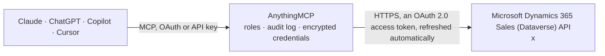

<!-- Generated by scripts/export-github-catalog.mjs in the anythingmcp-website repository. Do not edit by hand. -->

# Microsoft Dynamics 365 Sales (Dataverse) MCP connector

Let your AI work in Dynamics 365 Sales: find and update accounts, contacts, leads and opportunities, log tasks, calls and notes, qualify leads and close deals, and query any Dataverse table with OData or FetchXML. The AnythingMCP connector gives Claude, ChatGPT, Microsoft Copilot, Cursor and Gemini 42 MCP tools for Microsoft Dynamics 365 Sales (Dataverse): 19 read and 23 can change data.

**Category:** [CRM](../crm.md) · **Tools:** 42 · **Setup guide:** [anythingmcp.com](https://anythingmcp.com/guides/dynamics365-sales-to-mcp) · [Deutsch](https://anythingmcp.com/de/guides/dynamics365-sales-to-mcp) · [Italiano](https://anythingmcp.com/it/guides/dynamics365-sales-to-mcp) · [Español](https://anythingmcp.com/es/guides/dynamics365-sales-to-mcp) · [日本語](https://anythingmcp.com/ja/guides/dynamics365-sales-to-mcp) · [Русский](https://anythingmcp.com/ru/guides/dynamics365-sales-to-mcp) · [中文](https://anythingmcp.com/zh/guides/dynamics365-sales-to-mcp)

## Start without code

No installation and no terminal: AnythingMCP Cloud runs the Microsoft Dynamics 365 Sales (Dataverse) connector for you, operated by helpcode.ai in Frankfurt, Germany.

1. **Click the button above** and create an account or sign in. The Microsoft Dynamics 365 Sales (Dataverse) connector opens, ready to install.
2. **Sign in with your Microsoft Dynamics 365 Sales (Dataverse) account** when AnythingMCP asks. The first time, an admin creates a small app in the Microsoft Dynamics 365 Sales (Dataverse) developer console. Every click is in the [step-by-step guide](https://anythingmcp.com/guides/dynamics365-sales-to-mcp).
3. **Click Install.** AnythingMCP shows the address of your MCP server.
4. **Add that address to your assistant:** [Claude](https://anythingmcp.com/guides/connect-dynamics365-sales-to-claude) · [ChatGPT](https://anythingmcp.com/guides/connect-dynamics365-sales-to-chatgpt) · [Microsoft Copilot](https://anythingmcp.com/guides/connect-dynamics365-sales-to-copilot) · [Cursor](https://anythingmcp.com/guides/connect-dynamics365-sales-to-cursor) · [Gemini CLI](https://anythingmcp.com/guides/connect-dynamics365-sales-to-gemini) · [Meta Muse](https://anythingmcp.com/guides/connect-dynamics365-sales-to-muse).
5. **Ask your first question**, for example: *Show invoice INV-2026-078 for customer Nordwind Handels GmbH — status, due date and outstanding amount*

Prefer help with the setup? [Talk to us](https://anythingmcp.com/contact).

## How it works

- **The AI client** speaks MCP (Streamable HTTP) to AnythingMCP and only sees tool names, descriptions and results. It never gets the Microsoft Dynamics 365 Sales (Dataverse) credentials.
- **AnythingMCP** checks the client's role, builds the call from the tool definition, adds the credentials (an OAuth 2.0 access token, refreshed automatically), calls Microsoft Dynamics 365 Sales (Dataverse), logs the call and returns the result.
- **Microsoft Dynamics 365 Sales (Dataverse)** sees an ordinary API client with the rights of the account the credentials belong to.

## Tools

| Tool | What it does | Access |
|---|---|---|
| [`d365_who_am_i`](#d365_who_am_i) | Return the signed-in user's id (UserId), business unit and organization id. | read |
| [`d365_list_accounts`](#d365_list_accounts) | List or search accounts (companies): name, number, phone, email, website, city, country, primary contact, owner, status. | read |
| [`d365_get_account`](#d365_get_account) | Read one account with every column (or the selected ones), with labels for choice and lookup columns and its @odata.etag. | read |
| [`d365_create_account`](#d365_create_account) | Create an account. | write |
| [`d365_update_account`](#d365_update_account) | Change columns of one account; columns left out keep their values. | write |
| [`d365_delete_account`](#d365_delete_account) | Delete one account. | write |
| [`d365_list_contacts`](#d365_list_contacts) | List or search contacts (people): full name, job title, email, phones, company (parentcustomerid), city, owner, status. | read |
| [`d365_get_contact`](#d365_get_contact) | Read one contact with every column (or the selected ones), with labels for choice and lookup columns and its @odata.etag. | read |
| [`d365_create_contact`](#d365_create_contact) | Create a contact, optionally linked to its account. | write |
| [`d365_update_contact`](#d365_update_contact) | Change columns of one contact; columns left out keep their values. | write |
| [`d365_delete_contact`](#d365_delete_contact) | Delete one contact. | write |
| [`d365_list_leads`](#d365_list_leads) | List or search leads: topic, name, company, email, phone, source, rating, estimated value, owner, status (open, qualified, disqualified). | read |
| [`d365_get_lead`](#d365_get_lead) | Read one lead with every column (or the selected ones), with labels for choice and lookup columns and its @odata.etag. | read |
| [`d365_create_lead`](#d365_create_lead) | Create a lead. | write |
| [`d365_update_lead`](#d365_update_lead) | Change columns of one open lead; columns left out keep their values. | write |
| [`d365_qualify_lead`](#d365_qualify_lead) | Qualify an open lead: Dynamics closes it as qualified and creates the chosen records (account, contact, opportunity) from it, linked to the lead. | write |
| [`d365_disqualify_lead`](#d365_disqualify_lead) | Close an open lead as disqualified with a reason: 4 Lost, 5 Cannot Contact, 6 No Longer Interested (default), 7 Canceled. | write |
| [`d365_delete_lead`](#d365_delete_lead) | Delete one lead. | write |
| [`d365_list_opportunities`](#d365_list_opportunities) | List or search opportunities: topic, customer (account or contact), estimated value and close date, probability, pipeline phase, owner, status (open, won,… | read |
| [`d365_get_opportunity`](#d365_get_opportunity) | Read one opportunity with every column (or the selected ones), with labels for choice and lookup columns and its @odata.etag. | read |
| [`d365_create_opportunity`](#d365_create_opportunity) | Create an opportunity for an account or a contact. | write |
| [`d365_update_opportunity`](#d365_update_opportunity) | Change columns of one open opportunity (value, close date, probability, description); columns left out keep their values. | write |
| [`d365_win_opportunity`](#d365_win_opportunity) | Close an open opportunity as won, with the actual revenue and close date. | write |
| [`d365_lose_opportunity`](#d365_lose_opportunity) | Close an open opportunity as lost (canceled or out-sold), with an optional comment. | write |
| [`d365_delete_opportunity`](#d365_delete_opportunity) | Delete one opportunity. | write |
| [`d365_list_activities`](#d365_list_activities) | List activities of every type (tasks, phone calls, emails, appointments) with subject, type, dates, status and the row they are about. | read |
| [`d365_get_email`](#d365_get_email) | Read one email activity: subject, body (HTML in description), sender, recipients, direction, sent date, status and the row it is about. | read |
| [`d365_create_task`](#d365_create_task) | Create a task for the signed-in user, about an account, contact, lead or opportunity. | write |
| [`d365_create_phone_call`](#d365_create_phone_call) | Log a phone call activity about an account, contact, lead or opportunity, with notes. | write |
| [`d365_create_note`](#d365_create_note) | Add a note to the timeline of an account, contact, lead or opportunity. | write |
| [`d365_complete_task`](#d365_complete_task) | Mark an open task as completed. | write |
| [`d365_query`](#d365_query) | Query any table by its entity set name with OData: quotes, salesorders, invoices, products, pricelevels, campaigns, competitors, systemusers, teams,… | read |
| [`d365_next_page`](#d365_next_page) | Read the next page of any list, query or FetchXML answer that carried @odata.nextLink. | read |
| [`d365_fetchxml_query`](#d365_fetchxml_query) | Run a FetchXML query: joins across tables (link-entity), aggregates (count, sum, avg with groupby) and filters the OData syntax cannot express. | read |
| [`d365_get_record`](#d365_get_record) | Read one row of any table by entity set and id, with labels for choice and lookup columns and its @odata.etag. | read |
| [`d365_create_record`](#d365_create_record) | Create a row in any table that has no dedicated tool (a quote, a product, a custom table). | write |
| [`d365_update_record`](#d365_update_record) | Change columns of one row in any table; columns left out keep their values. | write |
| [`d365_delete_record`](#d365_delete_record) | Delete one row of any table. | write |
| [`d365_list_tables`](#d365_list_tables) | List tables with their logical name, entity set name (what the query tools take) and primary name column. | read |
| [`d365_describe_table`](#d365_describe_table) | Describe one table: entity set name, primary id and name columns, and every column with its type, whether it is required and whether it can be set on create… | read |
| [`d365_list_lookups`](#d365_list_lookups) | List the lookup columns of a table with the table each points to and the navigation property name a write needs ("<navigation property>@odata.bind":… | read |
| [`d365_get_choice_options`](#d365_get_choice_options) | List the values and labels of a choice column (option set), e.g. industrycode of account or statuscode of opportunity, so filters and writes can use the… | read |

## Tool reference

Every parameter as the AI client sees it in `tools/list`. Source: [`packages/backend/src/adapters/intl/dynamics365-sales.json`](../../../packages/backend/src/adapters/intl/dynamics365-sales.json).

### `d365_who_am_i`

Return the signed-in user's id (UserId), business unit and organization id. A cheap check that the connector works; the UserId is what ownerid filters and assignments need.

**Access:** read · **Call:** `GET /WhoAmI`

No parameters.

### `d365_list_accounts`

List or search accounts (companies): name, number, phone, email, website, city, country, primary contact, owner, status. Search a name with contains(name,'text').

**Access:** read · **Call:** `GET /accounts`

| Parameter | Type | Required | Description |
|---|---|---|---|
| `filter` | string | no | OData $filter on column logical names, e.g. "contains(name,'Contoso')", "address1_city eq 'Freiburg'", "statecode eq 0". Text in single quotes, GUIDs bare, dates bare (date and time columns as 2026-10-01T00:00:00Z), lookups as _<column>_value. |
| `select` | string | no | Comma-separated column logical names to return. The default is a short overview; d365_describe_table lists every column. |
| `orderby` | string | no | Sort order, e.g. "name". |
| `expand` | string | no | Related rows to include through a navigation property, e.g. "primarycontactid($select=fullname,emailaddress1)". |
| `count` | boolean | no | true to add @odata.count, the number of matching rows (counted up to 5000). |
| `page_size` | integer | no | Rows per answer (default 50, up to 5000). Also the way to ask for only a few rows. When more rows exist the answer carries @odata.nextLink; d365_next_page reads the next page. |

### `d365_get_account`

Read one account with every column (or the selected ones), with labels for choice and lookup columns and its @odata.etag.

**Access:** read · **Call:** `GET /accounts({account_id})`

| Parameter | Type | Required | Description |
|---|---|---|---|
| `account_id` | string | yes | Account id (GUID). |
| `select` | string | no | Comma-separated column logical names to return. Without it every column comes back. |
| `expand` | string | no | Related rows to include, e.g. "primarycontactid($select=fullname,emailaddress1)". |

### `d365_create_account`

Create an account. Returns the new row with its accountid. Check with d365_list_accounts that it does not exist yet, and confirm the details with the user before creating.

**Access:** write · **Call:** `POST /accounts`

| Parameter | Type | Required | Description |
|---|---|---|---|
| `name` | string | yes | Account name. |
| `accountnumber` | string | no | Account number. |
| `telephone1` | string | no | Main phone. |
| `emailaddress1` | string | no | Email address. |
| `websiteurl` | string | no | Website. |
| `address1_line1` | string | no | Street. |
| `address1_city` | string | no | City. |
| `address1_postalcode` | string | no | Postal code. |
| `address1_country` | string | no | Country. |
| `description` | string | no | Description. |
| `parent_account_id` | string | no | Id of the parent account. |
| `primary_contact_id` | string | no | Id of the primary contact. |
| `fields` | object | no | Further columns by logical name, e.g. {"industrycode": 7, "new_customfield": "x"}. Choice columns take the number, lookups take "<navigation property>@odata.bind": "/<entity set>(<id>)" (d365_list_lookups names them). |

### `d365_update_account`

Change columns of one account; columns left out keep their values. Returns the updated row. Confirm the change with the user.

**Access:** write · **Call:** `PATCH /accounts({account_id})`

| Parameter | Type | Required | Description |
|---|---|---|---|
| `account_id` | string | yes | Account id (GUID). |
| `fields` | object | yes | Columns to change by logical name, e.g. {"telephone1": "+49 761 1234", "industrycode": 7}. null clears a column; lookups take "<navigation property>@odata.bind": "/<entity set>(<id>)". |
| `etag` | string | no | The row's @odata.etag from the last read, so the change is refused (412) when someone else changed the row meanwhile. Default * updates whatever version is current; it never creates a row. |

### `d365_delete_account`

Delete one account. Related rows (contacts, opportunities, activities) may be deleted or unlinked depending on the relationship settings. Installed switched off; confirm every deletion with the user.

**Access:** write · **Call:** `DELETE /accounts({account_id})`

| Parameter | Type | Required | Description |
|---|---|---|---|
| `account_id` | string | yes | Account id (GUID). |

### `d365_list_contacts`

List or search contacts (people): full name, job title, email, phones, company (parentcustomerid), city, owner, status.

**Access:** read · **Call:** `GET /contacts`

| Parameter | Type | Required | Description |
|---|---|---|---|
| `filter` | string | no | OData $filter on column logical names, e.g. "contains(fullname,'Meyer')", "emailaddress1 eq 'ana@contoso.com'", "_parentcustomerid_value eq <account id>". Text in single quotes, GUIDs bare, dates bare (date and time columns as 2026-10-01T00:00:00Z), lookups as _<column>_value. |
| `select` | string | no | Comma-separated column logical names to return. The default is a short overview; d365_describe_table lists every column. |
| `orderby` | string | no | Sort order, e.g. "fullname". |
| `expand` | string | no | Related rows to include through a navigation property, e.g. "parentcustomerid_account($select=name)". |
| `count` | boolean | no | true to add @odata.count, the number of matching rows (counted up to 5000). |
| `page_size` | integer | no | Rows per answer (default 50, up to 5000). Also the way to ask for only a few rows. When more rows exist the answer carries @odata.nextLink; d365_next_page reads the next page. |

### `d365_get_contact`

Read one contact with every column (or the selected ones), with labels for choice and lookup columns and its @odata.etag.

**Access:** read · **Call:** `GET /contacts({contact_id})`

| Parameter | Type | Required | Description |
|---|---|---|---|
| `contact_id` | string | yes | Contact id (GUID). |
| `select` | string | no | Comma-separated column logical names to return. Without it every column comes back. |
| `expand` | string | no | Related rows to include, e.g. "parentcustomerid_account($select=name)". |

### `d365_create_contact`

Create a contact, optionally linked to its account. Returns the new row with its contactid. Check with d365_list_contacts that the person does not exist yet, and confirm with the user before creating.

**Access:** write · **Call:** `POST /contacts`

| Parameter | Type | Required | Description |
|---|---|---|---|
| `firstname` | string | no | First name. |
| `lastname` | string | yes | Last name. |
| `jobtitle` | string | no | Job title. |
| `emailaddress1` | string | no | Email address. |
| `telephone1` | string | no | Business phone. |
| `mobilephone` | string | no | Mobile phone. |
| `description` | string | no | Description. |
| `account_id` | string | no | Id of the account (company) the contact works for. |
| `fields` | object | no | Further columns by logical name, e.g. {"industrycode": 7, "new_customfield": "x"}. Choice columns take the number, lookups take "<navigation property>@odata.bind": "/<entity set>(<id>)" (d365_list_lookups names them). |

### `d365_update_contact`

Change columns of one contact; columns left out keep their values. Returns the updated row. Confirm the change with the user.

**Access:** write · **Call:** `PATCH /contacts({contact_id})`

| Parameter | Type | Required | Description |
|---|---|---|---|
| `contact_id` | string | yes | Contact id (GUID). |
| `fields` | object | yes | Columns to change by logical name, e.g. {"jobtitle": "Head of Purchasing", "mobilephone": "+49 170 1234"}. null clears a column; lookups take "<navigation property>@odata.bind": "/<entity set>(<id>)". |
| `etag` | string | no | The row's @odata.etag from the last read, so the change is refused (412) when someone else changed the row meanwhile. Default * updates whatever version is current; it never creates a row. |

### `d365_delete_contact`

Delete one contact. Installed switched off; confirm every deletion with the user.

**Access:** write · **Call:** `DELETE /contacts({contact_id})`

| Parameter | Type | Required | Description |
|---|---|---|---|
| `contact_id` | string | yes | Contact id (GUID). |

### `d365_list_leads`

List or search leads: topic, name, company, email, phone, source, rating, estimated value, owner, status (open, qualified, disqualified). Open leads have statecode 0.

**Access:** read · **Call:** `GET /leads`

| Parameter | Type | Required | Description |
|---|---|---|---|
| `filter` | string | no | OData $filter on column logical names, e.g. "statecode eq 0", "contains(companyname,'Fabrikam')", "createdon ge 2026-10-01T00:00:00Z". Text in single quotes, GUIDs bare, dates bare (date and time columns as 2026-10-01T00:00:00Z), lookups as _<column>_value. |
| `select` | string | no | Comma-separated column logical names to return. The default is a short overview; d365_describe_table lists every column. |
| `orderby` | string | no | Sort order, e.g. "createdon desc". |
| `expand` | string | no | Related rows to include through a navigation property, e.g. "parentaccountid($select=name)". |
| `count` | boolean | no | true to add @odata.count, the number of matching rows (counted up to 5000). |
| `page_size` | integer | no | Rows per answer (default 50, up to 5000). Also the way to ask for only a few rows. When more rows exist the answer carries @odata.nextLink; d365_next_page reads the next page. |

### `d365_get_lead`

Read one lead with every column (or the selected ones), with labels for choice and lookup columns and its @odata.etag.

**Access:** read · **Call:** `GET /leads({lead_id})`

| Parameter | Type | Required | Description |
|---|---|---|---|
| `lead_id` | string | yes | Lead id (GUID). |
| `select` | string | no | Comma-separated column logical names to return. Without it every column comes back. |
| `expand` | string | no | Related rows to include, e.g. "parentaccountid($select=name)". |

### `d365_create_lead`

Create a lead. Returns the new row with its leadid. Confirm with the user before creating.

**Access:** write · **Call:** `POST /leads`

| Parameter | Type | Required | Description |
|---|---|---|---|
| `subject` | string | yes | Topic, e.g. "Interest in 20 office chairs". |
| `firstname` | string | no | First name. |
| `lastname` | string | yes | Last name. |
| `companyname` | string | no | Company name. |
| `jobtitle` | string | no | Job title. |
| `emailaddress1` | string | no | Email address. |
| `telephone1` | string | no | Business phone. |
| `estimatedvalue` | number | no | Estimated value in the lead's currency. |
| `description` | string | no | Description. |
| `fields` | object | no | Further columns by logical name, e.g. {"industrycode": 7, "new_customfield": "x"}. Choice columns take the number, lookups take "<navigation property>@odata.bind": "/<entity set>(<id>)" (d365_list_lookups names them). |

### `d365_update_lead`

Change columns of one open lead; columns left out keep their values. Returns the updated row. Confirm the change with the user.

**Access:** write · **Call:** `PATCH /leads({lead_id})`

| Parameter | Type | Required | Description |
|---|---|---|---|
| `lead_id` | string | yes | Lead id (GUID). |
| `fields` | object | yes | Columns to change by logical name, e.g. {"leadqualitycode": 1, "estimatedvalue": 12000}. null clears a column; lookups take "<navigation property>@odata.bind": "/<entity set>(<id>)". |
| `etag` | string | no | The row's @odata.etag from the last read, so the change is refused (412) when someone else changed the row meanwhile. Default * updates whatever version is current; it never creates a row. |

### `d365_qualify_lead`

Qualify an open lead: Dynamics closes it as qualified and creates the chosen records (account, contact, opportunity) from it, linked to the lead. Returns the created records. Ask the user to confirm first, and which records to create; when the company already exists as an account, set create_account to false so no duplicate is made.

**Access:** write · **Call:** `POST /leads({lead_id})/Microsoft.Dynamics.CRM.QualifyLead`

| Parameter | Type | Required | Description |
|---|---|---|---|
| `lead_id` | string | yes | Lead id (GUID). |
| `create_account` | boolean | no | Create an account from the lead's company (default true). |
| `create_contact` | boolean | no | Create a contact from the lead's person (default true). |
| `create_opportunity` | boolean | no | Create an opportunity (default true). |
| `status` | integer | no | Status reason of the qualified lead; 3 is Qualified. |

### `d365_disqualify_lead`

Close an open lead as disqualified with a reason: 4 Lost, 5 Cannot Contact, 6 No Longer Interested (default), 7 Canceled. It can be reactivated in Dynamics later. Confirm with the user first.

**Access:** write · **Call:** `PATCH /leads({lead_id})`

| Parameter | Type | Required | Description |
|---|---|---|---|
| `lead_id` | string | yes | Lead id (GUID). |
| `status_reason` | integer | no | Disqualification reason (statuscode): 4 Lost, 5 Cannot Contact, 6 No Longer Interested, 7 Canceled, or a custom reason from d365_get_choice_options. |
| `etag` | string | no | The row's @odata.etag from the last read, so the change is refused (412) when someone else changed the row meanwhile. Default * updates whatever version is current; it never creates a row. |

### `d365_delete_lead`

Delete one lead. Installed switched off; confirm every deletion with the user. Closing it with d365_disqualify_lead keeps the history.

**Access:** write · **Call:** `DELETE /leads({lead_id})`

| Parameter | Type | Required | Description |
|---|---|---|---|
| `lead_id` | string | yes | Lead id (GUID). |

### `d365_list_opportunities`

List or search opportunities: topic, customer (account or contact), estimated value and close date, probability, pipeline phase, owner, status (open, won, lost). Open ones have statecode 0.

**Access:** read · **Call:** `GET /opportunities`

| Parameter | Type | Required | Description |
|---|---|---|---|
| `filter` | string | no | OData $filter on column logical names, e.g. "statecode eq 0", "estimatedclosedate le 2026-12-31", "_customerid_value eq <account id>". Text in single quotes, GUIDs bare, dates bare (date and time columns as 2026-10-01T00:00:00Z), lookups as _<column>_value. |
| `select` | string | no | Comma-separated column logical names to return. The default is a short overview; d365_describe_table lists every column. |
| `orderby` | string | no | Sort order, e.g. "estimatedclosedate". |
| `expand` | string | no | Related rows to include through a navigation property, e.g. "customerid_account($select=name)". |
| `count` | boolean | no | true to add @odata.count, the number of matching rows (counted up to 5000). |
| `page_size` | integer | no | Rows per answer (default 50, up to 5000). Also the way to ask for only a few rows. When more rows exist the answer carries @odata.nextLink; d365_next_page reads the next page. |

### `d365_get_opportunity`

Read one opportunity with every column (or the selected ones), with labels for choice and lookup columns and its @odata.etag.

**Access:** read · **Call:** `GET /opportunities({opportunity_id})`

| Parameter | Type | Required | Description |
|---|---|---|---|
| `opportunity_id` | string | yes | Opportunity id (GUID). |
| `select` | string | no | Comma-separated column logical names to return. Without it every column comes back. |
| `expand` | string | no | Related rows to include, e.g. "parentaccountid($select=name)". |

### `d365_create_opportunity`

Create an opportunity for an account or a contact. Returns the new row with its opportunityid. Confirm topic, customer, value and close date with the user before creating.

**Access:** write · **Call:** `POST /opportunities`

| Parameter | Type | Required | Description |
|---|---|---|---|
| `name` | string | yes | Topic, e.g. "20 office chairs for the new site". |
| `account_id` | string | no | Id of the customer account. Give account_id or contact_id. |
| `contact_id` | string | no | Id of the customer contact, for a person without an account. |
| `estimatedvalue` | number | no | Estimated revenue. |
| `estimatedclosedate` | string | no | Estimated close date, YYYY-MM-DD. |
| `closeprobability` | integer | no | Probability in percent. |
| `description` | string | no | Description. |
| `fields` | object | no | Further columns by logical name, e.g. {"industrycode": 7, "new_customfield": "x"}. Choice columns take the number, lookups take "<navigation property>@odata.bind": "/<entity set>(<id>)" (d365_list_lookups names them). |

### `d365_update_opportunity`

Change columns of one open opportunity (value, close date, probability, description); columns left out keep their values. Returns the updated row. Use d365_win_opportunity or d365_lose_opportunity to close it. Confirm the change with the user.

**Access:** write · **Call:** `PATCH /opportunities({opportunity_id})`

| Parameter | Type | Required | Description |
|---|---|---|---|
| `opportunity_id` | string | yes | Opportunity id (GUID). |
| `fields` | object | yes | Columns to change by logical name, e.g. {"estimatedvalue": 25000, "estimatedclosedate": "2026-12-15"}. null clears a column; lookups take "<navigation property>@odata.bind": "/<entity set>(<id>)". |
| `etag` | string | no | The row's @odata.etag from the last read, so the change is refused (412) when someone else changed the row meanwhile. Default * updates whatever version is current; it never creates a row. |

### `d365_win_opportunity`

Close an open opportunity as won, with the actual revenue and close date. Dynamics records an opportunity close activity. Ask the user to confirm first.

**Access:** write · **Call:** `POST /WinOpportunity`

| Parameter | Type | Required | Description |
|---|---|---|---|
| `opportunity_id` | string | yes | Opportunity id (GUID). |
| `status` | integer | no | Status reason for won; 3 is Won. |
| `subject` | string | no | Subject of the closing note. |
| `actual_revenue` | number | no | Actual revenue to record. |
| `close_date` | string | no | Actual close date as an ISO 8601 date and time, e.g. 2026-10-12T12:00:00Z (default today). |
| `description` | string | no | Closing comment. |

### `d365_lose_opportunity`

Close an open opportunity as lost (canceled or out-sold), with an optional comment. Dynamics records an opportunity close activity. Ask the user to confirm first.

**Access:** write · **Call:** `POST /LoseOpportunity`

| Parameter | Type | Required | Description |
|---|---|---|---|
| `opportunity_id` | string | yes | Opportunity id (GUID). |
| `status` | integer | no | Status reason for lost: 4 Canceled (default) or 5 Out-Sold, or a custom reason. |
| `subject` | string | no | Subject of the closing note. |
| `actual_revenue` | number | no | Actual revenue to record. |
| `close_date` | string | no | Actual close date as an ISO 8601 date and time, e.g. 2026-10-12T12:00:00Z (default today). |
| `description` | string | no | Closing comment. |

### `d365_delete_opportunity`

Delete one opportunity. Installed switched off; confirm every deletion with the user. Closing it as lost keeps the history.

**Access:** write · **Call:** `DELETE /opportunities({opportunity_id})`

| Parameter | Type | Required | Description |
|---|---|---|---|
| `opportunity_id` | string | yes | Opportunity id (GUID). |

### `d365_list_activities`

List activities of every type (tasks, phone calls, emails, appointments) with subject, type, dates, status and the row they are about. Filter by _regardingobjectid_value for one account, contact, lead or opportunity, by activitytypecode for one type.

**Access:** read · **Call:** `GET /activitypointers`

| Parameter | Type | Required | Description |
|---|---|---|---|
| `filter` | string | no | OData $filter on column logical names, e.g. "_regardingobjectid_value eq <id>", "activitytypecode eq 'task' and statecode eq 0", "scheduledend lt 2026-10-15T00:00:00Z". Text in single quotes, GUIDs bare, dates bare (date and time columns as 2026-10-01T00:00:00Z), lookups as _<column>_value. |
| `select` | string | no | Comma-separated column logical names to return. The default is a short overview; d365_describe_table lists every column. |
| `orderby` | string | no | Sort order, e.g. "scheduledend desc". |
| `expand` | string | no | Related rows to include through a navigation property, e.g. "regardingobjectid_account($select=name)". |
| `count` | boolean | no | true to add @odata.count, the number of matching rows (counted up to 5000). |
| `page_size` | integer | no | Rows per answer (default 50, up to 5000). Also the way to ask for only a few rows. When more rows exist the answer carries @odata.nextLink; d365_next_page reads the next page. |

### `d365_get_email`

Read one email activity: subject, body (HTML in description), sender, recipients, direction, sent date, status and the row it is about.

**Access:** read · **Call:** `GET /emails({activity_id})`

| Parameter | Type | Required | Description |
|---|---|---|---|
| `activity_id` | string | yes | Activity id (GUID) of the email, from d365_list_activities. |
| `select` | string | no | Comma-separated columns to return. |

### `d365_create_task`

Create a task for the signed-in user, about an account, contact, lead or opportunity. Returns the new task. Confirm with the user before creating.

**Access:** write · **Call:** `POST /tasks`

| Parameter | Type | Required | Description |
|---|---|---|---|
| `subject` | string | yes | What to do, e.g. "Send revised offer". |
| `description` | string | no | Details. |
| `scheduledend` | string | no | Due date and time, ISO 8601 (2026-10-20T09:00:00Z). |
| `prioritycode` | `0` \| `1` \| `2` | no | 0 Low, 1 Normal (default), 2 High. |
| `regarding_account_id` | string | no | Id of the account this is about. Give at most one regarding_* id. |
| `regarding_contact_id` | string | no | Id of the contact this is about. Give at most one regarding_* id. |
| `regarding_lead_id` | string | no | Id of the lead this is about. Give at most one regarding_* id. |
| `regarding_opportunity_id` | string | no | Id of the opportunity this is about. Give at most one regarding_* id. |
| `fields` | object | no | Further columns by logical name, e.g. {"industrycode": 7, "new_customfield": "x"}. Choice columns take the number, lookups take "<navigation property>@odata.bind": "/<entity set>(<id>)" (d365_list_lookups names them). |

### `d365_create_phone_call`

Log a phone call activity about an account, contact, lead or opportunity, with notes. Returns the new activity. Confirm with the user before creating.

**Access:** write · **Call:** `POST /phonecalls`

| Parameter | Type | Required | Description |
|---|---|---|---|
| `subject` | string | yes | Subject, e.g. "Follow-up on quote". |
| `phonenumber` | string | no | Phone number called or calling. |
| `directioncode` | boolean | no | true for an outgoing call (default), false for incoming. |
| `description` | string | no | Call notes. |
| `scheduledend` | string | no | Due date and time, ISO 8601. |
| `regarding_account_id` | string | no | Id of the account this is about. Give at most one regarding_* id. |
| `regarding_contact_id` | string | no | Id of the contact this is about. Give at most one regarding_* id. |
| `regarding_lead_id` | string | no | Id of the lead this is about. Give at most one regarding_* id. |
| `regarding_opportunity_id` | string | no | Id of the opportunity this is about. Give at most one regarding_* id. |
| `fields` | object | no | Further columns by logical name, e.g. {"industrycode": 7, "new_customfield": "x"}. Choice columns take the number, lookups take "<navigation property>@odata.bind": "/<entity set>(<id>)" (d365_list_lookups names them). |

### `d365_create_note`

Add a note to the timeline of an account, contact, lead or opportunity. Returns the new note. Confirm with the user before creating.

**Access:** write · **Call:** `POST /annotations`

| Parameter | Type | Required | Description |
|---|---|---|---|
| `subject` | string | no | Title of the note. |
| `notetext` | string | yes | Text of the note. |
| `regarding_account_id` | string | no | Id of the account this is about. Give at most one regarding_* id. |
| `regarding_contact_id` | string | no | Id of the contact this is about. Give at most one regarding_* id. |
| `regarding_lead_id` | string | no | Id of the lead this is about. Give at most one regarding_* id. |
| `regarding_opportunity_id` | string | no | Id of the opportunity this is about. Give at most one regarding_* id. |
| `fields` | object | no | Further columns by logical name, e.g. {"industrycode": 7, "new_customfield": "x"}. Choice columns take the number, lookups take "<navigation property>@odata.bind": "/<entity set>(<id>)" (d365_list_lookups names them). |

### `d365_complete_task`

Mark an open task as completed. Confirm with the user first.

**Access:** write · **Call:** `PATCH /tasks({task_id})`

| Parameter | Type | Required | Description |
|---|---|---|---|
| `task_id` | string | yes | Activity id (GUID) of the task. |
| `etag` | string | no | The row's @odata.etag from the last read, so the change is refused (412) when someone else changed the row meanwhile. Default * updates whatever version is current; it never creates a row. |

### `d365_query`

Query any table by its entity set name with OData: quotes, salesorders, invoices, products, pricelevels, campaigns, competitors, systemusers, teams, transactioncurrencies or a custom table. d365_list_tables gives entity set names, d365_describe_table the columns. Read-only.

**Access:** read · **Call:** `GET /{entity_set}`

| Parameter | Type | Required | Description |
|---|---|---|---|
| `entity_set` | string | yes | Entity set name, usually the plural logical name, e.g. "salesorders" or "cr123_projects". |
| `filter` | string | no | OData $filter, e.g. "statecode eq 0 and createdon ge 2026-01-01T00:00:00Z". |
| `select` | string | no | Comma-separated columns to return. Always set it: without it every column comes back. |
| `orderby` | string | no | Sort order, e.g. "createdon desc". |
| `expand` | string | no | Related rows through a navigation property. |
| `apply` | string | no | OData $apply for aggregates, e.g. "groupby((statecode),aggregate($count as total))". |
| `count` | boolean | no | true to add @odata.count. |
| `page_size` | integer | no | Rows per answer (default 50, up to 5000). Also the way to ask for only a few rows. When more rows exist the answer carries @odata.nextLink; d365_next_page reads the next page. |

### `d365_next_page`

Read the next page of any list, query or FetchXML answer that carried @odata.nextLink. Pass the entity set of the first call and everything after the "?" of the nextLink, unchanged.

**Access:** read · **Call:** `GET /{entity_set}`

| Parameter | Type | Required | Description |
|---|---|---|---|
| `entity_set` | string | yes | Entity set of the first call, e.g. "accounts". |
| `next_query` | string | yes | The part of @odata.nextLink after the "?", copied exactly as received (it is already encoded), e.g. "$select=name&$skiptoken=%3Ccookie...". |
| `page_size` | integer | no | Rows per page: the same value as in the first call (default 50, up to 5000). |

### `d365_fetchxml_query`

Run a FetchXML query: joins across tables (link-entity), aggregates (count, sum, avg with groupby) and filters the OData syntax cannot express. Up to 5000 rows; page with the page and count attributes of <fetch>. Read-only.

**Access:** read · **Call:** `GET /{entity_set}`

| Parameter | Type | Required | Description |
|---|---|---|---|
| `entity_set` | string | yes | Entity set name of the <entity> in the FetchXML, e.g. "opportunities" for <entity name="opportunity">. |
| `fetch_xml` | string | yes | The FetchXML document, e.g. <fetch top="10"><entity name="opportunity"><attribute name="name"/><attribute name="estimatedvalue"/><filter><condition attribute="statecode" operator="eq" value="0"/></filter><order attribute="estimatedvalue" descending="true"/></entity></fetch>. |

### `d365_get_record`

Read one row of any table by entity set and id, with labels for choice and lookup columns and its @odata.etag.

**Access:** read · **Call:** `GET /{entity_set}({record_id})`

| Parameter | Type | Required | Description |
|---|---|---|---|
| `entity_set` | string | yes | Entity set name, e.g. "salesorders". |
| `record_id` | string | yes | Row id (GUID). |
| `select` | string | no | Comma-separated columns to return. |
| `expand` | string | no | Related rows through a navigation property. |

### `d365_create_record`

Create a row in any table that has no dedicated tool (a quote, a product, a custom table). Returns the new row. Check the columns with d365_describe_table and the lookup names with d365_list_lookups first, and confirm with the user before creating.

**Access:** write · **Call:** `POST /{entity_set}`

| Parameter | Type | Required | Description |
|---|---|---|---|
| `entity_set` | string | yes | Entity set name, e.g. "quotes". |
| `fields` | object | yes | Columns by logical name. Lookups: "<navigation property>@odata.bind": "/<entity set>(<id>)", e.g. {"name": "Q-1", "customerid_account@odata.bind": "/accounts(<id>)"}. |

### `d365_update_record`

Change columns of one row in any table; columns left out keep their values. It never creates a row. Returns the updated row. Confirm the change with the user.

**Access:** write · **Call:** `PATCH /{entity_set}({record_id})`

| Parameter | Type | Required | Description |
|---|---|---|---|
| `entity_set` | string | yes | Entity set name, e.g. "quotes". |
| `record_id` | string | yes | Row id (GUID). |
| `fields` | object | yes | Columns to change by logical name; null clears a column. |
| `etag` | string | no | The row's @odata.etag from the last read, so the change is refused (412) when someone else changed the row meanwhile. Default * updates whatever version is current; it never creates a row. |

### `d365_delete_record`

Delete one row of any table. Installed switched off; turn it on only if the AI should delete data, and confirm every deletion with the user.

**Access:** write · **Call:** `DELETE /{entity_set}({record_id})`

| Parameter | Type | Required | Description |
|---|---|---|---|
| `entity_set` | string | yes | Entity set name. |
| `record_id` | string | yes | Row id (GUID). |

### `d365_list_tables`

List tables with their logical name, entity set name (what the query tools take) and primary name column. The full list has several hundred tables: filter it, e.g. IsCustomEntity eq true for custom tables.

**Access:** read · **Call:** `GET /EntityDefinitions`

| Parameter | Type | Required | Description |
|---|---|---|---|
| `filter` | string | no | Filter on table metadata, e.g. "IsCustomEntity eq true" or "LogicalName eq 'salesorder'". |

### `d365_describe_table`

Describe one table: entity set name, primary id and name columns, and every column with its type, whether it is required and whether it can be set on create or update. Call it before querying or writing a table you do not know.

**Access:** read · **Call:** `GET /EntityDefinitions(LogicalName='{table}')`

| Parameter | Type | Required | Description |
|---|---|---|---|
| `table` | string | yes | Table logical name (singular), e.g. "account", "opportunity", "cr123_project". |

### `d365_list_lookups`

List the lookup columns of a table with the table each points to and the navigation property name a write needs ("<navigation property>@odata.bind": "/<entity set>(<id>)"), e.g. parentcustomerid_account for a contact's company.

**Access:** read · **Call:** `GET /EntityDefinitions(LogicalName='{table}')/ManyToOneRelationships`

| Parameter | Type | Required | Description |
|---|---|---|---|
| `table` | string | yes | Table logical name (singular), e.g. "contact". |

### `d365_get_choice_options`

List the values and labels of a choice column (option set), e.g. industrycode of account or statuscode of opportunity, so filters and writes can use the right number.

**Access:** read · **Call:** `GET /EntityDefinitions(LogicalName='{table}')/Attributes(LogicalName='{column}')/Microsoft.Dynamics.CRM.{column_type}`

| Parameter | Type | Required | Description |
|---|---|---|---|
| `table` | string | yes | Table logical name, e.g. "account". |
| `column` | string | yes | Column logical name, e.g. "industrycode". |
| `column_type` | `PicklistAttributeMetadata` \| `MultiSelectPicklistAttributeMetadata` \| `StatusAttributeMetadata` \| `StateAttributeMetadata` \| `BooleanAttributeMetadata` | no | Kind of choice column: PicklistAttributeMetadata (default), MultiSelectPicklistAttributeMetadata, StatusAttributeMetadata for statuscode, StateAttributeMetadata for statecode, BooleanAttributeMetadata for yes/no. |

## Run it yourself

AnythingMCP is open source (AGPL-3.0). [Run it with Docker](../../../README.md#run-it-yourself), open **Connectors → Store**, pick **Microsoft Dynamics 365 Sales (Dataverse)** and enter `MICROSOFT_CLIENT_ID`, `MICROSOFT_CLIENT_SECRET`, `MICROSOFT_TENANT_ID`, `DYNAMICS_ORG_HOST`, then add your MCP server URL to the AI client.

[← CRM connectors](../crm.md) · [All categories](../README.md)
