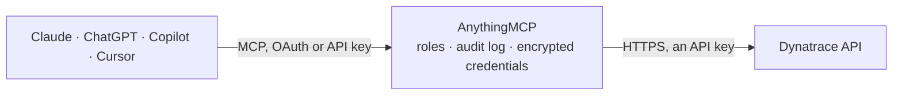

<!-- Generated by scripts/export-github-catalog.mjs in the anythingmcp-website repository. Do not edit by hand. -->

# Dynatrace MCP connector

Dynatrace observability through the Environment API v2: Davis problems with root cause and impact, monitored entities and tags, metrics and metric queries, log search, events, security problems, … The AnythingMCP connector gives Claude, ChatGPT, Microsoft Copilot, Cursor and Gemini 29 MCP tools for Dynatrace: 25 read and 4 can change data.

**Category:** [Monitoring](../monitoring.md) · **Tools:** 29 · **Setup guide:** [anythingmcp.com](https://anythingmcp.com/guides/dynatrace-to-mcp) · [Deutsch](https://anythingmcp.com/de/guides/dynatrace-to-mcp) · [Italiano](https://anythingmcp.com/it/guides/dynatrace-to-mcp) · [Español](https://anythingmcp.com/es/guides/dynatrace-to-mcp) · [日本語](https://anythingmcp.com/ja/guides/dynatrace-to-mcp) · [Русский](https://anythingmcp.com/ru/guides/dynatrace-to-mcp) · [中文](https://anythingmcp.com/zh/guides/dynatrace-to-mcp)

## Start without code

No installation and no terminal: AnythingMCP Cloud runs the Dynatrace connector for you, operated by helpcode.ai in Frankfurt, Germany.

1. **Click the button above** and create an account or sign in. The Dynatrace connector opens, ready to install.
2. **Paste the API key or token from your Dynatrace account.** Every click is in the [step-by-step guide](https://anythingmcp.com/guides/dynatrace-to-mcp).
3. **Click Install.** AnythingMCP shows the address of your MCP server.
4. **Add that address to your assistant:** [Claude](https://anythingmcp.com/guides/connect-dynatrace-to-claude) · [ChatGPT](https://anythingmcp.com/guides/connect-dynatrace-to-chatgpt) · [Microsoft Copilot](https://anythingmcp.com/guides/connect-dynatrace-to-copilot) · [Cursor](https://anythingmcp.com/guides/connect-dynatrace-to-cursor) · [Gemini CLI](https://anythingmcp.com/guides/connect-dynatrace-to-gemini) · [Meta Muse](https://anythingmcp.com/guides/connect-dynatrace-to-muse).
5. **Ask your first question**, for example: *Show the open problem P-2410456 for service order-api and its root cause evidence*

Prefer help with the setup? [Talk to us](https://anythingmcp.com/contact).

## How it works

- **The AI client** speaks MCP (Streamable HTTP) to AnythingMCP and only sees tool names, descriptions and results. It never gets the Dynatrace credentials.
- **AnythingMCP** checks the client's role, builds the call from the tool definition, adds the credentials (an API key), calls Dynatrace, logs the call and returns the result.
- **Dynatrace** sees an ordinary API client with the rights of the account the credentials belong to.

## Tools

| Tool | What it does | Access |
|---|---|---|
| [`dynatrace_list_problems`](#dynatrace_list_problems) | List problems (Davis AI detected incidents), newest first: id, display id (P-2410123), title, impact level (APPLICATION, SERVICE, INFRASTRUCTURE,… | read |
| [`dynatrace_get_problem`](#dynatrace_get_problem) | Get one problem with its evidence (the events, metrics and transactions Davis used), impact analysis, root cause, affected entities, linked problem and… | read |
| [`dynatrace_list_problem_comments`](#dynatrace_list_problem_comments) | List the comments on a problem: text, context (e.g. the tool that wrote it), author and time. | read |
| [`dynatrace_add_problem_comment`](#dynatrace_add_problem_comment) | Add a comment to a problem, e.g. the cause found or the ticket opened. | write |
| [`dynatrace_close_problem`](#dynatrace_close_problem) | Close an open problem by hand, with a closing comment. | write |
| [`dynatrace_list_entities`](#dynatrace_list_entities) | List monitored entities (hosts, services, processes, applications, Kubernetes workloads, cloud resources and so on) that match an entity selector: entity… | read |
| [`dynatrace_get_entity`](#dynatrace_get_entity) | Get one monitored entity with its type, display name, properties, tags, management zones, first and last seen time and its relationships to other entities… | read |
| [`dynatrace_list_entity_types`](#dynatrace_list_entity_types) | List the entity types of the environment (HOST, SERVICE, PROCESS_GROUP, APPLICATION, KUBERNETES_CLUSTER, CLOUD_APPLICATION and many more) with their… | read |
| [`dynatrace_get_entity_type`](#dynatrace_get_entity_type) | Get one entity type with its properties (usable in `fields` and selectors), the relationships it can have and its tag and management zone support. | read |
| [`dynatrace_list_tags`](#dynatrace_list_tags) | List the custom tags on the entities that match an entity selector, with key, value and how often each is used. | read |
| [`dynatrace_add_tags`](#dynatrace_add_tags) | Add custom tags to every entity that matches an entity selector, e.g. owner:team-payments. | write |
| [`dynatrace_list_metrics`](#dynatrace_list_metrics) | List the available metrics with key (e.g. builtin:host.cpu.usage), display name, description, unit, aggregation types and dimensions. | read |
| [`dynatrace_get_metric`](#dynatrace_get_metric) | Get the descriptor of one metric: display name, description, unit, dimensions, aggregation types, default aggregation and entity type. | read |
| [`dynatrace_query_metrics`](#dynatrace_query_metrics) | Read metric data points: one or more metrics with transformations (`:avg`, `:splitBy("dt.entity.host")`, `:sort(value(avg,descending))`, `:limit(10)`) for a… | read |
| [`dynatrace_search_logs`](#dynatrace_search_logs) | Search log records with the Dynatrace log search query language: timestamp, status (ERROR, WARN, INFO, NONE), content and attributes (host, process, log… | read |
| [`dynatrace_aggregate_logs`](#dynatrace_aggregate_logs) | Count log records over time and by attribute: how many records match a query per time slot and per value of the chosen groupings (e.g. status, log.source,… | read |
| [`dynatrace_list_events`](#dynatrace_list_events) | List events (deployments, configuration changes, availability, error, performance and resource events, custom events) with type, title, status, entity,… | read |
| [`dynatrace_get_event`](#dynatrace_get_event) | Get one event with all its properties, the entity it belongs to and its management zones. | read |
| [`dynatrace_list_event_types`](#dynatrace_list_event_types) | List the event types with their display name and description, for use in an event selector. | read |
| [`dynatrace_ingest_event`](#dynatrace_ingest_event) | Send a custom event to Dynatrace and attach it to entities: a deployment, configuration change or annotation shows on the entities and is used by Davis for… | write |
| [`dynatrace_list_security_problems`](#dynatrace_list_security_problems) | List security problems (vulnerabilities found by Runtime Vulnerability Analytics): id, display id (S-123), title, status (OPEN, RESOLVED, MUTED),… | read |
| [`dynatrace_get_security_problem`](#dynatrace_get_security_problem) | Get one security problem with its description, CVEs, risk assessment (exposure, data assets, public exploit), affected and related entities and remediation… | read |
| [`dynatrace_list_slos`](#dynatrace_list_slos) | List service-level objectives with name, target and warning thresholds, timeframe and, with `evaluate`, the current status (percentage), error budget and… | read |
| [`dynatrace_get_slo`](#dynatrace_get_slo) | Get one SLO with its definition and its evaluated status, error budget, burn rate and the metric expression behind it. | read |
| [`dynatrace_list_settings_schemas`](#dynatrace_list_settings_schemas) | List the settings schemas of the environment (e.g. builtin:alerting.profile, builtin:management-zones, builtin:problem.notifications,… | read |
| [`dynatrace_get_settings_schema`](#dynatrace_get_settings_schema) | Get one settings schema: its properties, types, allowed values, scopes and constraints. | read |
| [`dynatrace_list_settings_objects`](#dynatrace_list_settings_objects) | Read the configured settings objects of one or more schemas (alerting profiles, management zones, anomaly detection, notifications and so on): object id,… | read |
| [`dynatrace_get_settings_object`](#dynatrace_get_settings_object) | Read one settings object with its schema, scope, value and modification details. | read |
| [`dynatrace_list_audit_logs`](#dynatrace_list_audit_logs) | List the audit log: who changed what and when (configuration changes, token changes, logins), with user, category, event type, entity and the change itself. | read |

## Tool reference

Every parameter as the AI client sees it in `tools/list`. Source: [`packages/backend/src/adapters/intl/dynatrace.json`](../../../packages/backend/src/adapters/intl/dynatrace.json).

### `dynatrace_list_problems`

List problems (Davis AI detected incidents), newest first: id, display id (P-2410123), title, impact level (APPLICATION, SERVICE, INFRASTRUCTURE, ENVIRONMENT), severity (AVAILABILITY, ERROR, PERFORMANCE, RESOURCE_CONTENTION, CUSTOM_ALERT), status OPEN or CLOSED, affected and impacted entities, root cause entity, management zones, start and end time. Default timeframe: the last 2 hours.

**Access:** read · **Call:** `GET /problems`

| Parameter | Type | Required | Description |
|---|---|---|---|
| `problem_selector` | string | no | Problem selector, e.g. `status("OPEN")`, `severityLevel("AVAILABILITY","ERROR")`, `impactLevel("SERVICE")`, `managementZones("Production")`, `text("database")`, `displayId("P-2410123")`. Combine criteria with commas (AND). |
| `entity_selector` | string | no | Only problems that affect these entities. Entity selector, e.g. `type("HOST")`, `type("SERVICE"),tag("env:prod")`, `entityId("HOST-1234ABCD5678EF90")`, `type("PROCESS_GROUP_INSTANCE"),entityName.startsWith("payment")`, `type("SERVICE"),mzName("Production")`. |
| `from` | string | no | Start of the timeframe: relative (`now-2h`, `now-7d`), a UTC timestamp in milliseconds or ISO 8601 (`2026-10-30T08:00:00Z`). Default: now-2h. |
| `to` | string | no | End of the timeframe, same formats (default now). |
| `fields` | string | no | Extra properties, comma-separated: `evidenceDetails` (root cause evidence), `impactAnalysis`, `recentComments`. They make the answer much larger. |
| `sort` | string | no | Sort, e.g. `-startTime` (newest first, the default), `+status` (open first), `-relevance`. |
| `page_size` | integer | no | Results per page (default 50, up to 500). |
| `next_page_key` | string | no | Cursor for the next page: `nextPageKey` of the previous answer. When it is set, leave every other filter out (the cursor remembers them). |

### `dynatrace_get_problem`

Get one problem with its evidence (the events, metrics and transactions Davis used), impact analysis, root cause, affected entities, linked problem and recent comments.

**Access:** read · **Call:** `GET /problems/{problem_id}`

| Parameter | Type | Required | Description |
|---|---|---|---|
| `problem_id` | string | yes | Problem id (not the P- display id), from `dynatrace_list_problems` (`problems[].problemId`). |
| `fields` | string | no | Extra properties, comma-separated: `evidenceDetails`, `impactAnalysis`, `recentComments`. |

### `dynatrace_list_problem_comments`

List the comments on a problem: text, context (e.g. the tool that wrote it), author and time.

**Access:** read · **Call:** `GET /problems/{problem_id}/comments`

| Parameter | Type | Required | Description |
|---|---|---|---|
| `problem_id` | string | yes | Problem id, from `dynatrace_list_problems`. |
| `page_size` | integer | no | Results per page (default 10, up to 500). |
| `next_page_key` | string | no | Cursor for the next page: `nextPageKey` of the previous answer. When it is set, leave every other filter out (the cursor remembers them). |

### `dynatrace_add_problem_comment`

Add a comment to a problem, e.g. the cause found or the ticket opened. Every user of the environment sees it.

**Access:** write · **Call:** `POST /problems/{problem_id}/comments`

| Parameter | Type | Required | Description |
|---|---|---|---|
| `problem_id` | string | yes | Problem id, from `dynatrace_list_problems`. |
| `message` | string | yes | The comment text (markdown). |
| `context` | string | no | Where the comment comes from, e.g. `AnythingMCP` or a ticket number. |

### `dynatrace_close_problem`

Close an open problem by hand, with a closing comment. A closed problem cannot be reopened; Dynatrace opens a new one if the issue comes back.

**Access:** write · **Call:** `POST /problems/{problem_id}/close`

| Parameter | Type | Required | Description |
|---|---|---|---|
| `problem_id` | string | yes | Problem id, from `dynatrace_list_problems`. |
| `message` | string | yes | Closing comment: why the problem is closed. |

### `dynatrace_list_entities`

List monitored entities (hosts, services, processes, applications, Kubernetes workloads, cloud resources and so on) that match an entity selector: entity id, display name and, with `fields`, properties, tags, management zones and relationships. Default timeframe: the last 3 days.

**Access:** read · **Call:** `GET /entities`

| Parameter | Type | Required | Description |
|---|---|---|---|
| `entity_selector` | string | no | Required on the first page. Entity selector, e.g. `type("HOST")`, `type("SERVICE"),tag("env:prod")`, `entityId("HOST-1234ABCD5678EF90")`, `type("PROCESS_GROUP_INSTANCE"),entityName.startsWith("payment")`, `type("SERVICE"),mzName("Production")`. Types come from `dynatrace_list_entity_types`. |
| `from` | string | no | Start of the timeframe: relative (`now-2h`, `now-7d`), a UTC timestamp in milliseconds or ISO 8601 (`2026-10-30T08:00:00Z`). Default: now-3d. |
| `to` | string | no | End of the timeframe, same formats (default now). |
| `fields` | string | no | Extra properties, each with a leading +, comma-separated, e.g. `+tags,+managementZones,+lastSeenTms,+properties.osType,+fromRelationships,+toRelationships`. |
| `sort` | string | no | Sort by `name` or `-name`. |
| `page_size` | integer | no | Results per page (default 50, up to 500). |
| `next_page_key` | string | no | Cursor for the next page: `nextPageKey` of the previous answer. When it is set, leave every other filter out (the cursor remembers them). |

### `dynatrace_get_entity`

Get one monitored entity with its type, display name, properties, tags, management zones, first and last seen time and its relationships to other entities (runs on, calls, belongs to).

**Access:** read · **Call:** `GET /entities/{entity_id}`

| Parameter | Type | Required | Description |
|---|---|---|---|
| `entity_id` | string | yes | Entity id, e.g. HOST-1234ABCD5678EF90 or SERVICE-..., from `dynatrace_list_entities` or a problem. |
| `from` | string | no | Start of the timeframe: relative (`now-2h`, `now-7d`), a UTC timestamp in milliseconds or ISO 8601 (`2026-10-30T08:00:00Z`). Default: now-3d. |
| `to` | string | no | End of the timeframe, same formats (default now). |
| `fields` | string | no | Properties to add, each with a leading +, comma-separated. |

### `dynatrace_list_entity_types`

List the entity types of the environment (HOST, SERVICE, PROCESS_GROUP, APPLICATION, KUBERNETES_CLUSTER, CLOUD_APPLICATION and many more) with their properties and relationships.

**Access:** read · **Call:** `GET /entityTypes`

| Parameter | Type | Required | Description |
|---|---|---|---|
| `page_size` | integer | no | Results per page (default 50, up to 500). |
| `next_page_key` | string | no | Cursor for the next page: `nextPageKey` of the previous answer. When it is set, leave every other filter out (the cursor remembers them). |

### `dynatrace_get_entity_type`

Get one entity type with its properties (usable in `fields` and selectors), the relationships it can have and its tag and management zone support.

**Access:** read · **Call:** `GET /entityTypes/{type}`

| Parameter | Type | Required | Description |
|---|---|---|---|
| `type` | string | yes | Entity type, e.g. HOST or SERVICE. |

### `dynatrace_list_tags`

List the custom tags on the entities that match an entity selector, with key, value and how often each is used.

**Access:** read · **Call:** `GET /tags`

| Parameter | Type | Required | Description |
|---|---|---|---|
| `entity_selector` | string | yes | Entity selector, e.g. `type("HOST")`, `type("SERVICE"),tag("env:prod")`, `entityId("HOST-1234ABCD5678EF90")`, `type("PROCESS_GROUP_INSTANCE"),entityName.startsWith("payment")`, `type("SERVICE"),mzName("Production")`. |
| `from` | string | no | Start of the timeframe: relative (`now-2h`, `now-7d`), a UTC timestamp in milliseconds or ISO 8601 (`2026-10-30T08:00:00Z`). Default: now-3d. |
| `to` | string | no | End of the timeframe, same formats (default now). |

### `dynatrace_add_tags`

Add custom tags to every entity that matches an entity selector, e.g. owner:team-payments. Existing tags stay.

**Access:** write · **Call:** `POST /tags`

| Parameter | Type | Required | Description |
|---|---|---|---|
| `entity_selector` | string | yes | Which entities get the tags. Entity selector, e.g. `type("HOST")`, `type("SERVICE"),tag("env:prod")`, `entityId("HOST-1234ABCD5678EF90")`, `type("PROCESS_GROUP_INSTANCE"),entityName.startsWith("payment")`, `type("SERVICE"),mzName("Production")`. Check the match with `dynatrace_list_entities` first. |
| `tags` | object[] | yes | Tags to add, each `{"key": "owner", "value": "team-payments"}`; `value` is optional. |
| `from` | string | no | Start of the timeframe: relative (`now-2h`, `now-7d`), a UTC timestamp in milliseconds or ISO 8601 (`2026-10-30T08:00:00Z`). Default: now-3d. |
| `to` | string | no | End of the timeframe, same formats (default now). |

### `dynatrace_list_metrics`

List the available metrics with key (e.g. builtin:host.cpu.usage), display name, description, unit, aggregation types and dimensions. Search with `text` or narrow with `metric_selector`.

**Access:** read · **Call:** `GET /metrics`

| Parameter | Type | Required | Description |
|---|---|---|---|
| `text` | string | no | Search text in the key and display name, e.g. `cpu`. |
| `metric_selector` | string | no | Metric selector, e.g. `builtin:host.*` or `builtin:service.(response.time,errors.total.count)`. |
| `fields` | string | no | Properties to return, comma-separated, e.g. `displayName,unit,aggregationTypes,dimensionDefinitions,description`. Prefix with + to add to the defaults. |
| `written_since` | string | no | Only metrics that received data since this time (same formats as from). |
| `metadata_selector` | string | no | Metadata selector, e.g. `unit("Percent")`, `tags("feature")`. |
| `page_size` | integer | no | Results per page (default 100, up to 500). |
| `next_page_key` | string | no | Cursor for the next page: `nextPageKey` of the previous answer. When it is set, leave every other filter out (the cursor remembers them). |

### `dynatrace_get_metric`

Get the descriptor of one metric: display name, description, unit, dimensions, aggregation types, default aggregation and entity type.

**Access:** read · **Call:** `GET /metrics/{metric_key}`

| Parameter | Type | Required | Description |
|---|---|---|---|
| `metric_key` | string | yes | Metric key, e.g. builtin:host.cpu.usage, from `dynatrace_list_metrics`. |

### `dynatrace_query_metrics`

Read metric data points: one or more metrics with transformations (`:avg`, `:splitBy("dt.entity.host")`, `:sort(value(avg,descending))`, `:limit(10)`) for a timeframe and resolution. Default timeframe: the last 2 hours.

**Access:** read · **Call:** `GET /metrics/query`

| Parameter | Type | Required | Description |
|---|---|---|---|
| `metric_selector` | string | yes | Metric selector with transformations, up to 10 metrics, e.g. `builtin:host.cpu.usage:splitBy("dt.entity.host"):avg:sort(value(avg,descending)):limit(5)`. |
| `from` | string | no | Start of the timeframe: relative (`now-2h`, `now-7d`), a UTC timestamp in milliseconds or ISO 8601 (`2026-10-30T08:00:00Z`). Default: now-2h. |
| `to` | string | no | End of the timeframe, same formats (default now). |
| `resolution` | string | no | Data point spacing: a count of points (`120`), a timespan (`1m`, `5m`, `1h`, `1d`) or `Inf` for one value over the whole timeframe. |
| `entity_selector` | string | no | Only data from these entities. Entity selector, e.g. `type("HOST")`, `type("SERVICE"),tag("env:prod")`, `entityId("HOST-1234ABCD5678EF90")`, `type("PROCESS_GROUP_INSTANCE"),entityName.startsWith("payment")`, `type("SERVICE"),mzName("Production")`. |
| `mz_selector` | string | no | Management zone scope, e.g. `mzName("Production")` or `mzId(123)`. |

### `dynatrace_search_logs`

Search log records with the Dynatrace log search query language: timestamp, status (ERROR, WARN, INFO, NONE), content and attributes (host, process, log source, Kubernetes and cloud metadata). Default timeframe: the last 2 hours; up to 1000 records per call.

**Access:** read · **Call:** `GET /logs/search`

| Parameter | Type | Required | Description |
|---|---|---|---|
| `query` | string | no | Log search query, e.g. `status="ERROR"`, `content="timeout" AND dt.entity.host="HOST-1234"`, `log.source="/var/log/syslog"`. Empty matches everything. |
| `from` | string | no | Start of the timeframe: relative (`now-2h`, `now-7d`), a UTC timestamp in milliseconds or ISO 8601 (`2026-10-30T08:00:00Z`). Default: now-2h. |
| `to` | string | no | End of the timeframe, same formats (default now). |
| `limit` | integer | no | Records to return (default 1000, up to 1000). Ask for fewer first. |
| `sort` | `-timestamp` \| `timestamp` \| `+timestamp` | no | `-timestamp` (newest first) or `timestamp` (oldest first). |
| `next_slice_key` | string | no | Cursor for the next slice: `nextSliceKey` of the previous answer. Not available on Grail (Log Management and Analytics) environments; narrow the timeframe there instead. |

### `dynatrace_aggregate_logs`

Count log records over time and by attribute: how many records match a query per time slot and per value of the chosen groupings (e.g. status, log.source, dt.entity.host). Use it to see error spikes before reading single records.

**Access:** read · **Call:** `GET /logs/aggregate`

| Parameter | Type | Required | Description |
|---|---|---|---|
| `query` | string | no | Log search query, as in `dynatrace_search_logs`. |
| `from` | string | no | Start of the timeframe: relative (`now-2h`, `now-7d`), a UTC timestamp in milliseconds or ISO 8601 (`2026-10-30T08:00:00Z`). Default: now-2h. |
| `to` | string | no | End of the timeframe, same formats (default now). |
| `time_buckets` | integer | no | Number of equal time slots (default 1). |
| `max_group_values` | integer | no | Values per group (default 10, up to 100). |
| `group_by` | string[] | no | Attributes to group by, e.g. ["status", "log.source"]. Empty returns every possible group. |

### `dynatrace_list_events`

List events (deployments, configuration changes, availability, error, performance and resource events, custom events) with type, title, status, entity, properties and time. Default timeframe: the last 2 hours.

**Access:** read · **Call:** `GET /events`

| Parameter | Type | Required | Description |
|---|---|---|---|
| `event_selector` | string | no | Event selector, e.g. `eventType("CUSTOM_DEPLOYMENT")`, `status("OPEN")`, `property.dt.event.is_rootcause_relevant(true)`, `managementZone("Production")`. |
| `entity_selector` | string | no | Only events on these entities. Entity selector, e.g. `type("HOST")`, `type("SERVICE"),tag("env:prod")`, `entityId("HOST-1234ABCD5678EF90")`, `type("PROCESS_GROUP_INSTANCE"),entityName.startsWith("payment")`, `type("SERVICE"),mzName("Production")`. |
| `from` | string | no | Start of the timeframe: relative (`now-2h`, `now-7d`), a UTC timestamp in milliseconds or ISO 8601 (`2026-10-30T08:00:00Z`). Default: now-2h. |
| `to` | string | no | End of the timeframe, same formats (default now). |
| `page_size` | integer | no | Results per page (default 100, up to 1000). |
| `next_page_key` | string | no | Cursor for the next page: `nextPageKey` of the previous answer. When it is set, leave every other filter out (the cursor remembers them). |

### `dynatrace_get_event`

Get one event with all its properties, the entity it belongs to and its management zones.

**Access:** read · **Call:** `GET /events/{event_id}`

| Parameter | Type | Required | Description |
|---|---|---|---|
| `event_id` | string | yes | Event id, from `dynatrace_list_events` (`events[].eventId`). |

### `dynatrace_list_event_types`

List the event types with their display name and description, for use in an event selector.

**Access:** read · **Call:** `GET /eventTypes`

| Parameter | Type | Required | Description |
|---|---|---|---|
| `page_size` | integer | no | Results per page (default 100, up to 500). |
| `next_page_key` | string | no | Cursor for the next page: `nextPageKey` of the previous answer. When it is set, leave every other filter out (the cursor remembers them). |

### `dynatrace_ingest_event`

Send a custom event to Dynatrace and attach it to entities: a deployment, configuration change or annotation shows on the entities and is used by Davis for root cause analysis; an alert, error or availability event can open a problem.

**Access:** write · **Call:** `POST /events/ingest`

| Parameter | Type | Required | Description |
|---|---|---|---|
| `event_type` | `AVAILABILITY_EVENT` \| `CUSTOM_ALERT` \| `CUSTOM_ANNOTATION` \| `CUSTOM_CONFIGURATION` \| `CUSTOM_DEPLOYMENT` \| `CUSTOM_INFO` \| `ERROR_EVENT` \| `MARKED_FOR_TERMINATION` \| `PERFORMANCE_EVENT` \| `RESOURCE_CONTENTION_EVENT` \| `WARNING` | yes | Type: CUSTOM_DEPLOYMENT, CUSTOM_CONFIGURATION, CUSTOM_ANNOTATION and CUSTOM_INFO only inform; AVAILABILITY_EVENT, ERROR_EVENT, PERFORMANCE_EVENT, RESOURCE_CONTENTION_EVENT and CUSTOM_ALERT can open a problem. |
| `title` | string | yes | Event title. |
| `entity_selector` | string | no | Entities the event belongs to. Entity selector, e.g. `type("HOST")`, `type("SERVICE"),tag("env:prod")`, `entityId("HOST-1234ABCD5678EF90")`, `type("PROCESS_GROUP_INSTANCE"),entityName.startsWith("payment")`, `type("SERVICE"),mzName("Production")`. Without it the event belongs to the environment. |
| `start_time` | integer | no | Start, UTC milliseconds (default now). |
| `end_time` | integer | no | End, UTC milliseconds. |
| `timeout` | integer | no | Minutes until an open event without end time closes by itself (default 15). |
| `properties` | object | no | Extra key and value pairs, e.g. {"dt.event.deployment.version": "1.4.2", "dt.event.deployment.name": "checkout"}. |

### `dynatrace_list_security_problems`

List security problems (vulnerabilities found by Runtime Vulnerability Analytics): id, display id (S-123), title, status (OPEN, RESOLVED, MUTED), technology, CVE ids, Davis risk level and score, vulnerable component and affected entities.

**Access:** read · **Call:** `GET /securityProblems`

| Parameter | Type | Required | Description |
|---|---|---|---|
| `security_problem_selector` | string | no | Selector, e.g. `status("OPEN")`, `riskLevel("CRITICAL","HIGH")`, `cveId("CVE-2021-44228")`, `technology("JAVA")`, `minRiskScore("7")`, `managementZones("Production")`. |
| `sort` | string | no | Sort, e.g. `-riskAssessment.riskScore`, `+status`, `-firstSeenTimestamp`. |
| `fields` | string | no | Extra properties, comma-separated: riskAssessment, managementZones, codeLevelVulnerabilityDetails, globalCounts. |
| `from` | string | no | Start of the timeframe: relative (`now-2h`, `now-7d`), a UTC timestamp in milliseconds or ISO 8601 (`2026-10-30T08:00:00Z`). Default: now-30d. |
| `to` | string | no | End of the timeframe, same formats (default now). |
| `page_size` | integer | no | Results per page (default 100, up to 500). |
| `next_page_key` | string | no | Cursor for the next page: `nextPageKey` of the previous answer. When it is set, leave every other filter out (the cursor remembers them). |

### `dynatrace_get_security_problem`

Get one security problem with its description, CVEs, risk assessment (exposure, data assets, public exploit), affected and related entities and remediation status.

**Access:** read · **Call:** `GET /securityProblems/{security_problem_id}`

| Parameter | Type | Required | Description |
|---|---|---|---|
| `security_problem_id` | string | yes | Security problem id, from `dynatrace_list_security_problems`. |
| `fields` | string | no | Extra properties, comma-separated: riskAssessment, managementZones, entryPoints, vulnerableComponents, affectedEntities, exposedEntities, events, description, remediationDescription. |
| `management_zone_filter` | string | no | Only data from this management zone, e.g. `name("Production")`. |
| `from` | string | no | Start of the timeframe: relative (`now-2h`, `now-7d`), a UTC timestamp in milliseconds or ISO 8601 (`2026-10-30T08:00:00Z`). Default: now-30d. |

### `dynatrace_list_slos`

List service-level objectives with name, target and warning thresholds, timeframe and, with `evaluate`, the current status (percentage), error budget and burn rate.

**Access:** read · **Call:** `GET /slo`

| Parameter | Type | Required | Description |
|---|---|---|---|
| `slo_selector` | string | no | Selector, e.g. `name("Checkout availability")`, `id("...")`, `healthState("UNHEALTHY")`, `text("checkout")`. |
| `evaluate` | boolean | no | Calculate status and error budget (true; page size then at most 25) or only list the definitions (false, default). |
| `time_frame` | `CURRENT` \| `GTF` | no | `CURRENT` (each SLO's own timeframe, default) or `GTF` (use from and to). |
| `from` | string | no | Start of the timeframe: relative (`now-2h`, `now-7d`), a UTC timestamp in milliseconds or ISO 8601 (`2026-10-30T08:00:00Z`). Default: now-2w. |
| `to` | string | no | End of the timeframe, same formats (default now). |
| `enabled_slos` | `true` \| `false` \| `all` | no | `true` (enabled only, default), `false` (disabled only) or `all`. |
| `show_global_slos` | boolean | no | Include global SLOs (default true). |
| `sort` | `name` \| `-name` | no | `name` or `-name`. |
| `page_size` | integer | no | Results per page (default 10, up to 10000). |
| `next_page_key` | string | no | Cursor for the next page: `nextPageKey` of the previous answer. When it is set, leave every other filter out (the cursor remembers them). |

### `dynatrace_get_slo`

Get one SLO with its definition and its evaluated status, error budget, burn rate and the metric expression behind it.

**Access:** read · **Call:** `GET /slo/{slo_id}`

| Parameter | Type | Required | Description |
|---|---|---|---|
| `slo_id` | string | yes | SLO id, from `dynatrace_list_slos`. |
| `time_frame` | `CURRENT` \| `GTF` | no | `CURRENT` (default) or `GTF` (use from and to). |
| `from` | string | no | Start of the timeframe: relative (`now-2h`, `now-7d`), a UTC timestamp in milliseconds or ISO 8601 (`2026-10-30T08:00:00Z`). Default: the SLO timeframe. |
| `to` | string | no | End of the timeframe, same formats (default now). |

### `dynatrace_list_settings_schemas`

List the settings schemas of the environment (e.g. builtin:alerting.profile, builtin:management-zones, builtin:problem.notifications, builtin:anomaly-detection.services) with display name and latest version.

**Access:** read · **Call:** `GET /settings/schemas`

No parameters.

### `dynatrace_get_settings_schema`

Get one settings schema: its properties, types, allowed values, scopes and constraints. Read it before reading objects of that schema.

**Access:** read · **Call:** `GET /settings/schemas/{schema_id}`

| Parameter | Type | Required | Description |
|---|---|---|---|
| `schema_id` | string | yes | Schema id, e.g. builtin:alerting.profile, from `dynatrace_list_settings_schemas`. |
| `schema_version` | string | no | A specific version (default the latest). |

### `dynatrace_list_settings_objects`

Read the configured settings objects of one or more schemas (alerting profiles, management zones, anomaly detection, notifications and so on): object id, scope, summary and value.

**Access:** read · **Call:** `GET /settings/objects`

| Parameter | Type | Required | Description |
|---|---|---|---|
| `schema_ids` | string | no | Schema ids, comma-separated, e.g. `builtin:alerting.profile`. On the first page this or `scopes` is required. |
| `scopes` | string | no | Scopes, comma-separated, e.g. `environment` or an entity id such as HOST-1234ABCD5678EF90. |
| `fields` | string | no | Fields to return, comma-separated (default objectId,value): objectId, summary, searchSummary, created, modified, createdBy, modifiedBy, schemaId, schemaVersion, scope, value. |
| `filter` | string | no | Filter expression on created, modified, createdBy, modifiedBy or value fields, e.g. `value.enabled = true`. |
| `page_size` | integer | no | Results per page (default 100, up to 500). |
| `next_page_key` | string | no | Cursor for the next page: `nextPageKey` of the previous answer. When it is set, leave every other filter out (the cursor remembers them). |

### `dynatrace_get_settings_object`

Read one settings object with its schema, scope, value and modification details.

**Access:** read · **Call:** `GET /settings/objects/{object_id}`

| Parameter | Type | Required | Description |
|---|---|---|---|
| `object_id` | string | yes | Object id, from `dynatrace_list_settings_objects`. |

### `dynatrace_list_audit_logs`

List the audit log: who changed what and when (configuration changes, token changes, logins), with user, category, event type, entity and the change itself. Default timeframe: the last 2 weeks.

**Access:** read · **Call:** `GET /auditlogs`

| Parameter | Type | Required | Description |
|---|---|---|---|
| `filter` | string | no | Filter, e.g. `user("jane@example.com")`, `eventType("UPDATE")`, `category("CONFIG")`, `entityId("...")`, `success(false)`. Combine with commas. |
| `from` | string | no | Start of the timeframe: relative (`now-2h`, `now-7d`), a UTC timestamp in milliseconds or ISO 8601 (`2026-10-30T08:00:00Z`). Default: now-2w. |
| `to` | string | no | End of the timeframe, same formats (default now). |
| `sort` | `-timestamp` \| `timestamp` | no | `-timestamp` (newest first, default) or `timestamp`. |
| `page_size` | integer | no | Results per page (default 1000, up to 5000). |
| `next_page_key` | string | no | Cursor for the next page: `nextPageKey` of the previous answer. When it is set, leave every other filter out (the cursor remembers them). |

## Run it yourself

AnythingMCP is open source (AGPL-3.0). [Run it with Docker](../../../README.md#run-it-yourself), open **Connectors → Store**, pick **Dynatrace** and enter `DYNATRACE_ENVIRONMENT_URL`, `DYNATRACE_API_TOKEN`, then add your MCP server URL to the AI client.

[← Monitoring connectors](../monitoring.md) · [All categories](../README.md)
