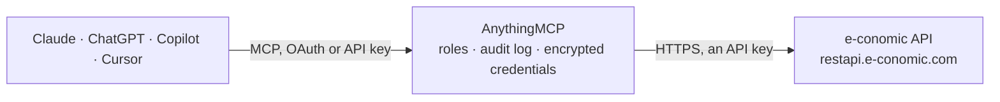

<!-- Generated by scripts/export-github-catalog.mjs in the anythingmcp-website repository. Do not edit by hand. -->

# e-conomic MCP connector

e-conomic — the Danish accounting standard (Visma group): customers, suppliers, booked and draft invoices, products, accounts and journals. The AnythingMCP connector gives Claude, ChatGPT, Microsoft Copilot, Cursor and Gemini 10 MCP tools for e-conomic, all read-only.

**Category:** [Accounting](../accounting.md) · **Tools:** 10 · **Setup guide:** [anythingmcp.com](https://anythingmcp.com/guides/e-conomic-to-mcp) · [Deutsch](https://anythingmcp.com/de/guides/e-conomic-to-mcp) · [Italiano](https://anythingmcp.com/it/guides/e-conomic-to-mcp) · [Español](https://anythingmcp.com/es/guides/e-conomic-to-mcp) · [日本語](https://anythingmcp.com/ja/guides/e-conomic-to-mcp) · [Русский](https://anythingmcp.com/ru/guides/e-conomic-to-mcp) · [中文](https://anythingmcp.com/zh/guides/e-conomic-to-mcp)

## Start without code

No installation and no terminal: AnythingMCP Cloud runs the e-conomic connector for you, operated by helpcode.ai in Frankfurt, Germany.

1. **Click the button above** and create an account or sign in. The e-conomic connector opens, ready to install.
2. **Paste the API key or token from your e-conomic account.** Every click is in the [step-by-step guide](https://anythingmcp.com/guides/e-conomic-to-mcp).
3. **Click Install.** AnythingMCP shows the address of your MCP server.
4. **Add that address to your assistant:** [Claude](https://anythingmcp.com/guides/connect-e-conomic-to-claude) · [ChatGPT](https://anythingmcp.com/guides/connect-e-conomic-to-chatgpt) · [Microsoft Copilot](https://anythingmcp.com/guides/connect-e-conomic-to-copilot) · [Cursor](https://anythingmcp.com/guides/connect-e-conomic-to-cursor) · [Gemini CLI](https://anythingmcp.com/guides/connect-e-conomic-to-gemini) · [Meta Muse](https://anythingmcp.com/guides/connect-e-conomic-to-muse).
5. **Ask your first question**, for example: *What are the invoice layout, payment terms and VAT zone for customer number 2002 (Københavns Kontorcenter)?*

Prefer help with the setup? [Talk to us](https://anythingmcp.com/contact).

## How it works

- **The AI client** speaks MCP (Streamable HTTP) to AnythingMCP and only sees tool names, descriptions and results. It never gets the e-conomic credentials.
- **AnythingMCP** checks the client's role, builds the call from the tool definition, adds the credentials (an API key), calls e-conomic, logs the call and returns the result.
- **e-conomic** sees an ordinary API client with the rights of the account the credentials belong to.

## Tools

| Tool | What it does | Access |
|---|---|---|
| [`e_conomic_get_self`](#e_conomic_get_self) | Read the agreement this connector is bound to: the company name, its CVR number, the application name and the modules enabled. | read |
| [`e_conomic_list_customers`](#e_conomic_list_customers) | List customers with their number, name, CVR number, address, currency and payment terms. | read |
| [`e_conomic_get_customer`](#e_conomic_get_customer) | Read one customer by their customer number, with addresses, VAT zone, payment terms and the layout used for their invoices. | read |
| [`e_conomic_list_booked_invoices`](#e_conomic_list_booked_invoices) | List booked (posted, immutable) invoices with their number, date, due date, customer and totals. | read |
| [`e_conomic_get_booked_invoice`](#e_conomic_get_booked_invoice) | Read one booked invoice in full: every line with product, quantity, unit price and VAT, plus the totals and the remaining amount. | read |
| [`e_conomic_list_overdue_invoices`](#e_conomic_list_overdue_invoices) | List booked invoices that are past their due date and still unpaid — the direct answer to 'who is late', without needing a filter. | read |
| [`e_conomic_list_draft_invoices`](#e_conomic_list_draft_invoices) | List unbooked invoice drafts. | read |
| [`e_conomic_list_suppliers`](#e_conomic_list_suppliers) | List suppliers with their number, name, CVR number, currency and payment terms, for the purchasing side of the ledger. | read |
| [`e_conomic_list_products`](#e_conomic_list_products) | List products with their number, name, sales price, cost price, unit and the product group they belong to. | read |
| [`e_conomic_list_accounts`](#e_conomic_list_accounts) | List the chart of accounts with each account's number, name, type, VAT account and current balance. | read |

## Tool reference

Every parameter as the AI client sees it in `tools/list`. Source: [`packages/backend/src/adapters/dk/e-conomic.json`](../../../packages/backend/src/adapters/dk/e-conomic.json).

### `e_conomic_get_self`

Read the agreement this connector is bound to: the company name, its CVR number, the application name and the modules enabled. The fastest way to check both tokens at once.

**Access:** read · **Call:** `GET /self`

No parameters.

### `e_conomic_list_customers`

List customers with their number, name, CVR number, address, currency and payment terms.

**Access:** read · **Call:** `GET /customers`

| Parameter | Type | Required | Description |
|---|---|---|---|
| `filter` | string | no | e-conomic filter, e.g. name$like:Muster or customerNumber$gte:1000. |
| `pagesize` | number | no | Rows per page, max 1000. |
| `skippages` | number | no | Pages to skip, for paging. |
| `sort` | string | no | Sort field, prefix with `-` for descending. |

### `e_conomic_get_customer`

Read one customer by their customer number, with addresses, VAT zone, payment terms and the layout used for their invoices.

**Access:** read · **Call:** `GET /customers/{customerNumber}`

| Parameter | Type | Required | Description |
|---|---|---|---|
| `customerNumber` | number | yes | e-conomic customer number. |

### `e_conomic_list_booked_invoices`

List booked (posted, immutable) invoices with their number, date, due date, customer and totals. This is what 'invoiced revenue' means.

**Access:** read · **Call:** `GET /invoices/booked`

| Parameter | Type | Required | Description |
|---|---|---|---|
| `filter` | string | no | e-conomic filter, e.g. date$gte:2026-01-01$and:date$lte:2026-03-31. |
| `pagesize` | number | no | Rows per page, max 1000. |
| `skippages` | number | no | Pages to skip, for paging. |
| `sort` | string | no | Sort field, prefix with `-` for descending, e.g. -date, bookedInvoiceNumber or customer.customerNumber. dueDate is not sortable (e-conomic answers 400). |

### `e_conomic_get_booked_invoice`

Read one booked invoice in full: every line with product, quantity, unit price and VAT, plus the totals and the remaining amount.

**Access:** read · **Call:** `GET /invoices/booked/{bookedInvoiceNumber}`

| Parameter | Type | Required | Description |
|---|---|---|---|
| `bookedInvoiceNumber` | number | yes | Booked invoice number. |

### `e_conomic_list_overdue_invoices`

List booked invoices that are past their due date and still unpaid — the direct answer to 'who is late', without needing a filter.

**Access:** read · **Call:** `GET /invoices/overdue`

| Parameter | Type | Required | Description |
|---|---|---|---|
| `pagesize` | number | no | Rows per page, max 1000. |
| `skippages` | number | no | Pages to skip, for paging. |
| `sort` | string | no | Sort field, prefix with `-` for descending, e.g. date, -date, bookedInvoiceNumber or customer.customerNumber. dueDate is not sortable (e-conomic answers 400). |

### `e_conomic_list_draft_invoices`

List unbooked invoice drafts. A draft is not revenue — keep it out of any figure reporting what was actually invoiced.

**Access:** read · **Call:** `GET /invoices/drafts`

| Parameter | Type | Required | Description |
|---|---|---|---|
| `filter` | string | no | e-conomic filter expression. |
| `pagesize` | number | no | Rows per page, max 1000. |
| `skippages` | number | no | Pages to skip, for paging. |

### `e_conomic_list_suppliers`

List suppliers with their number, name, CVR number, currency and payment terms, for the purchasing side of the ledger.

**Access:** read · **Call:** `GET /suppliers`

| Parameter | Type | Required | Description |
|---|---|---|---|
| `filter` | string | no | e-conomic filter expression. |
| `pagesize` | number | no | Rows per page, max 1000. |
| `skippages` | number | no | Pages to skip, for paging. |

### `e_conomic_list_products`

List products with their number, name, sales price, cost price, unit and the product group they belong to.

**Access:** read · **Call:** `GET /products`

| Parameter | Type | Required | Description |
|---|---|---|---|
| `filter` | string | no | e-conomic filter expression, e.g. name$like:Widget. |
| `pagesize` | number | no | Rows per page, max 1000. |
| `skippages` | number | no | Pages to skip, for paging. |

### `e_conomic_list_accounts`

List the chart of accounts with each account's number, name, type, VAT account and current balance.

**Access:** read · **Call:** `GET /accounts`

| Parameter | Type | Required | Description |
|---|---|---|---|
| `filter` | string | no | e-conomic filter expression. |
| `pagesize` | number | no | Rows per page, max 1000. |
| `skippages` | number | no | Pages to skip, for paging. |

## Run it yourself

AnythingMCP is open source (AGPL-3.0). [Run it with Docker](../../../README.md#run-it-yourself), open **Connectors → Store**, pick **e-conomic** and enter `ECONOMIC_APP_SECRET_TOKEN`, `ECONOMIC_AGREEMENT_GRANT_TOKEN`, then add your MCP server URL to the AI client.

[← Accounting connectors](../accounting.md) · [All categories](../README.md)
