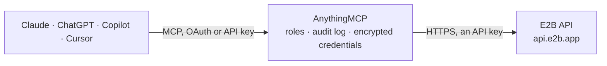

<!-- Generated by scripts/export-github-catalog.mjs in the anythingmcp-website repository. Do not edit by hand. -->

# E2B MCP connector

Manage E2B cloud sandboxes for AI agents: list, start, inspect, pause, resume and extend sandboxes, read their logs and CPU, memory and disk metrics, and browse the team's templates, builds and snapshots. The AnythingMCP connector gives Claude, ChatGPT, Microsoft Copilot, Cursor and Gemini 13 MCP tools for E2B: 8 read and 5 can change data.

**Category:** [Infrastructure](../infrastructure.md) · **Tools:** 13 · **Setup guide:** [anythingmcp.com](https://anythingmcp.com/guides/e2b-to-mcp) · [Deutsch](https://anythingmcp.com/de/guides/e2b-to-mcp) · [Italiano](https://anythingmcp.com/it/guides/e2b-to-mcp) · [Español](https://anythingmcp.com/es/guides/e2b-to-mcp) · [日本語](https://anythingmcp.com/ja/guides/e2b-to-mcp) · [Русский](https://anythingmcp.com/ru/guides/e2b-to-mcp) · [中文](https://anythingmcp.com/zh/guides/e2b-to-mcp)

## Start without code

No installation and no terminal: AnythingMCP Cloud runs the E2B connector for you, operated by helpcode.ai in Frankfurt, Germany.

1. **Click the button above** and create an account or sign in. The E2B connector opens, ready to install.
2. **Paste the API key or token from your E2B account.** Every click is in the [step-by-step guide](https://anythingmcp.com/guides/e2b-to-mcp).
3. **Click Install.** AnythingMCP shows the address of your MCP server.
4. **Add that address to your assistant:** [Claude](https://anythingmcp.com/guides/connect-e2b-to-claude) · [ChatGPT](https://anythingmcp.com/guides/connect-e2b-to-chatgpt) · [Microsoft Copilot](https://anythingmcp.com/guides/connect-e2b-to-copilot) · [Cursor](https://anythingmcp.com/guides/connect-e2b-to-cursor) · [Gemini CLI](https://anythingmcp.com/guides/connect-e2b-to-gemini) · [Meta Muse](https://anythingmcp.com/guides/connect-e2b-to-muse).
5. **Ask your first question**, for example: *Find the sandbox started for invoice INV-2026-119 tagged metadata user=marja&project=payroll*

Prefer help with the setup? [Talk to us](https://anythingmcp.com/contact).

## How it works

- **The AI client** speaks MCP (Streamable HTTP) to AnythingMCP and only sees tool names, descriptions and results. It never gets the E2B credentials.
- **AnythingMCP** checks the client's role, builds the call from the tool definition, adds the credentials (an API key), calls E2B, logs the call and returns the result.
- **E2B** sees an ordinary API client with the rights of the account the credentials belong to.

## Tools

| Tool | What it does | Access |
|---|---|---|
| [`e2b_list_sandboxes`](#e2b_list_sandboxes) | List the E2B sandboxes of the team, newest first: sandbox id, template, alias, state (running or paused), start and end time, CPU, memory, disk and metadata. | read |
| [`e2b_get_sandbox`](#e2b_get_sandbox) | Read one E2B sandbox: template and alias, state, start and end time, CPU, memory and disk, envd version, domain, internet access, network rules, lifecycle… | read |
| [`e2b_create_sandbox`](#e2b_create_sandbox) | Start a new E2B sandbox from a template. | write |
| [`e2b_set_sandbox_timeout`](#e2b_set_sandbox_timeout) | Set when an E2B sandbox ends: timeout seconds counted from now, replacing the previous end time (a shorter value ends it sooner). | write |
| [`e2b_pause_sandbox`](#e2b_pause_sandbox) | Pause a running E2B sandbox, saving its files and, by default, its memory, so it can be resumed later with e2b_resume_sandbox. | write |
| [`e2b_resume_sandbox`](#e2b_resume_sandbox) | Resume a paused E2B sandbox (or extend a running one) and return its details. | write |
| [`e2b_kill_sandbox`](#e2b_kill_sandbox) | Kill an E2B sandbox immediately. | write |
| [`e2b_get_sandbox_logs`](#e2b_get_sandbox_logs) | Read the logs of one E2B sandbox (system and process output) with timestamp, level and message; filter by minimum level or a search string. | read |
| [`e2b_get_sandbox_metrics`](#e2b_get_sandbox_metrics) | Read the resource use of one E2B sandbox over time: CPU count and usage percent, memory and disk used and total, per timestamp. | read |
| [`e2b_list_templates`](#e2b_list_templates) | List the team's E2B templates: template id, aliases and names, build id and status, CPU, memory and disk, public flag, spawn count, last spawn and dates. | read |
| [`e2b_list_template_builds`](#e2b_list_template_builds) | List the builds of one E2B template with build id, status, CPU, memory, disk, envd version and dates. | read |
| [`e2b_list_default_templates`](#e2b_list_default_templates) | List E2B's ready-made default templates (such as base, code-interpreter-v1 and desktop) with their aliases, CPU, memory, disk and envd version. | read |
| [`e2b_list_snapshots`](#e2b_list_snapshots) | List the team's E2B sandbox snapshots with id, name, the sandbox they came from and dates; filter by sandbox or name. | read |

## Tool reference

Every parameter as the AI client sees it in `tools/list`. Source: [`packages/backend/src/adapters/intl/e2b.json`](../../../packages/backend/src/adapters/intl/e2b.json).

### `e2b_list_sandboxes`

List the E2B sandboxes of the team, newest first: sandbox id, template, alias, state (running or paused), start and end time, CPU, memory, disk and metadata. Free. Next page token in _headers.x-next-token.

**Access:** read · **Call:** `GET /v2/sandboxes`

| Parameter | Type | Required | Description |
|---|---|---|---|
| `state` | `running` \| `paused` \| `running,paused` | no | Only sandboxes in this state; default both. |
| `template` | string | no | Only sandboxes of this template id or alias. |
| `metadata` | string | no | Metadata filter as key=value pairs joined by &, e.g. user=abc&app=prod. |
| `started_after` | string | no | Only sandboxes started at or after this ISO 8601 time. |
| `order` | `desc` \| `asc` | no | Sort by start time, default desc (newest first). |
| `limit` | integer | no | Sandboxes per page, default 50. |
| `next_token` | string | no | _headers.x-next-token of the previous page. |

### `e2b_get_sandbox`

Read one E2B sandbox: template and alias, state, start and end time, CPU, memory and disk, envd version, domain, internet access, network rules, lifecycle settings and metadata. Free.

**Access:** read · **Call:** `GET /sandboxes/{sandbox_id}`

| Parameter | Type | Required | Description |
|---|---|---|---|
| `sandbox_id` | string | yes | Sandbox id from e2b_list_sandboxes or e2b_create_sandbox. |

### `e2b_create_sandbox`

Start a new E2B sandbox from a template. COSTS MONEY: the team is billed per second of CPU and memory while it runs, until the timeout (default 300 seconds), a pause or a kill. Confirm with the user before starting one and keep the timeout short.

**Access:** write · **Call:** `POST /v2/sandboxes`

| Parameter | Type | Required | Description |
|---|---|---|---|
| `template_id` | string | no | Template id or alias, default base; e.g. code-interpreter-v1 or a team template from e2b_list_templates. |
| `timeout` | integer | no | Lifetime in seconds, default 300. Hobby allows up to 3600, Pro up to 86400. |
| `auto_pause` | boolean | no | true pauses the sandbox at the timeout instead of killing it. |
| `allow_internet_access` | boolean | no | false blocks all outgoing internet traffic. Default true. |
| `metadata` | object | no | String key-value pairs to find the sandbox again, e.g. {"user": "abc"}. |
| `env_vars` | object | no | Environment variables for processes in the sandbox, as string key-value pairs. Do not pass secrets the user has not approved. |

### `e2b_set_sandbox_timeout`

Set when an E2B sandbox ends: timeout seconds counted from now, replacing the previous end time (a shorter value ends it sooner). Extending it keeps the sandbox billed for longer: confirm with the user.

**Access:** write · **Call:** `POST /sandboxes/{sandbox_id}/timeout`

| Parameter | Type | Required | Description |
|---|---|---|---|
| `sandbox_id` | string | yes | Sandbox id. |
| `timeout` | integer | yes | Seconds from now until the sandbox ends. |

### `e2b_pause_sandbox`

Pause a running E2B sandbox, saving its files and, by default, its memory, so it can be resumed later with e2b_resume_sandbox. A paused sandbox is not billed for compute.

**Access:** write · **Call:** `POST /sandboxes/{sandbox_id}/pause`

| Parameter | Type | Required | Description |
|---|---|---|---|
| `sandbox_id` | string | yes | Sandbox id of a running sandbox. |
| `memory` | boolean | no | false saves only the file system; resuming then reboots the sandbox. Default true. |

### `e2b_resume_sandbox`

Resume a paused E2B sandbox (or extend a running one) and return its details. COSTS MONEY: the resumed sandbox is billed per second again until the timeout. Confirm with the user before resuming.

**Access:** write · **Call:** `POST /v2/sandboxes/{sandbox_id}/connect`

| Parameter | Type | Required | Description |
|---|---|---|---|
| `sandbox_id` | string | yes | Sandbox id. |
| `timeout` | integer | no | Seconds from now until it ends again, default 300. A running sandbox's end time is only extended, never shortened. |
| `memory` | boolean | no | false resumes from the saved files only (cold boot). Default true. |

### `e2b_kill_sandbox`

Kill an E2B sandbox immediately. Its processes, memory and files are gone and cannot be restored. Installed switched off. Confirm the sandbox id with the user before calling.

**Access:** write · **Call:** `DELETE /sandboxes/{sandbox_id}`

| Parameter | Type | Required | Description |
|---|---|---|---|
| `sandbox_id` | string | yes | Sandbox id to kill. |

### `e2b_get_sandbox_logs`

Read the logs of one E2B sandbox (system and process output) with timestamp, level and message; filter by minimum level or a search string. Free.

**Access:** read · **Call:** `GET /v2/sandboxes/{sandbox_id}/logs`

| Parameter | Type | Required | Description |
|---|---|---|---|
| `sandbox_id` | string | yes | Sandbox id. |
| `level` | `debug` \| `info` \| `warn` \| `error` | no | Minimum level to return. |
| `search` | string | no | Case-sensitive text the message must contain. |
| `direction` | `forward` \| `backward` | no | forward (oldest first) or backward (newest first) from the cursor. |
| `cursor` | integer | no | Start at this Unix timestamp in milliseconds. |
| `limit` | integer | no | Log lines to return, default 100. |

### `e2b_get_sandbox_metrics`

Read the resource use of one E2B sandbox over time: CPU count and usage percent, memory and disk used and total, per timestamp. Free.

**Access:** read · **Call:** `GET /sandboxes/{sandbox_id}/metrics`

| Parameter | Type | Required | Description |
|---|---|---|---|
| `sandbox_id` | string | yes | Sandbox id. |
| `start` | integer | no | Start of the interval, Unix seconds. |
| `end` | integer | no | End of the interval, Unix seconds. |

### `e2b_list_templates`

List the team's E2B templates: template id, aliases and names, build id and status, CPU, memory and disk, public flag, spawn count, last spawn and dates. Free. Next page token in _headers.x-next-token.

**Access:** read · **Call:** `GET /v2/templates`

| Parameter | Type | Required | Description |
|---|---|---|---|
| `limit` | integer | no | Templates per page, default 50. |
| `next_token` | string | no | _headers.x-next-token of the previous page. |

### `e2b_list_template_builds`

List the builds of one E2B template with build id, status, CPU, memory, disk, envd version and dates. Free. Next page token in _headers.x-next-token.

**Access:** read · **Call:** `GET /templates/{template_id}`

| Parameter | Type | Required | Description |
|---|---|---|---|
| `template_id` | string | yes | Template id from e2b_list_templates. |
| `limit` | integer | no | Builds per page, default 50. |
| `next_token` | string | no | _headers.x-next-token of the previous page. |

### `e2b_list_default_templates`

List E2B's ready-made default templates (such as base, code-interpreter-v1 and desktop) with their aliases, CPU, memory, disk and envd version. Free.

**Access:** read · **Call:** `GET /default-templates`

No parameters.

### `e2b_list_snapshots`

List the team's E2B sandbox snapshots with id, name, the sandbox they came from and dates; filter by sandbox or name. Free. Next page token in _headers.x-next-token.

**Access:** read · **Call:** `GET /snapshots`

| Parameter | Type | Required | Description |
|---|---|---|---|
| `sandbox_id` | string | no | Only snapshots of this sandbox. |
| `name` | string | no | Snapshot name or id, optionally tag-qualified (my-team/my-snapshot). |
| `limit` | integer | no | Snapshots per page, default 50. |
| `next_token` | string | no | _headers.x-next-token of the previous page. |

## Run it yourself

AnythingMCP is open source (AGPL-3.0). [Run it with Docker](../../../README.md#run-it-yourself), open **Connectors → Store**, pick **E2B** and enter `E2B_API_KEY`, then add your MCP server URL to the AI client.

[← Infrastructure connectors](../infrastructure.md) · [All categories](../README.md)
