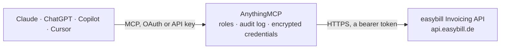

<!-- Generated by scripts/export-github-catalog.mjs in the anythingmcp-website repository. Do not edit by hand. -->

# easybill Invoicing MCP connector

Manage customers, invoices, offers, credit notes and products in easybill. The AnythingMCP connector gives Claude, ChatGPT, Microsoft Copilot, Cursor and Gemini 15 MCP tools for easybill Invoicing: 8 read and 7 can change data.

**Category:** [Finance](../finance.md) · **Tools:** 15 · **Setup guide:** [anythingmcp.com](https://anythingmcp.com/guides/easybill-to-mcp) · [Deutsch](https://anythingmcp.com/de/guides/easybill-to-mcp) · [Italiano](https://anythingmcp.com/it/guides/easybill-to-mcp) · [Español](https://anythingmcp.com/es/guides/easybill-to-mcp) · [日本語](https://anythingmcp.com/ja/guides/easybill-to-mcp) · [Русский](https://anythingmcp.com/ru/guides/easybill-to-mcp) · [中文](https://anythingmcp.com/zh/guides/easybill-to-mcp)

## Start without code

No installation and no terminal: AnythingMCP Cloud runs the easybill Invoicing connector for you, operated by helpcode.ai in Frankfurt, Germany.

1. **Click the button above** and create an account or sign in. The easybill Invoicing connector opens, ready to install.
2. **Paste the API key or token from your easybill Invoicing account.** Every click is in the [step-by-step guide](https://anythingmcp.com/guides/easybill-to-mcp).
3. **Click Install.** AnythingMCP shows the address of your MCP server.
4. **Add that address to your assistant:** [Claude](https://anythingmcp.com/guides/connect-easybill-to-claude) · [ChatGPT](https://anythingmcp.com/guides/connect-easybill-to-chatgpt) · [Microsoft Copilot](https://anythingmcp.com/guides/connect-easybill-to-copilot) · [Cursor](https://anythingmcp.com/guides/connect-easybill-to-cursor) · [Gemini CLI](https://anythingmcp.com/guides/connect-easybill-to-gemini) · [Meta Muse](https://anythingmcp.com/guides/connect-easybill-to-muse).
5. **Ask your first question**, for example: *Show me the customer record for customer number C-1042*

Prefer help with the setup? [Talk to us](https://anythingmcp.com/contact).

## How it works

- **The AI client** speaks MCP (Streamable HTTP) to AnythingMCP and only sees tool names, descriptions and results. It never gets the easybill Invoicing credentials.
- **AnythingMCP** checks the client's role, builds the call from the tool definition, adds the credentials (a bearer token), calls easybill Invoicing, logs the call and returns the result.
- **easybill Invoicing** sees an ordinary API client with the rights of the account the credentials belong to.

## Tools

| Tool | What it does | Access |
|---|---|---|
| [`easybill_list_customers`](#easybill_list_customers) | List customers (clients) from easybill with optional search and pagination. | read |
| [`easybill_get_customer`](#easybill_get_customer) | Get a single easybill customer by its numeric id, returning the full record (addresses, contact details, payment terms, VAT id). | read |
| [`easybill_create_customer`](#easybill_create_customer) | Create a new customer (client) in easybill. | write |
| [`easybill_list_documents`](#easybill_list_documents) | List documents (invoices, credits, offers, reminders, etc.) from easybill. | read |
| [`easybill_get_document`](#easybill_get_document) | Get a single easybill document (invoice/offer/credit) by id with full details including line items, taxes, totals and payment status. | read |
| [`easybill_get_document_pdf`](#easybill_get_document_pdf) | Fetch the rendered PDF of an easybill document by id. | read |
| [`easybill_list_positions`](#easybill_list_positions) | List products/articles (positions) from the easybill catalog with pagination. | read |
| [`easybill_list_payments`](#easybill_list_payments) | List payments recorded on easybill documents: amount in cents, payment date, type, provider, reference, notice and whether it is an overdue fee. | read |
| [`easybill_get_document_payment`](#easybill_get_document_payment) | Get one recorded document payment by its id: document, amount in cents, date, type, provider and reference. | read |
| [`easybill_record_payment`](#easybill_record_payment) | Record a payment received on an easybill document (Zahlungseingang), e.g. a bank transfer that settles an invoice. | write |
| [`easybill_remove_payment`](#easybill_remove_payment) | Delete a recorded document payment, e.g. one booked on the wrong invoice; the document is open again for that amount. | write |
| [`easybill_draft_document`](#easybill_draft_document) | Create a document in easybill as a draft: invoice, offer, order confirmation, delivery note, credit note, pro forma invoice or letter, for a customer, with… | write |
| [`easybill_complete_document`](#easybill_complete_document) | Complete (finalize) a draft document: easybill assigns the document number and the date and the document can no longer be edited. | write |
| [`easybill_send_document`](#easybill_send_document) | Send a completed document to the customer by e-mail (or fax, or as a letter through easybill's postal service, which charges postage). | write |
| [`easybill_create_storno`](#easybill_create_storno) | Cancel a completed invoice or credit note: easybill creates a cancellation document (Stornorechnung) that reverses it, and links the two. | write |

## Tool reference

Every parameter as the AI client sees it in `tools/list`. Source: [`packages/backend/src/adapters/de/easybill.json`](../../../packages/backend/src/adapters/de/easybill.json).

### `easybill_list_customers`

List customers (clients) from easybill with optional search and pagination. Returns id, customer number, name/company, address, emails and VAT id.

**Access:** read · **Call:** `GET /customers`

| Parameter | Type | Required | Description |
|---|---|---|---|
| `page` | number | no | Page number, 1-based (default 1) |
| `limit` | number | no | Results per page (default 100, max 1000) |
| `company_name` | string | no | Filter by company name (comma-separated for several values) |
| `last_name` | string | no | Filter by contact last name |
| `emails` | string | no | Filter by email address |
| `number` | string | no | Filter by easybill customer number |
| `country` | string | no | Filter by ISO country code, e.g. DE |

### `easybill_get_customer`

Get a single easybill customer by its numeric id, returning the full record (addresses, contact details, payment terms, VAT id).

**Access:** read · **Call:** `GET /customers/{id}`

| Parameter | Type | Required | Description |
|---|---|---|---|
| `id` | string | yes | The easybill customer id |

### `easybill_create_customer`

Create a new customer (client) in easybill. Provide at least a company name or a last name plus any address and contact fields.

**Access:** write · **Call:** `POST /customers`

| Parameter | Type | Required | Description |
|---|---|---|---|
| `company_name` | string | no | Company name (use this or last_name) |
| `first_name` | string | no | Contact first name |
| `last_name` | string | no | Contact last name (use this or company_name) |
| `street` | string | no | Street and house number |
| `zip_code` | string | no | Postal code |
| `city` | string | no | City |
| `country` | string | no | ISO country code, e.g. DE |
| `emails` | string | no | Primary email address |
| `vat_identifier` | string | no | VAT identification number (USt-IdNr.) |

### `easybill_list_documents`

List documents (invoices, credits, offers, reminders, etc.) from easybill. Filter by type, customer, date range and payment status. Returns numbers, dates, amounts and status.

**Access:** read · **Call:** `GET /documents`

| Parameter | Type | Required | Description |
|---|---|---|---|
| `page` | number | no | Page number, 1-based (default 1) |
| `limit` | number | no | Results per page (default 100, max 1000) |
| `type` | string | no | Document type filter, comma-separated. One or more of INVOICE, CREDIT, OFFER, REMINDER, DELIVERY |
| `customer_id` | string | no | Filter by customer id (comma-separated for several) |
| `document_date` | string | no | Document date filter: a single YYYY-MM-DD or a 'from,to' range e.g. 2026-01-01,2026-03-31 |
| `paid_at` | string | no | Payment filter: a date/range, or the literal 'null' to return only unpaid documents |

### `easybill_get_document`

Get a single easybill document (invoice/offer/credit) by id with full details including line items, taxes, totals and payment status.

**Access:** read · **Call:** `GET /documents/{id}`

| Parameter | Type | Required | Description |
|---|---|---|---|
| `id` | string | yes | The easybill document id |

### `easybill_get_document_pdf`

Fetch the rendered PDF of an easybill document by id. The PDF is returned base64-encoded in the response 'pdf' field, ready to save or forward.

**Access:** read · **Call:** `GET /documents/{id}/pdf`

| Parameter | Type | Required | Description |
|---|---|---|---|
| `id` | string | yes | The easybill document id |

### `easybill_list_positions`

List products/articles (positions) from the easybill catalog with pagination. Returns article number, description, unit price and VAT percentage.

**Access:** read · **Call:** `GET /positions`

| Parameter | Type | Required | Description |
|---|---|---|---|
| `page` | number | no | Page number, 1-based (default 1) |
| `limit` | number | no | Results per page (default 100, max 1000) |
| `number` | string | no | Filter by article number |

### `easybill_list_payments`

List payments recorded on easybill documents: amount in cents, payment date, type, provider, reference, notice and whether it is an overdue fee. Filter by document to see what was paid on an invoice, or by date to reconcile a period. Paged with page and limit.

**Access:** read · **Call:** `GET /document-payments`

| Parameter | Type | Required | Description |
|---|---|---|---|
| `document_id` | string | no | Only payments of these documents (comma-separated document ids). |
| `payment_at` | string | no | Payment date: a single YYYY-MM-DD or a range "2026-01-01,2026-03-31". |
| `reference` | string | no | Only payments with this reference (comma-separated for several). |
| `page` | number | no | Page number, 1-based (default 1). |
| `limit` | number | no | Results per page (default 100, max 1000). |

### `easybill_get_document_payment`

Get one recorded document payment by its id: document, amount in cents, date, type, provider and reference.

**Access:** read · **Call:** `GET /document-payments/{id}`

| Parameter | Type | Required | Description |
|---|---|---|---|
| `id` | string | yes | The document payment id from easybill_list_payments. |

### `easybill_record_payment`

Record a payment received on an easybill document (Zahlungseingang), e.g. a bank transfer that settles an invoice. Bookkeeping only: easybill stores the payment and updates the paid amount and status of the document; no money is collected or sent. Amounts are in cents. Check the open amount with easybill_get_document first and confirm amount and date with the user, because every call adds another payment.

**Access:** write · **Call:** `POST /document-payments`

| Parameter | Type | Required | Description |
|---|---|---|---|
| `document_id` | integer | yes | The easybill document id the payment belongs to. |
| `amount` | integer | yes | Amount in cents, e.g. 11900 for 119.00 EUR. |
| `payment_at` | string | no | Payment date, YYYY-MM-DD; defaults to today. |
| `type` | string | no | Payment type as shown in easybill, e.g. "Überweisung", "PayPal", "VISA". |
| `provider` | string | no | Payment provider, e.g. "Stripe" or the bank. |
| `reference` | string | no | Reference such as the bank statement purpose or transaction id. |
| `notice` | string | no | Internal note. |
| `is_overdue_fee` | boolean | no | true when the amount is a dunning or overdue fee rather than a payment of the invoice. |
| `paid` | boolean | no | true marks the document as paid even when the amount is less than the open amount (e.g. a small shortfall written off). |

### `easybill_remove_payment`

Delete a recorded document payment, e.g. one booked on the wrong invoice; the document is open again for that amount. Cannot be undone. Name the payment (document, amount, date) and get a yes first. Installed switched off.

**Access:** write · **Call:** `DELETE /document-payments/{id}`

| Parameter | Type | Required | Description |
|---|---|---|---|
| `id` | string | yes | The document payment id from easybill_list_payments. |

### `easybill_draft_document`

Create a document in easybill as a draft: invoice, offer, order confirmation, delivery note, credit note, pro forma invoice or letter, for a customer, with its line items. easybill takes address, payment terms and texts from the customer and the template; the draft gets its number when it is completed with easybill_complete_document. Prices are in cents. Returns the new document with its id. Confirm customer, items, prices and VAT with the user before creating.

**Access:** write · **Call:** `POST /documents`

| Parameter | Type | Required | Description |
|---|---|---|---|
| `type` | `INVOICE` \| `OFFER` \| `ORDER` \| `DELIVERY` \| `CREDIT` \| `PROFORMA_INVOICE` \| `CHARGE` \| `LETTER` | no | Document type; cannot be changed later. INVOICE by default. |
| `customer_id` | integer | no | easybill customer id (easybill_list_customers). Fills the address and terms. |
| `items` | object[] | no | Line items: [{"number": "ART-1", "description": "Webentwicklung", "quantity": 2, "unit": "Stunde", "single_price_net": 7500, "vat_percent": 19}]. Prices in cents (7500 = 75.00 EUR). position_id copies an article from easybill_list_positions; type TEXT adds a text line. |
| `title` | string | no | Document title, e.g. "Invoice for order 1042". |
| `document_date` | string | no | Document date, YYYY-MM-DD; defaults to today. |
| `due_in_days` | integer | no | Payment term in days; defaults to the customer setting. |
| `order_number` | string | no | The customer's order number. |
| `buyer_reference` | string | no | Buyer reference (Leitweg-ID for XRechnung to public authorities). |
| `currency` | string | no | ISO currency, default EUR. |
| `text_prefix` | string | no | Intro text above the items; defaults to the template text. |
| `text` | string | no | Closing text below the items; defaults to the template text. |
| `service_date` | object | no | Service date for INVOICE and CREDIT: {"type": "DEFAULT"} (invoice date is the date of supply), or type SERVICE or DELIVERY with exactly one of: date, date_from + date_to, or text, e.g. {"type": "SERVICE", "date_from": "2026-10-01", "date_to": "2026-10-31"}. |
| `ref_id` | integer | no | Id of a document this one refers to, e.g. the offer an invoice is based on. |
| `fields` | object | no | Further document fields by their easybill names, e.g. {"vat_option": "revc", "contact_id": 12, "pdf_template": "EN", "project_id": 7}. |

### `easybill_complete_document`

Complete (finalize) a draft document: easybill assigns the document number and the date and the document can no longer be edited. Needed before an invoice is sent. Not allowed for RECURRING documents. Returns the completed document. Show the user the draft (easybill_get_document) and confirm first: a completed invoice can only be corrected with a cancellation (easybill_create_storno).

**Access:** write · **Call:** `PUT /documents/{id}/done`

| Parameter | Type | Required | Description |
|---|---|---|---|
| `id` | string | yes | The easybill document id (numeric), not the document number. easybill_list_documents finds it. |
| `reason_for_change` | string | no | Reason stored on the document version. |

### `easybill_send_document`

Send a completed document to the customer by e-mail (or fax, or as a letter through easybill's postal service, which charges postage). For e-mail, to, subject and message default to the customer and the template; the PDF or e-invoice is attached. Returns nothing on success (HTTP 204). Confirm recipient and channel with the user first: the customer receives it at once.

**Access:** write · **Call:** `POST /documents/{id}/send/{type}`

| Parameter | Type | Required | Description |
|---|---|---|---|
| `id` | string | yes | The easybill document id (numeric), not the document number. easybill_list_documents finds it. |
| `type` | `email` \| `fax` \| `post` | yes | Channel: email, fax, or post (a paper letter sent by easybill, which costs postage). |
| `to` | string | no | Recipient(s); several e-mail addresses separated by comma or semicolon. Defaults to the customer. |
| `cc` | string | no | Copy recipient(s) for e-mail. |
| `from` | string | no | Sender address, if different from the account default. |
| `subject` | string | no | E-mail subject; defaults to the template. |
| `message` | string | no | E-mail text; defaults to the template. |
| `send_with_attachment` | boolean | no | false sends a link instead of attaching the document. |
| `document_file_type` | `default` \| `auto` \| `zugferd1` \| `zugferd2_2` \| `zugferd2_4_en16931` \| `zugferd2_4_extended` \| `zugferd2_5_en16931` \| `zugferd2_5_extended` \| `xrechnung` \| `xrechnung_xml` \| `xrechnung2_2_xml` \| `xrechnung3_0_xml` | no | File format of the attachment; auto (or leave out) uses the customer setting, e.g. XRechnung for public authorities. |
| `post_send_type` | `post_send_type_standard` \| `post_send_type_registered` \| `post_send_type_registered_and_personal` \| `post_send_type_registered_and_receipt` \| `post_send_type_registered_throwin` | no | Letter type for type=post. |

### `easybill_create_storno`

Cancel a completed invoice or credit note: easybill creates a cancellation document (Stornorechnung) that reverses it, and links the two. The original stays in the books, as the law requires. Returns the cancellation document. Name the document (number, customer, amount) and get a yes first; the cancellation is final. Installed switched off.

**Access:** write · **Call:** `POST /documents/{id}/cancel`

| Parameter | Type | Required | Description |
|---|---|---|---|
| `id` | string | yes | The easybill document id (numeric), not the document number. easybill_list_documents finds it. |
| `use_text_from_template` | boolean | no | true uses the standard texts of the cancellation template. |

## Run it yourself

AnythingMCP is open source (AGPL-3.0). [Run it with Docker](../../../README.md#run-it-yourself), open **Connectors → Store**, pick **easybill Invoicing** and enter `EASYBILL_API_KEY`, then add your MCP server URL to the AI client.

[← Finance connectors](../finance.md) · [All categories](../README.md)
