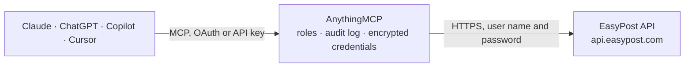

<!-- Generated by scripts/export-github-catalog.mjs in the anythingmcp-website repository. Do not edit by hand. -->

# EasyPost MCP connector

Let your AI ship with EasyPost: verify addresses, compare live rates from your carriers, buy, convert, insure and refund labels, track parcels, prepare customs declarations and create scan forms. The AnythingMCP connector gives Claude, ChatGPT, Microsoft Copilot, Cursor and Gemini 30 MCP tools for EasyPost: 18 read and 12 can change data.

**Category:** [Logistics](../logistics.md) · **Tools:** 30 · **Setup guide:** [anythingmcp.com](https://anythingmcp.com/guides/easypost-to-mcp) · [Deutsch](https://anythingmcp.com/de/guides/easypost-to-mcp) · [Italiano](https://anythingmcp.com/it/guides/easypost-to-mcp) · [Español](https://anythingmcp.com/es/guides/easypost-to-mcp) · [日本語](https://anythingmcp.com/ja/guides/easypost-to-mcp) · [Русский](https://anythingmcp.com/ru/guides/easypost-to-mcp) · [中文](https://anythingmcp.com/zh/guides/easypost-to-mcp)

## Start without code

No installation and no terminal: AnythingMCP Cloud runs the EasyPost connector for you, operated by helpcode.ai in Frankfurt, Germany.

1. **Click the button above** and create an account or sign in. The EasyPost connector opens, ready to install.
2. **Paste the API key or token from your EasyPost account.** Every click is in the [step-by-step guide](https://anythingmcp.com/guides/easypost-to-mcp).
3. **Click Install.** AnythingMCP shows the address of your MCP server.
4. **Add that address to your assistant:** [Claude](https://anythingmcp.com/guides/connect-easypost-to-claude) · [ChatGPT](https://anythingmcp.com/guides/connect-easypost-to-chatgpt) · [Microsoft Copilot](https://anythingmcp.com/guides/connect-easypost-to-copilot) · [Cursor](https://anythingmcp.com/guides/connect-easypost-to-cursor) · [Gemini CLI](https://anythingmcp.com/guides/connect-easypost-to-gemini) · [Meta Muse](https://anythingmcp.com/guides/connect-easypost-to-muse).
5. **Ask your first question**, for example: *What's the current status and estimated delivery date for tracking code EZ1000000001 for order FP-2026-089?*

Prefer help with the setup? [Talk to us](https://anythingmcp.com/contact).

## How it works

- **The AI client** speaks MCP (Streamable HTTP) to AnythingMCP and only sees tool names, descriptions and results. It never gets the EasyPost credentials.
- **AnythingMCP** checks the client's role, builds the call from the tool definition, adds the credentials (user name and password), calls EasyPost, logs the call and returns the result.
- **EasyPost** sees an ordinary API client with the rights of the account the credentials belong to.

## Tools

| Tool | What it does | Access |
|---|---|---|
| [`easypost_create_address`](#easypost_create_address) | Save an address. | write |
| [`easypost_create_and_verify_address`](#easypost_create_and_verify_address) | Save an address only if it passes verification, and return it corrected (for example with ZIP+4). | write |
| [`easypost_verify_address`](#easypost_verify_address) | Verify a saved address. | read |
| [`easypost_get_address`](#easypost_get_address) | Read a saved address by id, with its fields, mode (test or production) and any verification results. | read |
| [`easypost_list_addresses`](#easypost_list_addresses) | List saved addresses, newest first. | read |
| [`easypost_create_parcel`](#easypost_create_parcel) | Save a parcel: weight in ounces (always required) and length, width and height in inches (all three or none), or a carrier's predefined_package such as… | write |
| [`easypost_get_parcel`](#easypost_get_parcel) | Read a saved parcel by id: dimensions in inches, weight in ounces and predefined package. | read |
| [`easypost_create_shipment`](#easypost_create_shipment) | Create a shipment and get live rates from the account's carriers. | write |
| [`easypost_get_shipment`](#easypost_get_shipment) | Read a shipment by id: addresses, parcel, rates, selected_rate, postage_label (label_url once bought), tracking_code, tracker, refund_status and fees. | read |
| [`easypost_list_shipments`](#easypost_list_shipments) | List shipments, newest first, by default only bought ones from the last month. | read |
| [`easypost_buy_shipment`](#easypost_buy_shipment) | Buy the label for a rate of a shipment. | write |
| [`easypost_refund_shipment`](#easypost_refund_shipment) | Ask for a refund of an unused label. | write |
| [`easypost_rerate_shipment`](#easypost_rerate_shipment) | Get fresh rates for an unbought shipment, for example after a day has passed or carrier accounts changed. | write |
| [`easypost_get_smartrates`](#easypost_get_smartrates) | Get delivery time estimates for the rates of a US domestic shipment: for each rate the days it takes at different percentiles (time_in_transit.percentile_50… | read |
| [`easypost_convert_label`](#easypost_convert_label) | Get the label of a bought shipment in another format. | read |
| [`easypost_insure_shipment`](#easypost_insure_shipment) | Insure a bought shipment that was not insured when bought. | write |
| [`easypost_create_tracker`](#easypost_create_tracker) | Start tracking a parcel by its tracking code, also for labels bought elsewhere. | write |
| [`easypost_get_tracker`](#easypost_get_tracker) | Read a tracker by id: current status and status_detail, est_delivery_date, signed_by, weight, carrier_detail and the full tracking_details history. | read |
| [`easypost_list_trackers`](#easypost_list_trackers) | List trackers, newest first, from the last month unless start_datetime says otherwise. | read |
| [`easypost_list_carrier_accounts`](#easypost_list_carrier_accounts) | List the carrier accounts connected to EasyPost (id ca_..., type such as UspsAccount or UpsAccount, description, readable name). | read |
| [`easypost_get_carrier_account`](#easypost_get_carrier_account) | Read one carrier account by id: type, description, reference and its settings (credentials are not shown). | read |
| [`easypost_create_customs_item`](#easypost_create_customs_item) | Save one line of a customs declaration: description, quantity, total value in USD, total weight in ounces, HS tariff number and origin country. | write |
| [`easypost_get_customs_item`](#easypost_get_customs_item) | Read a saved customs item by id: description, quantity, value, weight, tariff number and origin country. | read |
| [`easypost_create_customs_info`](#easypost_create_customs_info) | Save a customs declaration for an international shipment and pass its id as customs_info to easypost_create_shipment. | write |
| [`easypost_get_customs_info`](#easypost_get_customs_info) | Read a saved customs declaration by id, with its items, contents type, signer and options. | read |
| [`easypost_list_batches`](#easypost_list_batches) | List batches (groups of shipments bought and printed together), newest first, with state (creating, created, purchasing, purchased, label_generating,… | read |
| [`easypost_get_batch`](#easypost_get_batch) | Read a batch by id: state, shipments with their batch_status and messages, label_url once labels are generated, and scan_form. | read |
| [`easypost_create_scan_form`](#easypost_create_scan_form) | Create a scan form (manifest) for bought shipments, so the carrier scans one sheet instead of every parcel at pickup. | write |
| [`easypost_list_scan_forms`](#easypost_list_scan_forms) | List scan forms, newest first, with status, tracking_codes, form_url and the address. | read |
| [`easypost_get_scan_form`](#easypost_get_scan_form) | Read a scan form by id: status, the tracking codes on it, form_url (PDF) and batch_id. | read |

## Tool reference

Every parameter as the AI client sees it in `tools/list`. Source: [`packages/backend/src/adapters/intl/easypost.json`](../../../packages/backend/src/adapters/intl/easypost.json).

### `easypost_create_address`

Save an address. Addresses cannot be changed once created. With verify true, EasyPost also checks it and the answer has verifications.delivery.success with errors and suggestions; a failed check still saves the address. Leave verify out entirely to skip the check (EasyPost verifies even when it is sent as false).

**Access:** write · **Call:** `POST /addresses`

| Parameter | Type | Required | Description |
|---|---|---|---|
| `name` | string | no | Full name of the person. |
| `company` | string | no | Company name. |
| `street1` | string | yes | Street and house number. |
| `street2` | string | no | Second address line (apartment, suite, floor). |
| `city` | string | no | City. |
| `state` | string | no | State or province code, e.g. CA (required for US and Canadian addresses). |
| `zip` | string | no | Postal code. |
| `country` | string | yes | ISO 3166 two-letter country code, e.g. US or DE (default US). |
| `phone` | string | no | Phone number (many carriers require it). |
| `email` | string | no | Email address. |
| `residential` | boolean | no | true for a private home, false for a business. |
| `federal_tax_id` | string | no | Federal tax id (EIN, VAT or EORI number) for customs. |
| `state_tax_id` | string | no | State tax id. |
| `verify` | boolean | no | true to verify deliverability (US) or the address format (other countries). Leave out to skip. |
| `verify_strict` | boolean | no | true to refuse the address with ADDRESS.VERIFY.FAILURE when the check fails. Leave out to skip. |
| `verify_carrier` | `ups` \| `fedex` | no | Verify with this carrier instead of EasyPost's default; needs verify or verify_strict true. |

### `easypost_create_and_verify_address`

Save an address only if it passes verification, and return it corrected (for example with ZIP+4). An address that cannot be verified fails with ADDRESS.VERIFY.FAILURE, naming the problem; nothing is saved then.

**Access:** write · **Call:** `POST /addresses/create_and_verify`

| Parameter | Type | Required | Description |
|---|---|---|---|
| `name` | string | no | Full name of the person. |
| `company` | string | no | Company name. |
| `street1` | string | yes | Street and house number. |
| `street2` | string | no | Second address line (apartment, suite, floor). |
| `city` | string | no | City. |
| `state` | string | no | State or province code, e.g. CA (required for US and Canadian addresses). |
| `zip` | string | no | Postal code. |
| `country` | string | yes | ISO 3166 two-letter country code, e.g. US or DE (default US). |
| `phone` | string | no | Phone number (many carriers require it). |
| `email` | string | no | Email address. |
| `residential` | boolean | no | true for a private home, false for a business. |
| `federal_tax_id` | string | no | Federal tax id (EIN, VAT or EORI number) for customs. |
| `state_tax_id` | string | no | State tax id. |

### `easypost_verify_address`

Verify a saved address. The answer wraps the checked address in "address" with verifications (delivery.success, errors with suggestions, and latitude, longitude and time zone in details). The checked address may come back with its own id: ship to the id in this answer.

**Access:** read · **Call:** `GET /addresses/{address_id}/verify`

| Parameter | Type | Required | Description |
|---|---|---|---|
| `address_id` | string | yes | The address id, e.g. adr_... |

### `easypost_get_address`

Read a saved address by id, with its fields, mode (test or production) and any verification results.

**Access:** read · **Call:** `GET /addresses/{address_id}`

| Parameter | Type | Required | Description |
|---|---|---|---|
| `address_id` | string | yes | The address id, e.g. adr_... |

### `easypost_list_addresses`

List saved addresses, newest first. The answer has addresses[] and has_more; for the next page pass the last id as before_id. An account that never saved one may answer without addresses.

**Access:** read · **Call:** `GET /addresses`

| Parameter | Type | Required | Description |
|---|---|---|---|
| `page_size` | integer | no | Results per page, 1 to 100 (default 20). |
| `before_id` | string | no | Id of the last item of the previous page, to get the next (older) page. |
| `after_id` | string | no | Id of an item, to get the items newer than it. Do not combine with before_id. |

### `easypost_create_parcel`

Save a parcel: weight in ounces (always required) and length, width and height in inches (all three or none), or a carrier's predefined_package such as FlatRateEnvelope. 1 kg is 35.27 oz, 1 cm is 0.394 in.

**Access:** write · **Call:** `POST /parcels`

| Parameter | Type | Required | Description |
|---|---|---|---|
| `length` | number | no | Length in inches, one decimal. |
| `width` | number | no | Width in inches, one decimal. |
| `height` | number | no | Height in inches, one decimal. |
| `weight` | number | yes | Weight in ounces, one decimal. |
| `predefined_package` | string | no | A carrier package name instead of dimensions, e.g. FlatRateEnvelope or SmallFlatRateBox (USPS). |

### `easypost_get_parcel`

Read a saved parcel by id: dimensions in inches, weight in ounces and predefined package.

**Access:** read · **Call:** `GET /parcels/{parcel_id}`

| Parameter | Type | Required | Description |
|---|---|---|---|
| `parcel_id` | string | yes | The parcel id, e.g. prcl_... |

### `easypost_create_shipment`

Create a shipment and get live rates from the account's carriers. Nothing is bought yet. Returns the shipment with id and rates[] (id, carrier, service, rate, currency, delivery_days, est_delivery_days) and messages[] for carriers that did not answer. International shipments need customs_info. Buy a rate with easypost_buy_shipment.

**Access:** write · **Call:** `POST /shipments`

| Parameter | Type | Required | Description |
|---|---|---|---|
| `to_address` | object | yes | Either {"id": "adr_..."} for a saved one or the full object as for easypost_create_address. |
| `from_address` | object | yes | Either {"id": "adr_..."} for a saved one or the full object as for easypost_create_address. |
| `parcel` | object | yes | Either {"id": "prcl_..."} for a saved one or the full object as for easypost_create_parcel. |
| `return_address` | object | no | Return address, if different from from_address. Either {"id": "adr_..."} for a saved one or the full object as for easypost_create_address. |
| `customs_info` | object | no | Either {"id": "cstinfo_..."} for a saved one or the full object as for easypost_create_customs_info. |
| `options` | object | no | Shipment options, e.g. {"label_format": "PDF", "label_size": "4x6", "label_date": "2026-10-13", "invoice_number": "123", "delivery_confirmation": "SIGNATURE"}. |
| `reference` | string | no | Your own reference, e.g. an order number. |
| `carrier_accounts` | string[] | no | Only rate these carrier account ids (ca_...); default all accounts of the user. |

### `easypost_get_shipment`

Read a shipment by id: addresses, parcel, rates, selected_rate, postage_label (label_url once bought), tracking_code, tracker, refund_status and fees.

**Access:** read · **Call:** `GET /shipments/{shipment_id}`

| Parameter | Type | Required | Description |
|---|---|---|---|
| `shipment_id` | string | yes | The shipment id, e.g. shp_... |

### `easypost_list_shipments`

List shipments, newest first, by default only bought ones from the last month. Pass purchased false for shipments without a label, and start_datetime for older ones. The answer has shipments[] and has_more; for the next page pass the last id as before_id.

**Access:** read · **Call:** `GET /shipments`

| Parameter | Type | Required | Description |
|---|---|---|---|
| `purchased` | boolean | no | true (default) for bought shipments only, false for unbought ones only. |
| `include_children` | boolean | no | true to include child user shipments. |
| `start_datetime` | string | no | Only items created at or after this time, ISO 8601. EasyPost defaults to one month back. |
| `end_datetime` | string | no | Only items created before this time, ISO 8601. Default: the end of today. |
| `page_size` | integer | no | Results per page, 1 to 100 (default 20). |
| `before_id` | string | no | Id of the last item of the previous page, to get the next (older) page. |
| `after_id` | string | no | Id of an item, to get the items newer than it. Do not combine with before_id. |

### `easypost_buy_shipment`

Buy the label for a rate of a shipment. With a production key this charges the rate (and any insurance) to the EasyPost wallet at once, so first state carrier, service, price and both addresses and wait for the user's yes. With a test key it is free. Returns the shipment with postage_label.label_url (PNG; convert with easypost_convert_label), tracking_code and tracker.public_url.

**Access:** write · **Call:** `POST /shipments/{shipment_id}/buy`

| Parameter | Type | Required | Description |
|---|---|---|---|
| `shipment_id` | string | yes | The shipment id, e.g. shp_... |
| `rate_id` | string | yes | The id of the chosen rate from the shipment's rates[], e.g. rate_... |
| `insurance` | string | no | Insured value in USD as a string, e.g. "249.99" (costs 1 percent, at least 1 USD). |

### `easypost_refund_shipment`

Ask for a refund of an unused label. The label must no longer be used once requested. refund_status becomes submitted and later refunded or rejected. USPS labels qualify within 30 days and take at least 15 days; UPS and FedEx within 90 days. Confirm with the user first.

**Access:** write · **Call:** `POST /shipments/{shipment_id}/refund`

| Parameter | Type | Required | Description |
|---|---|---|---|
| `shipment_id` | string | yes | The shipment id, e.g. shp_... |

### `easypost_rerate_shipment`

Get fresh rates for an unbought shipment, for example after a day has passed or carrier accounts changed. Returns rates[] with new ids; nothing is bought.

**Access:** write · **Call:** `POST /shipments/{shipment_id}/rerate`

| Parameter | Type | Required | Description |
|---|---|---|---|
| `shipment_id` | string | yes | The shipment id, e.g. shp_... |

### `easypost_get_smartrates`

Get delivery time estimates for the rates of a US domestic shipment: for each rate the days it takes at different percentiles (time_in_transit.percentile_50 to percentile_99), based on past deliveries.

**Access:** read · **Call:** `GET /shipments/{shipment_id}/smartrate`

| Parameter | Type | Required | Description |
|---|---|---|---|
| `shipment_id` | string | yes | The shipment id, e.g. shp_... |

### `easypost_convert_label`

Get the label of a bought shipment in another format. Returns the shipment with postage_label.label_pdf_url or label_zpl_url filled in.

**Access:** read · **Call:** `GET /shipments/{shipment_id}/label`

| Parameter | Type | Required | Description |
|---|---|---|---|
| `shipment_id` | string | yes | The shipment id, e.g. shp_... |
| `file_format` | `PDF` \| `ZPL` \| `EPL2` | yes | The format wanted. |

### `easypost_insure_shipment`

Insure a bought shipment that was not insured when bought. Costs 1 percent of the amount, at least 1 USD, charged at once with a production key; confirm with the user first.

**Access:** write · **Call:** `POST /shipments/{shipment_id}/insure`

| Parameter | Type | Required | Description |
|---|---|---|---|
| `shipment_id` | string | yes | The shipment id, e.g. shp_... |
| `amount` | string | yes | Insured value in USD as a string, e.g. "200". |

### `easypost_create_tracker`

Start tracking a parcel by its tracking code, also for labels bought elsewhere. Returns the tracker with status (pre_transit, in_transit, out_for_delivery, delivered, return_to_sender, failure, unknown), est_delivery_date, tracking_details[] and public_url. The same code and carrier within three months returns the existing tracker instead of a new one. Test keys accept only the codes EZ1000000001 to EZ7000000007.

**Access:** write · **Call:** `POST /trackers`

| Parameter | Type | Required | Description |
|---|---|---|---|
| `tracking_code` | string | yes | The tracking number. |
| `carrier` | string | no | Carrier name as EasyPost spells it, e.g. USPS, UPS, FedEx, DHLExpress. Optional; detected when left out. |

### `easypost_get_tracker`

Read a tracker by id: current status and status_detail, est_delivery_date, signed_by, weight, carrier_detail and the full tracking_details history.

**Access:** read · **Call:** `GET /trackers/{tracker_id}`

| Parameter | Type | Required | Description |
|---|---|---|---|
| `tracker_id` | string | yes | The tracker id, e.g. trk_... |

### `easypost_list_trackers`

List trackers, newest first, from the last month unless start_datetime says otherwise. Filter by tracking code or carrier. The answer has trackers[] and has_more.

**Access:** read · **Call:** `GET /trackers`

| Parameter | Type | Required | Description |
|---|---|---|---|
| `tracking_code` | string | no | Only the tracker of this tracking number. |
| `carrier` | string | no | Only trackers of this carrier, e.g. USPS. |
| `start_datetime` | string | no | Only items created at or after this time, ISO 8601. EasyPost defaults to one month back. |
| `end_datetime` | string | no | Only items created before this time, ISO 8601. Default: the end of today. |
| `page_size` | integer | no | Results per page, 1 to 100 (default 20). |
| `before_id` | string | no | Id of the last item of the previous page, to get the next (older) page. |
| `after_id` | string | no | Id of an item, to get the items newer than it. Do not combine with before_id. |

### `easypost_list_carrier_accounts`

List the carrier accounts connected to EasyPost (id ca_..., type such as UspsAccount or UpsAccount, description, readable name). Needs a production key: a test key is refused with MODE.UNAUTHORIZED. The answer is a plain array.

**Access:** read · **Call:** `GET /carrier_accounts`

No parameters.

### `easypost_get_carrier_account`

Read one carrier account by id: type, description, reference and its settings (credentials are not shown). Needs a production key.

**Access:** read · **Call:** `GET /carrier_accounts/{carrier_account_id}`

| Parameter | Type | Required | Description |
|---|---|---|---|
| `carrier_account_id` | string | yes | The carrier account id, e.g. ca_... |

### `easypost_create_customs_item`

Save one line of a customs declaration: description, quantity, total value in USD, total weight in ounces, HS tariff number and origin country. Use its id in easypost_create_customs_info.

**Access:** write · **Call:** `POST /customs_items`

| Parameter | Type | Required | Description |
|---|---|---|---|
| `description` | string | yes | What the goods are, e.g. Cotton T-shirt. |
| `quantity` | integer | yes | Number of pieces. |
| `value` | number | yes | Total value of this line in USD (or currency). |
| `weight` | number | yes | Total weight of this line in ounces. |
| `hs_tariff_number` | string | no | Harmonized System tariff number, e.g. 610910. |
| `origin_country` | string | no | Country of manufacture, ISO 2 code, e.g. US. |
| `currency` | string | no | Currency of value, e.g. USD or EUR. |
| `code` | string | no | Your SKU or product code. |

### `easypost_get_customs_item`

Read a saved customs item by id: description, quantity, value, weight, tariff number and origin country.

**Access:** read · **Call:** `GET /customs_items/{customs_item_id}`

| Parameter | Type | Required | Description |
|---|---|---|---|
| `customs_item_id` | string | yes | The customs item id, e.g. cstitem_... |

### `easypost_create_customs_info`

Save a customs declaration for an international shipment and pass its id as customs_info to easypost_create_shipment. contents_explanation is needed for contents_type other, customs_signer when customs_certify is true, restriction_comments when restriction_type is not none.

**Access:** write · **Call:** `POST /customs_infos`

| Parameter | Type | Required | Description |
|---|---|---|---|
| `customs_items` | object[] | yes | The lines: [{"id": "cstitem_..."}] or full item objects. |
| `contents_type` | `documents` \| `gift` \| `merchandise` \| `returned_goods` \| `sample` \| `dangerous_goods` \| `humanitarian_donation` \| `other` | yes | What is shipped. |
| `contents_explanation` | string | no | Explanation when contents_type is other. |
| `customs_certify` | boolean | no | true to certify the information electronically. |
| `customs_signer` | string | no | Name of the person certifying. |
| `non_delivery_option` | `return` \| `abandon` | no | What to do if it cannot be delivered (default return). |
| `restriction_type` | `none` \| `other` \| `quarantine` \| `sanitary_phytosanitary_inspection` | no | Restriction on the contents (default none). |
| `restriction_comments` | string | no | Explanation when restriction_type is not none. |
| `eel_pfc` | string | no | US export code, e.g. NOEEI 30.37(a) for goods under 2500 USD per tariff number. |

### `easypost_get_customs_info`

Read a saved customs declaration by id, with its items, contents type, signer and options.

**Access:** read · **Call:** `GET /customs_infos/{customs_info_id}`

| Parameter | Type | Required | Description |
|---|---|---|---|
| `customs_info_id` | string | yes | The customs info id, e.g. cstinfo_... |

### `easypost_list_batches`

List batches (groups of shipments bought and printed together), newest first, with state (creating, created, purchasing, purchased, label_generating, label_generated or a failed state), num_shipments, label_url and scan_form. The answer has batches[] and has_more.

**Access:** read · **Call:** `GET /batches`

| Parameter | Type | Required | Description |
|---|---|---|---|
| `page_size` | integer | no | Results per page, 1 to 100 (default 10). |
| `before_id` | string | no | Id of the last batch of the previous page. |
| `after_id` | string | no | Id of a batch, to get the newer ones. |

### `easypost_get_batch`

Read a batch by id: state, shipments with their batch_status and messages, label_url once labels are generated, and scan_form.

**Access:** read · **Call:** `GET /batches/{batch_id}`

| Parameter | Type | Required | Description |
|---|---|---|---|
| `batch_id` | string | yes | The batch id, e.g. batch_... |

### `easypost_create_scan_form`

Create a scan form (manifest) for bought shipments, so the carrier scans one sheet instead of every parcel at pickup. All shipments must come from the same carrier account and origin address and be bought the same day. Returns the scan form with status and form_url.

**Access:** write · **Call:** `POST /scan_forms`

| Parameter | Type | Required | Description |
|---|---|---|---|
| `shipments` | object[] | yes | The shipments to include, e.g. [{"id": "shp_..."}]. |

### `easypost_list_scan_forms`

List scan forms, newest first, with status, tracking_codes, form_url and the address. The answer has scan_forms[] and has_more.

**Access:** read · **Call:** `GET /scan_forms`

| Parameter | Type | Required | Description |
|---|---|---|---|
| `start_datetime` | string | no | Only items created at or after this time, ISO 8601. EasyPost defaults to one month back. |
| `end_datetime` | string | no | Only items created before this time, ISO 8601. Default: the end of today. |
| `page_size` | integer | no | Results per page, 1 to 100 (default 20). |
| `before_id` | string | no | Id of the last item of the previous page, to get the next (older) page. |
| `after_id` | string | no | Id of an item, to get the items newer than it. Do not combine with before_id. |

### `easypost_get_scan_form`

Read a scan form by id: status, the tracking codes on it, form_url (PDF) and batch_id.

**Access:** read · **Call:** `GET /scan_forms/{scan_form_id}`

| Parameter | Type | Required | Description |
|---|---|---|---|
| `scan_form_id` | string | yes | The scan form id, e.g. sf_... |

## Run it yourself

AnythingMCP is open source (AGPL-3.0). [Run it with Docker](../../../README.md#run-it-yourself), open **Connectors → Store**, pick **EasyPost** and enter `EASYPOST_API_KEY`, then add your MCP server URL to the AI client.

[← Logistics connectors](../logistics.md) · [All categories](../README.md)
