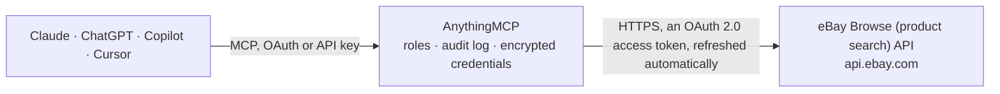

<!-- Generated by scripts/export-github-catalog.mjs in the anythingmcp-website repository. Do not edit by hand. -->

# eBay Browse (product search) MCP connector

Search live eBay listings and read item details with eBay's Browse API: prices, condition, seller, shipping and item specifics, by keyword, category, GTIN or product id. The AnythingMCP connector gives Claude, ChatGPT, Microsoft Copilot, Cursor and Gemini 4 MCP tools for eBay Browse (product search), all read-only.

**Category:** [E-commerce](../e-commerce.md) · **Tools:** 4 · **Setup guide:** [anythingmcp.com](https://anythingmcp.com/guides/ebay-browse-to-mcp) · [Deutsch](https://anythingmcp.com/de/guides/ebay-browse-to-mcp) · [Italiano](https://anythingmcp.com/it/guides/ebay-browse-to-mcp) · [Español](https://anythingmcp.com/es/guides/ebay-browse-to-mcp) · [日本語](https://anythingmcp.com/ja/guides/ebay-browse-to-mcp) · [Русский](https://anythingmcp.com/ru/guides/ebay-browse-to-mcp) · [中文](https://anythingmcp.com/zh/guides/ebay-browse-to-mcp)

## Start without code

No installation and no terminal: AnythingMCP Cloud runs the eBay Browse (product search) connector for you, operated by helpcode.ai in Frankfurt, Germany.

1. **Click the button above** and create an account or sign in. The eBay Browse (product search) connector opens, ready to install.
2. **Sign in with your eBay Browse (product search) account** when AnythingMCP asks. The first time, an admin creates a small app in the eBay Browse (product search) developer console. Every click is in the [step-by-step guide](https://anythingmcp.com/guides/ebay-browse-to-mcp).
3. **Click Install.** AnythingMCP shows the address of your MCP server.
4. **Add that address to your assistant:** [Claude](https://anythingmcp.com/guides/connect-ebay-browse-to-claude) · [ChatGPT](https://anythingmcp.com/guides/connect-ebay-browse-to-chatgpt) · [Microsoft Copilot](https://anythingmcp.com/guides/connect-ebay-browse-to-copilot) · [Cursor](https://anythingmcp.com/guides/connect-ebay-browse-to-cursor) · [Gemini CLI](https://anythingmcp.com/guides/connect-ebay-browse-to-gemini) · [Meta Muse](https://anythingmcp.com/guides/connect-ebay-browse-to-muse).
5. **Ask your first question**, for example: *Show me listing details for eBay item number 358412709023 on EBAY_GB, I need price, condition and seller.*

Prefer help with the setup? [Talk to us](https://anythingmcp.com/contact).

## How it works

- **The AI client** speaks MCP (Streamable HTTP) to AnythingMCP and only sees tool names, descriptions and results. It never gets the eBay Browse (product search) credentials.
- **AnythingMCP** checks the client's role, builds the call from the tool definition, adds the credentials (an OAuth 2.0 access token, refreshed automatically), calls eBay Browse (product search), logs the call and returns the result.
- **eBay Browse (product search)** sees an ordinary API client with the rights of the account the credentials belong to.

## Tools

| Tool | What it does | Access |
|---|---|---|
| [`ebay_browse_search_items`](#ebay_browse_search_items) | Search active eBay listings on the configured marketplace by keyword, category, GTIN or eBay product id. | read |
| [`ebay_browse_get_item`](#ebay_browse_get_item) | Read one listing in full: title, description, price, condition and condition description, item specifics (localizedAspects), brand, MPN and GTIN, images,… | read |
| [`ebay_browse_get_item_by_legacy_id`](#ebay_browse_get_item_by_legacy_id) | Read a listing by its classic eBay item number, the number in the listing URL (ebay.de/itm/123456789012). | read |
| [`ebay_browse_get_item_group`](#ebay_browse_get_item_group) | Read all variations (sizes, colours...) of a listing with variations, each with its own price and availability, plus the aspects that tell them apart. | read |

## Tool reference

Every parameter as the AI client sees it in `tools/list`. Source: [`packages/backend/src/adapters/intl/ebay-browse.json`](../../../packages/backend/src/adapters/intl/ebay-browse.json).

### `ebay_browse_search_items`

Search active eBay listings on the configured marketplace by keyword, category, GTIN or eBay product id. Returns per item: itemId, legacyItemId, title, price, condition, seller (username, feedback), shipping options, buying options (FIXED_PRICE, AUCTION, BEST_OFFER), item location and the listing URL, plus total and paging. Give at least one of q, category_ids, gtin or epid.

**Access:** read · **Call:** `GET /buy/browse/v1/item_summary/search`

| Parameter | Type | Required | Description |
|---|---|---|---|
| `q` | string | no | Keywords, e.g. lego technic 42115. Words are combined with AND; use (a, b) for OR. |
| `category_ids` | string | no | eBay category id(s), comma-separated. |
| `gtin` | string | no | EAN, UPC or ISBN of the product. |
| `epid` | string | no | eBay product id (ePID). |
| `filter` | string | no | Comma-separated filters, e.g. price:[10..50],priceCurrency:EUR,conditions:{NEW\|USED},buyingOptions:{FIXED_PRICE},itemLocationCountry:DE,sellers:{name}. |
| `aspect_filter` | string | no | Item specifics filter, needs category_ids, e.g. categoryId:15724,Color:{Red}. |
| `sort` | `price` \| `-price` \| `newlyListed` \| `endingSoonest` | no | Sort order; best match when omitted. |
| `limit` | integer | no | Items per page, 1 to 200. Default 50. |
| `offset` | integer | no | Items to skip, for paging. |
| `fieldgroups` | string | no | MATCHING_ITEMS (default), EXTENDED (adds a short description), ASPECT_REFINEMENTS or CATEGORY_REFINEMENTS (counts per aspect or category), comma-separated. |

### `ebay_browse_get_item`

Read one listing in full: title, description, price, condition and condition description, item specifics (localizedAspects), brand, MPN and GTIN, images, seller, shipping and return terms, available quantity and estimated delivery.

**Access:** read · **Call:** `GET /buy/browse/v1/item/{item_id}`

| Parameter | Type | Required | Description |
|---|---|---|---|
| `item_id` | string | yes | itemId from the search, e.g. v1\|123456789012\|0. |
| `fieldgroups` | string | no | PRODUCT adds eBay's product data (if the listing is matched to one); COMPACT returns only price, availability and a few fields. |

### `ebay_browse_get_item_by_legacy_id`

Read a listing by its classic eBay item number, the number in the listing URL (ebay.de/itm/123456789012). For a listing with variations also pass the variation id or SKU.

**Access:** read · **Call:** `GET /buy/browse/v1/item/get_item_by_legacy_id`

| Parameter | Type | Required | Description |
|---|---|---|---|
| `legacy_item_id` | string | yes | The item number, e.g. 123456789012. |
| `legacy_variation_id` | string | no | Variation id, for a listing with variations. |
| `legacy_variation_sku` | string | no | Seller's variation SKU, as an alternative to the variation id. |

### `ebay_browse_get_item_group`

Read all variations (sizes, colours...) of a listing with variations, each with its own price and availability, plus the aspects that tell them apart. The item group id is the number at the end of the item's itemGroupHref. A group can hold hundreds of variations; each comes back with its id, title, price, condition, colour, size, item specifics, availability and URL.

**Access:** read · **Call:** `GET /buy/browse/v1/item/get_items_by_item_group`

| Parameter | Type | Required | Description |
|---|---|---|---|
| `item_group_id` | string | yes | Item group id, e.g. 123456789012. |

## Run it yourself

AnythingMCP is open source (AGPL-3.0). [Run it with Docker](../../../README.md#run-it-yourself), open **Connectors → Store**, pick **eBay Browse (product search)** and enter `EBAY_CLIENT_ID`, `EBAY_CLIENT_SECRET`, `EBAY_MARKETPLACE_ID`, then add your MCP server URL to the AI client.

[← E-commerce connectors](../e-commerce.md) · [All categories](../README.md)
