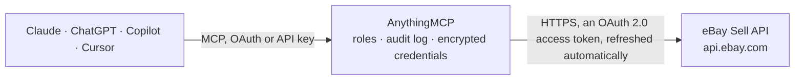

<!-- Generated by scripts/export-github-catalog.mjs in the anythingmcp-website repository. Do not edit by hand. -->

# eBay Sell MCP connector

eBay's Sell APIs for merchants: inventory items, item groups and offers (create, publish, withdraw), orders and fulfilment, payment disputes, account policies, Promoted Listings campaigns, category … The AnythingMCP connector gives Claude, ChatGPT, Microsoft Copilot, Cursor and Gemini 42 MCP tools for eBay Sell: 24 read and 18 can change data.

**Category:** [E-commerce](../e-commerce.md) · **Tools:** 42 · **Setup guide:** [anythingmcp.com](https://anythingmcp.com/guides/ebay-sell-to-mcp) · [Deutsch](https://anythingmcp.com/de/guides/ebay-sell-to-mcp) · [Italiano](https://anythingmcp.com/it/guides/ebay-sell-to-mcp) · [Español](https://anythingmcp.com/es/guides/ebay-sell-to-mcp) · [日本語](https://anythingmcp.com/ja/guides/ebay-sell-to-mcp) · [Русский](https://anythingmcp.com/ru/guides/ebay-sell-to-mcp) · [中文](https://anythingmcp.com/zh/guides/ebay-sell-to-mcp)

## Start without code

No installation and no terminal: AnythingMCP Cloud runs the eBay Sell connector for you, operated by helpcode.ai in Frankfurt, Germany.

1. **Click the button above** and create an account or sign in. The eBay Sell connector opens, ready to install.
2. **Sign in with your eBay Sell account** when AnythingMCP asks. The first time, an admin creates a small app in the eBay Sell developer console. Every click is in the [step-by-step guide](https://anythingmcp.com/guides/ebay-sell-to-mcp).
3. **Click Install.** AnythingMCP shows the address of your MCP server.
4. **Add that address to your assistant:** [Claude](https://anythingmcp.com/guides/connect-ebay-sell-to-claude) · [ChatGPT](https://anythingmcp.com/guides/connect-ebay-sell-to-chatgpt) · [Microsoft Copilot](https://anythingmcp.com/guides/connect-ebay-sell-to-copilot) · [Cursor](https://anythingmcp.com/guides/connect-ebay-sell-to-cursor) · [Gemini CLI](https://anythingmcp.com/guides/connect-ebay-sell-to-gemini) · [Meta Muse](https://anythingmcp.com/guides/connect-ebay-sell-to-muse).
5. **Ask your first question**, for example: *Show full order details for order 123-98765-43210 from buyer MicroTools GmbH*

Prefer help with the setup? [Talk to us](https://anythingmcp.com/contact).

## How it works

- **The AI client** speaks MCP (Streamable HTTP) to AnythingMCP and only sees tool names, descriptions and results. It never gets the eBay Sell credentials.
- **AnythingMCP** checks the client's role, builds the call from the tool definition, adds the credentials (an OAuth 2.0 access token, refreshed automatically), calls eBay Sell, logs the call and returns the result.
- **eBay Sell** sees an ordinary API client with the rights of the account the credentials belong to.

## Tools

| Tool | What it does | Access |
|---|---|---|
| [`ebay_sell_list_orders`](#ebay_sell_list_orders) | List orders with their buyer, line items, totals, payment status and fulfilment status. | read |
| [`ebay_sell_get_order`](#ebay_sell_get_order) | Read one order in full: every line item with SKU and price, the buyer, the shipping address, the payment summary and the fulfilment instructions. | read |
| [`ebay_sell_list_inventory_items`](#ebay_sell_list_inventory_items) | List inventory items — the SKU-level product records behind Sell-API listings. | read |
| [`ebay_sell_get_inventory_item`](#ebay_sell_get_inventory_item) | Read one inventory item by SKU: its product details, condition, package dimensions and available quantity per fulfilment channel. | read |
| [`ebay_sell_list_offers`](#ebay_sell_list_offers) | List the offers (listings) for one SKU, with their marketplace, format, price, listing status and listing id. | read |
| [`ebay_sell_list_fulfillment_policies`](#ebay_sell_list_fulfillment_policies) | List the seller's fulfilment (shipping) policies for the configured marketplace, with their services, costs and handling times. | read |
| [`ebay_sell_list_return_policies`](#ebay_sell_list_return_policies) | List the seller's return policies: whether returns are accepted, the return window, and who pays the shipping. | read |
| [`ebay_sell_list_payment_disputes`](#ebay_sell_list_payment_disputes) | List payment disputes opened against the seller, with the reason, amount, status and the deadline to respond. | read |
| [`ebay_sell_get_privileges`](#ebay_sell_get_privileges) | Read the selling privileges of the account: whether selling is enabled and what the current selling limits on quantity and value are. | read |
| [`ebay_sell_update_offer_price`](#ebay_sell_update_offer_price) | Change the price of a published offer (eBay bulk_update_price_quantity). | write |
| [`ebay_sell_upsert_inventory_item`](#ebay_sell_upsert_inventory_item) | Create an inventory item for a SKU, or replace it completely if the SKU already exists (Inventory API createOrReplaceInventoryItem). | write |
| [`ebay_sell_delete_inventory_item`](#ebay_sell_delete_inventory_item) | Delete an inventory item by SKU (Inventory API deleteInventoryItem). | write |
| [`ebay_sell_bulk_get_inventory_items`](#ebay_sell_bulk_get_inventory_items) | Read up to 25 inventory items in one call by SKU (Inventory API bulkGetInventoryItem). | read |
| [`ebay_sell_bulk_upsert_inventory_items`](#ebay_sell_bulk_upsert_inventory_items) | Create or fully replace up to 25 inventory items in one call (Inventory API bulkCreateOrReplaceInventoryItem). | write |
| [`ebay_sell_get_inventory_item_group`](#ebay_sell_get_inventory_item_group) | Get an inventory item group, the Inventory API's multi-variation listing (e.g. a shirt in several sizes and colours). | read |
| [`ebay_sell_upsert_inventory_item_group`](#ebay_sell_upsert_inventory_item_group) | Create an inventory item group (a multi-variation listing) or replace an existing one completely (Inventory API createOrReplaceInventoryItemGroup). | write |
| [`ebay_sell_delete_inventory_item_group`](#ebay_sell_delete_inventory_item_group) | Delete an inventory item group (Inventory API deleteInventoryItemGroup). | write |
| [`ebay_sell_get_offer`](#ebay_sell_get_offer) | Get one offer by its id: SKU, marketplace, format, price, available quantity, category, listing policies, merchant location, status (PUBLISHED or… | read |
| [`ebay_sell_create_offer`](#ebay_sell_create_offer) | Create an unpublished offer for an existing inventory item on one marketplace (Inventory API createOffer). | write |
| [`ebay_sell_update_offer`](#ebay_sell_update_offer) | Replace an offer's details (Inventory API updateOffer). | write |
| [`ebay_sell_delete_offer`](#ebay_sell_delete_offer) | Delete an offer (Inventory API deleteOffer). | write |
| [`ebay_sell_bulk_create_offers`](#ebay_sell_bulk_create_offers) | Create up to 25 unpublished offers in one call (Inventory API bulkCreateOffer), all for the same marketplace. | write |
| [`ebay_sell_publish_offer`](#ebay_sell_publish_offer) | Publish an offer, turning it into a live eBay listing (Inventory API publishOffer). | write |
| [`ebay_sell_bulk_publish_offers`](#ebay_sell_bulk_publish_offers) | Publish up to 25 offers in one call (Inventory API bulkPublishOffer), each becoming its own single-variation listing. | write |
| [`ebay_sell_publish_offers_by_item_group`](#ebay_sell_publish_offers_by_item_group) | Publish all unpublished offers of an inventory item group as one multi-variation listing on the connector's marketplace (Inventory API… | write |
| [`ebay_sell_withdraw_offer`](#ebay_sell_withdraw_offer) | End the live listing of a published single-variation offer (Inventory API withdrawOffer). | write |
| [`ebay_sell_withdraw_offers_by_item_group`](#ebay_sell_withdraw_offers_by_item_group) | End the multi-variation listing of an inventory item group on the connector's marketplace (Inventory API withdrawOfferByInventoryItemGroup). | write |
| [`ebay_sell_get_listing_fees`](#ebay_sell_get_listing_fees) | Estimate the listing fees eBay would charge to publish up to 250 unpublished offers (Inventory API getListingFees). | read |
| [`ebay_sell_migrate_listings`](#ebay_sell_migrate_listings) | Move up to 5 listings created with the legacy Trading API or Seller Hub into the Inventory API model (Inventory API bulkMigrateListing). | write |
| [`ebay_sell_list_inventory_locations`](#ebay_sell_list_inventory_locations) | List the seller's inventory locations (warehouses, stores): merchantLocationKey, name, address, type and status. | read |
| [`ebay_sell_search_items`](#ebay_sell_search_items) | Search live eBay listings on the connector's marketplace (Browse API item_summary/search), e.g. to check competing prices or find a listing. | read |
| [`ebay_sell_get_item`](#ebay_sell_get_item) | Get a live listing's public details by its RESTful item id (Browse API getItem): title, price, quantity sold and available, condition, item specifics,… | read |
| [`ebay_sell_get_item_by_legacy_id`](#ebay_sell_get_item_by_legacy_id) | Get a live listing's public details by the eBay item number shown on the listing page (Browse API getItemByLegacyId): title, price, availability, condition,… | read |
| [`ebay_sell_get_items_by_item_group`](#ebay_sell_get_items_by_item_group) | Get every variation of a live multi-variation listing (Browse API getItemsByItemGroup): one item per variation with its price, availability, aspects (size,… | read |
| [`ebay_sell_list_campaigns`](#ebay_sell_list_campaigns) | List the seller's Promoted Listings ad campaigns (Marketing API getCampaigns): campaignId, name, status, funding strategy (COST_PER_SALE or COST_PER_CLICK,… | read |
| [`ebay_sell_get_campaign`](#ebay_sell_get_campaign) | Get one Promoted Listings campaign by id (Marketing API getCampaign): name, status, funding strategy and bid percentage, budget, marketplace, dates and… | read |
| [`ebay_sell_list_campaign_ads`](#ebay_sell_list_campaign_ads) | List the ads of a Promoted Listings campaign (Marketing API getAds): adId, listingId, bid percentage and ad status. | read |
| [`ebay_sell_add_listings_to_campaign`](#ebay_sell_add_listings_to_campaign) | Promote up to 500 listings in a Promoted Listings campaign by listing id (Marketing API bulkCreateAdsByListingId). | write |
| [`ebay_sell_end_campaign`](#ebay_sell_end_campaign) | End a running or paused Promoted Listings campaign (Marketing API endCampaign). | write |
| [`ebay_sell_get_default_category_tree_id`](#ebay_sell_get_default_category_tree_id) | Get the id and version of the category tree of the connector's marketplace (Taxonomy API getDefaultCategoryTreeId), e.g. 77 for EBAY_DE, 0 for EBAY_US, 3… | read |
| [`ebay_sell_get_category_suggestions`](#ebay_sell_get_category_suggestions) | Suggest the leaf categories that best fit a product, from a short description (Taxonomy API getCategorySuggestions). | read |
| [`ebay_sell_get_item_aspects_for_category`](#ebay_sell_get_item_aspects_for_category) | List the item specifics (aspects) of a leaf category (Taxonomy API getItemAspectsForCategory): name, whether it is required or recommended, single or… | read |

## Tool reference

Every parameter as the AI client sees it in `tools/list`. Source: [`packages/backend/src/adapters/intl/ebay-sell.json`](../../../packages/backend/src/adapters/intl/ebay-sell.json).

### `ebay_sell_list_orders`

List orders with their buyer, line items, totals, payment status and fulfilment status. Filter by creation date or order status to answer 'what shipped this week'.

**Access:** read · **Call:** `GET /sell/fulfillment/v1/order`

| Parameter | Type | Required | Description |
|---|---|---|---|
| `filter` | string | no | eBay filter expression, e.g. creationdate:[2026-09-01T00:00:00.000Z..] or orderfulfillmentstatus:{NOT_STARTED\|IN_PROGRESS}. |
| `limit` | number | no | Rows per page, 1–200 (default 50). |
| `offset` | number | no | Rows to skip, for paging. |

### `ebay_sell_get_order`

Read one order in full: every line item with SKU and price, the buyer, the shipping address, the payment summary and the fulfilment instructions.

**Access:** read · **Call:** `GET /sell/fulfillment/v1/order/{orderId}`

| Parameter | Type | Required | Description |
|---|---|---|---|
| `orderId` | string | yes | eBay order id, e.g. 12-34567-89012. |

### `ebay_sell_list_inventory_items`

List inventory items — the SKU-level product records behind Sell-API listings. A seller whose listings predate the Inventory API will see this nearly empty.

**Access:** read · **Call:** `GET /sell/inventory/v1/inventory_item`

| Parameter | Type | Required | Description |
|---|---|---|---|
| `limit` | number | no | Rows per page, 1–200 (default 25). |
| `offset` | number | no | Page number, 0-based (0 = first page). Not a row count: eBay's Inventory API pages by index. |

### `ebay_sell_get_inventory_item`

Read one inventory item by SKU: its product details, condition, package dimensions and available quantity per fulfilment channel.

**Access:** read · **Call:** `GET /sell/inventory/v1/inventory_item/{sku}`

| Parameter | Type | Required | Description |
|---|---|---|---|
| `sku` | string | yes | Seller-defined SKU. |

### `ebay_sell_list_offers`

List the offers (listings) for one SKU, with their marketplace, format, price, listing status and listing id.

**Access:** read · **Call:** `GET /sell/inventory/v1/offer`

| Parameter | Type | Required | Description |
|---|---|---|---|
| `sku` | string | yes | Seller-defined SKU whose offers to list. |
| `limit` | number | no | Rows per page (default 100). |
| `offset` | number | no | Page number, 0-based (0 = first page). Not a row count: eBay's Inventory API pages by index. |

### `ebay_sell_list_fulfillment_policies`

List the seller's fulfilment (shipping) policies for the configured marketplace, with their services, costs and handling times.

**Access:** read · **Call:** `GET /sell/account/v1/fulfillment_policy`

No parameters.

### `ebay_sell_list_return_policies`

List the seller's return policies: whether returns are accepted, the return window, and who pays the shipping.

**Access:** read · **Call:** `GET /sell/account/v1/return_policy`

No parameters.

### `ebay_sell_list_payment_disputes`

List payment disputes opened against the seller, with the reason, amount, status and the deadline to respond. The thing that costs money when it is missed. Needs the `sell.payment.dispute` scope.

**Access:** read · **Call:** `GET https://apiz.ebay.com/sell/fulfillment/v1/payment_dispute_summary`

| Parameter | Type | Required | Description |
|---|---|---|---|
| `order_id` | string | no | Restrict to disputes on one order. |
| `limit` | number | no | Rows per page, 1–200 (default 200). |
| `offset` | number | no | Rows to skip, for paging. |

### `ebay_sell_get_privileges`

Read the selling privileges of the account: whether selling is enabled and what the current selling limits on quantity and value are.

**Access:** read · **Call:** `GET /sell/account/v1/privilege`

No parameters.

### `ebay_sell_update_offer_price`

Change the price of a published offer (eBay bulk_update_price_quantity). Buyers see the new price immediately — this is not a draft operation. eBay answers 200 or 207 Multi-Status; check the offer's statusCode and errors in the response.

**Access:** write · **Call:** `POST /sell/inventory/v1/bulk_update_price_quantity`

| Parameter | Type | Required | Description |
|---|---|---|---|
| `offerId` | string | yes | Offer id, from ebay_sell_list_offers. |
| `value` | string | yes | New price as a decimal string, e.g. 29.99. |
| `currency` | string | yes | ISO 4217 currency code matching the marketplace, e.g. EUR. |

### `ebay_sell_upsert_inventory_item`

Create an inventory item for a SKU, or replace it completely if the SKU already exists (Inventory API createOrReplaceInventoryItem). Fields left out of `item` are cleared on a replace, so read the item first with ebay_sell_get_inventory_item and send it back whole with your changes. Answers 204 on success; the item is not listed until an offer for it is published.

**Access:** write · **Call:** `PUT /sell/inventory/v1/inventory_item/{sku}`

| Parameter | Type | Required | Description |
|---|---|---|---|
| `sku` | string | yes | Seller-defined SKU, up to 50 characters. Unique across the seller's inventory. |
| `content_language` | string | yes | Language of the text in `item`, as a Content-Language value, e.g. en-US, en-GB, de-DE, fr-FR, it-IT. |
| `item` | object | yes | The inventory item: `product` (title, description, aspects, imageUrls, brand, mpn, ean/upc/isbn), `condition` (e.g. NEW, USED_EXCELLENT), `conditionDescription`, `availability` ({shipToLocationAvailability: {quantity}}) and optionally `packageWeightAndSize`. Do not include `sku`; it comes from the path. |

### `ebay_sell_delete_inventory_item`

Delete an inventory item by SKU (Inventory API deleteInventoryItem). This also deletes every offer for that SKU and ends any live listing built from it, published or not. Cannot be undone. Answers 204 on success.

**Access:** write · **Call:** `DELETE /sell/inventory/v1/inventory_item/{sku}`

| Parameter | Type | Required | Description |
|---|---|---|---|
| `sku` | string | yes | SKU of the inventory item to delete, from ebay_sell_list_inventory_items. |

### `ebay_sell_bulk_get_inventory_items`

Read up to 25 inventory items in one call by SKU (Inventory API bulkGetInventoryItem). Returns one response per SKU with its statusCode, the item (product, condition, availability) and any errors. Use instead of many ebay_sell_get_inventory_item calls. Does not change anything.

**Access:** read · **Call:** `POST /sell/inventory/v1/bulk_get_inventory_item`

| Parameter | Type | Required | Description |
|---|---|---|---|
| `requests` | object[] | yes | 1 to 25 entries of the form {"sku": "ABC-123"}. |

### `ebay_sell_bulk_upsert_inventory_items`

Create or fully replace up to 25 inventory items in one call (Inventory API bulkCreateOrReplaceInventoryItem). Each entry is a complete item with its `sku` and `locale`; fields left out are cleared on items that already exist. eBay answers 200 or 207 Multi-Status: read each entry's statusCode and errors in the response.

**Access:** write · **Call:** `POST /sell/inventory/v1/bulk_create_or_replace_inventory_item`

| Parameter | Type | Required | Description |
|---|---|---|---|
| `content_language` | string | yes | Language of the text in the items, as a Content-Language value, e.g. en-US, de-DE. |
| `requests` | object[] | yes | 1 to 25 inventory items, each with `sku`, `locale` (e.g. en_US, de_DE), `product`, `condition`, `availability` and optionally `packageWeightAndSize`. |

### `ebay_sell_get_inventory_item_group`

Get an inventory item group, the Inventory API's multi-variation listing (e.g. a shirt in several sizes and colours). Returns the shared title, description, aspects and images, the variant SKUs and the aspects they vary by (variesBy). Use the SKUs with ebay_sell_get_inventory_item or ebay_sell_list_offers.

**Access:** read · **Call:** `GET /sell/inventory/v1/inventory_item_group/{inventoryItemGroupKey}`

| Parameter | Type | Required | Description |
|---|---|---|---|
| `inventoryItemGroupKey` | string | yes | Seller-defined key of the group, e.g. the groupIds value of an inventory item or the key used when the group was created. |

### `ebay_sell_upsert_inventory_item_group`

Create an inventory item group (a multi-variation listing) or replace an existing one completely (Inventory API createOrReplaceInventoryItemGroup). The variant inventory items must exist first. Fields left out are cleared, so read the group with ebay_sell_get_inventory_item_group and send it back whole. When the group is already published, the live listing is updated too. Answers 204 on success.

**Access:** write · **Call:** `PUT /sell/inventory/v1/inventory_item_group/{inventoryItemGroupKey}`

| Parameter | Type | Required | Description |
|---|---|---|---|
| `inventoryItemGroupKey` | string | yes | Seller-defined key of the group, up to 50 characters. |
| `content_language` | string | yes | Language of the text in `group`, as a Content-Language value, e.g. en-US, de-DE. |
| `group` | object | yes | The group: `title`, `description`, `aspects` (shared item specifics, {"Brand": ["Acme"]}), `imageUrls`, `variantSKUs` (the SKUs in the group) and `variesBy` ({aspectsImageVariesBy: ["Color"], specifications: [{name: "Size", values: ["S", "M"]}]}). |

### `ebay_sell_delete_inventory_item_group`

Delete an inventory item group (Inventory API deleteInventoryItemGroup). The variant inventory items stay, but the multi-variation listing built from the group is no longer available to buyers. Withdraw it first with ebay_sell_withdraw_offers_by_item_group. Cannot be undone. Answers 204 on success.

**Access:** write · **Call:** `DELETE /sell/inventory/v1/inventory_item_group/{inventoryItemGroupKey}`

| Parameter | Type | Required | Description |
|---|---|---|---|
| `inventoryItemGroupKey` | string | yes | Key of the inventory item group to delete. |

### `ebay_sell_get_offer`

Get one offer by its id: SKU, marketplace, format, price, available quantity, category, listing policies, merchant location, status (PUBLISHED or UNPUBLISHED) and, once published, the eBay listing id. Offer ids come from ebay_sell_list_offers.

**Access:** read · **Call:** `GET /sell/inventory/v1/offer/{offerId}`

| Parameter | Type | Required | Description |
|---|---|---|---|
| `offerId` | string | yes | eBay offer id. |

### `ebay_sell_create_offer`

Create an unpublished offer for an existing inventory item on one marketplace (Inventory API createOffer). Returns the new offerId. Nothing is listed until the offer is published with ebay_sell_publish_offer. One offer per SKU and marketplace (two for auctions).

**Access:** write · **Call:** `POST /sell/inventory/v1/offer`

| Parameter | Type | Required | Description |
|---|---|---|---|
| `content_language` | string | yes | Language of the text in the offer, as a Content-Language value, e.g. en-US, de-DE. |
| `offer` | object | yes | The offer: `sku`, `marketplaceId` (e.g. EBAY_DE), `format` (FIXED_PRICE or AUCTION), `availableQuantity`, `categoryId`, `listingDescription`, `listingPolicies` ({fulfillmentPolicyId, paymentPolicyId, returnPolicyId}), `merchantLocationKey`, `pricingSummary` ({price: {value: "19.99", currency: "EUR"}}) and optionally `tax`, `storeCategoryNames`, `quantityLimitPerBuyer`. |

### `ebay_sell_update_offer`

Replace an offer's details (Inventory API updateOffer). This is a full replace: fields left out are cleared, so read the offer with ebay_sell_get_offer and send it back whole with your changes (without offerId, sku and marketplaceId, which cannot change). A published offer's live listing changes immediately. For a price or quantity change only, ebay_sell_update_offer_price is simpler.

**Access:** write · **Call:** `PUT /sell/inventory/v1/offer/{offerId}`

| Parameter | Type | Required | Description |
|---|---|---|---|
| `offerId` | string | yes | Id of the offer to update. |
| `content_language` | string | yes | Language of the text in the offer, as a Content-Language value, e.g. en-US, de-DE. |
| `offer` | object | yes | The complete offer: availableQuantity, categoryId, listingDescription, listingPolicies, merchantLocationKey, pricingSummary, tax, storeCategoryNames and the other fields eBay returned. |

### `ebay_sell_delete_offer`

Delete an offer (Inventory API deleteOffer). A published offer's listing ends; for a multi-variation listing only that variation is removed. The inventory item stays. Cannot be undone. Answers 204 on success.

**Access:** write · **Call:** `DELETE /sell/inventory/v1/offer/{offerId}`

| Parameter | Type | Required | Description |
|---|---|---|---|
| `offerId` | string | yes | Id of the offer to delete. |

### `ebay_sell_bulk_create_offers`

Create up to 25 unpublished offers in one call (Inventory API bulkCreateOffer), all for the same marketplace. Returns an offerId or errors per entry; eBay answers 200 or 207 Multi-Status, so check each entry's statusCode. Publish them with ebay_sell_bulk_publish_offers or ebay_sell_publish_offers_by_item_group.

**Access:** write · **Call:** `POST /sell/inventory/v1/bulk_create_offer`

| Parameter | Type | Required | Description |
|---|---|---|---|
| `content_language` | string | yes | Language of the text in the offers, as a Content-Language value, e.g. en-US, de-DE. |
| `requests` | object[] | yes | 1 to 25 offers, each shaped like the `offer` of ebay_sell_create_offer (sku, marketplaceId, format, availableQuantity, categoryId, listingPolicies, merchantLocationKey, pricingSummary, ...). |

### `ebay_sell_publish_offer`

Publish an offer, turning it into a live eBay listing (Inventory API publishOffer). Returns the listingId. eBay checks that the offer and its inventory item carry everything the category needs; the errors name what is missing. Insertion fees may apply.

**Access:** write · **Call:** `POST /sell/inventory/v1/offer/{offerId}/publish`

| Parameter | Type | Required | Description |
|---|---|---|---|
| `offerId` | string | yes | Id of the unpublished offer. |

### `ebay_sell_bulk_publish_offers`

Publish up to 25 offers in one call (Inventory API bulkPublishOffer), each becoming its own single-variation listing. Returns a listingId or errors per offer; eBay answers 200 or 207 Multi-Status. For a multi-variation listing use ebay_sell_publish_offers_by_item_group instead.

**Access:** write · **Call:** `POST /sell/inventory/v1/bulk_publish_offer`

| Parameter | Type | Required | Description |
|---|---|---|---|
| `requests` | object[] | yes | 1 to 25 entries of the form {"offerId": "1234567890"}. |

### `ebay_sell_publish_offers_by_item_group`

Publish all unpublished offers of an inventory item group as one multi-variation listing on the connector's marketplace (Inventory API publishOfferByInventoryItemGroup). Every variant SKU needs an offer first. Returns the listingId and per-SKU warnings. Also use it after adding a variant to an already published group.

**Access:** write · **Call:** `POST /sell/inventory/v1/offer/publish_by_inventory_item_group`

| Parameter | Type | Required | Description |
|---|---|---|---|
| `inventoryItemGroupKey` | string | yes | Key of the inventory item group to publish. |

### `ebay_sell_withdraw_offer`

End the live listing of a published single-variation offer (Inventory API withdrawOffer). The offer and inventory item stay and the offer returns to UNPUBLISHED; publishing it again creates a new listing with a new listing id. For a multi-variation listing use ebay_sell_withdraw_offers_by_item_group.

**Access:** write · **Call:** `POST /sell/inventory/v1/offer/{offerId}/withdraw`

| Parameter | Type | Required | Description |
|---|---|---|---|
| `offerId` | string | yes | Id of the published offer. |

### `ebay_sell_withdraw_offers_by_item_group`

End the multi-variation listing of an inventory item group on the connector's marketplace (Inventory API withdrawOfferByInventoryItemGroup). The offers, items and group stay and can be published again with ebay_sell_publish_offers_by_item_group, which creates a new listing. Answers 204 on success.

**Access:** write · **Call:** `POST /sell/inventory/v1/offer/withdraw_by_inventory_item_group`

| Parameter | Type | Required | Description |
|---|---|---|---|
| `inventoryItemGroupKey` | string | yes | Key of the inventory item group whose listing should end. |

### `ebay_sell_get_listing_fees`

Estimate the listing fees eBay would charge to publish up to 250 unpublished offers (Inventory API getListingFees). Returns the expected fees per marketplace (insertion fee, subtitle, and so on). Final value fees are not included. Does not publish anything.

**Access:** read · **Call:** `POST /sell/inventory/v1/offer/get_listing_fees`

| Parameter | Type | Required | Description |
|---|---|---|---|
| `offers` | object[] | yes | Entries of the form {"offerId": "1234567890"}; only unpublished offers. |

### `ebay_sell_migrate_listings`

Move up to 5 listings created with the legacy Trading API or Seller Hub into the Inventory API model (Inventory API bulkMigrateListing). Afterwards the listing is managed through inventory items and offers, and the response names the new SKUs, offer ids and inventory item group key. One-way: a migrated listing cannot go back. Every listing needs a SKU and Business Policies.

**Access:** write · **Call:** `POST /sell/inventory/v1/bulk_migrate_listing`

| Parameter | Type | Required | Description |
|---|---|---|---|
| `requests` | object[] | yes | 1 to 5 entries of the form {"listingId": "123456789012"}. |

### `ebay_sell_list_inventory_locations`

List the seller's inventory locations (warehouses, stores): merchantLocationKey, name, address, type and status. Offers name their location by merchantLocationKey, so use this before creating an offer.

**Access:** read · **Call:** `GET /sell/inventory/v1/location`

| Parameter | Type | Required | Description |
|---|---|---|---|
| `limit` | number | no | Locations per page, 1-100 (default 100). |
| `offset` | number | no | Number of locations to skip. |

### `ebay_sell_search_items`

Search live eBay listings on the connector's marketplace (Browse API item_summary/search), e.g. to check competing prices or find a listing. Returns item summaries with itemId, title, price, condition, seller, image and itemWebUrl, plus total and next for paging. Needs a keyword (`q`), a category, an ePID or a GTIN.

**Access:** read · **Call:** `GET /buy/browse/v1/item_summary/search`

| Parameter | Type | Required | Description |
|---|---|---|---|
| `q` | string | no | Keywords, e.g. iphone 15 case. No * wildcard. |
| `category_ids` | string | no | One eBay category id, e.g. 9355. |
| `gtin` | string | no | UPC, EAN or ISBN of the product. |
| `epid` | string | no | eBay product id from the eBay catalog. |
| `filter` | string | no | Field filters, e.g. price:[10..50],priceCurrency:EUR,conditions:{NEW},buyingOptions:{FIXED_PRICE},sellers:{seller_name}. |
| `aspect_filter` | string | no | Aspect filter with its category, e.g. categoryId:15724,Color:{Red}. |
| `sort` | string | no | price, -price, distance or newlyListed. Default: best match. |
| `fieldgroups` | string | no | MATCHING_ITEMS (default), ASPECT_REFINEMENTS, CATEGORY_REFINEMENTS, BUYING_OPTION_REFINEMENTS, CONDITION_REFINEMENTS, EXTENDED or FULL, comma separated. |
| `limit` | number | no | Items per page, 1-200 (default 50). |
| `offset` | number | no | Items to skip; a multiple of limit. |

### `ebay_sell_get_item`

Get a live listing's public details by its RESTful item id (Browse API getItem): title, price, quantity sold and available, condition, item specifics, images, seller, shipping and return terms. The id looks like v1|123456789012|0 (from ebay_sell_search_items); for a plain eBay item number use ebay_sell_get_item_by_legacy_id.

**Access:** read · **Call:** `GET /buy/browse/v1/item/{item_id}`

| Parameter | Type | Required | Description |
|---|---|---|---|
| `item_id` | string | yes | RESTful item id, e.g. v1\|123456789012\|0 or, for one variation, v1\|123456789012\|987654321098. |
| `fieldgroups` | string | no | PRODUCT adds eBay catalog product details; COMPACT returns only price, availability and a few other fields. |

### `ebay_sell_get_item_by_legacy_id`

Get a live listing's public details by the eBay item number shown on the listing page (Browse API getItemByLegacyId): title, price, availability, condition, item specifics, images, seller and shipping. For one variation of a multi-variation listing also pass legacy_variation_sku or legacy_variation_id.

**Access:** read · **Call:** `GET /buy/browse/v1/item/get_item_by_legacy_id`

| Parameter | Type | Required | Description |
|---|---|---|---|
| `legacy_item_id` | string | yes | eBay item number, e.g. 123456789012. |
| `legacy_variation_sku` | string | no | Seller SKU of the variation, for a multi-variation listing. |
| `legacy_variation_id` | string | no | Variation id, for a multi-variation listing. |
| `fieldgroups` | string | no | PRODUCT adds eBay catalog product details; ADDITIONAL_SELLER_DETAILS adds the seller's user id. |

### `ebay_sell_get_items_by_item_group`

Get every variation of a live multi-variation listing (Browse API getItemsByItemGroup): one item per variation with its price, availability, aspects (size, colour) and images, plus the aspects shared by the group. The item group id is the eBay item number of the multi-variation listing.

**Access:** read · **Call:** `GET /buy/browse/v1/item/get_items_by_item_group`

| Parameter | Type | Required | Description |
|---|---|---|---|
| `item_group_id` | string | yes | Item group id, i.e. the item number of the multi-variation listing. |

### `ebay_sell_list_campaigns`

List the seller's Promoted Listings ad campaigns (Marketing API getCampaigns): campaignId, name, status, funding strategy (COST_PER_SALE or COST_PER_CLICK, with the default bid percentage), marketplace, start and end dates. Filter by status or name. Needs the sell.marketing scope.

**Access:** read · **Call:** `GET /sell/marketing/v1/ad_campaign`

| Parameter | Type | Required | Description |
|---|---|---|---|
| `campaign_status` | string | no | Comma-separated statuses: RUNNING, PAUSED, ENDED, PENDING, SCHEDULED, ENDING_SOON, DRAFT. |
| `campaign_name` | string | no | Exact campaign name. |
| `funding_strategy` | string | no | COST_PER_SALE or COST_PER_CLICK. |
| `start_date_range` | string | no | Start-date range, e.g. 2026-01-01T00:00:00Z..2026-03-31T00:00:00Z. |
| `end_date_range` | string | no | End-date range, same format as start_date_range. |
| `limit` | number | no | Campaigns per page, 1-500 (default 10). |
| `offset` | number | no | Number of campaigns to skip. |

### `ebay_sell_get_campaign`

Get one Promoted Listings campaign by id (Marketing API getCampaign): name, status, funding strategy and bid percentage, budget, marketplace, dates and selection rules. Campaign ids come from ebay_sell_list_campaigns.

**Access:** read · **Call:** `GET /sell/marketing/v1/ad_campaign/{campaign_id}`

| Parameter | Type | Required | Description |
|---|---|---|---|
| `campaign_id` | string | yes | eBay campaign id. |

### `ebay_sell_list_campaign_ads`

List the ads of a Promoted Listings campaign (Marketing API getAds): adId, listingId, bid percentage and ad status. Filter by listing ids or status to check whether a listing is promoted.

**Access:** read · **Call:** `GET /sell/marketing/v1/ad_campaign/{campaign_id}/ad`

| Parameter | Type | Required | Description |
|---|---|---|---|
| `campaign_id` | string | yes | eBay campaign id. |
| `listing_ids` | string | no | Comma-separated listing ids to look for. |
| `ad_status` | string | no | Comma-separated statuses: ACTIVE, PAUSED, ARCHIVED, INELIGIBLE. |
| `limit` | number | no | Ads per page, 1-500 (default 10). |
| `offset` | number | no | Number of ads to skip. |

### `ebay_sell_add_listings_to_campaign`

Promote up to 500 listings in a Promoted Listings campaign by listing id (Marketing API bulkCreateAdsByListingId). In a cost-per-sale campaign each ad takes a bidPercentage (the ad fee charged when the item sells after a click on the ad); in a cost-per-click campaign pass adGroupId instead. Returns an adId or errors per listing; eBay answers 200 or 207 Multi-Status.

**Access:** write · **Call:** `POST /sell/marketing/v1/ad_campaign/{campaign_id}/bulk_create_ads_by_listing_id`

| Parameter | Type | Required | Description |
|---|---|---|---|
| `campaign_id` | string | yes | eBay campaign id, from ebay_sell_list_campaigns. |
| `requests` | object[] | yes | 1 to 500 entries such as {"listingId": "123456789012", "bidPercentage": "5.0"} (cost per sale, 2.0-100.0) or {"listingId": "...", "adGroupId": "..."} (cost per click). |

### `ebay_sell_end_campaign`

End a running or paused Promoted Listings campaign (Marketing API endCampaign). Its ads stop at once. An ended campaign cannot be restarted; to stop it for a while pause it in Seller Hub instead. Answers 204 on success.

**Access:** write · **Call:** `POST /sell/marketing/v1/ad_campaign/{campaign_id}/end`

| Parameter | Type | Required | Description |
|---|---|---|---|
| `campaign_id` | string | yes | Id of the campaign to end. |

### `ebay_sell_get_default_category_tree_id`

Get the id and version of the category tree of the connector's marketplace (Taxonomy API getDefaultCategoryTreeId), e.g. 77 for EBAY_DE, 0 for EBAY_US, 3 for EBAY_GB. Needed by ebay_sell_get_category_suggestions and ebay_sell_get_item_aspects_for_category.

**Access:** read · **Call:** `GET /commerce/taxonomy/v1/get_default_category_tree_id`

No parameters.

### `ebay_sell_get_category_suggestions`

Suggest the leaf categories that best fit a product, from a short description (Taxonomy API getCategorySuggestions). Returns category ids and names with their ancestor path, best match first. Use the id as an offer's categoryId and with ebay_sell_get_item_aspects_for_category.

**Access:** read · **Call:** `GET /commerce/taxonomy/v1/category_tree/{category_tree_id}/get_category_suggestions`

| Parameter | Type | Required | Description |
|---|---|---|---|
| `category_tree_id` | string | yes | Category tree id, from ebay_sell_get_default_category_tree_id (e.g. 77 for EBAY_DE). |
| `q` | string | yes | Words that describe the item, e.g. women's leather ankle boots. |

### `ebay_sell_get_item_aspects_for_category`

List the item specifics (aspects) of a leaf category (Taxonomy API getItemAspectsForCategory): name, whether it is required or recommended, single or multiple values, free text or one of the listed values. Use it to fill product.aspects of an inventory item so publishing does not fail on missing specifics.

**Access:** read · **Call:** `GET /commerce/taxonomy/v1/category_tree/{category_tree_id}/get_item_aspects_for_category`

| Parameter | Type | Required | Description |
|---|---|---|---|
| `category_tree_id` | string | yes | Category tree id, from ebay_sell_get_default_category_tree_id. |
| `category_id` | string | yes | Leaf category id, e.g. from ebay_sell_get_category_suggestions. |

## Run it yourself

AnythingMCP is open source (AGPL-3.0). [Run it with Docker](../../../README.md#run-it-yourself), open **Connectors → Store**, pick **eBay Sell** and enter `EBAY_CLIENT_ID`, `EBAY_CLIENT_SECRET`, `EBAY_RUNAME`, `EBAY_MARKETPLACE_ID`, then add your MCP server URL to the AI client.

[← E-commerce connectors](../e-commerce.md) · [All categories](../README.md)
