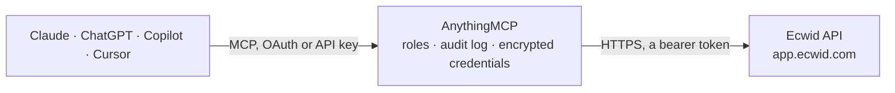

<!-- Generated by scripts/export-github-catalog.mjs in the anythingmcp-website repository. Do not edit by hand. -->

# Ecwid MCP connector

Drive Ecwid (Lightspeed-owned e-commerce platform) from any AI agent: products, categories, orders, customers. 10 tools, OAuth2 Bearer auth, store-scoped URL. The AnythingMCP connector gives Claude, ChatGPT, Microsoft Copilot, Cursor and Gemini 10 MCP tools for Ecwid: 7 read and 3 can change data.

**Category:** [E-commerce](../e-commerce.md) · **Tools:** 10 · **Setup guide:** [anythingmcp.com](https://anythingmcp.com/guides/ecwid-to-mcp) · [Deutsch](https://anythingmcp.com/de/guides/ecwid-to-mcp) · [Italiano](https://anythingmcp.com/it/guides/ecwid-to-mcp) · [Español](https://anythingmcp.com/es/guides/ecwid-to-mcp) · [日本語](https://anythingmcp.com/ja/guides/ecwid-to-mcp) · [Русский](https://anythingmcp.com/ru/guides/ecwid-to-mcp) · [中文](https://anythingmcp.com/zh/guides/ecwid-to-mcp)

## Start without code

No installation and no terminal: AnythingMCP Cloud runs the Ecwid connector for you, operated by helpcode.ai in Frankfurt, Germany.

1. **Click the button above** and create an account or sign in. The Ecwid connector opens, ready to install.
2. **Paste the API key or token from your Ecwid account.** Every click is in the [step-by-step guide](https://anythingmcp.com/guides/ecwid-to-mcp).
3. **Click Install.** AnythingMCP shows the address of your MCP server.
4. **Add that address to your assistant:** [Claude](https://anythingmcp.com/guides/connect-ecwid-to-claude) · [ChatGPT](https://anythingmcp.com/guides/connect-ecwid-to-chatgpt) · [Microsoft Copilot](https://anythingmcp.com/guides/connect-ecwid-to-copilot) · [Cursor](https://anythingmcp.com/guides/connect-ecwid-to-cursor) · [Gemini CLI](https://anythingmcp.com/guides/connect-ecwid-to-gemini) · [Meta Muse](https://anythingmcp.com/guides/connect-ecwid-to-muse).
5. **Ask your first question**, for example: *Show me order 2026-0587 for customer Nordic Timber OÜ created 2026-03-12*

Prefer help with the setup? [Talk to us](https://anythingmcp.com/contact).

## How it works

- **The AI client** speaks MCP (Streamable HTTP) to AnythingMCP and only sees tool names, descriptions and results. It never gets the Ecwid credentials.
- **AnythingMCP** checks the client's role, builds the call from the tool definition, adds the credentials (a bearer token), calls Ecwid, logs the call and returns the result.
- **Ecwid** sees an ordinary API client with the rights of the account the credentials belong to.

## Tools

| Tool | What it does | Access |
|---|---|---|
| [`ecwid_get_profile`](#ecwid_get_profile) | Get store profile (name, currency, formats, plan). | read |
| [`ecwid_search_products`](#ecwid_search_products) | Search products with filters. | read |
| [`ecwid_get_product`](#ecwid_get_product) | Get a product by ID. | read |
| [`ecwid_create_product`](#ecwid_create_product) | Create a product. | write |
| [`ecwid_update_product`](#ecwid_update_product) | Update a product (PUT — full replacement of passed fields). | write |
| [`ecwid_list_categories`](#ecwid_list_categories) | List categories. | read |
| [`ecwid_search_orders`](#ecwid_search_orders) | Search orders. | read |
| [`ecwid_get_order`](#ecwid_get_order) | Get an order by number. | read |
| [`ecwid_update_order`](#ecwid_update_order) | Update order — common: change paymentStatus, fulfillmentStatus, set trackingNumber. | write |
| [`ecwid_search_customers`](#ecwid_search_customers) | Search customers. | read |

## Tool reference

Every parameter as the AI client sees it in `tools/list`. Source: [`packages/backend/src/adapters/intl/ecwid.json`](../../../packages/backend/src/adapters/intl/ecwid.json).

### `ecwid_get_profile`

Get store profile (name, currency, formats, plan).

**Access:** read · **Call:** `GET /profile`

No parameters.

### `ecwid_search_products`

Search products with filters.

**Access:** read · **Call:** `GET /products`

| Parameter | Type | Required | Description |
|---|---|---|---|
| `keyword` | string | no | Search keyword across name/SKU/description. |
| `category` | integer | no | Filter by category ID. |
| `enabled` | boolean | no | true = only enabled products. |
| `inStock` | boolean | no | true = only in-stock. |
| `priceFrom` | number | no | Min price. |
| `priceTo` | number | no | Max price. |
| `sortBy` | string | no | RELEVANCE, ADDED_TIME_DESC, NAME_ASC, PRICE_ASC, etc. |
| `offset` | integer | no | Offset. |
| `limit` | integer | no | Per page (max 100). |

### `ecwid_get_product`

Get a product by ID.

**Access:** read · **Call:** `GET /products/{productId}`

| Parameter | Type | Required | Description |
|---|---|---|---|
| `productId` | integer | yes | Product ID. |

### `ecwid_create_product`

Create a product. Required: name + price.

**Access:** write · **Call:** `POST /products`

| Parameter | Type | Required | Description |
|---|---|---|---|
| `name` | string | yes | Product name. |
| `sku` | string | no | SKU (auto-generated if omitted). |
| `description` | string | no | HTML description. |
| `price` | number | yes | Price. |
| `originalPrice` | number | no | Compare-at price. |
| `costPrice` | number | no | Cost basis. |
| `weight` | number | no | Weight. |
| `quantity` | integer | no | Stock quantity. |
| `unlimited` | boolean | no | If true, don't track stock. |
| `enabled` | boolean | no | Visible on storefront. |
| `categoryIds` | any[] | no | Array of category IDs. |
| `tax` | object | no | {enabledManualTaxes:[ids]}. |
| `media` | object | no | {images:[{url, alt?}], videos:[{providerId, videoUrl}]}. |

### `ecwid_update_product`

Update a product (PUT — full replacement of passed fields).

**Access:** write · **Call:** `PUT /products/{productId}`

| Parameter | Type | Required | Description |
|---|---|---|---|
| `productId` | integer | yes | Product ID. |
| `name` | string | no | New name. |
| `price` | number | no | New price. |
| `quantity` | integer | no | New stock. |
| `enabled` | boolean | no | Visibility. |
| `description` | string | no | New description. |
| `categoryIds` | any[] | no | Replace categories. |

### `ecwid_list_categories`

List categories.

**Access:** read · **Call:** `GET /categories`

| Parameter | Type | Required | Description |
|---|---|---|---|
| `parent` | integer | no | Parent category ID (default 0 = root). |
| `offset` | integer | no | Offset. |
| `limit` | integer | no | Per page. |

### `ecwid_search_orders`

Search orders.

**Access:** read · **Call:** `GET /orders`

| Parameter | Type | Required | Description |
|---|---|---|---|
| `keywords` | string | no | Full-text across customer name/email/order #. |
| `paymentStatus` | string | no | AWAITING_PAYMENT, PAID, CANCELLED, REFUNDED, PARTIALLY_REFUNDED, INCOMPLETE. |
| `fulfillmentStatus` | string | no | AWAITING_PROCESSING, PROCESSING, SHIPPED, DELIVERED, etc. |
| `customer` | string | no | Customer email. |
| `createdFrom` | string | no | ISO 8601 datetime. |
| `createdTo` | string | no | ISO 8601 datetime. |
| `offset` | integer | no | Offset. |
| `limit` | integer | no | Per page (max 100). |

### `ecwid_get_order`

Get an order by number.

**Access:** read · **Call:** `GET /orders/{orderNumber}`

| Parameter | Type | Required | Description |
|---|---|---|---|
| `orderNumber` | string | yes | Order number (e.g. '12345'). |

### `ecwid_update_order`

Update order — common: change paymentStatus, fulfillmentStatus, set trackingNumber.

**Access:** write · **Call:** `PUT /orders/{orderNumber}`

| Parameter | Type | Required | Description |
|---|---|---|---|
| `orderNumber` | string | yes | Order number. |
| `paymentStatus` | string | no | New payment status. |
| `fulfillmentStatus` | string | no | New fulfillment status. |
| `trackingNumber` | string | no | Tracking number. |
| `shippingMethod` | string | no | Shipping method name. |

### `ecwid_search_customers`

Search customers.

**Access:** read · **Call:** `GET /customers`

| Parameter | Type | Required | Description |
|---|---|---|---|
| `keyword` | string | no | Search across name/email. |
| `email` | string | no | Exact email. |
| `offset` | integer | no | Offset. |
| `limit` | integer | no | Per page. |

## Run it yourself

AnythingMCP is open source (AGPL-3.0). [Run it with Docker](../../../README.md#run-it-yourself), open **Connectors → Store**, pick **Ecwid** and enter `ECWID_STORE_ID`, `ECWID_TOKEN`, then add your MCP server URL to the AI client.

[← E-commerce connectors](../e-commerce.md) · [All categories](../README.md)
