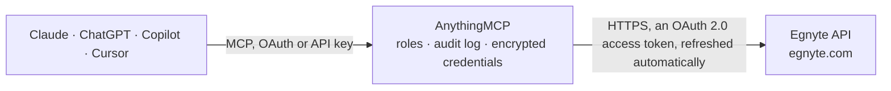

<!-- Generated by scripts/export-github-catalog.mjs in the anythingmcp-website repository. Do not edit by hand. -->

# Egnyte MCP connector

Let your AI work with your Egnyte files: browse folders, read file details, versions and small text files, search names and contents, list and create share links after you confirm, read folder … The AnythingMCP connector gives Claude, ChatGPT, Microsoft Copilot, Cursor and Gemini 14 MCP tools for Egnyte: 12 read and 2 can change data.

**Category:** [File Storage](../storage.md) · **Tools:** 14 · **Setup guide:** [anythingmcp.com](https://anythingmcp.com/guides/egnyte-to-mcp) · [Deutsch](https://anythingmcp.com/de/guides/egnyte-to-mcp) · [Italiano](https://anythingmcp.com/it/guides/egnyte-to-mcp) · [Español](https://anythingmcp.com/es/guides/egnyte-to-mcp) · [日本語](https://anythingmcp.com/ja/guides/egnyte-to-mcp) · [Русский](https://anythingmcp.com/ru/guides/egnyte-to-mcp) · [中文](https://anythingmcp.com/zh/guides/egnyte-to-mcp)

## Start without code

No installation and no terminal: AnythingMCP Cloud runs the Egnyte connector for you, operated by helpcode.ai in Frankfurt, Germany.

1. **Click the button above** and create an account or sign in. The Egnyte connector opens, ready to install.
2. **Sign in with your Egnyte account** when AnythingMCP asks. The first time, an admin creates a small app in the Egnyte developer console. Every click is in the [step-by-step guide](https://anythingmcp.com/guides/egnyte-to-mcp).
3. **Click Install.** AnythingMCP shows the address of your MCP server.
4. **Add that address to your assistant:** [Claude](https://anythingmcp.com/guides/connect-egnyte-to-claude) · [ChatGPT](https://anythingmcp.com/guides/connect-egnyte-to-chatgpt) · [Microsoft Copilot](https://anythingmcp.com/guides/connect-egnyte-to-copilot) · [Cursor](https://anythingmcp.com/guides/connect-egnyte-to-cursor) · [Gemini CLI](https://anythingmcp.com/guides/connect-egnyte-to-gemini) · [Meta Muse](https://anythingmcp.com/guides/connect-egnyte-to-muse).
5. **Ask your first question**, for example: *Locate invoice INV-2026-014 for Solarello GmbH under /Shared/Finance/Invoices and show its file details.*

Prefer help with the setup? [Talk to us](https://anythingmcp.com/contact).

## How it works

- **The AI client** speaks MCP (Streamable HTTP) to AnythingMCP and only sees tool names, descriptions and results. It never gets the Egnyte credentials.
- **AnythingMCP** checks the client's role, builds the call from the tool definition, adds the credentials (an OAuth 2.0 access token, refreshed automatically), calls Egnyte, logs the call and returns the result.
- **Egnyte** sees an ordinary API client with the rights of the account the credentials belong to.

## Tools

| Tool | What it does | Access |
|---|---|---|
| [`egnyte_get_user_info`](#egnyte_get_user_info) | Read who the connector acts as: user id, username, first and last name, e-mail and user type. | read |
| [`egnyte_list_folder`](#egnyte_list_folder) | List a folder's subfolders and files: names, paths, folder ids, file sizes in bytes, last modified, uploader, number of versions and lock state. | read |
| [`egnyte_get_item`](#egnyte_get_item) | Read the details of one file or folder without listing contents: for a file its size, last modified, uploader, ids, number of versions, lock and checksum;… | read |
| [`egnyte_list_file_versions`](#egnyte_list_file_versions) | List the versions of a file: the current version and every earlier one with entry_id, size, last modified, uploader and checksum. | read |
| [`egnyte_search`](#egnyte_search) | Search files and folders by name, content or comments. | read |
| [`egnyte_read_text_file`](#egnyte_read_text_file) | Read the beginning of a text file (txt, csv, md, json, xml, html, source code), at most max_bytes bytes. | read |
| [`egnyte_list_links`](#egnyte_list_links) | List share links with their details: id, URL, target path, type (file, folder, upload), who can open it (anyone, password, domain, recipients), creator,… | read |
| [`egnyte_get_link`](#egnyte_get_link) | Read one share link by id: URL, target path, type, accessibility, recipients, notification, expiry, creator and last access. | read |
| [`egnyte_create_link`](#egnyte_create_link) | Create a share link to a file or folder. | write |
| [`egnyte_get_folder_permissions`](#egnyte_get_folder_permissions) | Read the permissions set on a folder: each user's and group's level (Viewer Only, Viewer, Editor, Full, Owner) and whether the folder inherits permissions… | read |
| [`egnyte_get_effective_permission`](#egnyte_get_effective_permission) | Check the effective permission of one user on a folder, taking groups and inheritance into account: None, Nav, Viewer Only, Viewer, Editor, Full or Owner. | read |
| [`egnyte_get_events_cursor`](#egnyte_get_events_cursor) | Read the position of the activity stream: latest_event_id, oldest_event_id and the time of the latest event. | read |
| [`egnyte_list_events`](#egnyte_list_events) | Read file activity of the domain: creates, deletes, moves, copies, restores, comments and permission changes with time, source (web, sync, mobile, API) and… | read |
| [`egnyte_delete_item`](#egnyte_delete_item) | Delete a file or folder (it goes to Egnyte's trash). | write |

## Tool reference

Every parameter as the AI client sees it in `tools/list`. Source: [`packages/backend/src/adapters/intl/egnyte.json`](../../../packages/backend/src/adapters/intl/egnyte.json).

### `egnyte_get_user_info`

Read who the connector acts as: user id, username, first and last name, e-mail and user type. Use it first to check the connection.

**Access:** read · **Call:** `GET /v1/userinfo`

No parameters.

### `egnyte_list_folder`

List a folder's subfolders and files: names, paths, folder ids, file sizes in bytes, last modified, uploader, number of versions and lock state. Up to count items from offset (default 100); total_count tells how many there are.

**Access:** read · **Call:** `GET /v1/fs{path}`

| Parameter | Type | Required | Description |
|---|---|---|---|
| `path` | string | yes | Full path of the folder. Starts with /Shared or /Private, e.g. /Shared/Projects/Plan.docx. Write # as %23, ? as %3F and % as %25 in names. |
| `count` | integer | no | Items per page, default 100. |
| `offset` | integer | no | Index of the first item, for the next page. |
| `sort_by` | `name` \| `last_modified` \| `uploaded_by` | no | Sort by name, last_modified or uploaded_by. |
| `sort_direction` | `ascending` \| `descending` | no | ascending or descending. |

### `egnyte_get_item`

Read the details of one file or folder without listing contents: for a file its size, last modified, uploader, ids, number of versions, lock and checksum; for a folder its id, description, link settings and your permission level.

**Access:** read · **Call:** `GET /v1/fs{path}`

| Parameter | Type | Required | Description |
|---|---|---|---|
| `path` | string | yes | Full path of the file or folder. Starts with /Shared or /Private, e.g. /Shared/Projects/Plan.docx. Write # as %23, ? as %3F and % as %25 in names. |

### `egnyte_list_file_versions`

List the versions of a file: the current version and every earlier one with entry_id, size, last modified, uploader and checksum. Read an older version with egnyte_read_text_file and its entry_id.

**Access:** read · **Call:** `GET /v1/fs{path}`

| Parameter | Type | Required | Description |
|---|---|---|---|
| `path` | string | yes | Full path of the file. Starts with /Shared or /Private, e.g. /Shared/Projects/Plan.docx. Write # as %23, ? as %3F and % as %25 in names. |

### `egnyte_search`

Search files and folders by name, content or comments. query takes 3 to 100 characters; results carry name, path, type, size, a text snippet, last modified and uploader, 20 per page (use offset for more). Filter by folder, type and modification date.

**Access:** read · **Call:** `GET /v1/search`

| Parameter | Type | Required | Description |
|---|---|---|---|
| `query` | string | yes | What to look for, 3 to 100 characters. |
| `folder` | string | no | Only inside this folder (and below), e.g. /Shared/Projects. |
| `type` | `FILE` \| `FOLDER` | no | FILE or FOLDER. |
| `modified_after` | string | no | Only items modified after this time, ISO 8601, e.g. 2026-09-01T00:00:00Z. |
| `modified_before` | string | no | Only items modified before this time, ISO 8601. |
| `sort_by` | `score` \| `last_modified` \| `size` \| `name` | no | score (default), last_modified, size or name. |
| `sort_direction` | `ascending` \| `descending` | no | ascending or descending. |
| `offset` | integer | no | Index of the first result, for the next page. |
| `count` | integer | no | Results per page, 1 to 20. Default 20. |

### `egnyte_read_text_file`

Read the beginning of a text file (txt, csv, md, json, xml, html, source code), at most max_bytes bytes. JSON files that fit come back parsed. Not for PDFs, Office documents or images. Pass entry_id for an earlier version.

**Access:** read · **Call:** `GET /v1/fs-content{path}`

| Parameter | Type | Required | Description |
|---|---|---|---|
| `path` | string | yes | Full path of the file. Starts with /Shared or /Private, e.g. /Shared/Projects/Plan.docx. Write # as %23, ? as %3F and % as %25 in names. |
| `entry_id` | string | no | Version to read, from egnyte_list_file_versions. Default: the current version. |
| `max_bytes` | integer | no | How many bytes to read from the start, 1000 to 100000. Default 50000. |

### `egnyte_list_links`

List share links with their details: id, URL, target path, type (file, folder, upload), who can open it (anyone, password, domain, recipients), creator, creation, expiry and last access. Admins see all links, other users their own. Filter by path, creator, type, accessibility or creation date.

**Access:** read · **Call:** `GET /v2/links`

| Parameter | Type | Required | Description |
|---|---|---|---|
| `path` | string | no | Only links to this file or folder path. |
| `username` | string | no | Only links created by this user. |
| `type` | `file` \| `folder` | no | file or folder. |
| `accessibility` | `anyone` \| `password` \| `domain` \| `recipients` | no | anyone, password, domain or recipients. |
| `created_after` | string | no | Only links created after this date, YYYY-MM-DD. |
| `created_before` | string | no | Only links created before this date, YYYY-MM-DD. |
| `offset` | integer | no | Index of the first link, for the next page. |
| `count` | integer | no | Links per page, at most 500. Default 50. |

### `egnyte_get_link`

Read one share link by id: URL, target path, type, accessibility, recipients, notification, expiry, creator and last access.

**Access:** read · **Call:** `GET /v1/links/{link_id}`

| Parameter | Type | Required | Description |
|---|---|---|---|
| `link_id` | string | yes | The link id, e.g. 6a7ILnZZZ. |

### `egnyte_create_link`

Create a share link to a file or folder. accessibility decides who can open it: anyone with the link, password (Egnyte generates one unless you give it), domain (signed-in users of your Egnyte) or recipients (only the listed e-mails). Optional expiry date or click limit, preview only, and e-mail to recipients. Show the user the target, accessibility and expiry and confirm before calling.

**Access:** write · **Call:** `POST /v1/links`

| Parameter | Type | Required | Description |
|---|---|---|---|
| `path` | string | yes | Full path of the file or folder to share. Starts with /Shared or /Private, e.g. /Shared/Projects/Plan.docx. Write # as %23, ? as %3F and % as %25 in names. |
| `type` | `file` \| `folder` | yes | file or folder. |
| `accessibility` | `anyone` \| `password` \| `domain` \| `recipients` | yes | Who can open it. |
| `expiry_date` | string | no | Last day the link works, YYYY-MM-DD. Not together with expiry_clicks. |
| `expiry_clicks` | integer | no | Number of opens before the link stops working, 1 to 10. Not together with expiry_date. |
| `password` | string | no | Password for accessibility password. Leave out to let Egnyte generate one. |
| `protection` | `NONE` \| `PREVIEW` | no | PREVIEW makes a preview-only link (no download); NONE is a normal link. |
| `send_email` | boolean | no | true lets Egnyte e-mail the link to recipients. |
| `recipients` | string[] | no | E-mail addresses; required with send_email or accessibility recipients. |
| `message` | string | no | Personal message for the e-mail. |
| `notify` | boolean | no | true e-mails you when someone opens the link. |
| `link_to_current` | boolean | no | For files: true always serves the current version. |

### `egnyte_get_folder_permissions`

Read the permissions set on a folder: each user's and group's level (Viewer Only, Viewer, Editor, Full, Owner) and whether the folder inherits permissions from its parent.

**Access:** read · **Call:** `GET /v2/perms{path}`

| Parameter | Type | Required | Description |
|---|---|---|---|
| `path` | string | yes | Full path of the folder. Starts with /Shared or /Private, e.g. /Shared/Projects/Plan.docx. Write # as %23, ? as %3F and % as %25 in names. |

### `egnyte_get_effective_permission`

Check the effective permission of one user on a folder, taking groups and inheritance into account: None, Nav, Viewer Only, Viewer, Editor, Full or Owner.

**Access:** read · **Call:** `GET /v1/perms/user/{username}`

| Parameter | Type | Required | Description |
|---|---|---|---|
| `username` | string | yes | The Egnyte username to check. |
| `folder` | string | yes | Full folder path, e.g. /Shared/Finance. |

### `egnyte_get_events_cursor`

Read the position of the activity stream: latest_event_id, oldest_event_id and the time of the latest event. Use latest_event_id with egnyte_list_events and reverse 1 to read the most recent activity.

**Access:** read · **Call:** `GET /v1/events/cursor`

No parameters.

### `egnyte_list_events`

Read file activity of the domain: creates, deletes, moves, copies, restores, comments and permission changes with time, source (web, sync, mobile, API) and paths. Without reverse it returns events after id; with reverse 1 the count events up to id. Events are kept up to 30 days. An empty answer means no events.

**Access:** read · **Call:** `GET /v2/events`

| Parameter | Type | Required | Description |
|---|---|---|---|
| `id` | integer | yes | Cursor: an event id from egnyte_get_events_cursor or a previous answer. |
| `reverse` | `1` | no | Pass 1 to read backwards, the events up to id. |
| `count` | integer | no | Events per page, 1 to 100. Default 50. |
| `folder` | string | no | Only events in this folder and below, e.g. /Shared/Finance. |
| `type` | string | no | Event types separated by \|, e.g. file_system\|permission_change. Default all. |

### `egnyte_delete_item`

Delete a file or folder (it goes to Egnyte's trash). Installed switched off. Only when the user explicitly asks; confirm the path first.

**Access:** write · **Call:** `DELETE /v1/fs{path}`

| Parameter | Type | Required | Description |
|---|---|---|---|
| `path` | string | yes | Full path of the file or folder. Starts with /Shared or /Private, e.g. /Shared/Projects/Plan.docx. Write # as %23, ? as %3F and % as %25 in names. |

## Run it yourself

AnythingMCP is open source (AGPL-3.0). [Run it with Docker](../../../README.md#run-it-yourself), open **Connectors → Store**, pick **Egnyte** and enter `EGNYTE_DOMAIN`, `EGNYTE_CLIENT_ID`, `EGNYTE_CLIENT_SECRET`, `EGNYTE_USERNAME`, `EGNYTE_PASSWORD`, then add your MCP server URL to the AI client.

[← File Storage connectors](../storage.md) · [All categories](../README.md)
