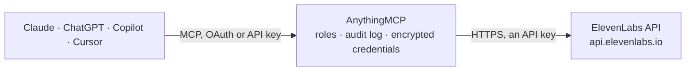

<!-- Generated by scripts/export-github-catalog.mjs in the anythingmcp-website repository. Do not edit by hand. -->

# ElevenLabs MCP connector

Let your AI use ElevenLabs with your own key: find voices in your account and the Voice Library, turn text into speech you can download, transcribe audio and video, dub videos into other languages, … The AnythingMCP connector gives Claude, ChatGPT, Microsoft Copilot, Cursor and Gemini 22 MCP tools for ElevenLabs: 17 read and 5 can change data.

**Category:** [Publishing](../publishing.md) · **Tools:** 22 · **Setup guide:** [anythingmcp.com](https://anythingmcp.com/guides/elevenlabs-to-mcp) · [Deutsch](https://anythingmcp.com/de/guides/elevenlabs-to-mcp) · [Italiano](https://anythingmcp.com/it/guides/elevenlabs-to-mcp) · [Español](https://anythingmcp.com/es/guides/elevenlabs-to-mcp) · [日本語](https://anythingmcp.com/ja/guides/elevenlabs-to-mcp) · [Русский](https://anythingmcp.com/ru/guides/elevenlabs-to-mcp) · [中文](https://anythingmcp.com/zh/guides/elevenlabs-to-mcp)

## Start without code

No installation and no terminal: AnythingMCP Cloud runs the ElevenLabs connector for you, operated by helpcode.ai in Frankfurt, Germany.

1. **Click the button above** and create an account or sign in. The ElevenLabs connector opens, ready to install.
2. **Paste the API key or token from your ElevenLabs account.** Every click is in the [step-by-step guide](https://anythingmcp.com/guides/elevenlabs-to-mcp).
3. **Click Install.** AnythingMCP shows the address of your MCP server.
4. **Add that address to your assistant:** [Claude](https://anythingmcp.com/guides/connect-elevenlabs-to-claude) · [ChatGPT](https://anythingmcp.com/guides/connect-elevenlabs-to-chatgpt) · [Microsoft Copilot](https://anythingmcp.com/guides/connect-elevenlabs-to-copilot) · [Cursor](https://anythingmcp.com/guides/connect-elevenlabs-to-cursor) · [Gemini CLI](https://anythingmcp.com/guides/connect-elevenlabs-to-gemini) · [Meta Muse](https://anythingmcp.com/guides/connect-elevenlabs-to-muse).
5. **Ask your first question**, for example: *Which voice produced the demo audio titled 'GreenStream demo v2' in our ElevenLabs history on 2026-10-02?*

Prefer help with the setup? [Talk to us](https://anythingmcp.com/contact).

## How it works

- **The AI client** speaks MCP (Streamable HTTP) to AnythingMCP and only sees tool names, descriptions and results. It never gets the ElevenLabs credentials.
- **AnythingMCP** checks the client's role, builds the call from the tool definition, adds the credentials (an API key), calls ElevenLabs, logs the call and returns the result.
- **ElevenLabs** sees an ordinary API client with the rights of the account the credentials belong to.

## Tools

| Tool | What it does | Access |
|---|---|---|
| [`elevenlabs_list_voices`](#elevenlabs_list_voices) | List the voices in the user's ElevenLabs account (premade, cloned, generated, professional and voices saved from the Voice Library), with id, name,… | read |
| [`elevenlabs_get_voice`](#elevenlabs_get_voice) | Get one voice by id: name, category, labels, description, preview link, default settings, the models it is tuned for and its verified languages. | read |
| [`elevenlabs_search_voice_library`](#elevenlabs_search_voice_library) | Search the public ElevenLabs Voice Library (voices shared by the community and professional voice actors) by words, gender, age, accent, language, locale or… | read |
| [`elevenlabs_add_library_voice`](#elevenlabs_add_library_voice) | Save a voice from the public Voice Library to the user's account under a new name, so it can be used for speech. | write |
| [`elevenlabs_list_models`](#elevenlabs_list_models) | List the ElevenLabs models with id, name, whether they do text to speech, their cost factor, maximum text length per request and supported languages. | read |
| [`elevenlabs_create_speech`](#elevenlabs_create_speech) | Turn text into spoken audio (MP3) with an ElevenLabs voice. | write |
| [`elevenlabs_get_speech`](#elevenlabs_get_speech) | Check a speech generation started with elevenlabs_create_speech. | read |
| [`elevenlabs_list_speech_generations`](#elevenlabs_list_speech_generations) | List the speech generations made through elevenlabs_create_speech (and other API calls of the same kind), newest first, with status and, when completed, a… | read |
| [`elevenlabs_transcribe`](#elevenlabs_transcribe) | Transcribe the speech in an audio or video file to text with ElevenLabs Scribe, optionally telling speakers apart. | write |
| [`elevenlabs_get_transcript`](#elevenlabs_get_transcript) | Get a transcript made with elevenlabs_transcribe by its transcription_id: the full text plus every word as [start second, speaker id, word], which shows who… | read |
| [`elevenlabs_list_history`](#elevenlabs_list_history) | List the audio generated in the account (text to speech, speech to speech, Studio, dubbing), newest first, with text, voice, model, date and source. | read |
| [`elevenlabs_get_history_item`](#elevenlabs_get_history_item) | Get one generated audio item from the history: text, voice, model, settings, date, source and character usage. | read |
| [`elevenlabs_delete_history_item`](#elevenlabs_delete_history_item) | Delete one generated audio item from the history. | write |
| [`elevenlabs_get_subscription`](#elevenlabs_get_subscription) | Show the account's plan and usage: tier, status, credits used (character_count) and included (character_limit) this period, when they reset… | read |
| [`elevenlabs_create_dubbing`](#elevenlabs_create_dubbing) | Dub a video or audio file into another language with ElevenLabs, keeping the original speakers' voices. | write |
| [`elevenlabs_get_dubbing`](#elevenlabs_get_dubbing) | Check a dubbing project: status (dubbing while it runs, dubbed when done, failed with error), source and target languages and media details. | read |
| [`elevenlabs_list_dubbings`](#elevenlabs_list_dubbings) | List the dubbing projects in the account, newest first, with id, name, status and languages. | read |
| [`elevenlabs_get_dubbing_transcript`](#elevenlabs_get_dubbing_transcript) | Get the subtitles of a finished dub as SRT or WebVTT text, for a target language or for the original (language_code source). | read |
| [`elevenlabs_list_agents`](#elevenlabs_list_agents) | List the ElevenLabs voice agents (ElevenAgents, formerly Conversational AI) in the account, with id, name, tags and last call time. | read |
| [`elevenlabs_get_agent`](#elevenlabs_get_agent) | Get a voice agent's setup: name, first message, language, system prompt, LLM, voice and TTS model, tags and phone numbers. | read |
| [`elevenlabs_list_conversations`](#elevenlabs_list_conversations) | List the conversations held by the account's voice agents, newest first: id, agent, start time, duration, number of messages, status, success evaluation and… | read |
| [`elevenlabs_get_conversation`](#elevenlabs_get_conversation) | Read one agent conversation: the transcript (who said what, at which second, and which tools the agent called), status, duration, termination reason, and… | read |

## Tool reference

Every parameter as the AI client sees it in `tools/list`. Source: [`packages/backend/src/adapters/intl/elevenlabs.json`](../../../packages/backend/src/adapters/intl/elevenlabs.json).

### `elevenlabs_list_voices`

List the voices in the user's ElevenLabs account (premade, cloned, generated, professional and voices saved from the Voice Library), with id, name, category, labels and a preview link. Search by name or description and filter by type, gender, age, accent or language. Call again with next_page_token while has_more is true. Free.

**Access:** read · **Call:** `GET /v2/voices`

| Parameter | Type | Required | Description |
|---|---|---|---|
| `search` | string | no | Words to look for in the voice name, description, labels or category. |
| `voice_type` | `personal` \| `community` \| `default` \| `workspace` \| `non-default` \| `non-community` \| `saved` | no | personal (the user's own), community (saved from the Voice Library), default (premade), workspace (shared in the workspace), saved, non-default or non-community. |
| `category` | `premade` \| `cloned` \| `generated` \| `professional` | no | Voice category. |
| `gender` | string | no | Gender label, e.g. male or female. |
| `age` | string | no | Age label, e.g. young, middle_aged or old. |
| `accent` | string | no | Accent label, e.g. british or american. |
| `language` | string | no | Language label as an ISO 639-1 code, e.g. en or de. |
| `sort` | `name` \| `created_at_unix` | no | Sort field. |
| `sort_direction` | `asc` \| `desc` | no | Sort direction. |
| `page_size` | integer | no | Voices per page, 1 to 100. Default 30. |
| `next_page_token` | string | no | next_page_token from the previous page. |

### `elevenlabs_get_voice`

Get one voice by id: name, category, labels, description, preview link, default settings, the models it is tuned for and its verified languages. Free.

**Access:** read · **Call:** `GET /v1/voices/{voice_id}`

| Parameter | Type | Required | Description |
|---|---|---|---|
| `voice_id` | string | yes | Voice id from elevenlabs_list_voices, e.g. JBFqnCBsd6RMkjVDRZzb. |

### `elevenlabs_search_voice_library`

Search the public ElevenLabs Voice Library (voices shared by the community and professional voice actors) by words, gender, age, accent, language, locale or use case. Each result has public_owner_id and voice_id, which elevenlabs_add_library_voice needs to save it to the account. Page with page (0, 1, 2...) while has_more is true. Free.

**Access:** read · **Call:** `GET /v1/shared-voices`

| Parameter | Type | Required | Description |
|---|---|---|---|
| `search` | string | no | Words to look for, e.g. calm narrator or german news. |
| `gender` | string | no | male, female or neutral. |
| `age` | string | no | young, middle_aged or old. |
| `accent` | string | no | Accent, e.g. british, american, australian. |
| `language` | string | no | Language as an ISO 639-1 code, e.g. en, de, it. |
| `locale` | string | no | Locale, e.g. en-US or de-DE. |
| `category` | `professional` \| `famous` \| `high_quality` | no | Voice category. |
| `use_cases` | string[] | no | Use cases, e.g. narrative_story, conversational, social_media, advertisement, informative_educational. |
| `featured` | boolean | no | Only featured voices. |
| `sort` | `created_date` \| `usage_character_count_1y` \| `trending` \| `cloned_by_count` | no | Sort order. Default created_date. |
| `page_size` | integer | no | Voices per page, 1 to 100. Default 20. |
| `page` | integer | no | Page number, starting at 0. |

### `elevenlabs_add_library_voice`

Save a voice from the public Voice Library to the user's account under a new name, so it can be used for speech. Costs nothing but takes one of the account's custom voice slots (see voice_slots_used and voice_limit in elevenlabs_get_subscription). Confirm with the user before calling.

**Access:** write · **Call:** `POST /v1/voices/add/{public_user_id}/{voice_id}`

| Parameter | Type | Required | Description |
|---|---|---|---|
| `public_user_id` | string | yes | public_owner_id of the voice, from elevenlabs_search_voice_library. |
| `voice_id` | string | yes | voice_id of the library voice. |
| `new_name` | string | yes | Name the voice gets in the user's account. |

### `elevenlabs_list_models`

List the ElevenLabs models with id, name, whether they do text to speech, their cost factor, maximum text length per request and supported languages. Free.

**Access:** read · **Call:** `GET /v1/models`

No parameters.

### `elevenlabs_create_speech`

Turn text into spoken audio (MP3) with an ElevenLabs voice. The audio is made in the background: this call returns a generation id, then elevenlabs_get_speech returns a download link once it is ready (usually within seconds). COSTS CREDITS: about 1 credit per character with eleven_multilingual_v2 and eleven_v3, about 0.5 with eleven_flash_v2_5 (on pay-as-you-go API billing about $0.08 or $0.04 per 1,000 characters). Tell the user the character count and confirm before calling.

**Access:** write · **Call:** `POST /v1/flows/text-to-speech`

| Parameter | Type | Required | Description |
|---|---|---|---|
| `text` | string | yes | The text to speak. Up to 10,000 characters with eleven_multilingual_v2, 5,000 with eleven_v3, 40,000 with eleven_flash_v2_5. eleven_v3 understands audio tags such as [whispers] or [laughs]. |
| `voice` | string | yes | Voice id from elevenlabs_list_voices, e.g. JBFqnCBsd6RMkjVDRZzb. |
| `model_id` | `eleven_multilingual_v2` \| `eleven_v3` \| `eleven_flash_v2_5` | no | eleven_multilingual_v2 (default, natural and stable, 29 languages), eleven_v3 (most expressive, 70+ languages) or eleven_flash_v2_5 (fastest, half the cost). |
| `output_format` | `mp3_22050_32` \| `mp3_24000_48` \| `mp3_44100_32` \| `mp3_44100_64` \| `mp3_44100_96` \| `mp3_44100_128` \| `mp3_44100_192` | no | MP3 sample rate and bitrate. Default mp3_44100_128; mp3_44100_192 needs the Creator plan or higher. |
| `language_code` | string | no | ISO 639-1 code to force the language, e.g. de. Only with eleven_v3 and eleven_flash_v2_5; leave it out for eleven_multilingual_v2. |
| `voice_settings` | object | no | Optional overrides for this generation only. eleven_multilingual_v2: stability, similarity_boost, style (0 to 1), use_speaker_boost (true/false), speed (about 0.7 to 1.2). eleven_flash_v2_5: stability, similarity_boost, speed. eleven_v3: stability only. |

### `elevenlabs_get_speech`

Check a speech generation started with elevenlabs_create_speech. status is pending or generating while it runs (wait a few seconds and call again), completed with content_url (a signed MP3 download link that expires after about an hour; call again for a fresh one) or failed with failure_reason and error_message (failed generations are not charged). Give the user the content_url to listen or download. Free.

**Access:** read · **Call:** `GET /v1/flows/text-to-speech/{generation_id}`

| Parameter | Type | Required | Description |
|---|---|---|---|
| `generation_id` | string | yes | id returned by elevenlabs_create_speech. |

### `elevenlabs_list_speech_generations`

List the speech generations made through elevenlabs_create_speech (and other API calls of the same kind), newest first, with status and, when completed, a fresh download link. Call again with cursor = next_cursor while has_more is true. Free.

**Access:** read · **Call:** `GET /v1/flows/text-to-speech`

| Parameter | Type | Required | Description |
|---|---|---|---|
| `status` | `pending` \| `generating` \| `completed` \| `failed` | no | Only generations with this status. |
| `model_id` | string | no | Only generations of this model. |
| `page_size` | integer | no | Generations per page, 1 to 100. Default 30. |
| `cursor` | string | no | next_cursor from the previous page. |

### `elevenlabs_transcribe`

Transcribe the speech in an audio or video file to text with ElevenLabs Scribe, optionally telling speakers apart. Pass source_url (a public link to the file, also YouTube or TikTok links; up to 2 GB) or file_url (a direct link AnythingMCP downloads and uploads, up to 10 MB). Returns the text, the detected language, the duration and a transcription_id; elevenlabs_get_transcript returns the word timings and speakers. COSTS MONEY: about $0.22 per hour of audio on pay-as-you-go API billing (credits on a subscription plan). Confirm with the user before transcribing long recordings.

**Access:** write · **Call:** `POST /v1/speech-to-text`

| Parameter | Type | Required | Description |
|---|---|---|---|
| `source_url` | string | no | Public HTTPS link to the audio or video file, or a YouTube or TikTok video URL. ElevenLabs downloads it. |
| `file_url` | string | no | Use instead of source_url when ElevenLabs cannot open the link: a direct link to the file that AnythingMCP downloads (max 10 MB) and uploads. |
| `model_id` | string | no | scribe_v2 (default) or scribe_v2_medical for clinical audio. |
| `language_code` | string | no | ISO 639-1 or 639-3 code of the spoken language, e.g. en or deu. Leave it out to detect it. |
| `diarize` | boolean | no | Tell speakers apart (speaker ids in elevenlabs_get_transcript). Default false. |
| `num_speakers` | integer | no | Maximum number of speakers, up to 32. Helps diarization. |
| `tag_audio_events` | boolean | no | Mark sounds such as (laughter) or (applause) in the text. Default true. |
| `no_verbatim` | boolean | no | Leave out filler words, false starts and non-speech sounds. Default false. |
| `transcript_edit` | string | no | Optional instruction applied to the finished transcript, e.g. Fix product names. The result comes back as edited_transcript. Adds 30% to the transcription cost. |

### `elevenlabs_get_transcript`

Get a transcript made with elevenlabs_transcribe by its transcription_id: the full text plus every word as [start second, speaker id, word], which shows who said what and when (speaker ids only when the transcription used diarize). Long recordings are cut at about 250 KB. Free.

**Access:** read · **Call:** `GET /v1/speech-to-text/transcripts/{transcription_id}`

| Parameter | Type | Required | Description |
|---|---|---|---|
| `transcription_id` | string | yes | transcription_id returned by elevenlabs_transcribe. |

### `elevenlabs_list_history`

List the audio generated in the account (text to speech, speech to speech, Studio, dubbing), newest first, with text, voice, model, date and source. Sound effects and music are not in this history. Page with start_after_history_item_id = last_history_item_id while has_more is true. Free.

**Access:** read · **Call:** `GET /v1/history`

| Parameter | Type | Required | Description |
|---|---|---|---|
| `search` | string | no | Words to look for in the generated text. |
| `voice_id` | string | no | Only items of this voice. |
| `model_id` | string | no | Only items of this model. |
| `source` | `TTS` \| `STS` \| `Flows` | no | TTS (text to speech), STS (speech to speech) or Flows (made with elevenlabs_create_speech). |
| `date_after_unix` | integer | no | Only items created at or after this Unix time (seconds). |
| `date_before_unix` | integer | no | Only items created before this Unix time (seconds). |
| `page_size` | integer | no | Items per page, 1 to 1,000. Default 30. |
| `start_after_history_item_id` | string | no | last_history_item_id of the previous page. |

### `elevenlabs_get_history_item`

Get one generated audio item from the history: text, voice, model, settings, date, source and character usage. The audio itself can be played and downloaded in the ElevenLabs app under History. Free.

**Access:** read · **Call:** `GET /v1/history/{history_item_id}`

| Parameter | Type | Required | Description |
|---|---|---|---|
| `history_item_id` | string | yes | history_item_id from elevenlabs_list_history. |

### `elevenlabs_delete_history_item`

Delete one generated audio item from the history. It cannot be restored. Confirm with the user first. Installed switched off.

**Access:** write · **Call:** `DELETE /v1/history/{history_item_id}`

| Parameter | Type | Required | Description |
|---|---|---|---|
| `history_item_id` | string | yes | history_item_id from elevenlabs_list_history. |

### `elevenlabs_get_subscription`

Show the account's plan and usage: tier, status, credits used (character_count) and included (character_limit) this period, when they reset (next_character_count_reset_unix), voice slots and whether usage-based overage is allowed. Use it before costly calls. Free.

**Access:** read · **Call:** `GET /v1/user/subscription`

No parameters.

### `elevenlabs_create_dubbing`

Dub a video or audio file into another language with ElevenLabs, keeping the original speakers' voices. Pass a public link to the file (also YouTube and other video sites). Runs in the background: returns dubbing_id and expected_duration_sec; check with elevenlabs_get_dubbing until status is dubbed. COSTS MONEY per minute of media: on pay-as-you-go API billing about $0.33 a minute with a watermark and $0.50 without (credits on a subscription plan). Tell the user the cost for the file's length and confirm before calling.

**Access:** write · **Call:** `POST /v1/dubbing`

| Parameter | Type | Required | Description |
|---|---|---|---|
| `source_url` | string | yes | Public link to the video or audio file, or a YouTube or other video page URL. |
| `target_lang` | string | yes | Language to dub into, ISO 639-1 code, e.g. de, es, it, ja. |
| `source_lang` | string | no | Language of the original, ISO 639-1 code. Default auto (detected). |
| `name` | string | no | Name of the dubbing project. |
| `num_speakers` | integer | no | Number of speakers; 0 (default) detects them. |
| `watermark` | boolean | no | Put a watermark on the output video (cheaper). Default false. |
| `start_time` | integer | no | Dub only from this second of the source. |
| `end_time` | integer | no | Dub only up to this second of the source. |
| `highest_resolution` | boolean | no | Use the highest resolution available. Default false. |
| `drop_background_audio` | boolean | no | Remove background music and noise from the dub. Default false. |
| `disable_voice_cloning` | boolean | no | Use similar Voice Library voices instead of cloning the speakers. Default false. |

### `elevenlabs_get_dubbing`

Check a dubbing project: status (dubbing while it runs, dubbed when done, failed with error), source and target languages and media details. A finished dub is played and downloaded in the ElevenLabs app under Dubbing; elevenlabs_get_dubbing_transcript returns its subtitles. Poll every 30 to 60 seconds, not faster. Free.

**Access:** read · **Call:** `GET /v1/dubbing/{dubbing_id}`

| Parameter | Type | Required | Description |
|---|---|---|---|
| `dubbing_id` | string | yes | dubbing_id from elevenlabs_create_dubbing or elevenlabs_list_dubbings. |

### `elevenlabs_list_dubbings`

List the dubbing projects in the account, newest first, with id, name, status and languages. Call again with cursor = next_cursor while has_more is true. Free.

**Access:** read · **Call:** `GET /v1/dubbing`

| Parameter | Type | Required | Description |
|---|---|---|---|
| `dubbing_status` | `dubbing` \| `dubbed` \| `failed` | no | Only projects in this state. |
| `filter_by_creator` | `personal` \| `others` \| `all` | no | Projects created by the key's user, by others, or all (default). |
| `page_size` | integer | no | Projects per page, 1 to 200. Default 30. |
| `cursor` | string | no | next_cursor from the previous page. |

### `elevenlabs_get_dubbing_transcript`

Get the subtitles of a finished dub as SRT or WebVTT text, for a target language or for the original (language_code source). Long media is cut at about 200 KB. Free.

**Access:** read · **Call:** `GET /v1/dubbing/{dubbing_id}/transcripts/{language_code}/format/{format_type}`

| Parameter | Type | Required | Description |
|---|---|---|---|
| `dubbing_id` | string | yes | dubbing_id of a dub with status dubbed. |
| `language_code` | string | yes | A target language of the dub, e.g. de, or source for the original. |
| `format_type` | `srt` \| `webvtt` | no | srt (default) or webvtt. |

### `elevenlabs_list_agents`

List the ElevenLabs voice agents (ElevenAgents, formerly Conversational AI) in the account, with id, name, tags and last call time. Call again with cursor = next_cursor while has_more is true. Free.

**Access:** read · **Call:** `GET /v1/convai/agents`

| Parameter | Type | Required | Description |
|---|---|---|---|
| `search` | string | no | Words to look for in the agent name. |
| `archived` | boolean | no | true lists archived agents instead. Default false. |
| `page_size` | integer | no | Agents per page, 1 to 100. Default 30. |
| `cursor` | string | no | next_cursor from the previous page. |

### `elevenlabs_get_agent`

Get a voice agent's setup: name, first message, language, system prompt, LLM, voice and TTS model, tags and phone numbers. Free.

**Access:** read · **Call:** `GET /v1/convai/agents/{agent_id}`

| Parameter | Type | Required | Description |
|---|---|---|---|
| `agent_id` | string | yes | agent_id from elevenlabs_list_agents. |

### `elevenlabs_list_conversations`

List the conversations held by the account's voice agents, newest first: id, agent, start time, duration, number of messages, status, success evaluation and a short title (with summary_mode include, also the summary). Filter by agent, time, outcome or words in the transcript. Call again with cursor = next_cursor while has_more is true. Free.

**Access:** read · **Call:** `GET /v1/convai/conversations`

| Parameter | Type | Required | Description |
|---|---|---|---|
| `agent_id` | string | no | Only conversations of this agent. |
| `call_successful` | `success` \| `failure` \| `unknown` | no | Only conversations with this success evaluation. |
| `call_start_after_unix` | integer | no | Only conversations that started after this Unix time (seconds). |
| `call_start_before_unix` | integer | no | Only conversations that started before this Unix time (seconds). |
| `search` | string | no | Words to look for in the transcripts. |
| `summary_mode` | `exclude` \| `include` | no | include adds each conversation's transcript summary. Default exclude. |
| `page_size` | integer | no | Conversations per page, 1 to 100. Default 30. |
| `cursor` | string | no | next_cursor from the previous page. |

### `elevenlabs_get_conversation`

Read one agent conversation: the transcript (who said what, at which second, and which tools the agent called), status, duration, termination reason, and the analysis (success, summary, data collection and evaluation results). The call recording itself is played in the ElevenLabs app. Free.

**Access:** read · **Call:** `GET /v1/convai/conversations/{conversation_id}`

| Parameter | Type | Required | Description |
|---|---|---|---|
| `conversation_id` | string | yes | conversation_id from elevenlabs_list_conversations. |

## Run it yourself

AnythingMCP is open source (AGPL-3.0). [Run it with Docker](../../../README.md#run-it-yourself), open **Connectors → Store**, pick **ElevenLabs** and enter `ELEVENLABS_API_KEY`, then add your MCP server URL to the AI client.

[← Publishing connectors](../publishing.md) · [All categories](../README.md)
