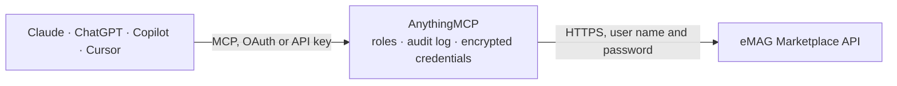

<!-- Generated by scripts/export-github-catalog.mjs in the anythingmcp-website repository. Do not edit by hand. -->

# eMAG Marketplace MCP connector

Sell on eMAG Romania, Bulgaria and Hungary from an AI agent: products and offers, prices and stock, orders with acknowledge and status changes, AWB shipping labels, returns (RMA), categories and … The AnythingMCP connector gives Claude, ChatGPT, Microsoft Copilot, Cursor and Gemini 39 MCP tools for eMAG Marketplace: 28 read and 11 can change data.

**Category:** [E-commerce](../e-commerce.md) · **Tools:** 39 · **Setup guide:** [anythingmcp.com](https://anythingmcp.com/guides/emag-marketplace-to-mcp) · [Deutsch](https://anythingmcp.com/de/guides/emag-marketplace-to-mcp) · [Italiano](https://anythingmcp.com/it/guides/emag-marketplace-to-mcp) · [Español](https://anythingmcp.com/es/guides/emag-marketplace-to-mcp) · [日本語](https://anythingmcp.com/ja/guides/emag-marketplace-to-mcp) · [Русский](https://anythingmcp.com/ru/guides/emag-marketplace-to-mcp) · [中文](https://anythingmcp.com/zh/guides/emag-marketplace-to-mcp)

## Start without code

No installation and no terminal: AnythingMCP Cloud runs the eMAG Marketplace connector for you, operated by helpcode.ai in Frankfurt, Germany.

1. **Click the button above** and create an account or sign in. The eMAG Marketplace connector opens, ready to install.
2. **Paste the API key or token from your eMAG Marketplace account.** Every click is in the [step-by-step guide](https://anythingmcp.com/guides/emag-marketplace-to-mcp).
3. **Click Install.** AnythingMCP shows the address of your MCP server.
4. **Add that address to your assistant:** [Claude](https://anythingmcp.com/guides/connect-emag-marketplace-to-claude) · [ChatGPT](https://anythingmcp.com/guides/connect-emag-marketplace-to-chatgpt) · [Microsoft Copilot](https://anythingmcp.com/guides/connect-emag-marketplace-to-copilot) · [Cursor](https://anythingmcp.com/guides/connect-emag-marketplace-to-cursor) · [Gemini CLI](https://anythingmcp.com/guides/connect-emag-marketplace-to-gemini) · [Meta Muse](https://anythingmcp.com/guides/connect-emag-marketplace-to-muse).
5. **Ask your first question**, for example: *Pull invoice number EMG-FC-2026-091 (commission) for September 2026 from eMAG Romania*

Prefer help with the setup? [Talk to us](https://anythingmcp.com/contact).

## How it works

- **The AI client** speaks MCP (Streamable HTTP) to AnythingMCP and only sees tool names, descriptions and results. It never gets the eMAG Marketplace credentials.
- **AnythingMCP** checks the client's role, builds the call from the tool definition, adds the credentials (user name and password), calls eMAG Marketplace, logs the call and returns the result.
- **eMAG Marketplace** sees an ordinary API client with the rights of the account the credentials belong to.

## Tools

| Tool | What it does | Access |
|---|---|---|
| [`emag_marketplace_list_vat_rates`](#emag_marketplace_list_vat_rates) | List the VAT rates of the platform with their vat_id, which every offer you save must carry. | read |
| [`emag_marketplace_list_handling_times`](#emag_marketplace_list_handling_times) | List the handling time values (days until you hand an order to the courier) the platform accepts for the handling_time of an offer. | read |
| [`emag_marketplace_list_categories`](#emag_marketplace_list_categories) | Read eMAG categories. | read |
| [`emag_marketplace_count_categories`](#emag_marketplace_count_categories) | Count the eMAG categories you may read, to know how many pages emag_marketplace_list_categories has. | read |
| [`emag_marketplace_list_product_offers`](#emag_marketplace_list_product_offers) | Read your products and offers: price, stock per warehouse, handling time, status (1 active, 0 inactive, 2 end of life), documentation and offer validation… | read |
| [`emag_marketplace_count_product_offers`](#emag_marketplace_count_product_offers) | Count your products and offers with the same filters as emag_marketplace_list_product_offers, e.g. how many are inactive or have an invalid price. | read |
| [`emag_marketplace_find_products_by_ean`](#emag_marketplace_find_products_by_ean) | Check whether products already exist on eMAG by EAN (up to 100 at once): part_number_key, name, brand, category, whether you may add an offer and whether… | read |
| [`emag_marketplace_list_orders`](#emag_marketplace_list_orders) | Read orders with customer, delivery address, products (price, quantity, status, campaign), vouchers, payment method, shipping tax and attachments. | read |
| [`emag_marketplace_count_orders`](#emag_marketplace_count_orders) | Count orders with the same filters as emag_marketplace_list_orders, e.g. how many new (status 1) orders wait. | read |
| [`emag_marketplace_list_order_attachments`](#emag_marketplace_list_order_attachments) | Read the attachments of an order (invoices, warranties, manuals, AWBs) with their type and URL. | read |
| [`emag_marketplace_get_order_volumetry`](#emag_marketplace_get_order_volumetry) | Read the weight and dimensions eMAG knows for each product of an order, to fill the packages of an AWB. | read |
| [`emag_marketplace_get_awb`](#emag_marketplace_get_awb) | Read an AWB (shipping label) issued through the API: order or return id, AWB number and barcode, courier, status history, weight and cash on delivery amount. | read |
| [`emag_marketplace_get_awb_pdf`](#emag_marketplace_get_awb_pdf) | Download an AWB issued through the API as a PDF in A4, A5 or A6 (or as ZPL), to print the shipping label. | read |
| [`emag_marketplace_get_awb_zpl`](#emag_marketplace_get_awb_zpl) | Read an AWB issued through the API in ZPL (base64), for thermal label printers. | read |
| [`emag_marketplace_list_returns`](#emag_marketplace_list_returns) | Read return requests (RMA) with order, products, return reason, pickup address, AWBs and status (1 incomplete, 2 new, 3 acknowledged, 4 refused, 5 canceled,… | read |
| [`emag_marketplace_count_returns`](#emag_marketplace_count_returns) | Count return requests with the same filters as emag_marketplace_list_returns, e.g. how many new (2) returns wait. | read |
| [`emag_marketplace_list_localities`](#emag_marketplace_list_localities) | Read localities (cities with their region, zip code and emag_id) for the sender and receiver of an AWB. | read |
| [`emag_marketplace_list_courier_accounts`](#emag_marketplace_list_courier_accounts) | List your courier accounts (id, courier name, type order or return, lockers or offices, status) to choose the courier_account_id of an AWB. | read |
| [`emag_marketplace_list_addresses`](#emag_marketplace_list_addresses) | List your pickup, return and invoice addresses (address_id, type, locality, street) to use as sender or return address of an AWB or return. | read |
| [`emag_marketplace_list_awb_packages`](#emag_marketplace_list_awb_packages) | List your predefined AWB packages (label, length, width, height, weight, default), used when issuing AWBs without explicit packages. | read |
| [`emag_marketplace_list_campaigns`](#emag_marketplace_list_campaigns) | Read the eMAG campaigns (Black Friday, discount, voucher, multi deals) with start, end and offer deadline and their participation rules (minimum discount,… | read |
| [`emag_marketplace_list_campaign_categories`](#emag_marketplace_list_campaign_categories) | Read the categories eligible for campaigns with restricted categories (participationRules.restrictedCategories true): id, name and parent. | read |
| [`emag_marketplace_list_campaign_eligible_offers`](#emag_marketplace_list_campaign_eligible_offers) | Read your offers that may join a campaign: current price, lowest price of the last 30 days (cmmp), maximum campaign price, stock, commission and the eMAG… | read |
| [`emag_marketplace_get_offer_campaign_badges`](#emag_marketplace_get_offer_campaign_badges) | Read the campaign badges (Black Friday, Genius Days and others) active or planned for one of your offers, with label text and dates. | read |
| [`emag_marketplace_check_smart_deals_price`](#emag_marketplace_check_smart_deals_price) | Get the price an offer must reach to qualify for the Smart Deals badge. | read |
| [`emag_marketplace_list_invoice_categories`](#emag_marketplace_list_invoice_categories) | List the categories of the invoices eMAG issues to you (e.g. FC commission) to filter emag_marketplace_list_invoices. | read |
| [`emag_marketplace_list_invoices`](#emag_marketplace_list_invoices) | Read the invoices eMAG issued to you (commission, services and others): number, date, lines, totals with and without VAT and currency. | read |
| [`emag_marketplace_list_customer_invoices`](#emag_marketplace_list_customer_invoices) | Read the invoices issued to your customers on eMAG orders (normal or storno): order id, number, date, lines and totals. | read |
| [`emag_marketplace_update_offers`](#emag_marketplace_update_offers) | Update existing offers only (light offer API, up to 50 per call): price, recommended, minimum and maximum price, stock and handling time per warehouse, VAT… | write |
| [`emag_marketplace_update_offer_stock`](#emag_marketplace_update_offer_stock) | Set the stock of one offer per warehouse (PATCH, stock only). | write |
| [`emag_marketplace_save_product_offers`](#emag_marketplace_save_product_offers) | Create new products with their offer, or update offers, up to 50 per call. | write |
| [`emag_marketplace_save_measurements`](#emag_marketplace_save_measurements) | Save the volume measurements of products (length, width, height in millimetres, weight in grams). | write |
| [`emag_marketplace_acknowledge_order`](#emag_marketplace_acknowledge_order) | Acknowledge a new order: moves it from 1 (new) to 2 (in progress) and stops eMAG notifying you about it. | write |
| [`emag_marketplace_save_order`](#emag_marketplace_save_order) | Update an order: set status 3 (prepared), 4 (finalized) or 0 (canceled with reason_cancellation), remove or add products, or storno a finalized order. | write |
| [`emag_marketplace_unlock_courier`](#emag_marketplace_unlock_courier) | Unlock the courier selection of an order so a different courier account can be used for its AWB. | write |
| [`emag_marketplace_save_order_attachments`](#emag_marketplace_save_order_attachments) | Attach documents to orders by URL: invoice (type 1), warranty (type 3, with order_product_id) and other types. | write |
| [`emag_marketplace_create_awb`](#emag_marketplace_create_awb) | Issue an AWB (shipping label) with your eMAG courier account for an order or a return: sender, receiver (with locality_id), parcels or envelopes, weight,… | write |
| [`emag_marketplace_save_return`](#emag_marketplace_save_return) | Update a return request (RMA), mainly its request_status: 2 new to 3 acknowledged or 5 canceled, 3 to 6 received, 6 to 4 refused or 7 finalized. | write |
| [`emag_marketplace_propose_campaign_offers`](#emag_marketplace_propose_campaign_offers) | Propose your offers in a campaign with the campaign price (and voucher discount, maximum quantity per order or date intervals where the campaign type needs… | write |

## Tool reference

Every parameter as the AI client sees it in `tools/list`. Source: [`packages/backend/src/adapters/intl/emag-marketplace.json`](../../../packages/backend/src/adapters/intl/emag-marketplace.json).

### `emag_marketplace_list_vat_rates`

List the VAT rates of the platform with their vat_id, which every offer you save must carry. Cheap call; also the install check.

**Access:** read · **Call:** `POST /vat/read`

No parameters.

### `emag_marketplace_list_handling_times`

List the handling time values (days until you hand an order to the courier) the platform accepts for the handling_time of an offer.

**Access:** read · **Call:** `POST /handling_time/read`

No parameters.

### `emag_marketplace_list_categories`

Read eMAG categories. Without an id: the first 100 categories (page through with currentPage). With an id: that category with its characteristics (ids, allowed values, mandatory flags) and family types, which a new product needs.

**Access:** read · **Call:** `POST /category/read`

| Parameter | Type | Required | Description |
|---|---|---|---|
| `id` | integer | no | eMAG category id to read with its characteristics. |
| `currentPage` | integer | no | Page number, starting at 1. |
| `itemsPerPage` | integer | no | Entries per page, at most 100 (default 100). |
| `valuesCurrentPage` | integer | no | Page of the characteristic values, starting at 1. |
| `valuesPerPage` | integer | no | Characteristic values per page. |
| `language` | `EN` \| `RO` \| `HU` \| `BG` \| `PL` \| `GR` \| `DE` | no | Language of the names. |

### `emag_marketplace_count_categories`

Count the eMAG categories you may read, to know how many pages emag_marketplace_list_categories has.

**Access:** read · **Call:** `POST /category/count`

No parameters.

### `emag_marketplace_list_product_offers`

Read your products and offers: price, stock per warehouse, handling time, status (1 active, 0 inactive, 2 end of life), documentation and offer validation status, doc_errors, buy button rank and the campaign the offer is in. Filter by your id, part number, PNK, status or validation status; 100 per page.

**Access:** read · **Call:** `POST /product_offer/read`

| Parameter | Type | Required | Description |
|---|---|---|---|
| `id` | integer | no | Your seller product id (ext_id) of one offer. |
| `status` | `0` \| `1` | no | 1 active, 0 inactive. |
| `part_number` | string | no | Your part number (product code). |
| `part_number_key` | string | no | eMAG product key (PNK), e.g. D5DD9BBBM. |
| `general_stock` | integer | no | Only offers whose general stock is between 0 and this number. |
| `estimated_stock` | integer | no | Only offers whose estimated stock is between 0 and this number. |
| `offer_validation_status` | `1` \| `2` | no | 1 saleable, 2 invalid price. |
| `validation_status` | `1` \| `2` \| `3` \| `4` \| `5` \| `6` \| `8` \| `9` \| `10` \| `11` \| `12` | no | Documentation validation: 1 awaiting marketplace validation, 2 awaiting brand validation, 3 awaiting EAN validation, 4 awaiting documentation validation, 5 brand rejected, 6 EAN rejected, 8 documentation rejected, 9 documentation approved, 10 blocked, 11 update awaiting approval, 12 update rejected. |
| `translation_validation_status` | `1` \| `2` \| `3` \| `4` \| `5` \| `6` \| `8` \| `9` \| `10` \| `11` \| `12` \| `13` \| `14` \| `15` \| `16` \| `17` | no | Translation validation status (same codes as validation_status, plus 13 waiting for salable offer, 14 translation failed, 15 in progress, 16 pending, 17 partial). |
| `currentPage` | integer | no | Page number, starting at 1. |
| `itemsPerPage` | integer | no | Entries per page, at most 100 (default 100). |

### `emag_marketplace_count_product_offers`

Count your products and offers with the same filters as emag_marketplace_list_product_offers, e.g. how many are inactive or have an invalid price.

**Access:** read · **Call:** `POST /product_offer/count`

| Parameter | Type | Required | Description |
|---|---|---|---|
| `id` | integer | no | Your seller product id (ext_id) of one offer. |
| `status` | `0` \| `1` | no | 1 active, 0 inactive. |
| `part_number` | string | no | Your part number (product code). |
| `part_number_key` | string | no | eMAG product key (PNK), e.g. D5DD9BBBM. |
| `general_stock` | integer | no | Only offers whose general stock is between 0 and this number. |
| `estimated_stock` | integer | no | Only offers whose estimated stock is between 0 and this number. |
| `offer_validation_status` | `1` \| `2` | no | 1 saleable, 2 invalid price. |
| `validation_status` | `1` \| `2` \| `3` \| `4` \| `5` \| `6` \| `8` \| `9` \| `10` \| `11` \| `12` | no | Documentation validation: 1 awaiting marketplace validation, 2 awaiting brand validation, 3 awaiting EAN validation, 4 awaiting documentation validation, 5 brand rejected, 6 EAN rejected, 8 documentation rejected, 9 documentation approved, 10 blocked, 11 update awaiting approval, 12 update rejected. |
| `translation_validation_status` | `1` \| `2` \| `3` \| `4` \| `5` \| `6` \| `8` \| `9` \| `10` \| `11` \| `12` \| `13` \| `14` \| `15` \| `16` \| `17` | no | Translation validation status (same codes as validation_status, plus 13 waiting for salable offer, 14 translation failed, 15 in progress, 16 pending, 17 partial). |

### `emag_marketplace_find_products_by_ean`

Check whether products already exist on eMAG by EAN (up to 100 at once): part_number_key, name, brand, category, whether you may add an offer and whether you already have one. Use it before creating a product, to attach your offer to the existing one instead.

**Access:** read · **Call:** `GET /documentation/find_by_eans`

| Parameter | Type | Required | Description |
|---|---|---|---|
| `eans` | string[] | yes | EAN codes, at most 100. |

### `emag_marketplace_list_orders`

Read orders with customer, delivery address, products (price, quantity, status, campaign), vouchers, payment method, shipping tax and attachments. Without filters the last 100 orders; filter by status, created or modified dates, payment method or type and page with currentPage.

**Access:** read · **Call:** `POST /order/read`

| Parameter | Type | Required | Description |
|---|---|---|---|
| `id` | integer | no | One eMAG order id. |
| `status` | `0` \| `1` \| `2` \| `3` \| `4` \| `5`[] | no | Order statuses: 1 new, 2 in progress, 3 prepared, 4 finalized, 0 canceled, 5 returned. One or more. |
| `createdAfter` | string | no | Orders created after this moment, format YYYY-mm-dd HH:ii:ss (platform local time), e.g. 2026-10-01 00:00:00. |
| `createdBefore` | string | no | Orders created before this moment, same format; only together with createdAfter, at most 1 month apart. |
| `modifiedAfter` | string | no | Orders changed after this moment, format YYYY-mm-dd HH:ii:ss. |
| `modifiedBefore` | string | no | Orders changed before this moment; only together with modifiedAfter, at most 1 month apart. |
| `payment_mode_id` | integer[] | no | Payment methods: 1 cash on delivery, 2 bank transfer, 3 online card. One or more. |
| `is_complete` | `0` \| `1` | no | 1 complete orders only, 0 incomplete only. |
| `type` | `2` \| `3` | no | 2 fulfilled by eMAG (FBE), 3 fulfilled by you (default). |
| `currentPage` | integer | no | Page number, starting at 1. |
| `itemsPerPage` | integer | no | Entries per page, at most 100 (default 100). |

### `emag_marketplace_count_orders`

Count orders with the same filters as emag_marketplace_list_orders, e.g. how many new (status 1) orders wait. Date filters here need both ends, at most 1 month apart.

**Access:** read · **Call:** `POST /order/count`

| Parameter | Type | Required | Description |
|---|---|---|---|
| `id` | integer | no | One eMAG order id. |
| `status` | `0` \| `1` \| `2` \| `3` \| `4` \| `5`[] | no | Order statuses: 1 new, 2 in progress, 3 prepared, 4 finalized, 0 canceled, 5 returned. One or more. |
| `createdAfter` | string | no | Orders created after this moment, format YYYY-mm-dd HH:ii:ss (platform local time), e.g. 2026-10-01 00:00:00. |
| `createdBefore` | string | no | Orders created before this moment, same format; only together with createdAfter, at most 1 month apart. |
| `modifiedAfter` | string | no | Orders changed after this moment, format YYYY-mm-dd HH:ii:ss. |
| `modifiedBefore` | string | no | Orders changed before this moment; only together with modifiedAfter, at most 1 month apart. |
| `payment_mode_id` | integer[] | no | Payment methods: 1 cash on delivery, 2 bank transfer, 3 online card. One or more. |
| `is_complete` | `0` \| `1` | no | 1 complete orders only, 0 incomplete only. |
| `type` | `2` \| `3` | no | 2 fulfilled by eMAG (FBE), 3 fulfilled by you (default). |

### `emag_marketplace_list_order_attachments`

Read the attachments of an order (invoices, warranties, manuals, AWBs) with their type and URL.

**Access:** read · **Call:** `POST /order/attachments/read`

| Parameter | Type | Required | Description |
|---|---|---|---|
| `order_id` | integer | yes | eMAG order id. |
| `order_type` | `2` \| `3` | no | 2 fulfilled by eMAG, 3 fulfilled by you. |

### `emag_marketplace_get_order_volumetry`

Read the weight and dimensions eMAG knows for each product of an order, to fill the packages of an AWB. Only for orders with quantity 1 per product and one parcel.

**Access:** read · **Call:** `POST /order/volumetry/read`

| Parameter | Type | Required | Description |
|---|---|---|---|
| `order_id` | integer | yes | eMAG order id. |
| `type` | `2` \| `3` | no | 2 fulfilled by eMAG, 3 fulfilled by you. |
| `product_id` | integer | no | Only this product. |

### `emag_marketplace_get_awb`

Read an AWB (shipping label) issued through the API: order or return id, AWB number and barcode, courier, status history, weight and cash on delivery amount.

**Access:** read · **Call:** `POST /awb/read`

| Parameter | Type | Required | Description |
|---|---|---|---|
| `emag_id` | integer | no | eMAG id of the AWB, from emag_marketplace_create_awb. |
| `reservation_id` | integer | no | eMAG AWB reservation id. |

### `emag_marketplace_get_awb_pdf`

Download an AWB issued through the API as a PDF in A4, A5 or A6 (or as ZPL), to print the shipping label.

**Access:** read · **Call:** `GET /awb/read_pdf`

| Parameter | Type | Required | Description |
|---|---|---|---|
| `emag_id` | integer | yes | eMAG id of the AWB. |
| `awb_format` | `A4` \| `A5` \| `A6` \| `ZPL` | no | Paper format. |

### `emag_marketplace_get_awb_zpl`

Read an AWB issued through the API in ZPL (base64), for thermal label printers.

**Access:** read · **Call:** `GET /awb/read_zpl`

| Parameter | Type | Required | Description |
|---|---|---|---|
| `emag_id` | integer | yes | eMAG id of the AWB. |

### `emag_marketplace_list_returns`

Read return requests (RMA) with order, products, return reason, pickup address, AWBs and status (1 incomplete, 2 new, 3 acknowledged, 4 refused, 5 canceled, 6 received, 7 finalized). Filter by id, order, product, status or dates; 100 per page.

**Access:** read · **Call:** `POST /rma/read`

| Parameter | Type | Required | Description |
|---|---|---|---|
| `id` | integer | no | Your internal return request id. |
| `emag_id` | integer | no | eMAG return request id. |
| `order_id` | integer | no | Order the returned product was on. |
| `product_id` | integer | no | Your internal id of the returned product. |
| `product_emag_id` | integer | no | eMAG id of the returned product. |
| `request_status` | `1` \| `2` \| `3` \| `4` \| `5` \| `6` \| `7` | no | 1 incomplete, 2 new, 3 acknowledged, 4 refused, 5 canceled, 6 received, 7 finalized. |
| `date_start` | string | no | Returns placed from this moment, format YYYY-mm-dd HH:ii:ss. |
| `date_end` | string | no | Returns placed before this moment, format YYYY-mm-dd HH:ii:ss. |
| `type` | `2` \| `3` | no | 2 fulfilled by eMAG, 3 fulfilled by you. |
| `currentPage` | integer | no | Page number, starting at 1. |
| `itemsPerPage` | integer | no | Entries per page, at most 100 (default 100). |

### `emag_marketplace_count_returns`

Count return requests with the same filters as emag_marketplace_list_returns, e.g. how many new (2) returns wait.

**Access:** read · **Call:** `POST /rma/count`

| Parameter | Type | Required | Description |
|---|---|---|---|
| `id` | integer | no | Your internal return request id. |
| `emag_id` | integer | no | eMAG return request id. |
| `order_id` | integer | no | Order the returned product was on. |
| `product_id` | integer | no | Your internal id of the returned product. |
| `product_emag_id` | integer | no | eMAG id of the returned product. |
| `request_status` | `1` \| `2` \| `3` \| `4` \| `5` \| `6` \| `7` | no | 1 incomplete, 2 new, 3 acknowledged, 4 refused, 5 canceled, 6 received, 7 finalized. |
| `date_start` | string | no | Returns placed from this moment, format YYYY-mm-dd HH:ii:ss. |
| `date_end` | string | no | Returns placed before this moment, format YYYY-mm-dd HH:ii:ss. |
| `type` | `2` \| `3` | no | 2 fulfilled by eMAG, 3 fulfilled by you. |

### `emag_marketplace_list_localities`

Read localities (cities with their region, zip code and emag_id) for the sender and receiver of an AWB. Search by name, region or country; 100 per page.

**Access:** read · **Call:** `POST /locality/read`

| Parameter | Type | Required | Description |
|---|---|---|---|
| `name` | string | no | Locality name, e.g. Bucuresti. |
| `region2` | string | no | County or region name. |
| `country_code` | `RO` \| `BG` \| `HU` \| `PL` \| `EL` \| `DE` | no | Country; without it only localities of the platform country. |
| `emag_id` | integer | no | One locality id. |
| `modified` | string | no | Only localities changed since this moment, YYYY-mm-dd HH:ii:ss. |
| `currentPage` | integer | no | Page number, starting at 1. |
| `itemsPerPage` | integer | no | Entries per page, at most 100 (default 100). |

### `emag_marketplace_list_courier_accounts`

List your courier accounts (id, courier name, type order or return, lockers or offices, status) to choose the courier_account_id of an AWB.

**Access:** read · **Call:** `POST /courier_accounts/read`

No parameters.

### `emag_marketplace_list_addresses`

List your pickup, return and invoice addresses (address_id, type, locality, street) to use as sender or return address of an AWB or return.

**Access:** read · **Call:** `POST /addresses/read`

No parameters.

### `emag_marketplace_list_awb_packages`

List your predefined AWB packages (label, length, width, height, weight, default), used when issuing AWBs without explicit packages.

**Access:** read · **Call:** `POST /awb/package/read`

No parameters.

### `emag_marketplace_list_campaigns`

Read the eMAG campaigns (Black Friday, discount, voucher, multi deals) with start, end and offer deadline and their participation rules (minimum discount, stock, handling time, price range, restricted categories).

**Access:** read · **Call:** `POST /campaigns/read`

| Parameter | Type | Required | Description |
|---|---|---|---|
| `id` | integer[] | no | Campaign ids. |
| `name` | string | no | Part of the campaign name, e.g. Genius. |
| `status` | `0` \| `1` | no | 1 active, 0 inactive. |
| `campaignType` | `1` \| `2` \| `3` \| `4` | no | 1 Black Friday, 2 discount, 3 voucher, 4 multi deals. |
| `startDate` | string | no | Campaigns starting on this date, YYYY-MM-DD. |
| `endDate` | string | no | Campaigns ending on this date, YYYY-MM-DD. |
| `currentPage` | integer | no | Page number, starting at 1. |
| `itemsPerPage` | integer | no | Entries per page, at most 100 (default 100). |

### `emag_marketplace_list_campaign_categories`

Read the categories eligible for campaigns with restricted categories (participationRules.restrictedCategories true): id, name and parent. 100 per page.

**Access:** read · **Call:** `POST /campaign_categories/read`

| Parameter | Type | Required | Description |
|---|---|---|---|
| `currentPage` | integer | no | Page number, starting at 1. |
| `itemsPerPage` | integer | no | Entries per page, at most 100 (default 100). |

### `emag_marketplace_list_campaign_eligible_offers`

Read your offers that may join a campaign: current price, lowest price of the last 30 days (cmmp), maximum campaign price, stock, commission and the eMAG support tiers. Cursor paging: pass the ext_id of the last offer as lastId.

**Access:** read · **Call:** `GET /campaigns/{campaign_id}/eligible-offers`

| Parameter | Type | Required | Description |
|---|---|---|---|
| `campaign_id` | integer | yes | Campaign id from emag_marketplace_list_campaigns. |
| `pageSize` | integer | no | Offers per page. |
| `lastId` | integer | no | ext_id of the last offer of the previous page. |

### `emag_marketplace_get_offer_campaign_badges`

Read the campaign badges (Black Friday, Genius Days and others) active or planned for one of your offers, with label text and dates. eMAG platforms only.

**Access:** read · **Call:** `GET /offers/{ext_id}/campaign_product_badge_timeline`

| Parameter | Type | Required | Description |
|---|---|---|---|
| `ext_id` | integer | yes | Your seller product id of the offer. |

### `emag_marketplace_check_smart_deals_price`

Get the price an offer must reach to qualify for the Smart Deals badge.

**Access:** read · **Call:** `GET /smart-deals-price-check`

| Parameter | Type | Required | Description |
|---|---|---|---|
| `productId` | integer | yes | Your seller product id of the offer. |

### `emag_marketplace_list_invoice_categories`

List the categories of the invoices eMAG issues to you (e.g. FC commission) to filter emag_marketplace_list_invoices.

**Access:** read · **Call:** `POST /invoice/categories`

No parameters.

### `emag_marketplace_list_invoices`

Read the invoices eMAG issued to you (commission, services and others): number, date, lines, totals with and without VAT and currency. Without filters the last 100.

**Access:** read · **Call:** `POST /invoice/read`

| Parameter | Type | Required | Description |
|---|---|---|---|
| `category` | string | no | Invoice category from emag_marketplace_list_invoice_categories, e.g. FC. |
| `number` | string | no | Invoice number. |
| `date_start` | string | no | From this date, YYYY-MM-DD. |
| `date_end` | string | no | Until this date, YYYY-MM-DD. |
| `currentPage` | integer | no | Page number, starting at 1. |
| `itemsPerPage` | integer | no | Invoices per page, at most 1000. |

### `emag_marketplace_list_customer_invoices`

Read the invoices issued to your customers on eMAG orders (normal or storno): order id, number, date, lines and totals. Without filters the last 100.

**Access:** read · **Call:** `POST /customer-invoice/read`

| Parameter | Type | Required | Description |
|---|---|---|---|
| `category` | `normal` \| `storno` | no | normal or storno. |
| `order_id` | integer | no | eMAG order id. |
| `number` | string | no | Invoice number. |
| `date_start` | string | no | From this date, YYYY-MM-DD. |
| `date_end` | string | no | Until this date, YYYY-MM-DD. |
| `currentPage` | integer | no | Page number, starting at 1. |
| `itemsPerPage` | integer | no | Invoices per page. |

### `emag_marketplace_update_offers`

Update existing offers only (light offer API, up to 50 per call): price, recommended, minimum and maximum price, stock and handling time per warehouse, VAT id and status (1 active, 0 inactive, 2 end of life). Changes what buyers see at once: list each offer with old and new values and get a yes first.

**Access:** write · **Call:** `POST /offer/save`

| Parameter | Type | Required | Description |
|---|---|---|---|
| `offers` | object[] | yes | [{"id": 123, "sale_price": 99.99, "stock": [{"warehouse_id": 1, "value": 10}], "handling_time": [{"warehouse_id": 1, "value": 1}], "status": 1}]. id is your seller product id; prices without VAT. |

### `emag_marketplace_update_offer_stock`

Set the stock of one offer per warehouse (PATCH, stock only). Confirm the new quantities with the user first.

**Access:** write · **Call:** `PATCH /offer_stock/{resource_id}`

| Parameter | Type | Required | Description |
|---|---|---|---|
| `resource_id` | integer | yes | Your seller product id (ext_id) of the offer. |
| `stock` | object[] | yes | [{"warehouse_id": 1, "value": 25}]. |

### `emag_marketplace_save_product_offers`

Create new products with their offer, or update offers, up to 50 per call. A new product needs category_id, name, part_number, brand, description, images, characteristics and ean plus the offer data (status, sale_price, vat_id, stock, handling_time); an update needs only the offer data. eMAG validates new documentation before it goes live. Confirm the data with the user first.

**Access:** write · **Call:** `POST /product_offer/save`

| Parameter | Type | Required | Description |
|---|---|---|---|
| `products` | object[] | yes | Product and offer objects as documented by eMAG, e.g. [{"id": 123, "category_id": 506, "name": "...", "part_number": "...", "brand": "...", "ean": ["5940000000000"], "status": 1, "sale_price": 99.99, "vat_id": 1, "stock": [{"warehouse_id": 1, "value": 10}], "handling_time": [{"warehouse_id": 1, "value": 1}]}]. |

### `emag_marketplace_save_measurements`

Save the volume measurements of products (length, width, height in millimetres, weight in grams). Confirm the values with the user first.

**Access:** write · **Call:** `POST /measurements/save`

| Parameter | Type | Required | Description |
|---|---|---|---|
| `measurements` | object[] | yes | [{"id": 123, "length": 200, "width": 100, "height": 50, "weight": 450}]. id is your seller product id. |

### `emag_marketplace_acknowledge_order`

Acknowledge a new order: moves it from 1 (new) to 2 (in progress) and stops eMAG notifying you about it. Seller-fulfilled orders only. Confirm with the user first.

**Access:** write · **Call:** `POST /order/acknowledge/{order_id}`

| Parameter | Type | Required | Description |
|---|---|---|---|
| `order_id` | integer | yes | eMAG order id. |

### `emag_marketplace_save_order`

Update an order: set status 3 (prepared), 4 (finalized) or 0 (canceled with reason_cancellation), remove or add products, or storno a finalized order. Send ALL fields read with emag_marketplace_list_orders and change only what is needed; orders can be edited only in status 2 or 3. Acts on the live order: show the change and get a yes first.

**Access:** write · **Call:** `POST /order/save`

| Parameter | Type | Required | Description |
|---|---|---|---|
| `orders` | object[] | yes | Full order objects as read, with the changed fields, e.g. [{"id": 123, "status": 3, "type": 3, "payment_mode_id": 1, "products": [...], "customer": {...}, ...}]. |

### `emag_marketplace_unlock_courier`

Unlock the courier selection of an order so a different courier account can be used for its AWB. Confirm with the user first.

**Access:** write · **Call:** `POST /order/{order_id}/unlock-courier`

| Parameter | Type | Required | Description |
|---|---|---|---|
| `order_id` | integer | yes | eMAG order id. |

### `emag_marketplace_save_order_attachments`

Attach documents to orders by URL: invoice (type 1), warranty (type 3, with order_product_id) and other types. The customer sees them in the order. Confirm with the user first.

**Access:** write · **Call:** `POST /order/attachments/save`

| Parameter | Type | Required | Description |
|---|---|---|---|
| `attachments` | object[] | yes | [{"order_id": 123, "order_type": 3, "name": "Invoice 1001", "url": "https://.../invoice.pdf", "type": 1}]. |

### `emag_marketplace_create_awb`

Issue an AWB (shipping label) with your eMAG courier account for an order or a return: sender, receiver (with locality_id), parcels or envelopes, weight, cash on delivery and options. Books a real courier pickup: show the data and get a yes first. Then read the label with emag_marketplace_get_awb_pdf.

**Access:** write · **Call:** `POST /awb/save`

| Parameter | Type | Required | Description |
|---|---|---|---|
| `awbs` | object[] | yes | [{"order_id": 123, "sender": {"name": "...", "contact": "...", "phone1": "...", "locality_id": 8801, "street": "..."}, "receiver": {...}, "envelope_number": 0, "parcel_number": 1, "is_oversize": 0, "cod": 0, "weight": 1.2}]. Add rma_id for a return. |

### `emag_marketplace_save_return`

Update a return request (RMA), mainly its request_status: 2 new to 3 acknowledged or 5 canceled, 3 to 6 received, 6 to 4 refused or 7 finalized. Send the full return as read with emag_marketplace_list_returns. Confirm the change with the user first.

**Access:** write · **Call:** `POST /rma/save`

| Parameter | Type | Required | Description |
|---|---|---|---|
| `returns` | object[] | yes | Full return request objects as read, with the changed request_status, e.g. [{"emag_id": 1, "order_id": 123, "type": 3, "request_status": 3, ...}]. |

### `emag_marketplace_propose_campaign_offers`

Propose your offers in a campaign with the campaign price (and voucher discount, maximum quantity per order or date intervals where the campaign type needs them). Commits you to the campaign price: show offers and prices and get a yes first.

**Access:** write · **Call:** `POST /campaign_proposals/save`

| Parameter | Type | Required | Description |
|---|---|---|---|
| `proposals` | object[] | yes | [{"id": 123, "campaign_id": 456, "sale_price": 79.99, "stock": 20, "max_qty_per_order": 2}]. id is your seller product id; prices without VAT. |

## Run it yourself

AnythingMCP is open source (AGPL-3.0). [Run it with Docker](../../../README.md#run-it-yourself), open **Connectors → Store**, pick **eMAG Marketplace** and enter `EMAG_API_HOST`, `EMAG_USERNAME`, `EMAG_PASSWORD`, then add your MCP server URL to the AI client.

[← E-commerce connectors](../e-commerce.md) · [All categories](../README.md)
