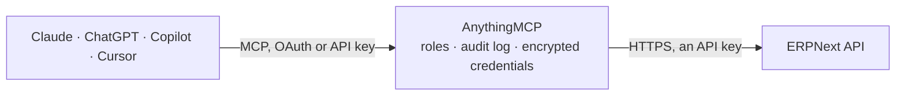

<!-- Generated by scripts/export-github-catalog.mjs in the anythingmcp-website repository. Do not edit by hand. -->

# ERPNext MCP connector

ERPNext / Frappe: read and write any DocType — customers, sales orders, invoices, items, stock and leads — with Frappe's filter syntax, plus a generic resource escape hatch. The AnythingMCP connector gives Claude, ChatGPT, Microsoft Copilot, Cursor and Gemini 11 MCP tools for ERPNext: 10 read and 1 can change data.

**Category:** [ERP](../erp.md) · **Tools:** 11 · **Setup guide:** [anythingmcp.com](https://anythingmcp.com/guides/erpnext-to-mcp) · [Deutsch](https://anythingmcp.com/de/guides/erpnext-to-mcp) · [Italiano](https://anythingmcp.com/it/guides/erpnext-to-mcp) · [Español](https://anythingmcp.com/es/guides/erpnext-to-mcp) · [日本語](https://anythingmcp.com/ja/guides/erpnext-to-mcp) · [Русский](https://anythingmcp.com/ru/guides/erpnext-to-mcp) · [中文](https://anythingmcp.com/zh/guides/erpnext-to-mcp)

## Start without code

No installation and no terminal: AnythingMCP Cloud runs the ERPNext connector for you, operated by helpcode.ai in Frankfurt, Germany.

1. **Click the button above** and create an account or sign in. The ERPNext connector opens, ready to install.
2. **Paste the API key or token from your ERPNext account.** Every click is in the [step-by-step guide](https://anythingmcp.com/guides/erpnext-to-mcp).
3. **Click Install.** AnythingMCP shows the address of your MCP server.
4. **Add that address to your assistant:** [Claude](https://anythingmcp.com/guides/connect-erpnext-to-claude) · [ChatGPT](https://anythingmcp.com/guides/connect-erpnext-to-chatgpt) · [Microsoft Copilot](https://anythingmcp.com/guides/connect-erpnext-to-copilot) · [Cursor](https://anythingmcp.com/guides/connect-erpnext-to-cursor) · [Gemini CLI](https://anythingmcp.com/guides/connect-erpnext-to-gemini) · [Meta Muse](https://anythingmcp.com/guides/connect-erpnext-to-muse).
5. **Ask your first question**, for example: *Show invoice INV-2026-045 for customer Nordic Solutions OÜ, I need status, posting and due dates, outstanding amount*

Prefer help with the setup? [Talk to us](https://anythingmcp.com/contact).

## How it works

- **The AI client** speaks MCP (Streamable HTTP) to AnythingMCP and only sees tool names, descriptions and results. It never gets the ERPNext credentials.
- **AnythingMCP** checks the client's role, builds the call from the tool definition, adds the credentials (an API key), calls ERPNext, logs the call and returns the result.
- **ERPNext** sees an ordinary API client with the rights of the account the credentials belong to.

## Tools

| Tool | What it does | Access |
|---|---|---|
| [`erpnext_get_logged_user`](#erpnext_get_logged_user) | Read which user the API key belongs to. | read |
| [`erpnext_list_documents`](#erpnext_list_documents) | List documents of any DocType with Frappe filters. | read |
| [`erpnext_get_document`](#erpnext_get_document) | Read one document of any DocType in full by its name (ERPNext's primary key), including its child tables. | read |
| [`erpnext_count_documents`](#erpnext_count_documents) | Count the documents of a DocType matching a filter, without transferring them. | read |
| [`erpnext_get_doctype_meta`](#erpnext_get_doctype_meta) | Describe a DocType: every field (standard and custom) with its type, label, options and whether it is required, under docs[0].fields. | read |
| [`erpnext_list_customers`](#erpnext_list_customers) | List customers with their name, group, territory, currency and default payment terms. | read |
| [`erpnext_list_sales_orders`](#erpnext_list_sales_orders) | List sales orders with their customer, date, delivery date, status and grand total. | read |
| [`erpnext_list_sales_invoices`](#erpnext_list_sales_invoices) | List sales invoices with their customer, posting date, due date, status and outstanding amount — the answer to 'what is still unpaid'. | read |
| [`erpnext_list_items`](#erpnext_list_items) | List items from the catalogue with their code, name, group, stock UOM, stock flag and disabled flag. | read |
| [`erpnext_list_stock_balance`](#erpnext_list_stock_balance) | Read per-warehouse stock: actual, reserved and projected quantity per item. | read |
| [`erpnext_create_document`](#erpnext_create_document) | Create a document of any DocType. | write |

## Tool reference

Every parameter as the AI client sees it in `tools/list`. Source: [`packages/backend/src/adapters/intl/erpnext.json`](../../../packages/backend/src/adapters/intl/erpnext.json).

### `erpnext_get_logged_user`

Read which user the API key belongs to. No parameters and no DocType permission needed — the fastest proof that the `token key:secret` header is right.

**Access:** read · **Call:** `GET /method/frappe.auth.get_logged_user`

No parameters.

### `erpnext_list_documents`

List documents of any DocType with Frappe filters. The real API: pass the DocType plus the fields you want, because without `fields` you get only the primary key.

**Access:** read · **Call:** `GET /resource/{doctype}`

| Parameter | Type | Required | Description |
|---|---|---|---|
| `doctype` | string | yes | DocType name, e.g. Customer, Sales Order, Sales Invoice, Item, Lead. |
| `fields` | string | no | JSON array of field names, e.g. ["name","customer","grand_total","status"]. Required in practice. |
| `filters` | string | no | JSON array of triples, e.g. [["status","=","Open"]]. |
| `limit_page_length` | number | no | Rows to return (default 20; 0 means everything). |
| `limit_start` | number | no | Rows to skip, for paging. |
| `order_by` | string | no | Sort expression, e.g. `creation desc`. |

### `erpnext_get_document`

Read one document of any DocType in full by its name (ERPNext's primary key), including its child tables.

**Access:** read · **Call:** `GET /resource/{doctype}/{name}`

| Parameter | Type | Required | Description |
|---|---|---|---|
| `doctype` | string | yes | DocType name, e.g. Sales Invoice. |
| `name` | string | yes | Document name — ERPNext's primary key, e.g. SINV-00042. |

### `erpnext_count_documents`

Count the documents of a DocType matching a filter, without transferring them. Use it before a list to find out whether the answer is 12 rows or 120,000.

**Access:** read · **Call:** `GET /method/frappe.client.get_count`

| Parameter | Type | Required | Description |
|---|---|---|---|
| `doctype` | string | yes | DocType name. |
| `filters` | string | no | JSON array of triples, e.g. [["status","=","Overdue"]]. |

### `erpnext_get_doctype_meta`

Describe a DocType: every field (standard and custom) with its type, label, options and whether it is required, under docs[0].fields. Read this before composing a filter against an unfamiliar DocType.

**Access:** read · **Call:** `GET /method/frappe.desk.form.load.getdoctype`

| Parameter | Type | Required | Description |
|---|---|---|---|
| `doctype` | string | yes | DocType name, e.g. Sales Order. |

### `erpnext_list_customers`

List customers with their name, group, territory, currency and default payment terms. Convenience wrapper over the Customer DocType.

**Access:** read · **Call:** `GET /resource/Customer`

| Parameter | Type | Required | Description |
|---|---|---|---|
| `filters` | string | no | JSON array of triples, e.g. [["customer_group","=","Commercial"]]. |
| `limit_page_length` | number | no | Rows to return. |
| `limit_start` | number | no | Rows to skip, for paging. |

### `erpnext_list_sales_orders`

List sales orders with their customer, date, delivery date, status and grand total. Convenience wrapper over the Sales Order DocType.

**Access:** read · **Call:** `GET /resource/Sales Order`

| Parameter | Type | Required | Description |
|---|---|---|---|
| `filters` | string | no | JSON array of triples, e.g. [["status","=","To Deliver and Bill"]]. |
| `limit_page_length` | number | no | Rows to return. |
| `limit_start` | number | no | Rows to skip, for paging. |

### `erpnext_list_sales_invoices`

List sales invoices with their customer, posting date, due date, status and outstanding amount — the answer to 'what is still unpaid'.

**Access:** read · **Call:** `GET /resource/Sales Invoice`

| Parameter | Type | Required | Description |
|---|---|---|---|
| `filters` | string | no | JSON array of triples, e.g. [["status","=","Overdue"]]. |
| `limit_page_length` | number | no | Rows to return. |
| `limit_start` | number | no | Rows to skip, for paging. |

### `erpnext_list_items`

List items from the catalogue with their code, name, group, stock UOM, stock flag and disabled flag. `standard_rate` is only the rate entered when the item was created, not the current price: selling and buying prices live in the Item Price DocType (erpnext_list_documents with doctype Item Price).

**Access:** read · **Call:** `GET /resource/Item`

| Parameter | Type | Required | Description |
|---|---|---|---|
| `filters` | string | no | JSON array of triples, e.g. [["is_stock_item","=",1]]. |
| `limit_page_length` | number | no | Rows to return. |
| `limit_start` | number | no | Rows to skip, for paging. |

### `erpnext_list_stock_balance`

Read per-warehouse stock: actual, reserved and projected quantity per item. The availability answer, from the Bin DocType rather than the item master.

**Access:** read · **Call:** `GET /resource/Bin`

| Parameter | Type | Required | Description |
|---|---|---|---|
| `filters` | string | no | JSON array of triples, e.g. [["item_code","=","ITEM-001"]]. |
| `limit_page_length` | number | no | Rows to return. |

### `erpnext_create_document`

Create a document of any DocType. Writes to the live instance and fires ERPNext's server scripts, notifications and stock ledger entries.

**Access:** write · **Call:** `POST /resource/{doctype}`

| Parameter | Type | Required | Description |
|---|---|---|---|
| `doctype` | string | yes | DocType name, e.g. Lead or Customer. |
| `data` | object | yes | Field values for the new document, e.g. {"customer_name": "Muster GmbH", "customer_group": "Commercial"}. |

## Run it yourself

AnythingMCP is open source (AGPL-3.0). [Run it with Docker](../../../README.md#run-it-yourself), open **Connectors → Store**, pick **ERPNext** and enter `ERPNEXT_URL`, `ERPNEXT_API_KEY`, `ERPNEXT_API_SECRET`, then add your MCP server URL to the AI client.

[← ERP connectors](../erp.md) · [All categories](../README.md)
