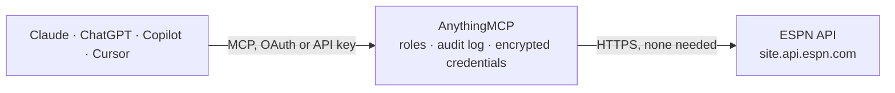

<!-- Generated by scripts/export-github-catalog.mjs in the anythingmcp-website repository. Do not edit by hand. -->

# ESPN MCP connector

ESPN public sports data, no API key: scoreboards, game summaries, news, teams, rosters, schedules, standings and injury reports for NFL, NBA, WNBA, MLB, NHL, college sports and major soccer leagues. The AnythingMCP connector gives Claude, ChatGPT, Microsoft Copilot, Cursor and Gemini 9 MCP tools for ESPN, all read-only.

**Category:** [Sports](../sports.md) · **Tools:** 9 · **Setup guide:** [anythingmcp.com](https://anythingmcp.com/guides/espn-to-mcp) · [Deutsch](https://anythingmcp.com/de/guides/espn-to-mcp) · [Italiano](https://anythingmcp.com/it/guides/espn-to-mcp) · [Español](https://anythingmcp.com/es/guides/espn-to-mcp) · [日本語](https://anythingmcp.com/ja/guides/espn-to-mcp) · [Русский](https://anythingmcp.com/ru/guides/espn-to-mcp) · [中文](https://anythingmcp.com/zh/guides/espn-to-mcp)

## Start without code

No installation and no terminal: AnythingMCP Cloud runs the ESPN connector for you, operated by helpcode.ai in Frankfurt, Germany.

1. **Click the button above** and create an account or sign in. The ESPN connector opens, ready to install.
2. **Nothing to enter:** this connector needs no credentials. Every click is in the [step-by-step guide](https://anythingmcp.com/guides/espn-to-mcp).
3. **Click Install.** AnythingMCP shows the address of your MCP server.
4. **Add that address to your assistant:** [Claude](https://anythingmcp.com/guides/connect-espn-to-claude) · [ChatGPT](https://anythingmcp.com/guides/connect-espn-to-chatgpt) · [Microsoft Copilot](https://anythingmcp.com/guides/connect-espn-to-copilot) · [Cursor](https://anythingmcp.com/guides/connect-espn-to-cursor) · [Gemini CLI](https://anythingmcp.com/guides/connect-espn-to-gemini) · [Meta Muse](https://anythingmcp.com/guides/connect-espn-to-muse).
5. **Ask your first question**, for example: *Who led scoring in the Lakers vs Warriors game on 20261019 and what was the final score?*

Prefer help with the setup? [Talk to us](https://anythingmcp.com/contact).

## How it works

- **The AI client** speaks MCP (Streamable HTTP) to AnythingMCP and only sees tool names, descriptions and results. It never gets the ESPN credentials.
- **AnythingMCP** checks the client's role, builds the call from the tool definition, adds the credentials (none needed), calls ESPN, logs the call and returns the result.
- **ESPN** sees an ordinary API client with the rights of the account the credentials belong to.

## Tools

| Tool | What it does | Access |
|---|---|---|
| [`espn_get_scoreboard`](#espn_get_scoreboard) | Games of one league on a day (default today): teams, scores, status and clock, venue, TV and the betting line ESPN shows. | read |
| [`espn_get_game_summary`](#espn_get_game_summary) | One game in detail by ESPN event id: score by period, team box score stats, stat leaders, scoring plays, soccer key events and lineups, injuries and the… | read |
| [`espn_get_news`](#espn_get_news) | Latest ESPN headlines for a league, or for one team: headline, short description, publish time, byline and the link to the article on espn.com. | read |
| [`espn_list_teams`](#espn_list_teams) | All teams of a league with ESPN id, abbreviation, name and location. | read |
| [`espn_get_team`](#espn_get_team) | One team: name, current record (overall, home, away), standing summary, home venue and next game. | read |
| [`espn_get_team_roster`](#espn_get_team_roster) | Current roster of a team with ESPN athlete id, jersey, position, age, height, weight, experience, status and injury status, plus the head coach. | read |
| [`espn_get_team_schedule`](#espn_get_team_schedule) | A team's schedule and results for a season: date, opponent, home or away, score, winner and status for each game, with the event id for espn_get_game_summary. | read |
| [`espn_get_standings`](#espn_get_standings) | League table or standings by conference: wins, losses, points, win percentage, games behind, streak and the other columns ESPN shows. | read |
| [`espn_get_injuries`](#espn_get_injuries) | Injury report of every team in a league (NFL, NBA, WNBA, MLB, NHL): player, position, status (Out, Questionable, Day-To-Day ...), date and a short note. | read |

## Tool reference

Every parameter as the AI client sees it in `tools/list`. Source: [`packages/backend/src/adapters/intl/espn.json`](../../../packages/backend/src/adapters/intl/espn.json).

### `espn_get_scoreboard`

Games of one league on a day (default today): teams, scores, status and clock, venue, TV and the betting line ESPN shows. Pass dates as YYYYMMDD for one day, YYYYMM for a month or YYYY for a season; NFL and college football also take week with seasontype.

**Access:** read · **Call:** `GET /apis/site/v2/sports/{sport}/{league}/scoreboard`

| Parameter | Type | Required | Description |
|---|---|---|---|
| `sport` | `football` \| `basketball` \| `baseball` \| `hockey` \| `soccer` | yes | ESPN sport path: football (NFL, college football), basketball (NBA, WNBA, college), baseball (MLB), hockey (NHL) or soccer. |
| `league` | string | yes | ESPN league slug for that sport: nfl or college-football; nba, wnba, mens-college-basketball or womens-college-basketball; mlb; nhl; soccer codes such as eng.1 (Premier League), esp.1 (LaLiga), ger.1 (Bundesliga), ita.1 (Serie A), fra.1 (Ligue 1), usa.1 (MLS), uefa.champions, fifa.world. |
| `dates` | string | no | YYYYMMDD (one day), YYYYMM (a month) or YYYY. Ranges such as 20261001-20261018 are refused by ESPN. Leave out for today. |
| `week` | integer | no | Week number, for NFL and college football. |
| `seasontype` | `1` \| `2` \| `3` | no | 1 preseason, 2 regular season, 3 postseason. Use with week. |
| `groups` | string | no | Conference group id for college sports, e.g. 80 for all FBS games, 50 for all Division I basketball games. |
| `limit` | integer | no | Maximum number of games (college days can have hundreds). |

### `espn_get_game_summary`

One game in detail by ESPN event id: score by period, team box score stats, stat leaders, scoring plays, soccer key events and lineups, injuries and the betting lines ESPN lists. The event id comes from espn_get_scoreboard or espn_get_team_schedule.

**Access:** read · **Call:** `GET /apis/site/v2/sports/{sport}/{league}/summary`

| Parameter | Type | Required | Description |
|---|---|---|---|
| `sport` | `football` \| `basketball` \| `baseball` \| `hockey` \| `soccer` | yes | ESPN sport path: football (NFL, college football), basketball (NBA, WNBA, college), baseball (MLB), hockey (NHL) or soccer. |
| `league` | string | yes | ESPN league slug for that sport: nfl or college-football; nba, wnba, mens-college-basketball or womens-college-basketball; mlb; nhl; soccer codes such as eng.1 (Premier League), esp.1 (LaLiga), ger.1 (Bundesliga), ita.1 (Serie A), fra.1 (Ligue 1), usa.1 (MLS), uefa.champions, fifa.world. |
| `event` | string | yes | ESPN event id, e.g. 401772510. |

### `espn_get_news`

Latest ESPN headlines for a league, or for one team: headline, short description, publish time, byline and the link to the article on espn.com.

**Access:** read · **Call:** `GET /apis/site/v2/sports/{sport}/{league}/news`

| Parameter | Type | Required | Description |
|---|---|---|---|
| `sport` | `football` \| `basketball` \| `baseball` \| `hockey` \| `soccer` | yes | ESPN sport path: football (NFL, college football), basketball (NBA, WNBA, college), baseball (MLB), hockey (NHL) or soccer. |
| `league` | string | yes | ESPN league slug for that sport: nfl or college-football; nba, wnba, mens-college-basketball or womens-college-basketball; mlb; nhl; soccer codes such as eng.1 (Premier League), esp.1 (LaLiga), ger.1 (Bundesliga), ita.1 (Serie A), fra.1 (Ligue 1), usa.1 (MLS), uefa.champions, fifa.world. |
| `team` | string | no | Numeric ESPN team id to get that team's news only. |
| `limit` | integer | no | Number of articles, default 10. |

### `espn_list_teams`

All teams of a league with ESPN id, abbreviation, name and location. Use it to find the team id or abbreviation for the team tools.

**Access:** read · **Call:** `GET /apis/site/v2/sports/{sport}/{league}/teams`

| Parameter | Type | Required | Description |
|---|---|---|---|
| `sport` | `football` \| `basketball` \| `baseball` \| `hockey` \| `soccer` | yes | ESPN sport path: football (NFL, college football), basketball (NBA, WNBA, college), baseball (MLB), hockey (NHL) or soccer. |
| `league` | string | yes | ESPN league slug for that sport: nfl or college-football; nba, wnba, mens-college-basketball or womens-college-basketball; mlb; nhl; soccer codes such as eng.1 (Premier League), esp.1 (LaLiga), ger.1 (Bundesliga), ita.1 (Serie A), fra.1 (Ligue 1), usa.1 (MLS), uefa.champions, fifa.world. |
| `limit` | integer | no | Maximum number of teams. College leagues have several hundred; pass 1000 to get all. |

### `espn_get_team`

One team: name, current record (overall, home, away), standing summary, home venue and next game.

**Access:** read · **Call:** `GET /apis/site/v2/sports/{sport}/{league}/teams/{team}`

| Parameter | Type | Required | Description |
|---|---|---|---|
| `sport` | `football` \| `basketball` \| `baseball` \| `hockey` \| `soccer` | yes | ESPN sport path: football (NFL, college football), basketball (NBA, WNBA, college), baseball (MLB), hockey (NHL) or soccer. |
| `league` | string | yes | ESPN league slug for that sport: nfl or college-football; nba, wnba, mens-college-basketball or womens-college-basketball; mlb; nhl; soccer codes such as eng.1 (Premier League), esp.1 (LaLiga), ger.1 (Bundesliga), ita.1 (Serie A), fra.1 (Ligue 1), usa.1 (MLS), uefa.champions, fifa.world. |
| `team` | string | yes | ESPN team id (e.g. 12) or abbreviation (e.g. kc, lal, nyy). Ids come from espn_list_teams; soccer teams need the numeric id. |

### `espn_get_team_roster`

Current roster of a team with ESPN athlete id, jersey, position, age, height, weight, experience, status and injury status, plus the head coach.

**Access:** read · **Call:** `GET /apis/site/v2/sports/{sport}/{league}/teams/{team}/roster`

| Parameter | Type | Required | Description |
|---|---|---|---|
| `sport` | `football` \| `basketball` \| `baseball` \| `hockey` \| `soccer` | yes | ESPN sport path: football (NFL, college football), basketball (NBA, WNBA, college), baseball (MLB), hockey (NHL) or soccer. |
| `league` | string | yes | ESPN league slug for that sport: nfl or college-football; nba, wnba, mens-college-basketball or womens-college-basketball; mlb; nhl; soccer codes such as eng.1 (Premier League), esp.1 (LaLiga), ger.1 (Bundesliga), ita.1 (Serie A), fra.1 (Ligue 1), usa.1 (MLS), uefa.champions, fifa.world. |
| `team` | string | yes | ESPN team id (e.g. 12) or abbreviation (e.g. kc, lal, nyy). Ids come from espn_list_teams; soccer teams need the numeric id. |

### `espn_get_team_schedule`

A team's schedule and results for a season: date, opponent, home or away, score, winner and status for each game, with the event id for espn_get_game_summary.

**Access:** read · **Call:** `GET /apis/site/v2/sports/{sport}/{league}/teams/{team}/schedule`

| Parameter | Type | Required | Description |
|---|---|---|---|
| `sport` | `football` \| `basketball` \| `baseball` \| `hockey` \| `soccer` | yes | ESPN sport path: football (NFL, college football), basketball (NBA, WNBA, college), baseball (MLB), hockey (NHL) or soccer. |
| `league` | string | yes | ESPN league slug for that sport: nfl or college-football; nba, wnba, mens-college-basketball or womens-college-basketball; mlb; nhl; soccer codes such as eng.1 (Premier League), esp.1 (LaLiga), ger.1 (Bundesliga), ita.1 (Serie A), fra.1 (Ligue 1), usa.1 (MLS), uefa.champions, fifa.world. |
| `team` | string | yes | ESPN team id (e.g. 12) or abbreviation (e.g. kc, lal, nyy). Ids come from espn_list_teams; soccer teams need the numeric id. |
| `season` | integer | no | Season year, e.g. 2026. Leave out for the current season. |
| `seasontype` | `1` \| `2` \| `3` | no | 1 preseason, 2 regular season (default), 3 postseason. |

### `espn_get_standings`

League table or standings by conference: wins, losses, points, win percentage, games behind, streak and the other columns ESPN shows. Set level 3 for NFL, NBA, MLB or NHL divisions.

**Access:** read · **Call:** `GET /apis/v2/sports/{sport}/{league}/standings`

| Parameter | Type | Required | Description |
|---|---|---|---|
| `sport` | `football` \| `basketball` \| `baseball` \| `hockey` \| `soccer` | yes | ESPN sport path: football (NFL, college football), basketball (NBA, WNBA, college), baseball (MLB), hockey (NHL) or soccer. |
| `league` | string | yes | ESPN league slug for that sport: nfl or college-football; nba, wnba, mens-college-basketball or womens-college-basketball; mlb; nhl; soccer codes such as eng.1 (Premier League), esp.1 (LaLiga), ger.1 (Bundesliga), ita.1 (Serie A), fra.1 (Ligue 1), usa.1 (MLS), uefa.champions, fifa.world. |
| `season` | integer | no | Season year, e.g. 2025. Leave out for the current season. |
| `level` | `1` \| `2` \| `3` | no | Grouping for US leagues: 1 whole league, 2 conferences (default), 3 divisions. |

### `espn_get_injuries`

Injury report of every team in a league (NFL, NBA, WNBA, MLB, NHL): player, position, status (Out, Questionable, Day-To-Day ...), date and a short note. Soccer leagues usually return an empty list.

**Access:** read · **Call:** `GET /apis/site/v2/sports/{sport}/{league}/injuries`

| Parameter | Type | Required | Description |
|---|---|---|---|
| `sport` | `football` \| `basketball` \| `baseball` \| `hockey` \| `soccer` | yes | ESPN sport path: football (NFL, college football), basketball (NBA, WNBA, college), baseball (MLB), hockey (NHL) or soccer. |
| `league` | string | yes | ESPN league slug for that sport: nfl or college-football; nba, wnba, mens-college-basketball or womens-college-basketball; mlb; nhl; soccer codes such as eng.1 (Premier League), esp.1 (LaLiga), ger.1 (Bundesliga), ita.1 (Serie A), fra.1 (Ligue 1), usa.1 (MLS), uefa.champions, fifa.world. |

## Run it yourself

AnythingMCP is open source (AGPL-3.0). [Run it with Docker](../../../README.md#run-it-yourself), open **Connectors → Store**, pick **ESPN**, then add your MCP server URL to the AI client.

[← Sports connectors](../sports.md) · [All categories](../README.md)
