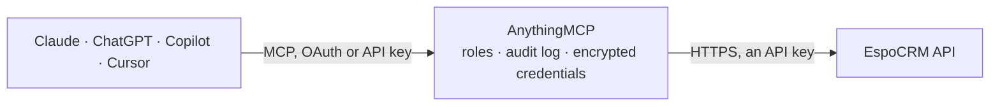

<!-- Generated by scripts/export-github-catalog.mjs in the anythingmcp-website repository. Do not edit by hand. -->

# EspoCRM MCP connector

EspoCRM open-source CRM: accounts, contacts, leads, opportunities, cases, calls, meetings and tasks, plus a generic entity route for custom entities. The AnythingMCP connector gives Claude, ChatGPT, Microsoft Copilot, Cursor and Gemini 9 MCP tools for EspoCRM, all read-only.

**Category:** [CRM](../crm.md) · **Tools:** 9 · **Setup guide:** [anythingmcp.com](https://anythingmcp.com/guides/espocrm-to-mcp) · [Deutsch](https://anythingmcp.com/de/guides/espocrm-to-mcp) · [Italiano](https://anythingmcp.com/it/guides/espocrm-to-mcp) · [Español](https://anythingmcp.com/es/guides/espocrm-to-mcp) · [日本語](https://anythingmcp.com/ja/guides/espocrm-to-mcp) · [Русский](https://anythingmcp.com/ru/guides/espocrm-to-mcp) · [中文](https://anythingmcp.com/zh/guides/espocrm-to-mcp)

## Start without code

No installation and no terminal: AnythingMCP Cloud runs the EspoCRM connector for you, operated by helpcode.ai in Frankfurt, Germany.

1. **Click the button above** and create an account or sign in. The EspoCRM connector opens, ready to install.
2. **Paste the API key or token from your EspoCRM account.** Every click is in the [step-by-step guide](https://anythingmcp.com/guides/espocrm-to-mcp).
3. **Click Install.** AnythingMCP shows the address of your MCP server.
4. **Add that address to your assistant:** [Claude](https://anythingmcp.com/guides/connect-espocrm-to-claude) · [ChatGPT](https://anythingmcp.com/guides/connect-espocrm-to-chatgpt) · [Microsoft Copilot](https://anythingmcp.com/guides/connect-espocrm-to-copilot) · [Cursor](https://anythingmcp.com/guides/connect-espocrm-to-cursor) · [Gemini CLI](https://anythingmcp.com/guides/connect-espocrm-to-gemini) · [Meta Muse](https://anythingmcp.com/guides/connect-espocrm-to-muse).
5. **Ask your first question**, for example: *Show the account record for RivaSolar GmbH and its billing city and assigned user.*

Prefer help with the setup? [Talk to us](https://anythingmcp.com/contact).

## How it works

- **The AI client** speaks MCP (Streamable HTTP) to AnythingMCP and only sees tool names, descriptions and results. It never gets the EspoCRM credentials.
- **AnythingMCP** checks the client's role, builds the call from the tool definition, adds the credentials (an API key), calls EspoCRM, logs the call and returns the result.
- **EspoCRM** sees an ordinary API client with the rights of the account the credentials belong to.

## Tools

| Tool | What it does | Access |
|---|---|---|
| [`espocrm_get_app_user`](#espocrm_get_app_user) | Read the API user this key belongs to, with their roles and the entity permissions they carry. | read |
| [`espocrm_list_entities`](#espocrm_list_entities) | List records of any entity type with a single where clause. | read |
| [`espocrm_get_entity`](#espocrm_get_entity) | Read one record of any entity type by id, with every attribute the API user's role permits. | read |
| [`espocrm_list_accounts`](#espocrm_list_accounts) | List accounts — the customer companies — with their name, industry, website, phone, billing city and assigned user. | read |
| [`espocrm_list_contacts`](#espocrm_list_contacts) | List contacts with their name, account, e-mail, phone and title, to find the person before logging an interaction against them. | read |
| [`espocrm_list_opportunities`](#espocrm_list_opportunities) | List opportunities with their name, account, amount, stage, probability and close date — the sales-pipeline view. | read |
| [`espocrm_list_leads`](#espocrm_list_leads) | List leads with their name, company, status, source, e-mail and phone — the top of the funnel, before conversion into an account. | read |
| [`espocrm_list_cases`](#espocrm_list_cases) | List support cases with their number, subject, status, priority, account and assigned user. | read |
| [`espocrm_get_related`](#espocrm_get_related) | List the records linked to one record — the contacts on an account, the opportunities on a contact, the activities on anything. | read |

## Tool reference

Every parameter as the AI client sees it in `tools/list`. Source: [`packages/backend/src/adapters/intl/espocrm.json`](../../../packages/backend/src/adapters/intl/espocrm.json).

### `espocrm_get_app_user`

Read the API user this key belongs to, with their roles and the entity permissions they carry. The fastest way to see what this connector is actually allowed to read.

**Access:** read · **Call:** `GET /App/user`

No parameters.

### `espocrm_list_entities`

List records of any entity type with a single where clause. The real API: Account, Contact, Lead, Opportunity, Case and any custom entity share this route.

**Access:** read · **Call:** `GET /{entityType}`

| Parameter | Type | Required | Description |
|---|---|---|---|
| `entityType` | string | yes | Entity type, e.g. Account, Contact, Lead, Opportunity, Case, Call, Meeting, Task. |
| `where_type` | string | no | Clause type: equals, notEquals, contains, startsWith, greaterThan, lessThan, isNull, isNotNull, today, lastXDays. |
| `where_attribute` | string | no | Attribute the clause applies to, e.g. status or createdAt. |
| `where_value` | string | no | Value the clause compares against. |
| `select` | string | no | Comma-separated attributes to return, e.g. id,name,status,createdAt. |
| `orderBy` | string | no | Attribute to sort by, e.g. createdAt. |
| `order` | string | no | `asc` or `desc`. |
| `maxSize` | number | no | Rows to return (default 20, max 200). |
| `offset` | number | no | Rows to skip, for paging. |

### `espocrm_get_entity`

Read one record of any entity type by id, with every attribute the API user's role permits.

**Access:** read · **Call:** `GET /{entityType}/{id}`

| Parameter | Type | Required | Description |
|---|---|---|---|
| `entityType` | string | yes | Entity type, e.g. Account. |
| `id` | string | yes | Record id. |

### `espocrm_list_accounts`

List accounts — the customer companies — with their name, industry, website, phone, billing city and assigned user.

**Access:** read · **Call:** `GET /Account`

| Parameter | Type | Required | Description |
|---|---|---|---|
| `where_type` | string | no | Clause type, e.g. contains. |
| `where_attribute` | string | no | Attribute the clause applies to, e.g. name. |
| `where_value` | string | no | Value the clause compares against. |
| `maxSize` | number | no | Rows to return (max 200). |
| `offset` | number | no | Rows to skip, for paging. |

### `espocrm_list_contacts`

List contacts with their name, account, e-mail, phone and title, to find the person before logging an interaction against them.

**Access:** read · **Call:** `GET /Contact`

| Parameter | Type | Required | Description |
|---|---|---|---|
| `where_type` | string | no | Clause type, e.g. equals. |
| `where_attribute` | string | no | Attribute the clause applies to, e.g. emailAddress. |
| `where_value` | string | no | Value the clause compares against. |
| `maxSize` | number | no | Rows to return (max 200). |
| `offset` | number | no | Rows to skip, for paging. |

### `espocrm_list_opportunities`

List opportunities with their name, account, amount, stage, probability and close date — the sales-pipeline view.

**Access:** read · **Call:** `GET /Opportunity`

| Parameter | Type | Required | Description |
|---|---|---|---|
| `where_type` | string | no | Clause type, e.g. equals. |
| `where_attribute` | string | no | Attribute the clause applies to, e.g. stage. |
| `where_value` | string | no | Value the clause compares against, e.g. Proposal. |
| `maxSize` | number | no | Rows to return (max 200). |
| `offset` | number | no | Rows to skip, for paging. |

### `espocrm_list_leads`

List leads with their name, company, status, source, e-mail and phone — the top of the funnel, before conversion into an account.

**Access:** read · **Call:** `GET /Lead`

| Parameter | Type | Required | Description |
|---|---|---|---|
| `where_type` | string | no | Clause type, e.g. equals. |
| `where_attribute` | string | no | Attribute the clause applies to, e.g. status. |
| `where_value` | string | no | Value the clause compares against, e.g. New. |
| `maxSize` | number | no | Rows to return (max 200). |
| `offset` | number | no | Rows to skip, for paging. |

### `espocrm_list_cases`

List support cases with their number, subject, status, priority, account and assigned user.

**Access:** read · **Call:** `GET /Case`

| Parameter | Type | Required | Description |
|---|---|---|---|
| `where_type` | string | no | Clause type, e.g. equals. |
| `where_attribute` | string | no | Attribute the clause applies to, e.g. status. |
| `where_value` | string | no | Value the clause compares against, e.g. Open. |
| `maxSize` | number | no | Rows to return (max 200). |
| `offset` | number | no | Rows to skip, for paging. |

### `espocrm_get_related`

List the records linked to one record — the contacts on an account, the opportunities on a contact, the activities on anything. EspoCRM's history lives in these links.

**Access:** read · **Call:** `GET /{entityType}/{id}/{link}`

| Parameter | Type | Required | Description |
|---|---|---|---|
| `entityType` | string | yes | Entity type of the anchor record, e.g. Account. |
| `id` | string | yes | Id of the anchor record. |
| `link` | string | yes | Link name, e.g. contacts, opportunities, cases, meetings. |
| `maxSize` | number | no | Rows to return. |
| `offset` | number | no | Rows to skip, for paging. |

## Run it yourself

AnythingMCP is open source (AGPL-3.0). [Run it with Docker](../../../README.md#run-it-yourself), open **Connectors → Store**, pick **EspoCRM** and enter `ESPOCRM_URL`, `ESPOCRM_API_KEY`, then add your MCP server URL to the AI client.

[← CRM connectors](../crm.md) · [All categories](../README.md)
