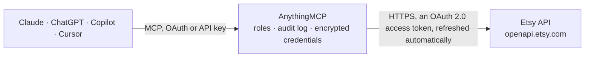

<!-- Generated by scripts/export-github-catalog.mjs in the anythingmcp-website repository. Do not edit by hand. -->

# Etsy MCP connector

Run an Etsy shop from any AI agent: create draft listings, edit and publish them, add photos, videos and digital files, set price, stock, attributes and translations, add tracking to orders, and read … The AnythingMCP connector gives Claude, ChatGPT, Microsoft Copilot, Cursor and Gemini 42 MCP tools for Etsy: 28 read and 14 can change data.

**Category:** [E-commerce](../e-commerce.md) · **Tools:** 42 · **Setup guide:** [anythingmcp.com](https://anythingmcp.com/guides/etsy-to-mcp) · [Deutsch](https://anythingmcp.com/de/guides/etsy-to-mcp) · [Italiano](https://anythingmcp.com/it/guides/etsy-to-mcp) · [Español](https://anythingmcp.com/es/guides/etsy-to-mcp) · [日本語](https://anythingmcp.com/ja/guides/etsy-to-mcp) · [Русский](https://anythingmcp.com/ru/guides/etsy-to-mcp) · [中文](https://anythingmcp.com/zh/guides/etsy-to-mcp)

## Start without code

No installation and no terminal: AnythingMCP Cloud runs the Etsy connector for you, operated by helpcode.ai in Frankfurt, Germany.

1. **Click the button above** and create an account or sign in. The Etsy connector opens, ready to install.
2. **Sign in with your Etsy account** when AnythingMCP asks. The first time, an admin creates a small app in the Etsy developer console. Every click is in the [step-by-step guide](https://anythingmcp.com/guides/etsy-to-mcp).
3. **Click Install.** AnythingMCP shows the address of your MCP server.
4. **Add that address to your assistant:** [Claude](https://anythingmcp.com/guides/connect-etsy-to-claude) · [ChatGPT](https://anythingmcp.com/guides/connect-etsy-to-chatgpt) · [Microsoft Copilot](https://anythingmcp.com/guides/connect-etsy-to-copilot) · [Cursor](https://anythingmcp.com/guides/connect-etsy-to-cursor) · [Gemini CLI](https://anythingmcp.com/guides/connect-etsy-to-gemini) · [Meta Muse](https://anythingmcp.com/guides/connect-etsy-to-muse).
5. **Ask your first question**, for example: *For receipt 5829173045 (order date 2026-10-12) — is it paid and what's the buyer email and total?*

Prefer help with the setup? [Talk to us](https://anythingmcp.com/contact).

## How it works

- **The AI client** speaks MCP (Streamable HTTP) to AnythingMCP and only sees tool names, descriptions and results. It never gets the Etsy credentials.
- **AnythingMCP** checks the client's role, builds the call from the tool definition, adds the credentials (an OAuth 2.0 access token, refreshed automatically), calls Etsy, logs the call and returns the result.
- **Etsy** sees an ordinary API client with the rights of the account the credentials belong to.

## Tools

| Tool | What it does | Access |
|---|---|---|
| [`etsy_get_authenticated_user`](#etsy_get_authenticated_user) | Return the user the OAuth token belongs to. | read |
| [`etsy_get_user_shops`](#etsy_get_user_shops) | List shops owned by a user. | read |
| [`etsy_get_shop`](#etsy_get_shop) | Fetch one shop by shop_id with full details (announcement, sale message, etc.). | read |
| [`etsy_get_shop_listings_active`](#etsy_get_shop_listings_active) | Public list of a shop's active listings, as any visitor sees them. | read |
| [`etsy_get_listings_by_shop`](#etsy_get_listings_by_shop) | Listings of your own shop by state (active, inactive, sold_out, draft, removed, expired), as the shop owner sees them. | read |
| [`etsy_get_listing`](#etsy_get_listing) | Fetch one listing by listing_id with full details: title, description, state, price, quantity, tags, URL and the optional includes. | read |
| [`etsy_get_listings_by_ids`](#etsy_get_listings_by_ids) | Fetch up to 100 listings in one call by their listing ids, with the same details as etsy_get_listing (title, description, state, price, quantity, tags, URL). | read |
| [`etsy_get_shop_receipts`](#etsy_get_shop_receipts) | List the shop's orders (receipts) with buyer, totals, payment and shipping status, filtered by creation or change date and by paid or shipped state. | read |
| [`etsy_get_shop_receipt`](#etsy_get_shop_receipt) | Fetch one receipt with buyer info, transactions[], shipping address. | read |
| [`etsy_get_shop_transactions`](#etsy_get_shop_transactions) | List the shop's sold items (transactions, one per listing line of an order): transaction_id, receipt_id, listing_id, title, sku, quantity, price, shipping… | read |
| [`etsy_get_shop_reviews`](#etsy_get_shop_reviews) | List the shop's reviews (transactions with feedback): rating, review text, listing id and date, optionally since min_created. | read |
| [`etsy_get_listings_by_shop_section`](#etsy_get_listings_by_shop_section) | List the shop's listings filed under one or more of its sections (section ids from etsy_list_shop_sections). | read |
| [`etsy_list_seller_taxonomy`](#etsy_list_seller_taxonomy) | The full tree of Etsy seller categories (id, name, children). | read |
| [`etsy_list_taxonomy_properties`](#etsy_list_taxonomy_properties) | Properties (size, colour, material…) and their allowed values for one seller category. | read |
| [`etsy_list_shipping_profiles`](#etsy_list_shipping_profiles) | The shop's shipping profiles. | read |
| [`etsy_list_processing_profiles`](#etsy_list_processing_profiles) | The shop's processing profiles (Etsy calls them readiness states: ready to ship or made to order, with processing times). | read |
| [`etsy_list_return_policies`](#etsy_list_return_policies) | The shop's return policies. | read |
| [`etsy_list_shop_sections`](#etsy_list_shop_sections) | The shop's sections, to file a listing under one with shop_section_id. | read |
| [`etsy_read_listing_inventory`](#etsy_read_listing_inventory) | Products, prices, quantities and SKUs of a listing, per variation. | read |
| [`etsy_create_listing_draft`](#etsy_create_listing_draft) | Create a listing as a draft (not visible to buyers). | write |
| [`etsy_edit_listing`](#etsy_edit_listing) | Change a listing: title, description, tags, category, shipping, section, or state. | write |
| [`etsy_set_listing_inventory`](#etsy_set_listing_inventory) | Set price, quantity and SKU of a listing, per variation. | write |
| [`etsy_add_listing_image`](#etsy_add_listing_image) | Add a photo to a listing from a public image URL (JPG, PNG or GIF, up to 10 MB). | write |
| [`etsy_add_order_tracking`](#etsy_add_order_tracking) | Mark an order (receipt) as shipped with its tracking code. | write |
| [`etsy_get_listing_properties`](#etsy_get_listing_properties) | Read the attribute values set on a listing (colour, material, size, occasion, ...): one entry per property with property_id, property_name, scale_id,… | read |
| [`etsy_set_listing_property`](#etsy_set_listing_property) | Set one attribute of a listing (e.g. primary colour, material, occasion), replacing its current values. | write |
| [`etsy_delete_listing_property`](#etsy_delete_listing_property) | Remove one attribute (property) and its values from a listing. | write |
| [`etsy_read_listing_translation`](#etsy_read_listing_translation) | Read a listing's translation into one language: translated title, description and tags. | read |
| [`etsy_add_listing_translation`](#etsy_add_listing_translation) | Add a translation of a listing for buyers browsing Etsy in another language: title, description and optional tags in that language. | write |
| [`etsy_replace_listing_translation`](#etsy_replace_listing_translation) | Replace a listing's existing translation into one language: send the full translated title and description (and tags, which are cleared when left out). | write |
| [`etsy_list_listing_images`](#etsy_list_listing_images) | List the photos of a listing in display order: listing_image_id, rank, url_fullxfull and smaller sizes, dimensions, alt_text and the dominant colour. | read |
| [`etsy_delete_listing_image`](#etsy_delete_listing_image) | Remove a photo from a listing. | write |
| [`etsy_list_listing_variation_images`](#etsy_list_listing_variation_images) | List which photo is shown for which variation value of a listing (e.g. the red mug photo for Colour = Red): entries with property_id, value_id, value and… | read |
| [`etsy_assign_variation_images`](#etsy_assign_variation_images) | Link listing photos to variation values, so buyers see the right photo when they pick an option. | write |
| [`etsy_list_listing_files`](#etsy_list_listing_files) | List the downloadable files of a digital listing: listing_file_id, filename, filesize, filetype, rank and creation time. | read |
| [`etsy_upload_listing_file`](#etsy_upload_listing_file) | Attach a file buyers download after purchase to a digital listing (type download or both), from a public URL. | write |
| [`etsy_list_listing_videos`](#etsy_list_listing_videos) | List the videos of a listing: video_id, height, width, thumbnail_url, video_url and video_state (active or still processing). | read |
| [`etsy_add_listing_video`](#etsy_add_listing_video) | Upload an existing video file to a listing from a public URL. | write |
| [`etsy_delete_listing_permanently`](#etsy_delete_listing_permanently) | Delete a listing for good, in any state (active, inactive, draft, expired, sold out). | write |
| [`etsy_search_active_listings`](#etsy_search_active_listings) | Search all active listings on Etsy, not only your shop's, by keywords, category, price range or shop location: e.g. to see what similar items cost. | read |
| [`etsy_search_shops`](#etsy_search_shops) | Find Etsy shops by name. | read |
| [`etsy_list_production_partners`](#etsy_list_production_partners) | List the shop's production partners (people or companies who help make the items): production_partner_id, partner_name and location. | read |

## Tool reference

Every parameter as the AI client sees it in `tools/list`. Source: [`packages/backend/src/adapters/intl/etsy.json`](../../../packages/backend/src/adapters/intl/etsy.json).

### `etsy_get_authenticated_user`

Return the user the OAuth token belongs to. Returns user_id, login_name, primary_email.

**Access:** read · **Call:** `GET /users/me`

No parameters.

### `etsy_get_user_shops`

List shops owned by a user. Returns shop_id, shop_name, currency_code, languages, login_name, last_updated_tsz, listing_active_count. For the connected account, take user_id from etsy_get_authenticated_user first.

**Access:** read · **Call:** `GET /users/{user_id}/shops`

| Parameter | Type | Required | Description |
|---|---|---|---|
| `user_id` | integer | yes | Etsy user ID (a positive number): use the user_id returned by etsy_get_authenticated_user. |

### `etsy_get_shop`

Fetch one shop by shop_id with full details (announcement, sale message, etc.).

**Access:** read · **Call:** `GET /shops/{shop_id}`

| Parameter | Type | Required | Description |
|---|---|---|---|
| `shop_id` | integer | yes | Shop ID. |

### `etsy_get_shop_listings_active`

Public list of a shop's active listings, as any visitor sees them. Etsy caps how far this public view can page (large offsets are refused); to go through all of your own shop's listings, or drafts and inactive ones, use etsy_get_listings_by_shop.

**Access:** read · **Call:** `GET /shops/{shop_id}/listings/active`

| Parameter | Type | Required | Description |
|---|---|---|---|
| `shop_id` | integer | yes | Shop ID. |
| `limit` | integer | no | Per page, 1 to 100 (default 25). |
| `offset` | integer | no | Pagination offset (0 = first page). Keep it small: Etsy refuses large offsets on this public endpoint. |
| `sort_on` | string | no | created, price, updated, score. |
| `sort_order` | string | no | asc, ascending, desc, descending, up, down. |
| `keywords` | string | no | Substring search on title. |

### `etsy_get_listings_by_shop`

Listings of your own shop by state (active, inactive, sold_out, draft, removed, expired), as the shop owner sees them. Authenticated, so it pages through the whole catalogue, and it can include Inventory and Shipping. Use it rather than etsy_get_shop_listings_active for your own shop.

**Access:** read · **Call:** `GET /shops/{shop_id}/listings`

| Parameter | Type | Required | Description |
|---|---|---|---|
| `shop_id` | integer | yes | Shop ID (from etsy_get_user_shops). |
| `state` | `active` \| `inactive` \| `sold_out` \| `draft` \| `removed` \| `expired` | no | Listing state. Default: active. |
| `limit` | integer | no | Per page, 1 to 100 (default 25). |
| `offset` | integer | no | Pagination offset (0 = first page). |
| `sort_on` | `created` \| `price` \| `updated` \| `score` | no | Sort field. |
| `sort_order` | `asc` \| `desc` | no | Sort direction. |
| `includes` | string | no | Optional extra data, comma-separated, any of: Shipping, Images, Shop, User, Translations, Inventory, Videos, Personalization, BuyerPrice. |

### `etsy_get_listing`

Fetch one listing by listing_id with full details: title, description, state, price, quantity, tags, URL and the optional includes.

**Access:** read · **Call:** `GET /listings/{listing_id}`

| Parameter | Type | Required | Description |
|---|---|---|---|
| `listing_id` | integer | yes | Listing ID. |
| `includes` | string | no | Optional extra data, comma-separated, any of: Images, Shop, User, Translations, Videos, Personalization, BuyerPrice. Etsy answers 400 to anything else, Inventory included: for SKUs, quantities and prices per variation call etsy_read_listing_inventory. Shipping comes with the shop's shipping profiles, not with the listing. |

### `etsy_get_listings_by_ids`

Fetch up to 100 listings in one call by their listing ids, with the same details as etsy_get_listing (title, description, state, price, quantity, tags, URL). Use it to look up the listings behind a page of orders or transactions instead of one call per listing.

**Access:** read · **Call:** `GET /listings/batch`

| Parameter | Type | Required | Description |
|---|---|---|---|
| `listing_ids` | string | yes | Comma-separated listing ids, at most 100, e.g. "1234567890,1234567891" (listing_id from etsy_get_shop_transactions, etsy_get_shop_receipts or the listing tools). |
| `includes` | string | no | Optional extra data, comma-separated, any of: Images, Shop, User, Translations, Videos, Personalization, BuyerPrice. Etsy answers 400 to anything else, Inventory included: for SKUs, quantities and prices per variation call etsy_read_listing_inventory. Shipping comes with the shop's shipping profiles, not with the listing. |
| `currency` | string | no | Optional ISO 4217 currency code (e.g. EUR, USD) to convert the listing prices to. |
| `buyer_country` | string | no | Optional ISO 3166-1 alpha-2 country of the buyer (e.g. DE, GB), for buyer-facing prices with VAT and included shipping. It does not filter the listings. |

### `etsy_get_shop_receipts`

List the shop's orders (receipts) with buyer, totals, payment and shipping status, filtered by creation or change date and by paid or shipped state. Pages with limit and offset.

**Access:** read · **Call:** `GET /shops/{shop_id}/receipts`

| Parameter | Type | Required | Description |
|---|---|---|---|
| `shop_id` | integer | yes | Shop ID. |
| `min_created` | integer | no | Unix timestamp. |
| `max_created` | integer | no | Unix timestamp. |
| `min_last_modified` | integer | no | Unix timestamp. |
| `max_last_modified` | integer | no | Unix timestamp. |
| `limit` | integer | no | Per page (max 100). |
| `offset` | integer | no | Offset. |
| `sort_on` | string | no | created, updated, receipt_id. |
| `sort_order` | string | no | asc, desc. |
| `was_paid` | boolean | no | Filter paid status. |
| `was_shipped` | boolean | no | Filter shipped status. |

### `etsy_get_shop_receipt`

Fetch one receipt with buyer info, transactions[], shipping address.

**Access:** read · **Call:** `GET /shops/{shop_id}/receipts/{receipt_id}`

| Parameter | Type | Required | Description |
|---|---|---|---|
| `shop_id` | integer | yes | Shop ID. |
| `receipt_id` | integer | yes | Receipt ID. |

### `etsy_get_shop_transactions`

List the shop's sold items (transactions, one per listing line of an order): transaction_id, receipt_id, listing_id, title, sku, quantity, price, shipping cost, variations, buyer user id and the paid, shipped and expected ship dates. Use it for sales per product or SKU; etsy_get_shop_receipts is the order-level view. Pages with limit and offset.

**Access:** read · **Call:** `GET /shops/{shop_id}/transactions`

| Parameter | Type | Required | Description |
|---|---|---|---|
| `shop_id` | integer | yes | Shop ID (from etsy_get_user_shops). |
| `limit` | integer | no | Per page, 1 to 100 (default 25). |
| `offset` | integer | no | Pagination offset (0 = first page). |

### `etsy_get_shop_reviews`

List the shop's reviews (transactions with feedback): rating, review text, listing id and date, optionally since min_created. Pages with limit and offset. Etsy treats this endpoint as public and refuses large offsets: to reach older reviews, narrow with min_created instead of paging far.

**Access:** read · **Call:** `GET /shops/{shop_id}/reviews`

| Parameter | Type | Required | Description |
|---|---|---|---|
| `shop_id` | integer | yes | Shop ID. |
| `limit` | integer | no | Per page, 1 to 100 (default 25). |
| `offset` | integer | no | Pagination offset (0 = first page). Keep it small: Etsy refuses large offsets on this public endpoint. |
| `min_created` | integer | no | Unix timestamp lower bound. |

### `etsy_get_listings_by_shop_section`

List the shop's listings filed under one or more of its sections (section ids from etsy_list_shop_sections). Etsy treats this endpoint as public and refuses large offsets; to go through all of your own shop's listings, use etsy_get_listings_by_shop.

**Access:** read · **Call:** `GET /shops/{shop_id}/shop-sections/listings`

| Parameter | Type | Required | Description |
|---|---|---|---|
| `shop_id` | integer | yes | Shop ID. |
| `shop_section_ids` | string | yes | Comma-separated section IDs (etsy_list_shop_sections). |
| `limit` | integer | no | Per page, 1 to 100 (default 25). |
| `offset` | integer | no | Pagination offset (0 = first page). Keep it small: Etsy refuses large offsets on this public endpoint. |

### `etsy_list_seller_taxonomy`

The full tree of Etsy seller categories (id, name, children). Use it to find the taxonomy_id for a new listing. The response is large: look for the closest leaf category and keep only its id.

**Access:** read · **Call:** `GET /seller-taxonomy/nodes`

No parameters.

### `etsy_list_taxonomy_properties`

Properties (size, colour, material…) and their allowed values for one seller category. Needed when an inventory product sets property_values.

**Access:** read · **Call:** `GET /seller-taxonomy/nodes/{taxonomy_id}/properties`

| Parameter | Type | Required | Description |
|---|---|---|---|
| `taxonomy_id` | integer | yes | Seller taxonomy category ID. |

### `etsy_list_shipping_profiles`

The shop's shipping profiles. A physical listing needs one: pass its shipping_profile_id when creating the listing.

**Access:** read · **Call:** `GET /shops/{shop_id}/shipping-profiles`

| Parameter | Type | Required | Description |
|---|---|---|---|
| `shop_id` | integer | yes | Shop ID (from etsy_get_user_shops). |

### `etsy_list_processing_profiles`

The shop's processing profiles (Etsy calls them readiness states: ready to ship or made to order, with processing times). A physical listing needs one: pass its readiness_state_id.

**Access:** read · **Call:** `GET /shops/{shop_id}/readiness-state-definitions`

| Parameter | Type | Required | Description |
|---|---|---|---|
| `shop_id` | integer | yes | Shop ID (from etsy_get_user_shops). |

### `etsy_list_return_policies`

The shop's return policies. Publishing a physical listing needs a return_policy_id (not for EU-based shops).

**Access:** read · **Call:** `GET /shops/{shop_id}/policies/return`

| Parameter | Type | Required | Description |
|---|---|---|---|
| `shop_id` | integer | yes | Shop ID (from etsy_get_user_shops). |

### `etsy_list_shop_sections`

The shop's sections, to file a listing under one with shop_section_id.

**Access:** read · **Call:** `GET /shops/{shop_id}/sections`

| Parameter | Type | Required | Description |
|---|---|---|---|
| `shop_id` | integer | yes | Shop ID (from etsy_get_user_shops). |

### `etsy_read_listing_inventory`

Products, prices, quantities and SKUs of a listing, per variation. Read this before etsy_set_listing_inventory: that call replaces the whole inventory.

**Access:** read · **Call:** `GET /listings/{listing_id}/inventory`

| Parameter | Type | Required | Description |
|---|---|---|---|
| `listing_id` | integer | yes | Listing ID. |

### `etsy_create_listing_draft`

Create a listing as a draft (not visible to buyers). A physical listing also needs shipping_profile_id and readiness_state_id; get them, and taxonomy_id, from the etsy_list_* tools first. Add photos with etsy_add_listing_image, then publish with etsy_edit_listing state=active.

**Access:** write · **Call:** `POST /shops/{shop_id}/listings`

| Parameter | Type | Required | Description |
|---|---|---|---|
| `shop_id` | integer | yes | Shop ID (from etsy_get_user_shops). |
| `quantity` | integer | yes | Units available (at least 1). |
| `price` | number | yes | Price in the shop currency, e.g. 24.5. |
| `title` | string | yes | Listing title, at most 140 characters. Letters, numbers, punctuation and spaces only; "&" at most once; no more than 3 words starting with two capital letters. |
| `description` | string | yes | Full listing description (plain text). |
| `who_made` | `i_did` \| `someone_else` \| `collective` | yes | Who made the item. Etsy needs who_made, when_made and is_supply together. |
| `when_made` | `made_to_order` \| `2020_2026` \| `2010_2019` \| `2007_2009` \| `before_2007` \| `2000_2006` \| `1990s` \| `1980s` \| `1970s` \| `1960s` \| `1950s` \| `1940s` \| `1930s` \| `1920s` \| `1910s` \| `1900s` \| `1800s` \| `1700s` \| `before_1700` | yes | When it was made. Etsy needs who_made, when_made and is_supply together. |
| `is_supply` | boolean | no | true for a craft supply, false for a finished product. Etsy needs who_made, when_made and is_supply together. |
| `taxonomy_id` | integer | yes | Seller taxonomy category ID (etsy_list_seller_taxonomy). |
| `type` | `physical` \| `download` \| `both` | no | physical (default), download or both. |
| `shipping_profile_id` | integer | no | Shipping profile ID (etsy_list_shipping_profiles). Required for physical listings. |
| `readiness_state_id` | integer | no | Processing profile ID (etsy_list_processing_profiles). Required for physical listings. |
| `return_policy_id` | integer | no | Return policy ID (etsy_list_return_policies). Required to publish a physical listing, except for EU-based shops. |
| `shop_section_id` | integer | no | Shop section ID (etsy_list_shop_sections). |
| `tags` | string | no | Up to 13 tags, comma-separated: letters, numbers, spaces, - and ' only. On English listings each tag has at most 20 characters (Etsy refuses longer ones); listings in other languages may have longer tags. |
| `materials` | string | no | Materials, comma-separated. Letters, numbers and spaces only. |
| `item_weight` | number | no | Item weight, in item_weight_unit. |
| `item_weight_unit` | `oz` \| `lb` \| `g` \| `kg` | no | Unit of item_weight. |
| `item_length` | number | no | Item length, in item_dimensions_unit. |
| `item_width` | number | no | Item width, in item_dimensions_unit. |
| `item_height` | number | no | Item height, in item_dimensions_unit. |
| `item_dimensions_unit` | `in` \| `ft` \| `mm` \| `cm` \| `m` \| `yd` | no | Unit of the item dimensions. |
| `should_auto_renew` | boolean | no | Renew automatically for four months when the listing expires. |
| `is_taxable` | boolean | no | Apply the shop's tax rates at checkout. |

### `etsy_edit_listing`

Change a listing: title, description, tags, category, shipping, section, or state. state=active publishes a draft (it needs at least one image) and state=inactive takes a listing off the shop. Send only the fields to change, but who_made, when_made and is_supply always together. Price and quantity are not here: use etsy_set_listing_inventory.

**Access:** write · **Call:** `PATCH /shops/{shop_id}/listings/{listing_id}`

| Parameter | Type | Required | Description |
|---|---|---|---|
| `shop_id` | integer | yes | Shop ID (from etsy_get_user_shops). |
| `listing_id` | integer | yes | Listing ID. |
| `state` | `active` \| `inactive` | no | active publishes the listing (draft or inactive); inactive hides it. |
| `title` | string | no | Listing title, at most 140 characters. Letters, numbers, punctuation and spaces only; "&" at most once; no more than 3 words starting with two capital letters. |
| `description` | string | no | Full listing description (plain text). |
| `who_made` | `i_did` \| `someone_else` \| `collective` | no | Who made the item. Etsy needs who_made, when_made and is_supply together. |
| `when_made` | `made_to_order` \| `2020_2026` \| `2010_2019` \| `2007_2009` \| `before_2007` \| `2000_2006` \| `1990s` \| `1980s` \| `1970s` \| `1960s` \| `1950s` \| `1940s` \| `1930s` \| `1920s` \| `1910s` \| `1900s` \| `1800s` \| `1700s` \| `before_1700` | no | When it was made. Etsy needs who_made, when_made and is_supply together. |
| `is_supply` | boolean | no | true for a craft supply, false for a finished product. Etsy needs who_made, when_made and is_supply together. |
| `taxonomy_id` | integer | no | Seller taxonomy category ID (etsy_list_seller_taxonomy). |
| `type` | `physical` \| `download` \| `both` | no | physical (default), download or both. |
| `shipping_profile_id` | integer | no | Shipping profile ID (etsy_list_shipping_profiles). Required for physical listings. |
| `return_policy_id` | integer | no | Return policy ID (etsy_list_return_policies). Required to publish a physical listing, except for EU-based shops. |
| `shop_section_id` | integer | no | Shop section ID (etsy_list_shop_sections). |
| `tags` | string | no | Up to 13 tags, comma-separated: letters, numbers, spaces, - and ' only. On English listings each tag has at most 20 characters (Etsy refuses longer ones); listings in other languages may have longer tags. |
| `materials` | string | no | Materials, comma-separated. Letters, numbers and spaces only. |
| `item_weight` | number | no | Item weight, in item_weight_unit. |
| `item_weight_unit` | `oz` \| `lb` \| `g` \| `kg` | no | Unit of item_weight. |
| `item_length` | number | no | Item length, in item_dimensions_unit. |
| `item_width` | number | no | Item width, in item_dimensions_unit. |
| `item_height` | number | no | Item height, in item_dimensions_unit. |
| `item_dimensions_unit` | `in` \| `ft` \| `mm` \| `cm` \| `m` \| `yd` | no | Unit of the item dimensions. |
| `should_auto_renew` | boolean | no | Renew automatically for four months when the listing expires. |
| `is_taxable` | boolean | no | Apply the shop's tax rates at checkout. |

### `etsy_set_listing_inventory`

Set price, quantity and SKU of a listing, per variation. It REPLACES the whole inventory: read it with etsy_read_listing_inventory, change what you need, and send every product back. In each product keep sku and property_values exactly as read: every property value needs property_id, property_name, scale_id (when the read has one), value_ids and values (Etsy refuses a value without property_name); in each offering send price as a plain number (amount / divisor from the read, e.g. 2450/100 = 24.5), quantity, is_enabled and readiness_state_id. Etsy refuses an offering without readiness_state_id ("All offerings need readiness state"): keep the one from the read, or take an id from etsy_list_processing_profiles. Unless quantity_on_property lists the property that varies, every product must have the same quantity ("quantity must be consistent across all products"); the same holds for price with price_on_property. Leave out product_id, offering_id, is_deleted and scale_name.

**Access:** write · **Call:** `PUT /listings/{listing_id}/inventory`

| Parameter | Type | Required | Description |
|---|---|---|---|
| `listing_id` | integer | yes | Listing ID. |
| `products` | object[] | yes | Every product of the listing, e.g. [{"sku": "MUG-01", "property_values": [], "offerings": [{"price": 24.5, "quantity": 10, "is_enabled": true, "readiness_state_id": 1234567}]}]. |
| `price_on_property` | integer[] | no | Property IDs whose values change the price (as returned by the read). |
| `quantity_on_property` | integer[] | no | Property IDs whose values change the quantity. |
| `sku_on_property` | integer[] | no | Property IDs whose values change the SKU. |

### `etsy_add_listing_image`

Add a photo to a listing from a public image URL (JPG, PNG or GIF, up to 10 MB). rank 1 is the main photo. Etsy allows up to 20 images per listing.

**Access:** write · **Call:** `POST /shops/{shop_id}/listings/{listing_id}/images`

| Parameter | Type | Required | Description |
|---|---|---|---|
| `shop_id` | integer | yes | Shop ID (from etsy_get_user_shops). |
| `listing_id` | integer | yes | Listing ID. |
| `image_url` | string | yes | Public https URL of the image. AnythingMCP downloads it and uploads it to Etsy. |
| `rank` | integer | no | Position, 1 = main photo. |
| `overwrite` | boolean | no | Replace the image already at this rank. |
| `alt_text` | string | no | Alt text, up to 500 characters. |

### `etsy_add_order_tracking`

Mark an order (receipt) as shipped with its tracking code. Etsy emails the buyer the shipping notification.

**Access:** write · **Call:** `POST /shops/{shop_id}/receipts/{receipt_id}/tracking`

| Parameter | Type | Required | Description |
|---|---|---|---|
| `shop_id` | integer | yes | Shop ID (from etsy_get_user_shops). |
| `receipt_id` | integer | yes | Receipt (order) ID from etsy_get_shop_receipts. |
| `tracking_code` | string | yes | Tracking number. |
| `carrier_name` | string | yes | Carrier, e.g. dhl, ups, usps, royal-mail, deutsche-post. |
| `note_to_buyer` | string | no | Optional message in the buyer's notification. |
| `send_bcc` | boolean | no | Also send the notification to the seller. |

### `etsy_get_listing_properties`

Read the attribute values set on a listing (colour, material, size, occasion, ...): one entry per property with property_id, property_name, scale_id, value_ids and values. The properties a category allows come from etsy_list_taxonomy_properties; change one with etsy_set_listing_property.

**Access:** read · **Call:** `GET /shops/{shop_id}/listings/{listing_id}/properties`

| Parameter | Type | Required | Description |
|---|---|---|---|
| `shop_id` | integer | yes | Shop ID (from etsy_get_user_shops). |
| `listing_id` | integer | yes | Listing ID. |

### `etsy_set_listing_property`

Set one attribute of a listing (e.g. primary colour, material, occasion), replacing its current values. property_id, the allowed value_ids and, for sized properties, scale_id come from etsy_list_taxonomy_properties for the listing's taxonomy_id; values holds the matching display names in the same order. Returns the property as stored.

**Access:** write · **Call:** `PUT /shops/{shop_id}/listings/{listing_id}/properties/{property_id}`

| Parameter | Type | Required | Description |
|---|---|---|---|
| `shop_id` | integer | yes | Shop ID (from etsy_get_user_shops). |
| `listing_id` | integer | yes | Listing ID. |
| `property_id` | integer | yes | Property ID, e.g. 200 for primary colour (from etsy_list_taxonomy_properties). |
| `value_ids` | integer[] | yes | IDs of the chosen values, e.g. [1213]. |
| `values` | string[] | yes | Display names of the chosen values, same order as value_ids, e.g. ["Beige"]. |
| `scale_id` | integer | no | Measurement scale, for properties such as sizes that have one. |

### `etsy_delete_listing_property`

Remove one attribute (property) and its values from a listing. The listing stays; Etsy may then flag it as missing a required attribute for its category.

**Access:** write · **Call:** `DELETE /shops/{shop_id}/listings/{listing_id}/properties/{property_id}`

| Parameter | Type | Required | Description |
|---|---|---|---|
| `shop_id` | integer | yes | Shop ID (from etsy_get_user_shops). |
| `listing_id` | integer | yes | Listing ID. |
| `property_id` | integer | yes | Property ID to remove (from etsy_get_listing_properties). |

### `etsy_read_listing_translation`

Read a listing's translation into one language: translated title, description and tags. Etsy answers 404 when the listing has no translation in that language yet; add one with etsy_add_listing_translation.

**Access:** read · **Call:** `GET /shops/{shop_id}/listings/{listing_id}/translations/{language}`

| Parameter | Type | Required | Description |
|---|---|---|---|
| `shop_id` | integer | yes | Shop ID (from etsy_get_user_shops). |
| `listing_id` | integer | yes | Listing ID. |
| `language` | `de` \| `en` \| `es` \| `fr` \| `it` \| `ja` \| `nl` \| `pl` \| `pt` | yes | Language of the translation. |

### `etsy_add_listing_translation`

Add a translation of a listing for buyers browsing Etsy in another language: title, description and optional tags in that language. Use it when the language has no translation yet (otherwise Etsy answers 409); change an existing one with etsy_replace_listing_translation.

**Access:** write · **Call:** `POST /shops/{shop_id}/listings/{listing_id}/translations/{language}`

| Parameter | Type | Required | Description |
|---|---|---|---|
| `shop_id` | integer | yes | Shop ID (from etsy_get_user_shops). |
| `listing_id` | integer | yes | Listing ID. |
| `language` | `de` \| `en` \| `es` \| `fr` \| `it` \| `ja` \| `nl` \| `pl` \| `pt` | yes | Language of the translation. |
| `title` | string | yes | Translated title, at most 140 characters, same title rules as the listing. |
| `description` | string | yes | Translated description (plain text). |
| `tags` | string | no | Up to 13 translated tags, comma-separated. In English each tag has at most 20 characters; other languages may have longer tags. |

### `etsy_replace_listing_translation`

Replace a listing's existing translation into one language: send the full translated title and description (and tags, which are cleared when left out). For a language without a translation use etsy_add_listing_translation.

**Access:** write · **Call:** `PUT /shops/{shop_id}/listings/{listing_id}/translations/{language}`

| Parameter | Type | Required | Description |
|---|---|---|---|
| `shop_id` | integer | yes | Shop ID (from etsy_get_user_shops). |
| `listing_id` | integer | yes | Listing ID. |
| `language` | `de` \| `en` \| `es` \| `fr` \| `it` \| `ja` \| `nl` \| `pl` \| `pt` | yes | Language of the translation. |
| `title` | string | yes | Translated title, at most 140 characters. |
| `description` | string | yes | Translated description (plain text). |
| `tags` | string | no | Up to 13 translated tags, comma-separated. In English each tag has at most 20 characters; other languages may have longer tags. |

### `etsy_list_listing_images`

List the photos of a listing in display order: listing_image_id, rank, url_fullxfull and smaller sizes, dimensions, alt_text and the dominant colour. Use the ids with etsy_assign_variation_images or etsy_delete_listing_image.

**Access:** read · **Call:** `GET /listings/{listing_id}/images`

| Parameter | Type | Required | Description |
|---|---|---|---|
| `listing_id` | integer | yes | Listing ID. |

### `etsy_delete_listing_image`

Remove a photo from a listing. An active listing must keep at least one photo. Cannot be undone: to bring the photo back, upload it again with etsy_add_listing_image.

**Access:** write · **Call:** `DELETE /shops/{shop_id}/listings/{listing_id}/images/{listing_image_id}`

| Parameter | Type | Required | Description |
|---|---|---|---|
| `shop_id` | integer | yes | Shop ID (from etsy_get_user_shops). |
| `listing_id` | integer | yes | Listing ID. |
| `listing_image_id` | integer | yes | Image ID (from etsy_list_listing_images). |

### `etsy_list_listing_variation_images`

List which photo is shown for which variation value of a listing (e.g. the red mug photo for Colour = Red): entries with property_id, value_id, value and image_id.

**Access:** read · **Call:** `GET /shops/{shop_id}/listings/{listing_id}/variation-images`

| Parameter | Type | Required | Description |
|---|---|---|---|
| `shop_id` | integer | yes | Shop ID (from etsy_get_user_shops). |
| `listing_id` | integer | yes | Listing ID. |

### `etsy_assign_variation_images`

Link listing photos to variation values, so buyers see the right photo when they pick an option. Replaces all existing links: send every pair you want to keep. property_id and value_id come from the listing's inventory (etsy_read_listing_inventory), image_id from etsy_list_listing_images; only one property per listing can have variation images.

**Access:** write · **Call:** `POST /shops/{shop_id}/listings/{listing_id}/variation-images`

| Parameter | Type | Required | Description |
|---|---|---|---|
| `shop_id` | integer | yes | Shop ID (from etsy_get_user_shops). |
| `listing_id` | integer | yes | Listing ID. |
| `variation_images` | object[] | yes | Pairs such as [{"property_id": 200, "value_id": 1213, "image_id": 4567890123}]. |

### `etsy_list_listing_files`

List the downloadable files of a digital listing: listing_file_id, filename, filesize, filetype, rank and creation time. Physical listings have none.

**Access:** read · **Call:** `GET /shops/{shop_id}/listings/{listing_id}/files`

| Parameter | Type | Required | Description |
|---|---|---|---|
| `shop_id` | integer | yes | Shop ID (from etsy_get_user_shops). |
| `listing_id` | integer | yes | Listing ID. |

### `etsy_upload_listing_file`

Attach a file buyers download after purchase to a digital listing (type download or both), from a public URL. Etsy allows up to 5 files per listing; the connector downloads the URL and uploads it, up to the server's file upload limit (10 MB by default).

**Access:** write · **Call:** `POST /shops/{shop_id}/listings/{listing_id}/files`

| Parameter | Type | Required | Description |
|---|---|---|---|
| `shop_id` | integer | yes | Shop ID (from etsy_get_user_shops). |
| `listing_id` | integer | yes | Listing ID of a digital listing. |
| `file_url` | string | yes | Public https URL of the file (PDF, ZIP, image, ...). |
| `name` | string | yes | File name buyers see, with extension, e.g. pattern.pdf. |
| `rank` | integer | no | Position among the listing's files, 1 first. |

### `etsy_list_listing_videos`

List the videos of a listing: video_id, height, width, thumbnail_url, video_url and video_state (active or still processing). A listing has at most one video.

**Access:** read · **Call:** `GET /listings/{listing_id}/videos`

| Parameter | Type | Required | Description |
|---|---|---|---|
| `listing_id` | integer | yes | Listing ID. |

### `etsy_add_listing_video`

Upload an existing video file to a listing from a public URL. Etsy takes one video per listing, 5 to 15 seconds long, and processes it after upload (video_state stays inactive for a while). The connector downloads the URL and uploads it, up to the server's file upload limit (10 MB by default).

**Access:** write · **Call:** `POST /shops/{shop_id}/listings/{listing_id}/videos`

| Parameter | Type | Required | Description |
|---|---|---|---|
| `shop_id` | integer | yes | Shop ID (from etsy_get_user_shops). |
| `listing_id` | integer | yes | Listing ID. |
| `video_url` | string | yes | Public https URL of the video file (MP4, MOV, ...). |
| `name` | string | yes | File name of the video, with extension, e.g. mug.mp4. |

### `etsy_delete_listing_permanently`

Delete a listing for good, in any state (active, inactive, draft, expired, sold out). Its photos, inventory, translations and stats are gone and it cannot be restored; to hide a listing for now use etsy_edit_listing with state=inactive instead. Needs the listings_d scope.

**Access:** write · **Call:** `DELETE /listings/{listing_id}`

| Parameter | Type | Required | Description |
|---|---|---|---|
| `listing_id` | integer | yes | Listing ID. |

### `etsy_search_active_listings`

Search all active listings on Etsy, not only your shop's, by keywords, category, price range or shop location: e.g. to see what similar items cost. Returns listings with listing_id, title, price, shop_id, url, tags and quantity, and count for paging. sort_on and sort_order only work together with keywords.

**Access:** read · **Call:** `GET /listings/active`

| Parameter | Type | Required | Description |
|---|---|---|---|
| `keywords` | string | no | Search words, e.g. ceramic mug handmade. |
| `taxonomy_id` | integer | no | Only this category (etsy_list_seller_taxonomy). |
| `min_price` | number | no | Minimum price. |
| `max_price` | number | no | Maximum price. |
| `shop_location` | string | no | Shop location, e.g. Germany or Berlin. |
| `sort_on` | `created` \| `price` \| `updated` \| `score` | no | Sort field (needs keywords). |
| `sort_order` | `asc` \| `desc` | no | Sort direction (needs keywords). |
| `currency` | string | no | ISO 4217 code to convert prices into, e.g. EUR. |
| `buyer_country` | string | no | ISO 3166-1 alpha-2 code; only listings that ship there. |
| `limit` | integer | no | Results per page (default 25, max 100). |
| `offset` | integer | no | Results to skip. |

### `etsy_search_shops`

Find Etsy shops by name. Returns matching shops with shop_id, shop_name, title, url, listing_active_count and review summary, and count for paging.

**Access:** read · **Call:** `GET /shops`

| Parameter | Type | Required | Description |
|---|---|---|---|
| `shop_name` | string | yes | Shop name or part of it. |
| `limit` | integer | no | Results per page (default 25). |
| `offset` | integer | no | Results to skip. |

### `etsy_list_production_partners`

List the shop's production partners (people or companies who help make the items): production_partner_id, partner_name and location. Listings made with help name them in production_partner_ids when created or edited.

**Access:** read · **Call:** `GET /shops/{shop_id}/production-partners`

| Parameter | Type | Required | Description |
|---|---|---|---|
| `shop_id` | integer | yes | Shop ID (from etsy_get_user_shops). |

## Run it yourself

AnythingMCP is open source (AGPL-3.0). [Run it with Docker](../../../README.md#run-it-yourself), open **Connectors → Store**, pick **Etsy** and enter `ETSY_CLIENT_ID`, `ETSY_CLIENT_SECRET`, then add your MCP server URL to the AI client.

[← E-commerce connectors](../e-commerce.md) · [All categories](../README.md)
