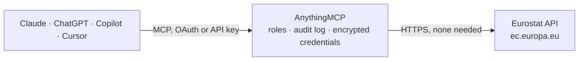

<!-- Generated by scripts/export-github-catalog.mjs in the anythingmcp-website repository. Do not edit by hand. -->

# Eurostat MCP connector

Official statistics of the European Union from Eurostat: read any of about 8,000 datasets (GDP, inflation, unemployment, population, energy, environment, regional NUTS data) with country, period and … The AnythingMCP connector gives Claude, ChatGPT, Microsoft Copilot, Cursor and Gemini 10 MCP tools for Eurostat, all read-only.

**Category:** [Public Data](../data.md) · **Tools:** 10 · **Setup guide:** [anythingmcp.com](https://anythingmcp.com/guides/eurostat-to-mcp) · [Deutsch](https://anythingmcp.com/de/guides/eurostat-to-mcp) · [Italiano](https://anythingmcp.com/it/guides/eurostat-to-mcp) · [Español](https://anythingmcp.com/es/guides/eurostat-to-mcp) · [日本語](https://anythingmcp.com/ja/guides/eurostat-to-mcp) · [Русский](https://anythingmcp.com/ru/guides/eurostat-to-mcp) · [中文](https://anythingmcp.com/zh/guides/eurostat-to-mcp)

## Start without code

No installation and no terminal: AnythingMCP Cloud runs the Eurostat connector for you, operated by helpcode.ai in Frankfurt, Germany.

1. **Click the button above** and create an account or sign in. The Eurostat connector opens, ready to install.
2. **Nothing to enter:** this connector needs no credentials. Every click is in the [step-by-step guide](https://anythingmcp.com/guides/eurostat-to-mcp).
3. **Click Install.** AnythingMCP shows the address of your MCP server.
4. **Add that address to your assistant:** [Claude](https://anythingmcp.com/guides/connect-eurostat-to-claude) · [ChatGPT](https://anythingmcp.com/guides/connect-eurostat-to-chatgpt) · [Microsoft Copilot](https://anythingmcp.com/guides/connect-eurostat-to-copilot) · [Cursor](https://anythingmcp.com/guides/connect-eurostat-to-cursor) · [Gemini CLI](https://anythingmcp.com/guides/connect-eurostat-to-gemini) · [Meta Muse](https://anythingmcp.com/guides/connect-eurostat-to-muse).
5. **Ask your first question**, for example: *What's the latest GDP per capita for Finland in dataset nama_10_pc and when was that dataset last updated?*

Prefer help with the setup? [Talk to us](https://anythingmcp.com/contact).

## How it works

- **The AI client** speaks MCP (Streamable HTTP) to AnythingMCP and only sees tool names, descriptions and results. It never gets the Eurostat credentials.
- **AnythingMCP** checks the client's role, builds the call from the tool definition, adds the credentials (none needed), calls Eurostat, logs the call and returns the result.
- **Eurostat** sees an ordinary API client with the rights of the account the credentials belong to.

## Tools

| Tool | What it does | Access |
|---|---|---|
| [`eurostat_get_data`](#eurostat_get_data) | Read Eurostat statistics (JSON-stat 2.0) from any dataset, filtered by country or region, period and dimension values: GDP, inflation, unemployment,… | read |
| [`eurostat_get_series`](#eurostat_get_series) | Read Eurostat data by SDMX series key: dimension values in the dataset's dimension order, joined by dots, several values joined by + and an empty position… | read |
| [`eurostat_get_dataset_info`](#eurostat_get_dataset_info) | Metadata of one Eurostat dataset: title, data structure id, number of observations, oldest and latest period, last data and structure update, planned next… | read |
| [`eurostat_get_dataset_codes`](#eurostat_get_dataset_codes) | The dimensions of a Eurostat dataset in key order, with every code actually used in the dataset and its English label (e.g. unit CP_MEUR = Current prices,… | read |
| [`eurostat_get_dataset_structure`](#eurostat_get_dataset_structure) | The SDMX data structure definition (DSD) of a Eurostat dataset: its dimensions with their position (the order of an SDMX series key), the code list of each… | read |
| [`eurostat_get_dataset_availability`](#eurostat_get_dataset_availability) | Which codes have data in a Eurostat dataset, per dimension, with their count (the SDMX content constraint), including the list of available periods. | read |
| [`eurostat_get_codelist`](#eurostat_get_codelist) | A whole Eurostat code list with the label of every code, e.g. GEO (countries and regions), UNIT, NA_ITEM, NACE_R2, COICOP, SEX, AGE, FREQ, OBS_FLAG. | read |
| [`eurostat_list_recent_updates`](#eurostat_list_recent_updates) | What changed at Eurostat in the last 7 days (the official update feed, rebuilt at 11:00 and 23:00 CET): new and deleted datasets with titles, datasets whose… | read |
| [`eurostat_list_comext_datasets`](#eurostat_list_comext_datasets) | List the Comext and PRODCOM datasets (detailed international trade in goods by HS, CN8, SITC, BEC and CPA, and industrial production), with code and title,… | read |
| [`eurostat_get_comext_data`](#eurostat_get_comext_data) | Read detailed EU trade in goods (Comext) or PRODCOM production data (JSON-stat 2.0) by reporter, partner, product, flow and indicator, e.g. German exports… | read |

## Tool reference

Every parameter as the AI client sees it in `tools/list`. Source: [`packages/backend/src/adapters/intl/eurostat.json`](../../../packages/backend/src/adapters/intl/eurostat.json).

### `eurostat_get_data`

Read Eurostat statistics (JSON-stat 2.0) from any dataset, filtered by country or region, period and dimension values: GDP, inflation, unemployment, population, energy, trade, regional NUTS data and more. Returns the values with labelled dimensions; filter tightly, an unfiltered dataset can have millions of cells. Free, no key.

**Access:** read · **Call:** `GET /eurostat/api/dissemination/statistics/1.0/data/{dataset}`

| Parameter | Type | Required | Description |
|---|---|---|---|
| `dataset` | string | yes | Dataset code, e.g. nama_10_gdp (GDP), une_rt_m (monthly unemployment), prc_hicp_manr (HICP inflation), demo_pjan (population). Case-insensitive. |
| `geo` | string[] | no | Country or region codes (one value per element), e.g. ["DE", "FR", "EU27_2020"]. NUTS codes for regional datasets (DE1, DE11, DE111). Cannot be combined with geoLevel. |
| `time` | string[] | no | Exact periods to return, in the dataset's format: 2024 (annual), 2024-Q3 (quarterly), 2024-09 (monthly), 2024-09-30 (daily). Do not combine with the other time parameters. |
| `sinceTimePeriod` | string | no | First period to return, e.g. 2015 or 2020-01. Can be combined with untilTimePeriod only. |
| `untilTimePeriod` | string | no | Last period to return. Can be combined with sinceTimePeriod only. |
| `lastTimePeriod` | integer | no | Only the N most recent periods, e.g. 1 for the latest value. Not combinable with the other time parameters. |
| `geoLevel` | `aggregate` \| `country` \| `nuts1` \| `nuts2` \| `nuts3` \| `city` | no | Return every geo code of one level instead of listing them: aggregate (EU27_2020, EA20 ...), country, nuts1, nuts2, nuts3 or city. Cannot be combined with geo. |
| `unit` | string[] | no | Values of the unit dimension, e.g. ["CP_MEUR"] (current prices, million euro) or ["PC"] (percent). Only for datasets that have a unit dimension. |
| `freq` | string[] | no | Values of the freq dimension: A annual, Q quarterly, M monthly, D daily. Only for datasets that have it. |
| `filters` | string | no | Any other dimension filters as a query string, one value per dimension, e.g. "na_item=B1GQ&s_adj=SA&sex=T&age=Y15-74". Dimension codes come from eurostat_get_dataset_codes. A dimension that the dataset does not have is refused with 400. For several values of such a dimension use eurostat_get_series. |
| `lang` | `EN` \| `FR` \| `DE` | no | Language of the labels: EN (default), FR or DE. |

### `eurostat_get_series`

Read Eurostat data by SDMX series key: dimension values in the dataset's dimension order, joined by dots, several values joined by + and an empty position for all values (A.CP_MEUR.B1GQ.DE+FR, M.SA.TOTAL.PC_ACT.T.). Returns JSON-stat 2.0 like eurostat_get_data. Use it when several values are needed for a dimension other than geo, time, unit or freq. Free, no key.

**Access:** read · **Call:** `GET /eurostat/api/dissemination/sdmx/2.1/data/{dataset}/{key}`

| Parameter | Type | Required | Description |
|---|---|---|---|
| `dataset` | string | yes | Dataset code, e.g. nama_10_gdp (GDP), une_rt_m (monthly unemployment), prc_hicp_manr (HICP inflation), demo_pjan (population). Case-insensitive. |
| `key` | string | yes | Series key in the order of eurostat_get_dataset_structure (time is not part of it), e.g. A.CP_MEUR.B1GQ.DE+FR+IT for nama_10_gdp (freq.unit.na_item.geo). Leave a position empty for every value, e.g. A.CP_MEUR..LU. |
| `startPeriod` | string | no | First period, e.g. 2015, 2020-Q1, 2024-01. |
| `endPeriod` | string | no | Last period. |
| `lastNObservations` | integer | no | Only the N most recent observations of each series. |
| `firstNObservations` | integer | no | Only the N oldest observations of each series. |
| `lang` | `en` \| `fr` \| `de` | no | Language of the labels: en (default), fr or de. |

### `eurostat_get_dataset_info`

Metadata of one Eurostat dataset: title, data structure id, number of observations, oldest and latest period, last data and structure update, planned next update, source institutions and links to the methodology (ESMS) page. Free.

**Access:** read · **Call:** `GET /eurostat/api/dissemination/sdmx/2.1/dataflow/ESTAT/{dataset}/latest`

| Parameter | Type | Required | Description |
|---|---|---|---|
| `dataset` | string | yes | Dataset code, e.g. nama_10_gdp (GDP), une_rt_m (monthly unemployment), prc_hicp_manr (HICP inflation), demo_pjan (population). Case-insensitive. |
| `lang` | `en` \| `fr` \| `de` | no | Language of the labels: en (default), fr or de. |

### `eurostat_get_dataset_codes`

The dimensions of a Eurostat dataset in key order, with every code actually used in the dataset and its English label (e.g. unit CP_MEUR = Current prices, million euro; geo DE = Germany). Call it before eurostat_get_data to pick valid filter values. Free.

**Access:** read · **Call:** `GET /eurostat/api/dissemination/sdmx/2.1/dataflow/ESTAT/{dataset}/latest`

| Parameter | Type | Required | Description |
|---|---|---|---|
| `dataset` | string | yes | Dataset code, e.g. nama_10_gdp (GDP), une_rt_m (monthly unemployment), prc_hicp_manr (HICP inflation), demo_pjan (population). Case-insensitive. |

### `eurostat_get_dataset_structure`

The SDMX data structure definition (DSD) of a Eurostat dataset: its dimensions with their position (the order of an SDMX series key), the code list of each dimension, the time dimension and the attributes (observation flags). The DSD id is the dataset code in upper case. Free.

**Access:** read · **Call:** `GET /eurostat/api/dissemination/sdmx/2.1/datastructure/ESTAT/{datastructure}/latest`

| Parameter | Type | Required | Description |
|---|---|---|---|
| `datastructure` | string | yes | Data structure id, normally the dataset code in upper case, e.g. NAMA_10_GDP (the datastructure field of eurostat_get_dataset_info). |

### `eurostat_get_dataset_availability`

Which codes have data in a Eurostat dataset, per dimension, with their count (the SDMX content constraint), including the list of available periods. Use it to check that a country, unit or year exists before querying, and to estimate the size of a request (the product of the counts). Codes only, no labels. Free.

**Access:** read · **Call:** `GET /eurostat/api/dissemination/sdmx/2.1/contentconstraint/ESTAT/{dataset}/latest`

| Parameter | Type | Required | Description |
|---|---|---|---|
| `dataset` | string | yes | Dataset code, e.g. nama_10_gdp (GDP), une_rt_m (monthly unemployment), prc_hicp_manr (HICP inflation), demo_pjan (population). Case-insensitive. |

### `eurostat_get_codelist`

A whole Eurostat code list with the label of every code, e.g. GEO (countries and regions), UNIT, NA_ITEM, NACE_R2, COICOP, SEX, AGE, FREQ, OBS_FLAG. Large lists (GEO has more than 3,000 codes) are big; prefer eurostat_get_dataset_codes for the codes of one dataset. Free.

**Access:** read · **Call:** `GET /eurostat/api/dissemination/sdmx/2.1/codelist/ESTAT/{codelist}/latest`

| Parameter | Type | Required | Description |
|---|---|---|---|
| `codelist` | string | yes | Code list id, e.g. GEO, UNIT, NA_ITEM, NACE_R2, OBS_STATUS (from eurostat_get_dataset_structure). |
| `lang` | `en` \| `fr` \| `de` | no | Language of the labels: en (default), fr or de. |

### `eurostat_list_recent_updates`

What changed at Eurostat in the last 7 days (the official update feed, rebuilt at 11:00 and 23:00 CET): new and deleted datasets with titles, datasets whose structure changed, datasets with new data, and code list changes. Takes no parameters. Free.

**Access:** read · **Call:** `GET /eurostat/api/dissemination/catalogue/rss/en/statistics-update.rss`

No parameters.

### `eurostat_list_comext_datasets`

List the Comext and PRODCOM datasets (detailed international trade in goods by HS, CN8, SITC, BEC and CPA, and industrial production), with code and title, for use with eurostat_get_comext_data. Takes no parameters. Free.

**Access:** read · **Call:** `GET /eurostat/api/comext/dissemination/sdmx/2.1/dataflow/ESTAT/all`

No parameters.

### `eurostat_get_comext_data`

Read detailed EU trade in goods (Comext) or PRODCOM production data (JSON-stat 2.0) by reporter, partner, product, flow and indicator, e.g. German exports to the US of HS chapter 87 in euro. Always set reporter, product, flow and indicators: the product dimension has tens of thousands of codes. Free, no key.

**Access:** read · **Call:** `GET /eurostat/api/comext/dissemination/statistics/1.0/data/{dataset}`

| Parameter | Type | Required | Description |
|---|---|---|---|
| `dataset` | string | yes | Comext or PRODCOM dataset code from eurostat_list_comext_datasets, e.g. DS-045409 (EU trade by HS2-4-6 and CN8), DS-059341 (trade of EU and non-EU countries by HS), DS-059358 (PRODCOM sold production, exports and imports). |
| `geo` | string[] | no | Not used by most Comext datasets; leave empty and use reporter and partner instead. |
| `time` | string[] | no | Exact periods to return, in the dataset's format: 2024 (annual), 2024-Q3 (quarterly), 2024-09 (monthly), 2024-09-30 (daily). Do not combine with the other time parameters. |
| `sinceTimePeriod` | string | no | First period to return, e.g. 2015 or 2020-01. Can be combined with untilTimePeriod only. |
| `untilTimePeriod` | string | no | Last period to return. Can be combined with sinceTimePeriod only. |
| `lastTimePeriod` | integer | no | Only the N most recent periods, e.g. 1 for the latest value. Not combinable with the other time parameters. |
| `reporter` | string[] | no | Reporting countries, e.g. ["DE"], ["IT", "FR"], or EU aggregate ["EU"] where the dataset has it. |
| `partner` | string[] | no | Partner countries or zones, e.g. ["US", "CN"], EXT_EU27_2020 (extra-EU), INT_EU27_2020 (intra-EU), WORLD. |
| `product` | string[] | no | Product codes of the dataset's classification: TOTAL, HS2 chapters ("27"), HS4 ("8703"), HS6 ("870380") or CN8 ("87038010") in DS-045409. |
| `flow` | string[] | no | Trade flow: "1" imports, "2" exports. Leave empty for both. |
| `indicators` | string[] | no | Measures, e.g. ["VALUE_IN_EUROS"], ["QUANTITY_IN_100KG"], ["SUPPLEMENTARY_QUANTITY"] in the trade datasets. |
| `freq` | string[] | no | A annual or M monthly. |
| `filters` | string | no | Other dimension filters as a query string with one value per dimension, e.g. "transport_mode=1" or "prccode=10511133". |
| `lang` | `EN` \| `FR` \| `DE` | no | Language of the labels: EN (default), FR or DE. |

## Run it yourself

AnythingMCP is open source (AGPL-3.0). [Run it with Docker](../../../README.md#run-it-yourself), open **Connectors → Store**, pick **Eurostat**, then add your MCP server URL to the AI client.

[← Public Data connectors](../data.md) · [All categories](../README.md)
