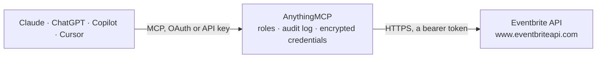

<!-- Generated by scripts/export-github-catalog.mjs in the anythingmcp-website repository. Do not edit by hand. -->

# Eventbrite MCP connector

Let your AI work with Eventbrite: list your events, attendees with check-in state, orders, ticket types, venues, discount codes and sales reports, and create, update and publish events, tickets, … The AnythingMCP connector gives Claude, ChatGPT, Microsoft Copilot, Cursor and Gemini 24 MCP tools for Eventbrite: 14 read and 10 can change data.

**Category:** [Scheduling](../scheduling.md) · **Tools:** 24 · **Setup guide:** [anythingmcp.com](https://anythingmcp.com/guides/eventbrite-to-mcp) · [Deutsch](https://anythingmcp.com/de/guides/eventbrite-to-mcp) · [Italiano](https://anythingmcp.com/it/guides/eventbrite-to-mcp) · [Español](https://anythingmcp.com/es/guides/eventbrite-to-mcp) · [日本語](https://anythingmcp.com/ja/guides/eventbrite-to-mcp) · [Русский](https://anythingmcp.com/ru/guides/eventbrite-to-mcp) · [中文](https://anythingmcp.com/zh/guides/eventbrite-to-mcp)

## Start without code

No installation and no terminal: AnythingMCP Cloud runs the Eventbrite connector for you, operated by helpcode.ai in Frankfurt, Germany.

1. **Click the button above** and create an account or sign in. The Eventbrite connector opens, ready to install.
2. **Paste the API key or token from your Eventbrite account.** Every click is in the [step-by-step guide](https://anythingmcp.com/guides/eventbrite-to-mcp).
3. **Click Install.** AnythingMCP shows the address of your MCP server.
4. **Add that address to your assistant:** [Claude](https://anythingmcp.com/guides/connect-eventbrite-to-claude) · [ChatGPT](https://anythingmcp.com/guides/connect-eventbrite-to-chatgpt) · [Microsoft Copilot](https://anythingmcp.com/guides/connect-eventbrite-to-copilot) · [Cursor](https://anythingmcp.com/guides/connect-eventbrite-to-cursor) · [Gemini CLI](https://anythingmcp.com/guides/connect-eventbrite-to-gemini) · [Meta Muse](https://anythingmcp.com/guides/connect-eventbrite-to-muse).
5. **Ask your first question**, for example: *Get details for order ORD-2026-137 so I can match the bank payment.*

Prefer help with the setup? [Talk to us](https://anythingmcp.com/contact).

## How it works

- **The AI client** speaks MCP (Streamable HTTP) to AnythingMCP and only sees tool names, descriptions and results. It never gets the Eventbrite credentials.
- **AnythingMCP** checks the client's role, builds the call from the tool definition, adds the credentials (a bearer token), calls Eventbrite, logs the call and returns the result.
- **Eventbrite** sees an ordinary API client with the rights of the account the credentials belong to.

## Tools

| Tool | What it does | Access |
|---|---|---|
| [`eventbrite_get_current_user`](#eventbrite_get_current_user) | Return the Eventbrite user the private token belongs to: id, name, emails. | read |
| [`eventbrite_list_my_organizations`](#eventbrite_list_my_organizations) | List the organizations the user belongs to: id, name, vertical. | read |
| [`eventbrite_list_events`](#eventbrite_list_events) | List the events of an organization, filtered by status and time: id, name, start and end (local and UTC with timezone), status (draft, live, started, ended,… | read |
| [`eventbrite_get_event`](#eventbrite_get_event) | Get one event with its name, summary, dates, status, url, currency, capacity, listing settings, venue and ticket availability (with the default expand). | read |
| [`eventbrite_create_event`](#eventbrite_create_event) | Create a new event as a draft in an organization. | write |
| [`eventbrite_update_event`](#eventbrite_update_event) | Change an event's name, dates, summary, venue, capacity or listing settings; only the fields you pass change. | write |
| [`eventbrite_publish_event`](#eventbrite_publish_event) | Publish an event: it becomes visible and its tickets go on sale. | write |
| [`eventbrite_unpublish_event`](#eventbrite_unpublish_event) | Unpublish an event: it is no longer visible and stops selling. | write |
| [`eventbrite_cancel_event`](#eventbrite_cancel_event) | Cancel an event for good. | write |
| [`eventbrite_delete_event`](#eventbrite_delete_event) | Delete an event for good. | write |
| [`eventbrite_get_event_description`](#eventbrite_get_event_description) | Get the long description of an event (its structured content): page_version_number and the modules (text with HTML, images, videos) and widgets (agenda, FAQs). | read |
| [`eventbrite_set_event_description`](#eventbrite_set_event_description) | Replace the long description of an event with one HTML text block and publish it. | write |
| [`eventbrite_list_ticket_classes`](#eventbrite_list_ticket_classes) | List an event's ticket types: id, name, free or cost (with fee and tax), capacity, quantity_sold, sales start and end, on_sale_status, hidden, min and max… | read |
| [`eventbrite_create_ticket_class`](#eventbrite_create_ticket_class) | Add a ticket type to an event, free (free true) or paid (cost such as EUR,2500 for 25.00 EUR in the event currency) with a capacity. | write |
| [`eventbrite_update_ticket_class`](#eventbrite_update_ticket_class) | Change a ticket type: name, price, capacity, sales dates, limits per order or hidden; only the fields you pass change. | write |
| [`eventbrite_list_attendees`](#eventbrite_list_attendees) | List the attendees of an event (one per ticket sold): id, name, email, ticket type, status (Attending, Checked In, Not Attending), checked_in, cancelled,… | read |
| [`eventbrite_get_attendee`](#eventbrite_get_attendee) | Get one attendee of an event with profile (name, email, phone, company, job title), ticket type, cost, status, check-in state per barcode and answers to the… | read |
| [`eventbrite_list_event_orders`](#eventbrite_list_event_orders) | List the orders of an event: id, buyer name and email, status, created time, gross, base price, Eventbrite fee, payment fee and tax. | read |
| [`eventbrite_list_organization_orders`](#eventbrite_list_organization_orders) | List the orders across all events of an organization: id, event_id, buyer name and email, status, created time and amounts. | read |
| [`eventbrite_get_order`](#eventbrite_get_order) | Get one order with buyer, status and the full cost breakdown; expand attendees to see the tickets in it, event for the event. | read |
| [`eventbrite_list_venues`](#eventbrite_list_venues) | List the saved venues of an organization: id, name, address, capacity and age restriction. | read |
| [`eventbrite_create_venue`](#eventbrite_create_venue) | Save a new venue in an organization so events can use it. | write |
| [`eventbrite_list_discounts`](#eventbrite_list_discounts) | List discount, access and promo codes of an organization: id, code, type, amount_off or percent_off, how many are available and used, validity dates and the… | read |
| [`eventbrite_get_sales_report`](#eventbrite_get_sales_report) | Get a sales report for one or more events: gross, net, quantity, fees and royalty per period (day by default), optionally grouped by ticket, payment method,… | read |

## Tool reference

Every parameter as the AI client sees it in `tools/list`. Source: [`packages/backend/src/adapters/intl/eventbrite.json`](../../../packages/backend/src/adapters/intl/eventbrite.json).

### `eventbrite_get_current_user`

Return the Eventbrite user the private token belongs to: id, name, emails. Free and the quickest check that the token works. Read-only.

**Access:** read · **Call:** `GET /users/me/`

No parameters.

### `eventbrite_list_my_organizations`

List the organizations the user belongs to: id, name, vertical. Almost every other tool needs an organization_id from here (it is not the organizer id from a profile URL). Read-only.

**Access:** read · **Call:** `GET /users/me/organizations/`

| Parameter | Type | Required | Description |
|---|---|---|---|
| `continuation` | string | no | pagination.continuation from the previous answer, for the next page (only while has_more_items is true). |

### `eventbrite_list_events`

List the events of an organization, filtered by status and time: id, name, start and end (local and UTC with timezone), status (draft, live, started, ended, completed, canceled), url, currency, capacity, online_event, venue and, with expand ticket_availability, prices and sold-out state. Public event search across Eventbrite no longer exists in the API; this lists your own events. Read-only.

**Access:** read · **Call:** `GET /organizations/{organization_id}/events/`

| Parameter | Type | Required | Description |
|---|---|---|---|
| `organization_id` | string | yes | Organization id from eventbrite_list_my_organizations (not the organizer id). |
| `status` | string | no | Event status, or several comma-separated (e.g. live,started). Default all. |
| `time_filter` | `current_future` \| `past` \| `all` | no | current_future (default here), past or all. |
| `order_by` | `start_asc` \| `start_desc` \| `created_asc` \| `created_desc` \| `name_asc` \| `name_desc` | no | Sort order. |
| `name_filter` | string | no | Only events whose name contains this text. |
| `page_size` | integer | no | Events per page, e.g. 20 or 50. |
| `expand` | string | no | Comma-separated expansions, e.g. venue,ticket_availability (lowest and highest price, sold out, sales start). Also organizer, category, format, refund_policy, event_sales_status. |
| `continuation` | string | no | pagination.continuation from the previous answer, for the next page (only while has_more_items is true). |

### `eventbrite_get_event`

Get one event with its name, summary, dates, status, url, currency, capacity, listing settings, venue and ticket availability (with the default expand). For the long description use eventbrite_get_event_description. Read-only.

**Access:** read · **Call:** `GET /events/{event_id}/`

| Parameter | Type | Required | Description |
|---|---|---|---|
| `event_id` | string | yes | Event id, e.g. from eventbrite_list_events. |
| `expand` | string | no | Comma-separated expansions, e.g. venue,ticket_availability (lowest and highest price, sold out, sales start). Also organizer, category, format, refund_policy, event_sales_status. |

### `eventbrite_create_event`

Create a new event as a draft in an organization. Confirm the name, dates, timezone and currency with the user first. The event stays unpublished (not visible, no sales) until eventbrite_publish_event; add tickets with eventbrite_create_ticket_class and the long description with eventbrite_set_event_description before publishing. Set venue_id (from eventbrite_list_venues or eventbrite_create_venue) or online_event true, not both. Returns the new event with its id.

**Access:** write · **Call:** `POST /organizations/{organization_id}/events/`

| Parameter | Type | Required | Description |
|---|---|---|---|
| `organization_id` | string | yes | Organization id from eventbrite_list_my_organizations (not the organizer id). |
| `name` | string | yes | Event name. |
| `start_utc` | string | yes | Start in UTC, YYYY-MM-DDTHH:MM:SSZ without milliseconds, e.g. 2026-11-20T18:00:00Z. |
| `end_utc` | string | yes | End in UTC, same format, after the start. |
| `timezone` | string | yes | Timezone of the event, e.g. Europe/Berlin or America/New_York. |
| `currency` | string | yes | ISO 4217 currency for tickets, e.g. EUR or USD. |
| `summary` | string | no | Short plain-text summary, up to 140 characters. |
| `online_event` | boolean | no | true for an online-only event without a venue. |
| `venue_id` | string | no | Venue id; leave out for online events. |
| `listed` | boolean | no | false to keep the event out of Eventbrite search (default true). |
| `shareable` | boolean | no | Show social sharing buttons. |
| `invite_only` | boolean | no | Only invited people can see the page (cannot be combined with listed true). |
| `capacity` | integer | no | Total capacity; leave out to use the sum of the ticket capacities. |
| `organizer_id` | string | no | Organizer profile id; leave out for the default organizer. |
| `category_id` | string | no | Category id, e.g. 103 Music, 102 Science & Technology, 101 Business. |
| `format_id` | string | no | Format id, e.g. 1 Conference, 2 Seminar or Talk, 9 Class or Workshop. |
| `locale` | string | no | Language of the listing page, e.g. de_DE, en_US, it_IT (default en_US). |

### `eventbrite_update_event`

Change an event's name, dates, summary, venue, capacity or listing settings; only the fields you pass change. Show the user the changes and confirm before calling: a live event changes for everyone who sees or bought it. Dates take an object with timezone and utc. Currency cannot change once paid tickets are sold. Returns the updated event.

**Access:** write · **Call:** `POST /events/{event_id}/`

| Parameter | Type | Required | Description |
|---|---|---|---|
| `event_id` | string | yes | Event id, e.g. from eventbrite_list_events. |
| `name` | object | no | New name as {"html": "Summer Party 2026"}. |
| `start` | object | no | New start as {"timezone": "Europe/Berlin", "utc": "2026-11-20T18:00:00Z"}. |
| `end` | object | no | New end as {"timezone": "Europe/Berlin", "utc": "2026-11-20T22:00:00Z"}; same timezone as start. |
| `summary` | string | no | New plain-text summary, up to 140 characters. |
| `online_event` | boolean | no | true for online only. |
| `venue_id` | string | no | New venue id. |
| `listed` | boolean | no | Show in Eventbrite search. |
| `shareable` | boolean | no | Show social sharing buttons. |
| `invite_only` | boolean | no | Only invited people can see the page. |
| `capacity` | integer | no | New total capacity. |
| `currency` | string | no | New currency (only before paid sales). |
| `category_id` | string | no | Category id. |
| `format_id` | string | no | Format id. |

### `eventbrite_publish_event`

Publish an event: it becomes visible and its tickets go on sale. Confirm with the user first. Publishing needs a name, a description, an organizer, at least one ticket class and, for paid tickets, payout settings; otherwise Eventbrite answers 400 naming what is missing. Returns published true.

**Access:** write · **Call:** `POST /events/{event_id}/publish/`

| Parameter | Type | Required | Description |
|---|---|---|---|
| `event_id` | string | yes | Event id, e.g. from eventbrite_list_events. |

### `eventbrite_unpublish_event`

Unpublish an event: it is no longer visible and stops selling. Confirm with the user first. Only possible while the event has no pending or completed orders (a completed and paid-out paid event can be unpublished). Returns unpublished true.

**Access:** write · **Call:** `POST /events/{event_id}/unpublish/`

| Parameter | Type | Required | Description |
|---|---|---|---|
| `event_id` | string | yes | Event id, e.g. from eventbrite_list_events. |

### `eventbrite_cancel_event`

Cancel an event for good. Only possible when it has no pending or completed orders (refund them first). Installed switched off: an administrator turns it on deliberately. Show the event with eventbrite_get_event first and call only after the user confirms. Returns canceled true.

**Access:** write · **Call:** `POST /events/{event_id}/cancel/`

| Parameter | Type | Required | Description |
|---|---|---|---|
| `event_id` | string | yes | Event id, e.g. from eventbrite_list_events. |

### `eventbrite_delete_event`

Delete an event for good. Only possible when it has no pending or completed orders. Installed switched off: an administrator turns it on deliberately. Show the event with eventbrite_get_event first and call only after the user confirms. Returns deleted true.

**Access:** write · **Call:** `DELETE /events/{event_id}/`

| Parameter | Type | Required | Description |
|---|---|---|---|
| `event_id` | string | yes | Event id, e.g. from eventbrite_list_events. |

### `eventbrite_get_event_description`

Get the long description of an event (its structured content): page_version_number and the modules (text with HTML, images, videos) and widgets (agenda, FAQs). This is the latest working version, published or not. eventbrite_set_event_description needs page_version_number + 1 as version (1 when there is no version yet). Read-only.

**Access:** read · **Call:** `GET /events/{event_id}/structured_content/edit/`

| Parameter | Type | Required | Description |
|---|---|---|---|
| `event_id` | string | yes | Event id, e.g. from eventbrite_list_events. |
| `purpose` | `listing` \| `digital_content` | no | listing (the event page, default) or digital_content (online event page). |

### `eventbrite_set_event_description`

Replace the long description of an event with one HTML text block and publish it. This replaces every existing module (images and videos too), so read eventbrite_get_event_description first, keep what should stay in the HTML, show the user the new text and call only after the user confirms. version must be the current page_version_number + 1 (400 PAGE_VERSION_DISCONTINUITY otherwise; read the description again and retry). HTML allowed: paragraphs, bold, italics, links and lists.

**Access:** write · **Call:** `POST /events/{event_id}/structured_content/{version}/`

| Parameter | Type | Required | Description |
|---|---|---|---|
| `event_id` | string | yes | Event id, e.g. from eventbrite_list_events. |
| `version` | string | yes | New version: page_version_number from eventbrite_get_event_description plus 1, or 1 for the first description. |
| `html` | string | yes | The description as HTML, e.g. 
Doors open at <strong>7 pm</strong>.
 |
| `publish` | boolean | no | true (default) makes the new text visible on the event page; false saves it as a draft. |
| `purpose` | `listing` \| `digital_content` | no | listing (default) or digital_content. |

### `eventbrite_list_ticket_classes`

List an event's ticket types: id, name, free or cost (with fee and tax), capacity, quantity_sold, sales start and end, on_sale_status, hidden, min and max per order. Read-only.

**Access:** read · **Call:** `GET /events/{event_id}/ticket_classes/`

| Parameter | Type | Required | Description |
|---|---|---|---|
| `event_id` | string | yes | Event id, e.g. from eventbrite_list_events. |
| `continuation` | string | no | pagination.continuation from the previous answer, for the next page (only while has_more_items is true). |

### `eventbrite_create_ticket_class`

Add a ticket type to an event, free (free true) or paid (cost such as EUR,2500 for 25.00 EUR in the event currency) with a capacity. Confirm name, price and quantity with the user first. Paid tickets need payout settings in Eventbrite before the event can be published. Returns the ticket class with its id.

**Access:** write · **Call:** `POST /events/{event_id}/ticket_classes/`

| Parameter | Type | Required | Description |
|---|---|---|---|
| `event_id` | string | yes | Event id, e.g. from eventbrite_list_events. |
| `name` | string | yes | Ticket name, e.g. General Admission. |
| `free` | boolean | no | true for a free ticket (leave cost out). |
| `cost` | string | no | Price as currency and amount in the smallest unit, matching the event currency: EUR,2500 is 25.00 EUR. |
| `capacity` | integer | no | How many of this ticket can be sold. |
| `description` | string | no | Description shown with the ticket. |
| `minimum_quantity` | integer | no | Minimum per order. |
| `maximum_quantity` | integer | no | Maximum per order. |
| `sales_start` | string | no | Sales start in UTC, YYYY-MM-DDTHH:MM:SSZ; default when the event is published. |
| `sales_end` | string | no | Sales end in UTC, YYYY-MM-DDTHH:MM:SSZ; default one hour before the start. |
| `hidden` | boolean | no | Hide this ticket from the event page. |
| `include_fee` | boolean | no | Absorb the Eventbrite fee into the price. |
| `sales_channels` | string[] | no | Where it sells: ["online"], ["atd"] (at the door) or both. |

### `eventbrite_update_ticket_class`

Change a ticket type: name, price, capacity, sales dates, limits per order or hidden; only the fields you pass change. Confirm the change with the user first. The price cannot change once tickets were sold. Returns the updated ticket class.

**Access:** write · **Call:** `POST /events/{event_id}/ticket_classes/{ticket_class_id}/`

| Parameter | Type | Required | Description |
|---|---|---|---|
| `event_id` | string | yes | Event id, e.g. from eventbrite_list_events. |
| `ticket_class_id` | string | yes | Ticket class id from eventbrite_list_ticket_classes. |
| `name` | string | no | Ticket name, e.g. General Admission. |
| `free` | boolean | no | true for a free ticket (leave cost out). |
| `cost` | string | no | Price as currency and amount in the smallest unit, matching the event currency: EUR,2500 is 25.00 EUR. |
| `capacity` | integer | no | How many of this ticket can be sold. |
| `description` | string | no | Description shown with the ticket. |
| `minimum_quantity` | integer | no | Minimum per order. |
| `maximum_quantity` | integer | no | Maximum per order. |
| `sales_start` | string | no | Sales start in UTC, YYYY-MM-DDTHH:MM:SSZ; default when the event is published. |
| `sales_end` | string | no | Sales end in UTC, YYYY-MM-DDTHH:MM:SSZ; default one hour before the start. |
| `hidden` | boolean | no | Hide this ticket from the event page. |
| `include_fee` | boolean | no | Absorb the Eventbrite fee into the price. |
| `sales_channels` | string[] | no | Where it sells: ["online"], ["atd"] (at the door) or both. |

### `eventbrite_list_attendees`

List the attendees of an event (one per ticket sold): id, name, email, ticket type, status (Attending, Checked In, Not Attending), checked_in, cancelled, refunded, order_id and the check-in state of each barcode. Barcode values are left out. Read-only.

**Access:** read · **Call:** `GET /events/{event_id}/attendees/`

| Parameter | Type | Required | Description |
|---|---|---|---|
| `event_id` | string | yes | Event id, e.g. from eventbrite_list_events. |
| `status` | `attending` \| `not_attending` \| `unpaid` | no | attending (attending or checked in), not_attending, or unpaid. |
| `changed_since` | string | no | Only attendees changed at or after this UTC time, YYYY-MM-DDTHH:MM:SSZ. |
| `continuation` | string | no | pagination.continuation from the previous answer, for the next page (only while has_more_items is true). |

### `eventbrite_get_attendee`

Get one attendee of an event with profile (name, email, phone, company, job title), ticket type, cost, status, check-in state per barcode and answers to the order form questions. Barcode values are left out. Read-only.

**Access:** read · **Call:** `GET /events/{event_id}/attendees/{attendee_id}/`

| Parameter | Type | Required | Description |
|---|---|---|---|
| `event_id` | string | yes | Event id, e.g. from eventbrite_list_events. |
| `attendee_id` | string | yes | Attendee id from eventbrite_list_attendees. |

### `eventbrite_list_event_orders`

List the orders of an event: id, buyer name and email, status, created time, gross, base price, Eventbrite fee, payment fee and tax. Read-only.

**Access:** read · **Call:** `GET /events/{event_id}/orders/`

| Parameter | Type | Required | Description |
|---|---|---|---|
| `event_id` | string | yes | Event id, e.g. from eventbrite_list_events. |
| `status` | `active` \| `inactive` \| `both` \| `all_not_deleted` | no | active (attending, default), inactive (not attending), both, or all_not_deleted. |
| `changed_since` | string | no | Only orders changed at or after this UTC time, YYYY-MM-DDTHH:MM:SSZ. |
| `continuation` | string | no | pagination.continuation from the previous answer, for the next page (only while has_more_items is true). |

### `eventbrite_list_organization_orders`

List the orders across all events of an organization: id, event_id, buyer name and email, status, created time and amounts. Use changed_since to look at recent sales. Read-only.

**Access:** read · **Call:** `GET /organizations/{organization_id}/orders/`

| Parameter | Type | Required | Description |
|---|---|---|---|
| `organization_id` | string | yes | Organization id from eventbrite_list_my_organizations (not the organizer id). |
| `status` | `active` \| `inactive` \| `both` \| `all_not_deleted` | no | active (attending, default), inactive (not attending), both, or all_not_deleted. |
| `changed_since` | string | no | Only orders changed at or after this UTC time, YYYY-MM-DDTHH:MM:SSZ. |
| `continuation` | string | no | pagination.continuation from the previous answer, for the next page (only while has_more_items is true). |

### `eventbrite_get_order`

Get one order with buyer, status and the full cost breakdown; expand attendees to see the tickets in it, event for the event. Read-only.

**Access:** read · **Call:** `GET /orders/{order_id}/`

| Parameter | Type | Required | Description |
|---|---|---|---|
| `order_id` | string | yes | Order id. |
| `expand` | string | no | Comma-separated expansions: attendees, event. |

### `eventbrite_list_venues`

List the saved venues of an organization: id, name, address, capacity and age restriction. Use the id as venue_id when creating or updating an event. Read-only.

**Access:** read · **Call:** `GET /organizations/{organization_id}/venues/`

| Parameter | Type | Required | Description |
|---|---|---|---|
| `organization_id` | string | yes | Organization id from eventbrite_list_my_organizations (not the organizer id). |
| `continuation` | string | no | pagination.continuation from the previous answer, for the next page (only while has_more_items is true). |

### `eventbrite_create_venue`

Save a new venue in an organization so events can use it. Confirm name and address with the user first. Returns the venue with its id.

**Access:** write · **Call:** `POST /organizations/{organization_id}/venues/`

| Parameter | Type | Required | Description |
|---|---|---|---|
| `organization_id` | string | yes | Organization id from eventbrite_list_my_organizations (not the organizer id). |
| `name` | string | yes | Venue name. |
| `address` | object | no | Address: {"address_1": "Hauptstr. 1", "address_2": "", "city": "Freiburg", "region": "BW", "postal_code": "79098", "country": "DE"}; latitude and longitude as strings may be added here too, never at the top level. |
| `capacity` | integer | no | Venue capacity. |
| `age_restriction` | `AGE_RESTRICTION_ALL_AGES` \| `AGE_RESTRICTION_MIN_TWELVE` \| `AGE_RESTRICTION_MIN_THIRTEEN` \| `AGE_RESTRICTION_MIN_FOURTEEN` \| `AGE_RESTRICTION_MIN_FIFTEEN` \| `AGE_RESTRICTION_MIN_SIXTEEN` \| `AGE_RESTRICTION_MIN_SEVENTEEN` \| `AGE_RESTRICTION_MIN_EIGHTEEN` \| `AGE_RESTRICTION_MIN_NINETEEN` \| `AGE_RESTRICTION_MIN_TWENTY_ONE` \| `AGE_RESTRICTION_UNDER_TWENTY_ONE_WITH_GUARDIAN` \| `AGE_RESTRICTION_UNDER_EIGHTEEN_WITH_GUARDIAN` | no | Age restriction. |
| `google_place_id` | string | no | Google Place id of the venue, if known. |

### `eventbrite_list_discounts`

List discount, access and promo codes of an organization: id, code, type, amount_off or percent_off, how many are available and used, validity dates and the event or ticket classes they apply to. With scope event (default) event_id is required. Read-only.

**Access:** read · **Call:** `GET /organizations/{organization_id}/discounts/`

| Parameter | Type | Required | Description |
|---|---|---|---|
| `organization_id` | string | yes | Organization id from eventbrite_list_my_organizations (not the organizer id). |
| `scope` | `event` \| `multi_events` \| `user` | no | event (codes of one event, needs event_id), multi_events or user. |
| `event_id` | string | no | Event id; required for scope event. |
| `code` | string | no | Only the code with exactly this name. |
| `code_filter` | string | no | Only codes containing this text (not together with code). |
| `type` | `coded` \| `access` \| `public` \| `hold` | no | Only this kind: coded (discount code), access (access code), public (public discount) or hold. |
| `page_size` | integer | no | Codes per page. |
| `continuation` | string | no | pagination.continuation from the previous answer, for the next page (only while has_more_items is true). |

### `eventbrite_get_sales_report`

Get a sales report for one or more events: gross, net, quantity, fees and royalty per period (day by default), optionally grouped by ticket, payment method, currency, country, sales channel and more. Read-only.

**Access:** read · **Call:** `GET /reports/sales/`

| Parameter | Type | Required | Description |
|---|---|---|---|
| `event_ids` | string[] | yes | Event ids to report on, e.g. ["123456789"]. |
| `event_status` | `all` \| `live` \| `ended` | no | Limit to events with this status. |
| `start_date` | string | no | Start of the period, YYYY-MM-DD. |
| `end_date` | string | no | End of the period, YYYY-MM-DD. |
| `date_facet` | `fifteen` \| `hour` \| `day` \| `event_day` \| `week` \| `month` \| `year` \| `none` | no | Period per row: fifteen, hour, day (default), event_day, week, month, year or none (one total). |
| `group_by` | string | no | Break out by: ticket, payment_method, currency, event, country, city, sales_channel_lvl_1, delivery_method and others. |
| `timezone` | string | no | Timezone of the dates, e.g. Europe/Berlin; default the first event's timezone. |

## Run it yourself

AnythingMCP is open source (AGPL-3.0). [Run it with Docker](../../../README.md#run-it-yourself), open **Connectors → Store**, pick **Eventbrite** and enter `EVENTBRITE_PRIVATE_TOKEN`, then add your MCP server URL to the AI client.

[← Scheduling connectors](../scheduling.md) · [All categories](../README.md)
