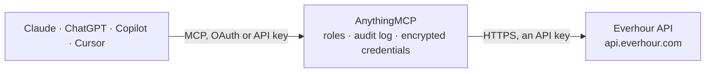

<!-- Generated by scripts/export-github-catalog.mjs in the anythingmcp-website repository. Do not edit by hand. -->

# Everhour MCP connector

Track time in Everhour from your AI: find tasks, log and correct time, start and stop timers, and read projects, clients, team time records, invoices, expenses, the schedule and project and user reports. The AnythingMCP connector gives Claude, ChatGPT, Microsoft Copilot, Cursor and Gemini 24 MCP tools for Everhour: 19 read and 5 can change data.

**Category:** [Time Tracking](../time-tracking.md) · **Tools:** 24 · **Setup guide:** [anythingmcp.com](https://anythingmcp.com/guides/everhour-to-mcp) · [Deutsch](https://anythingmcp.com/de/guides/everhour-to-mcp) · [Italiano](https://anythingmcp.com/it/guides/everhour-to-mcp) · [Español](https://anythingmcp.com/es/guides/everhour-to-mcp) · [日本語](https://anythingmcp.com/ja/guides/everhour-to-mcp) · [Русский](https://anythingmcp.com/ru/guides/everhour-to-mcp) · [中文](https://anythingmcp.com/zh/guides/everhour-to-mcp)

## Start without code

No installation and no terminal: AnythingMCP Cloud runs the Everhour connector for you, operated by helpcode.ai in Frankfurt, Germany.

1. **Click the button above** and create an account or sign in. The Everhour connector opens, ready to install.
2. **Paste the API key or token from your Everhour account.** Every click is in the [step-by-step guide](https://anythingmcp.com/guides/everhour-to-mcp).
3. **Click Install.** AnythingMCP shows the address of your MCP server.
4. **Add that address to your assistant:** [Claude](https://anythingmcp.com/guides/connect-everhour-to-claude) · [ChatGPT](https://anythingmcp.com/guides/connect-everhour-to-chatgpt) · [Microsoft Copilot](https://anythingmcp.com/guides/connect-everhour-to-copilot) · [Cursor](https://anythingmcp.com/guides/connect-everhour-to-cursor) · [Gemini CLI](https://anythingmcp.com/guides/connect-everhour-to-gemini) · [Meta Muse](https://anythingmcp.com/guides/connect-everhour-to-muse).
5. **Ask your first question**, for example: *Show invoice INV-2026-042 for client Greenfield GmbH (I need amount and status).*

Prefer help with the setup? [Talk to us](https://anythingmcp.com/contact).

## How it works

- **The AI client** speaks MCP (Streamable HTTP) to AnythingMCP and only sees tool names, descriptions and results. It never gets the Everhour credentials.
- **AnythingMCP** checks the client's role, builds the call from the tool definition, adds the credentials (an API key), calls Everhour, logs the call and returns the result.
- **Everhour** sees an ordinary API client with the rights of the account the credentials belong to.

## Tools

| Tool | What it does | Access |
|---|---|---|
| [`everhour_get_me`](#everhour_get_me) | Show the Everhour user the API key belongs to: id, name, headline, role (admin, supervisor or member) and status. | read |
| [`everhour_list_users`](#everhour_list_users) | List or search the team's users: id, name, email, headline, role and status (active, invited, pending, removed). | read |
| [`everhour_list_projects`](#everhour_list_projects) | List projects, optionally searched by name or limited to one integration (Asana, Trello, Jira...): id with platform prefix, name, workspace, client id,… | read |
| [`everhour_get_project`](#everhour_get_project) | Get one project: name, workspace, client, type, assigned users, billing type and fee, rates and budget with its progress (money in cents, time in seconds). | read |
| [`everhour_list_project_tasks`](#everhour_list_project_tasks) | List the tasks of one project: id, name, status, due date, labels, total tracked time and estimate (seconds). | read |
| [`everhour_search_tasks`](#everhour_search_tasks) | Search tasks by name across all projects, to find the task id needed to log time or start a timer: id, name, projects, status, due date, tracked time and… | read |
| [`everhour_get_task`](#everhour_get_task) | Get one task: name, projects, section, status, due date, labels, description, tracked time per user and estimate (seconds). | read |
| [`everhour_list_clients`](#everhour_list_clients) | List clients, optionally searched by name: id, name, project ids, business details and budget. | read |
| [`everhour_list_time_records`](#everhour_list_time_records) | List the whole team's time records in a date range: id, date, time (seconds), user id, comment, task id and name, project ids, locked and invoiced flags. | read |
| [`everhour_list_user_time_records`](#everhour_list_user_time_records) | List one user's time records in a date range, same fields as everhour_list_time_records. | read |
| [`everhour_list_project_time_records`](#everhour_list_project_time_records) | List the time records of one project in a date range, same fields as everhour_list_time_records. | read |
| [`everhour_add_time`](#everhour_add_time) | Log time on a task for a day (adds to what is already there). | write |
| [`everhour_update_time_record`](#everhour_update_time_record) | Change one time record: set its time (seconds), and optionally its date, task, user or comment. | write |
| [`everhour_delete_time_record`](#everhour_delete_time_record) | Delete one time record for good. | write |
| [`everhour_get_running_timer`](#everhour_get_running_timer) | Show the key owner's timer: status (active or stopped), task, comment, when it started and how long it has run (seconds). | read |
| [`everhour_list_team_timers`](#everhour_list_team_timers) | List the timers running for the team right now: user, task, start time and duration (seconds). | read |
| [`everhour_start_timer`](#everhour_start_timer) | Start the key owner's timer on a task; a timer already running is stopped and its time saved first. | write |
| [`everhour_stop_timer`](#everhour_stop_timer) | Stop the key owner's running timer and save its time to the task; returns the saved time record. | write |
| [`everhour_list_invoices`](#everhour_list_invoices) | List invoices: id, number, client, status (draft, sent, paid), issue and due date, period, total time (seconds) and amounts in cents (list, net, total). | read |
| [`everhour_get_invoice`](#everhour_get_invoice) | Get one invoice with its line items (name, billed time in seconds, amounts in cents), tax, discount and totals. | read |
| [`everhour_list_expenses`](#everhour_list_expenses) | List expenses: id, date, user id, project, category id, amount (cents), quantity, billable flag and details. | read |
| [`everhour_list_schedule`](#everhour_list_schedule) | List resource planner assignments (scheduled work and time off) by date, project, task or client: id, type (project or time-off), user id, project, start… | read |
| [`everhour_projects_report`](#everhour_projects_report) | Projects report for a period: per project the tracked time, billable and non-billable time (seconds), billable amount, costs, profit, expenses and… | read |
| [`everhour_users_report`](#everhour_users_report) | Users report for a period: per team member the tracked, billable and non-billable time, time off (seconds), billable amount, costs and profit (cents). | read |

## Tool reference

Every parameter as the AI client sees it in `tools/list`. Source: [`packages/backend/src/adapters/intl/everhour.json`](../../../packages/backend/src/adapters/intl/everhour.json).

### `everhour_get_me`

Show the Everhour user the API key belongs to: id, name, headline, role (admin, supervisor or member) and status. Use the id as user in other tools. Read-only.

**Access:** read · **Call:** `GET /users/me`

No parameters.

### `everhour_list_users`

List or search the team's users: id, name, email, headline, role and status (active, invited, pending, removed). Read-only.

**Access:** read · **Call:** `GET /team/users`

| Parameter | Type | Required | Description |
|---|---|---|---|
| `query` | string | no | Search users by name or email. |

### `everhour_list_projects`

List projects, optionally searched by name or limited to one integration (Asana, Trello, Jira...): id with platform prefix, name, workspace, client id, type, assigned user ids, billing type and budget. Read-only.

**Access:** read · **Call:** `GET /projects`

| Parameter | Type | Required | Description |
|---|---|---|---|
| `query` | string | no | Search projects by name. |
| `platform` | `ev` \| `as` \| `b3` \| `b2` \| `pv` \| `gh` \| `in` \| `tr` \| `jr` | no | Only projects of this integration: ev Everhour, as Asana, b3/b2 Basecamp, pv Pivotal Tracker, gh GitHub, in Insightly, tr Trello, jr Jira. |
| `limit` | integer | no | Projects per page. Default 100. |
| `page` | integer | no | 1-based page. |

### `everhour_get_project`

Get one project: name, workspace, client, type, assigned users, billing type and fee, rates and budget with its progress (money in cents, time in seconds). Read-only.

**Access:** read · **Call:** `GET /projects/{project_id}`

| Parameter | Type | Required | Description |
|---|---|---|---|
| `project_id` | string | yes | Project id with its platform prefix, e.g. ev:1234567890 for an Everhour project or as:1203817 for an Asana one, from everhour_list_projects. |

### `everhour_list_project_tasks`

List the tasks of one project: id, name, status, due date, labels, total tracked time and estimate (seconds). Read-only.

**Access:** read · **Call:** `GET /projects/{project_id}/tasks`

| Parameter | Type | Required | Description |
|---|---|---|---|
| `project_id` | string | yes | Project id with its platform prefix, e.g. ev:1234567890 for an Everhour project or as:1203817 for an Asana one, from everhour_list_projects. |
| `query` | string | no | Search tasks by name. |
| `exclude_closed` | boolean | no | Leave out closed or completed tasks. |
| `limit` | integer | no | Tasks per page, at most 250. Default 100. |
| `page` | integer | no | 1-based page. |

### `everhour_search_tasks`

Search tasks by name across all projects, to find the task id needed to log time or start a timer: id, name, projects, status, due date, tracked time and estimate. Read-only.

**Access:** read · **Call:** `GET /tasks/search`

| Parameter | Type | Required | Description |
|---|---|---|---|
| `query` | string | yes | Words from the task name. |
| `limit` | integer | no | Maximum results. Default 20. |
| `search_in_closed` | boolean | no | Also search closed or completed tasks. |

### `everhour_get_task`

Get one task: name, projects, section, status, due date, labels, description, tracked time per user and estimate (seconds). Read-only.

**Access:** read · **Call:** `GET /tasks/{task_id}`

| Parameter | Type | Required | Description |
|---|---|---|---|
| `task_id` | string | yes | Task id with its platform prefix, e.g. ev:3000010034, from everhour_search_tasks or everhour_list_project_tasks. |

### `everhour_list_clients`

List clients, optionally searched by name: id, name, project ids, business details and budget. Read-only.

**Access:** read · **Call:** `GET /clients`

| Parameter | Type | Required | Description |
|---|---|---|---|
| `query` | string | no | Search clients by name. |

### `everhour_list_time_records`

List the whole team's time records in a date range: id, date, time (seconds), user id, comment, task id and name, project ids, locked and invoiced flags. Use everhour_list_users to name the users. Read-only.

**Access:** read · **Call:** `GET /team/time`

| Parameter | Type | Required | Description |
|---|---|---|---|
| `from` | string | no | First day, YYYY-MM-DD. |
| `to` | string | no | Last day, YYYY-MM-DD. |
| `limit` | integer | no | Records per page. Default 500. |
| `page` | integer | no | 1-based page. Call again with page + 1 while a full page comes back. |

### `everhour_list_user_time_records`

List one user's time records in a date range, same fields as everhour_list_time_records. Read-only.

**Access:** read · **Call:** `GET /users/{user_id}/time`

| Parameter | Type | Required | Description |
|---|---|---|---|
| `user_id` | integer | yes | User id from everhour_list_users or everhour_get_me. |
| `from` | string | no | First day, YYYY-MM-DD. |
| `to` | string | no | Last day, YYYY-MM-DD. |
| `limit` | integer | no | Records per page. Default 500. |
| `page` | integer | no | 1-based page. Call again with page + 1 while a full page comes back. |

### `everhour_list_project_time_records`

List the time records of one project in a date range, same fields as everhour_list_time_records. Read-only.

**Access:** read · **Call:** `GET /projects/{project_id}/time`

| Parameter | Type | Required | Description |
|---|---|---|---|
| `project_id` | string | yes | Project id with its platform prefix, e.g. ev:1234567890 for an Everhour project or as:1203817 for an Asana one, from everhour_list_projects. |
| `from` | string | no | First day, YYYY-MM-DD. |
| `to` | string | no | Last day, YYYY-MM-DD. |
| `limit` | integer | no | Records per page. Default 500. |
| `page` | integer | no | 1-based page. Call again with page + 1 while a full page comes back. |

### `everhour_add_time`

Log time on a task for a day (adds to what is already there). time is in seconds: 1 h 30 min is 5400. Without user it is logged for the key's owner; admins can log for others. Before calling, show the user exactly what will be recorded and confirm with the user first; wait for their yes.

**Access:** write · **Call:** `POST /time`

| Parameter | Type | Required | Description |
|---|---|---|---|
| `task_id` | string | yes | Task id with its platform prefix, e.g. ev:3000010034, from everhour_search_tasks or everhour_list_project_tasks. |
| `date` | string | no | Day worked, YYYY-MM-DD. Default today. |
| `time` | integer | yes | Time in seconds, e.g. 3600 for one hour. |
| `user_id` | integer | no | User to log the time for. Default: the key owner. |
| `comment` | string | no | Note on the time record. |

### `everhour_update_time_record`

Change one time record: set its time (seconds), and optionally its date, task, user or comment. Locked or invoiced records may be refused. Before calling, show the user exactly what will be recorded and confirm with the user first; wait for their yes.

**Access:** write · **Call:** `PUT /time/{time_id}`

| Parameter | Type | Required | Description |
|---|---|---|---|
| `time_id` | integer | yes | Time record id from a time records list. |
| `date` | string | no | Move the record to this day, YYYY-MM-DD. |
| `time` | integer | yes | Time in seconds. Required by Everhour: send the current value when only the comment or date changes. |
| `task_id` | string | no | Task id with its platform prefix, e.g. ev:3000010034, from everhour_search_tasks or everhour_list_project_tasks. |
| `user_id` | integer | no | User of the record. |
| `comment` | string | no | New comment. |

### `everhour_delete_time_record`

Delete one time record for good. Installed switched off. Only when the user asks to delete that exact record: show its date, task and time, confirm with the user first, and wait for their yes.

**Access:** write · **Call:** `DELETE /time/{time_id}`

| Parameter | Type | Required | Description |
|---|---|---|---|
| `time_id` | integer | yes | Time record id from a time records list. |

### `everhour_get_running_timer`

Show the key owner's timer: status (active or stopped), task, comment, when it started and how long it has run (seconds). Read-only.

**Access:** read · **Call:** `GET /timers/current`

No parameters.

### `everhour_list_team_timers`

List the timers running for the team right now: user, task, start time and duration (seconds). Read-only.

**Access:** read · **Call:** `GET /team/timers`

No parameters.

### `everhour_start_timer`

Start the key owner's timer on a task; a timer already running is stopped and its time saved first. Stop it with everhour_stop_timer. Before calling, show the user exactly what will be recorded and confirm with the user first; wait for their yes.

**Access:** write · **Call:** `POST /timers`

| Parameter | Type | Required | Description |
|---|---|---|---|
| `task_id` | string | yes | Task id with its platform prefix, e.g. ev:3000010034, from everhour_search_tasks or everhour_list_project_tasks. |
| `user_date` | string | no | Day to book the time on, YYYY-MM-DD. Default today in the user's time zone. |
| `comment` | string | no | Note for the time record. |

### `everhour_stop_timer`

Stop the key owner's running timer and save its time to the task; returns the saved time record. Before calling, show the user exactly what will be recorded and confirm with the user first; wait for their yes.

**Access:** write · **Call:** `DELETE /timers/current`

No parameters.

### `everhour_list_invoices`

List invoices: id, number, client, status (draft, sent, paid), issue and due date, period, total time (seconds) and amounts in cents (list, net, total). Read-only.

**Access:** read · **Call:** `GET /invoices`

No parameters.

### `everhour_get_invoice`

Get one invoice with its line items (name, billed time in seconds, amounts in cents), tax, discount and totals. Read-only.

**Access:** read · **Call:** `GET /invoices/{invoice_id}`

| Parameter | Type | Required | Description |
|---|---|---|---|
| `invoice_id` | integer | yes | Invoice id from everhour_list_invoices. |

### `everhour_list_expenses`

List expenses: id, date, user id, project, category id, amount (cents), quantity, billable flag and details. Read-only.

**Access:** read · **Call:** `GET /expenses`

No parameters.

### `everhour_list_schedule`

List resource planner assignments (scheduled work and time off) by date, project, task or client: id, type (project or time-off), user id, project, start and end date, workdays and scheduled time (seconds). Read-only.

**Access:** read · **Call:** `GET /resource-planner/assignments`

| Parameter | Type | Required | Description |
|---|---|---|---|
| `type` | `assignment` \| `time-off` | no | Only scheduled work (assignment) or only time off. |
| `project_id` | string | no | Only this project, e.g. ev:3456780034. |
| `task_id` | string | no | Only this task, e.g. ev:1123000456. |
| `client_id` | integer | no | Only this client id. |
| `from` | string | no | Assignments from this day, YYYY-MM-DD. |
| `to` | string | no | Assignments until this day, YYYY-MM-DD. |

### `everhour_projects_report`

Projects report for a period: per project the tracked time, billable and non-billable time (seconds), billable amount, costs, profit, expenses and uninvoiced amount (cents). Filter by project, client or user. Read-only.

**Access:** read · **Call:** `GET /dashboards/projects`

| Parameter | Type | Required | Description |
|---|---|---|---|
| `date_from` | string | no | Report start date, YYYY-MM-DD. |
| `date_to` | string | no | Report end date, YYYY-MM-DD. |
| `project_id` | string | no | Only this project, e.g. ev:1234567890. |
| `client_id` | integer | no | Only this client id. |
| `member_id` | integer | no | Only this user id. |

### `everhour_users_report`

Users report for a period: per team member the tracked, billable and non-billable time, time off (seconds), billable amount, costs and profit (cents). Filter by project, client or user. Read-only.

**Access:** read · **Call:** `GET /dashboards/users`

| Parameter | Type | Required | Description |
|---|---|---|---|
| `date_from` | string | no | Report start date, YYYY-MM-DD. |
| `date_to` | string | no | Report end date, YYYY-MM-DD. |
| `project_id` | string | no | Only this project, e.g. ev:1234567890. |
| `client_id` | integer | no | Only this client id. |
| `member_id` | integer | no | Only this user id. |

## Run it yourself

AnythingMCP is open source (AGPL-3.0). [Run it with Docker](../../../README.md#run-it-yourself), open **Connectors → Store**, pick **Everhour** and enter `EVERHOUR_API_KEY`, then add your MCP server URL to the AI client.

[← Time Tracking connectors](../time-tracking.md) · [All categories](../README.md)
