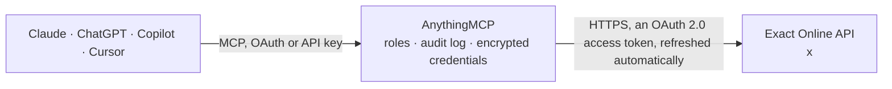

<!-- Generated by scripts/export-github-catalog.mjs in the anythingmcp-website repository. Do not edit by hand. -->

# Exact Online MCP connector

Exact Online — the Dutch accounting and ERP standard: accounts, sales and purchase invoices, items, stock, GL accounts and outstanding receivables. The AnythingMCP connector gives Claude, ChatGPT, Microsoft Copilot, Cursor and Gemini 10 MCP tools for Exact Online, all read-only.

**Category:** [Accounting](../accounting.md) · **Tools:** 10 · **Setup guide:** [anythingmcp.com](https://anythingmcp.com/guides/exact-online-to-mcp) · [Deutsch](https://anythingmcp.com/de/guides/exact-online-to-mcp) · [Italiano](https://anythingmcp.com/it/guides/exact-online-to-mcp) · [Español](https://anythingmcp.com/es/guides/exact-online-to-mcp) · [日本語](https://anythingmcp.com/ja/guides/exact-online-to-mcp) · [Русский](https://anythingmcp.com/ru/guides/exact-online-to-mcp) · [中文](https://anythingmcp.com/zh/guides/exact-online-to-mcp)

## Start without code

No installation and no terminal: AnythingMCP Cloud runs the Exact Online connector for you, operated by helpcode.ai in Frankfurt, Germany.

1. **Click the button above** and create an account or sign in. The Exact Online connector opens, ready to install.
2. **Sign in with your Exact Online account** when AnythingMCP asks. The first time, an admin creates a small app in the Exact Online developer console. Every click is in the [step-by-step guide](https://anythingmcp.com/guides/exact-online-to-mcp).
3. **Click Install.** AnythingMCP shows the address of your MCP server.
4. **Add that address to your assistant:** [Claude](https://anythingmcp.com/guides/connect-exact-online-to-claude) · [ChatGPT](https://anythingmcp.com/guides/connect-exact-online-to-chatgpt) · [Microsoft Copilot](https://anythingmcp.com/guides/connect-exact-online-to-copilot) · [Cursor](https://anythingmcp.com/guides/connect-exact-online-to-cursor) · [Gemini CLI](https://anythingmcp.com/guides/connect-exact-online-to-gemini) · [Meta Muse](https://anythingmcp.com/guides/connect-exact-online-to-muse).
5. **Ask your first question**, for example: *Show the Exact account record for customer Lumenix BV (we need VAT and status).*

Prefer help with the setup? [Talk to us](https://anythingmcp.com/contact).

## How it works

- **The AI client** speaks MCP (Streamable HTTP) to AnythingMCP and only sees tool names, descriptions and results. It never gets the Exact Online credentials.
- **AnythingMCP** checks the client's role, builds the call from the tool definition, adds the credentials (an OAuth 2.0 access token, refreshed automatically), calls Exact Online, logs the call and returns the result.
- **Exact Online** sees an ordinary API client with the rights of the account the credentials belong to.

## Tools

| Tool | What it does | Access |
|---|---|---|
| [`exact_online_get_me`](#exact_online_get_me) | Read the authenticated user and, importantly, their CurrentDivision — the administration id every other path needs. | read |
| [`exact_online_list_divisions`](#exact_online_list_divisions) | List the administrations (divisions) this account can reach, with their code, description and currency. | read |
| [`exact_online_list_accounts`](#exact_online_list_accounts) | List accounts — Exact's customers, suppliers and prospects — with their code, name, VAT number and status. | read |
| [`exact_online_list_sales_invoices`](#exact_online_list_sales_invoices) | List sales invoices with their number, date, account, amounts and status. | read |
| [`exact_online_list_receivables`](#exact_online_list_receivables) | List outstanding receivables with their invoice number, account, due date and amount still open — the direct answer to 'who owes us money'. | read |
| [`exact_online_list_purchase_invoices`](#exact_online_list_purchase_invoices) | List purchase invoices from Exact's purchase module (purchase/PurchaseInvoices): supplier, dates, amounts and status. | read |
| [`exact_online_list_purchase_entries`](#exact_online_list_purchase_entries) | List purchase entries (Inkoopboekingen): the bookkeeping record of every supplier invoice, with supplier, invoice number, entry and due dates, AmountDC, VAT… | read |
| [`exact_online_list_items`](#exact_online_list_items) | List items from the product catalogue with their code, description, sales price, cost price and unit. | read |
| [`exact_online_list_stock_positions`](#exact_online_list_stock_positions) | Read current stock per item and warehouse (Exact's ItemWarehouses: ItemCode, Warehouse, CurrentStock, plus planned and reserved stock). | read |
| [`exact_online_list_gl_accounts`](#exact_online_list_gl_accounts) | List general ledger accounts with their code, description, type and balance side, for questions that need the chart of accounts. | read |

## Tool reference

Every parameter as the AI client sees it in `tools/list`. Source: [`packages/backend/src/adapters/nl/exact-online.json`](../../../packages/backend/src/adapters/nl/exact-online.json).

### `exact_online_get_me`

Read the authenticated user and, importantly, their CurrentDivision — the administration id every other path needs. Start here to find the right EXACT_DIVISION.

**Access:** read · **Call:** `GET /current/Me`

No parameters.

### `exact_online_list_divisions`

List the administrations (divisions) this account can reach, with their code, description and currency. A customer with several companies has several divisions.

**Access:** read · **Call:** `GET /{EXACT_DIVISION}/hrm/Divisions`

| Parameter | Type | Required | Description |
|---|---|---|---|
| `select` | string | no | OData $select list, e.g. Code,Description,Currency. |

### `exact_online_list_accounts`

List accounts — Exact's customers, suppliers and prospects — with their code, name, VAT number and status. Always $select; accounts have well over a hundred columns.

**Access:** read · **Call:** `GET /{EXACT_DIVISION}/crm/Accounts`

| Parameter | Type | Required | Description |
|---|---|---|---|
| `select` | string | no | OData $select list, e.g. ID,Code,Name,VATNumber,City,IsSales,IsSupplier. |
| `filter` | string | no | OData $filter expression, e.g. IsSales eq true. |
| `top` | number | no | Maximum rows to return (Exact pages at 60). |
| `orderby` | string | no | Sort expression, e.g. `Name asc`. |

### `exact_online_list_sales_invoices`

List sales invoices with their number, date, account, amounts and status. Filter by InvoiceDate for a period, or by Status for what is still open.

**Access:** read · **Call:** `GET /{EXACT_DIVISION}/salesinvoice/SalesInvoices`

| Parameter | Type | Required | Description |
|---|---|---|---|
| `select` | string | no | OData $select list, e.g. InvoiceNumber,InvoiceDate,OrderedBy,AmountDC,Status. |
| `filter` | string | no | OData $filter, e.g. InvoiceDate ge datetime'2026-01-01'. |
| `top` | number | no | Maximum rows to return. |
| `orderby` | string | no | Sort expression, e.g. `InvoiceDate desc`. |

### `exact_online_list_receivables`

List outstanding receivables with their invoice number, account, due date and amount still open — the direct answer to 'who owes us money'.

**Access:** read · **Call:** `GET /{EXACT_DIVISION}/read/financial/ReceivablesList`

| Parameter | Type | Required | Description |
|---|---|---|---|
| `select` | string | no | OData $select list, e.g. InvoiceNumber,AccountName,InvoiceDate,DueDate,Amount,CurrencyCode. The open amount field is `Amount` (there is no AmountDC here). |
| `filter` | string | no | OData $filter, e.g. DueDate lt datetime'2026-09-01' for overdue only. |
| `top` | number | no | Maximum rows to return. |
| `orderby` | string | no | Sort expression, e.g. `DueDate asc`. |

### `exact_online_list_purchase_invoices`

List purchase invoices from Exact's purchase module (purchase/PurchaseInvoices): supplier, dates, amounts and status. Only available in the Manufacturing, Professional Services and Wholesale packages; for an accounting-only administration use exact_online_list_purchase_entries.

**Access:** read · **Call:** `GET /{EXACT_DIVISION}/purchase/PurchaseInvoices`

| Parameter | Type | Required | Description |
|---|---|---|---|
| `select` | string | no | OData $select list. |
| `filter` | string | no | OData $filter expression. |
| `top` | number | no | Maximum rows to return. |
| `orderby` | string | no | Sort expression. |

### `exact_online_list_purchase_entries`

List purchase entries (Inkoopboekingen): the bookkeeping record of every supplier invoice, with supplier, invoice number, entry and due dates, AmountDC, VAT and status. Works in accounting-only administrations, where exact_online_list_purchase_invoices is not available.

**Access:** read · **Call:** `GET /{EXACT_DIVISION}/purchaseentry/PurchaseEntries`

| Parameter | Type | Required | Description |
|---|---|---|---|
| `select` | string | no | OData $select list, e.g. EntryNumber,InvoiceNumber,SupplierName,EntryDate,DueDate,AmountDC,VATAmountDC,StatusDescription. |
| `filter` | string | no | OData $filter expression, e.g. EntryDate ge datetime'2026-01-01'. |
| `top` | number | no | Maximum rows to return. |
| `orderby` | string | no | Sort expression. |

### `exact_online_list_items`

List items from the product catalogue with their code, description, sales price, cost price and unit.

**Access:** read · **Call:** `GET /{EXACT_DIVISION}/logistics/Items`

| Parameter | Type | Required | Description |
|---|---|---|---|
| `select` | string | no | OData $select list, e.g. ID,Code,Description,SalesVatCode,CostPriceStandard. |
| `filter` | string | no | OData $filter expression, e.g. IsSalesItem eq true. |
| `top` | number | no | Maximum rows to return. |

### `exact_online_list_stock_positions`

Read current stock per item and warehouse (Exact's ItemWarehouses: ItemCode, Warehouse, CurrentStock, plus planned and reserved stock). Needs a Manufacturing or Wholesale & Distribution package (Plus or higher); accounting-only administrations have no stock.

**Access:** read · **Call:** `GET /{EXACT_DIVISION}/inventory/ItemWarehouses`

| Parameter | Type | Required | Description |
|---|---|---|---|
| `select` | string | no | OData $select list, e.g. ItemCode,ItemDescription,WarehouseCode,CurrentStock,ProjectedStock,ReservedStock. |
| `filter` | string | no | OData $filter expression, e.g. ItemCode eq 'ART001'. |
| `top` | number | no | Maximum rows to return. |

### `exact_online_list_gl_accounts`

List general ledger accounts with their code, description, type and balance side, for questions that need the chart of accounts.

**Access:** read · **Call:** `GET /{EXACT_DIVISION}/financial/GLAccounts`

| Parameter | Type | Required | Description |
|---|---|---|---|
| `select` | string | no | OData $select list, e.g. Code,Description,Type,BalanceSide. |
| `top` | number | no | Maximum rows to return. |

## Run it yourself

AnythingMCP is open source (AGPL-3.0). [Run it with Docker](../../../README.md#run-it-yourself), open **Connectors → Store**, pick **Exact Online** and enter `EXACT_CLIENT_ID`, `EXACT_CLIENT_SECRET`, `EXACT_BASE_HOST`, `EXACT_DIVISION`, then add your MCP server URL to the AI client.

[← Accounting connectors](../accounting.md) · [All categories](../README.md)
