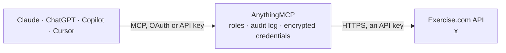

<!-- Generated by scripts/export-github-catalog.mjs in the anythingmcp-website repository. Do not edit by hand. -->

# Exercise.com MCP connector

Exercise.com gym and coaching software: members and staff, appointments and classes, scheduled occurrences and rosters, visits and check-ins, calendar, services, locations, availability schedules, … The AnythingMCP connector gives Claude, ChatGPT, Microsoft Copilot, Cursor and Gemini 27 MCP tools for Exercise.com: 25 read and 2 can change data.

**Category:** [Sports](../sports.md) · **Tools:** 27 · **Setup guide:** [anythingmcp.com](https://anythingmcp.com/guides/exercise-com-to-mcp) · [Deutsch](https://anythingmcp.com/de/guides/exercise-com-to-mcp) · [Italiano](https://anythingmcp.com/it/guides/exercise-com-to-mcp) · [Español](https://anythingmcp.com/es/guides/exercise-com-to-mcp) · [日本語](https://anythingmcp.com/ja/guides/exercise-com-to-mcp) · [Русский](https://anythingmcp.com/ru/guides/exercise-com-to-mcp) · [中文](https://anythingmcp.com/zh/guides/exercise-com-to-mcp)

## Start without code

No installation and no terminal: AnythingMCP Cloud runs the Exercise.com connector for you, operated by helpcode.ai in Frankfurt, Germany.

1. **Click the button above** and create an account or sign in. The Exercise.com connector opens, ready to install.
2. **Paste the API key or token from your Exercise.com account.** Every click is in the [step-by-step guide](https://anythingmcp.com/guides/exercise-com-to-mcp).
3. **Click Install.** AnythingMCP shows the address of your MCP server.
4. **Add that address to your assistant:** [Claude](https://anythingmcp.com/guides/connect-exercise-com-to-claude) · [ChatGPT](https://anythingmcp.com/guides/connect-exercise-com-to-chatgpt) · [Microsoft Copilot](https://anythingmcp.com/guides/connect-exercise-com-to-copilot) · [Cursor](https://anythingmcp.com/guides/connect-exercise-com-to-cursor) · [Gemini CLI](https://anythingmcp.com/guides/connect-exercise-com-to-gemini) · [Meta Muse](https://anythingmcp.com/guides/connect-exercise-com-to-muse).
5. **Ask your first question**, for example: *Find user record for maria@fitforge.pt and tell me her user id and membership expiry.*

Prefer help with the setup? [Talk to us](https://anythingmcp.com/contact).

## How it works

- **The AI client** speaks MCP (Streamable HTTP) to AnythingMCP and only sees tool names, descriptions and results. It never gets the Exercise.com credentials.
- **AnythingMCP** checks the client's role, builds the call from the tool definition, adds the credentials (an API key), calls Exercise.com, logs the call and returns the result.
- **Exercise.com** sees an ordinary API client with the rights of the account the credentials belong to.

## Tools

| Tool | What it does | Access |
|---|---|---|
| [`exercise_com_list_users`](#exercise_com_list_users) | List the platform's users (members, clients and staff) with name, e-mail, phone, head trainer and sign-up dates. | read |
| [`exercise_com_get_user`](#exercise_com_get_user) | Return one user by id with profile, contact details, head trainer, membership and sign-up information. | read |
| [`exercise_com_list_visits`](#exercise_com_list_visits) | List visits (bookings and check-ins of a member for an appointment or class) with status, registered, completed, no-show and cancelled times, payment and… | read |
| [`exercise_com_get_visit`](#exercise_com_get_visit) | Return one visit by id with member, appointment, status timestamps, check-in and check-out, payment and booking details. | read |
| [`exercise_com_list_appointments`](#exercise_com_list_appointments) | List appointments (booked sessions and class occurrences) with service, trainers, location, start and end time, status and capacity. | read |
| [`exercise_com_get_appointment`](#exercise_com_get_appointment) | Return one appointment by id with its service, trainer, location, times, capacity, price and booking rules. | read |
| [`exercise_com_list_appointment_packages`](#exercise_com_list_appointment_packages) | List the packages (class packs, memberships with visit credits) that can be used to book one appointment: id, name, price options, number of visits, expiry… | read |
| [`exercise_com_list_scheduled_appointments`](#exercise_com_list_scheduled_appointments) | List scheduled appointments: the dated occurrences of recurring classes and sessions, with start and end, trainer, location and capacity. | read |
| [`exercise_com_get_scheduled_appointment`](#exercise_com_get_scheduled_appointment) | Return one scheduled appointment (one occurrence of a recurring class or session) by id. | read |
| [`exercise_com_list_scheduled_appointment_members`](#exercise_com_list_scheduled_appointment_members) | List the members booked into scheduled appointments (class rosters). | read |
| [`exercise_com_get_calendar`](#exercise_com_get_calendar) | Return calendar events between two Unix timestamps: appointments and trainer availability (affinity schedule), scheduled workouts (logger), logged workouts… | read |
| [`exercise_com_list_services`](#exercise_com_list_services) | List the services offered (session and class types) with name, duration, price and booking settings. | read |
| [`exercise_com_get_service`](#exercise_com_get_service) | Return one service by id with duration, price, packages that cover it and booking rules. | read |
| [`exercise_com_list_locations`](#exercise_com_list_locations) | List the business locations with name and address. | read |
| [`exercise_com_list_schedules`](#exercise_com_list_schedules) | List trainers' availability schedules (the time windows in which services can be booked). | read |
| [`exercise_com_list_waitlist_entries`](#exercise_com_list_waitlist_entries) | List waitlist entries for full appointments with member and position. | read |
| [`exercise_com_list_assessments`](#exercise_com_list_assessments) | List assessment templates (fitness tests, questionnaires, intake forms) with name and questions. | read |
| [`exercise_com_get_assessment`](#exercise_com_get_assessment) | Return one assessment template by id: name, description, its questions and fields, scoring formula and assignment settings. | read |
| [`exercise_com_list_user_assessments`](#exercise_com_list_user_assessments) | List completed or assigned assessments of members, with answers, scores and dates. | read |
| [`exercise_com_get_user_assessment`](#exercise_com_get_user_assessment) | Return one member's assessment by id with every answer and score. | read |
| [`exercise_com_list_groups`](#exercise_com_list_groups) | List groups (teams, classes or communities; type 1 free, 2 paid) with name, members and privacy. | read |
| [`exercise_com_list_group_calendars`](#exercise_com_list_group_calendars) | List the group calendars: the calendars attached to groups, used for group events and classes. | read |
| [`exercise_com_list_workouts`](#exercise_com_list_workouts) | List completed (logged) workouts with date, user and summary. | read |
| [`exercise_com_list_user_workout_exercises`](#exercise_com_list_user_workout_exercises) | Return a member's logged history of workout exercises (sets, reps, weights), oldest first, paginated. | read |
| [`exercise_com_list_purchased_items`](#exercise_com_list_purchased_items) | List what a member has bought: per item its type and id (package, workout plan, group...) and the payment option used (purchase or subscription, amount,… | read |
| [`exercise_com_book_visit`](#exercise_com_book_visit) | Book a member into an appointment by creating a visit. | write |
| [`exercise_com_cancel_visit`](#exercise_com_cancel_visit) | Delete (cancel) a visit by id. | write |

## Tool reference

Every parameter as the AI client sees it in `tools/list`. Source: [`packages/backend/src/adapters/intl/exercise-com.json`](../../../packages/backend/src/adapters/intl/exercise-com.json).

### `exercise_com_list_users`

List the platform's users (members, clients and staff) with name, e-mail, phone, head trainer and sign-up dates. Filter with q[email_cont]=... or trainer_id; the id is the user_id other tools use.

**Access:** read · **Call:** `GET /api/v4/users`

| Parameter | Type | Required | Description |
|---|---|---|---|
| `trainer_id` | integer | no | Only users whose head trainer is this user id. |
| `with_ids` | string | no | Comma-separated user ids to fetch; paging is ignored when set. |
| `filter` | string | no | Ransack filter as a query-string fragment of q[...] predicates joined with &, e.g. q[status_eq]=completed&q[created_at_gteq]=2026-09-01. Predicates: _eq, _not_eq, _in, _lt, _lteq, _gt, _gteq, _cont, _null; q[s]=created_at desc sorts. |
| `pluck_columns` | string | no | Comma-separated stored columns to return instead of full records, e.g. id,first_name,last_name,email. The answer is then a plain array of every match (per and page may be ignored); computed fields such as service_name are not columns and fail. |
| `per` | integer | no | Records per page. When per or page is set the answer carries meta.total with the total count. |
| `page` | integer | no | Page number, starting at 1. |

### `exercise_com_get_user`

Return one user by id with profile, contact details, head trainer, membership and sign-up information.

**Access:** read · **Call:** `GET /api/v4/users/{id}`

| Parameter | Type | Required | Description |
|---|---|---|---|
| `id` | string | yes | User id from exercise_com_list_users. |

### `exercise_com_list_visits`

List visits (bookings and check-ins of a member for an appointment or class) with status, registered, completed, no-show and cancelled times, payment and package used. Filter by appointment, by member (for_user), by ids or with a Ransack filter.

**Access:** read · **Call:** `GET /api/v4/fbm/visits`

| Parameter | Type | Required | Description |
|---|---|---|---|
| `appointment_id` | string | no | Only visits of this appointment id. |
| `active_visits` | string | no | Pass true to return only finished visits for appointments and check-ins. |
| `for_user` | string | no | A user id: only the visits that user can access (their own bookings and check-ins). |
| `with_ids` | string | no | Comma-separated visit ids to fetch; paging is ignored when set. |
| `filter` | string | no | Ransack filter as a query-string fragment of q[...] predicates joined with &, e.g. q[status_eq]=completed&q[created_at_gteq]=2026-09-01. Predicates: _eq, _not_eq, _in, _lt, _lteq, _gt, _gteq, _cont, _null; q[s]=created_at desc sorts. |
| `pluck_columns` | string | no | Comma-separated stored columns to return instead of full records, e.g. id,first_name,last_name,email. The answer is then a plain array of every match (per and page may be ignored); computed fields such as service_name are not columns and fail. |
| `per` | integer | no | Records per page. When per or page is set the answer carries meta.total with the total count. |
| `page` | integer | no | Page number, starting at 1. |

### `exercise_com_get_visit`

Return one visit by id with member, appointment, status timestamps, check-in and check-out, payment and booking details.

**Access:** read · **Call:** `GET /api/v4/fbm/visits/{id}`

| Parameter | Type | Required | Description |
|---|---|---|---|
| `id` | string | yes | Visit id from exercise_com_list_visits. |

### `exercise_com_list_appointments`

List appointments (booked sessions and class occurrences) with service, trainers, location, start and end time, status and capacity. Always narrow by date: an unfiltered list of all history times out with a 500.

**Access:** read · **Call:** `GET /api/v4/fbm/appointments`

| Parameter | Type | Required | Description |
|---|---|---|---|
| `filter` | string | yes | Required: a start_time window, e.g. q[start_time_gteq]=2026-09-01&q[start_time_lt]=2026-10-01, optionally with q[service_id_eq]=12 or q[s]=start_time desc. Ransack filter as a query-string fragment of q[...] predicates joined with &, e.g. q[status_eq]=completed&q[created_at_gteq]=2026-09-01. Predicates: _eq, _not_eq, _in, _lt, _lteq, _gt, _gteq, _cont, _null; q[s]=created_at desc sorts. |
| `pluck_columns` | string | no | Comma-separated stored columns to return instead of full records, e.g. id,first_name,last_name,email. The answer is then a plain array of every match (per and page may be ignored); computed fields such as service_name are not columns and fail. |
| `per` | integer | no | Records per page. When per or page is set the answer carries meta.total with the total count. |
| `page` | integer | no | Page number, starting at 1. |

### `exercise_com_get_appointment`

Return one appointment by id with its service, trainer, location, times, capacity, price and booking rules.

**Access:** read · **Call:** `GET /api/v4/fbm/appointments/{id}`

| Parameter | Type | Required | Description |
|---|---|---|---|
| `id` | string | yes | Appointment id from exercise_com_list_appointments. |

### `exercise_com_list_appointment_packages`

List the packages (class packs, memberships with visit credits) that can be used to book one appointment: id, name, price options, number of visits, expiry and the services they cover. Use it to tell a member which package pays for a class.

**Access:** read · **Call:** `GET /api/v4/fbm/appointments/{id}/packages`

| Parameter | Type | Required | Description |
|---|---|---|---|
| `id` | string | yes | Appointment id from exercise_com_list_appointments. |

### `exercise_com_list_scheduled_appointments`

List scheduled appointments: the dated occurrences of recurring classes and sessions, with start and end, trainer, location and capacity.

**Access:** read · **Call:** `GET /api/v4/fbm/scheduled_appointments`

| Parameter | Type | Required | Description |
|---|---|---|---|
| `filter` | string | no | Ransack filter as a query-string fragment of q[...] predicates joined with &, e.g. q[status_eq]=completed&q[created_at_gteq]=2026-09-01. Predicates: _eq, _not_eq, _in, _lt, _lteq, _gt, _gteq, _cont, _null; q[s]=created_at desc sorts. |
| `pluck_columns` | string | no | Comma-separated stored columns to return instead of full records, e.g. id,first_name,last_name,email. The answer is then a plain array of every match (per and page may be ignored); computed fields such as service_name are not columns and fail. |
| `per` | integer | no | Records per page. When per or page is set the answer carries meta.total with the total count. |
| `page` | integer | no | Page number, starting at 1. |

### `exercise_com_get_scheduled_appointment`

Return one scheduled appointment (one occurrence of a recurring class or session) by id.

**Access:** read · **Call:** `GET /api/v4/fbm/scheduled_appointments/{id}`

| Parameter | Type | Required | Description |
|---|---|---|---|
| `id` | string | yes | Scheduled appointment id from exercise_com_list_scheduled_appointments. |

### `exercise_com_list_scheduled_appointment_members`

List the members booked into scheduled appointments (class rosters). Pass scheduled_appointment_id for one occurrence's roster. Pass for_user for the classes one member is booked into.

**Access:** read · **Call:** `GET /api/v4/fbm/scheduled_appointment_members`

| Parameter | Type | Required | Description |
|---|---|---|---|
| `scheduled_appointment_id` | integer | no | Only the members of this scheduled appointment. |
| `appointment_id` | integer | no | Together with scheduled_appointment_id: leave out members whose visit for this appointment was deleted. |
| `for_user` | string | no | A user id: only the roster entries of this member. |
| `filter` | string | no | Ransack filter as a query-string fragment of q[...] predicates joined with &, e.g. q[status_eq]=completed&q[created_at_gteq]=2026-09-01. Predicates: _eq, _not_eq, _in, _lt, _lteq, _gt, _gteq, _cont, _null; q[s]=created_at desc sorts. |
| `pluck_columns` | string | no | Comma-separated stored columns to return instead of full records, e.g. id,first_name,last_name,email. The answer is then a plain array of every match (per and page may be ignored); computed fields such as service_name are not columns and fail. |
| `per` | integer | no | Records per page. When per or page is set the answer carries meta.total with the total count. |
| `page` | integer | no | Page number, starting at 1. |

### `exercise_com_get_calendar`

Return calendar events between two Unix timestamps: appointments and trainer availability (affinity schedule), scheduled workouts (logger), logged workouts (summary) or assessments, habits and check-ins (webview).

**Access:** read · **Call:** `GET /api/v4/calendar`

| Parameter | Type | Required | Description |
|---|---|---|---|
| `start` | integer | yes | Window start as a Unix timestamp in seconds, e.g. 1759708800. |
| `end` | integer | yes | Window end as a Unix timestamp in seconds. |
| `affinity` | string | no | Comma-separated: schedule (appointments and availability), logger (scheduled workouts), summary (logged workouts), webview (assessments, habits, check-ins, waivers). affinity or object_type is required. |
| `object_type` | string | no | Comma-separated object types instead of affinity: appointment, scheduled_appointment, schedule, schedule_service, workout, logged-workout, assessment, habit, checkin, required. |
| `user_id` | string | no | Only this user's events. |
| `user_ids` | string | no | Comma-separated user ids. |
| `group_id` | integer | no | Only this group's events. |
| `service_id` | integer | no | schedule affinity: only this service id. |
| `trainer_id` | integer | no | schedule affinity: only this trainer's user id. |
| `location_id` | integer | no | schedule affinity: only this location id. |
| `cancelled` | boolean | no | schedule affinity: true to include cancelled events. |

### `exercise_com_list_services`

List the services offered (session and class types) with name, duration, price and booking settings. The id is used to filter appointments and the calendar.

**Access:** read · **Call:** `GET /api/v4/fbm/services`

| Parameter | Type | Required | Description |
|---|---|---|---|
| `filter` | string | no | Ransack filter as a query-string fragment of q[...] predicates joined with &, e.g. q[status_eq]=completed&q[created_at_gteq]=2026-09-01. Predicates: _eq, _not_eq, _in, _lt, _lteq, _gt, _gteq, _cont, _null; q[s]=created_at desc sorts. |
| `pluck_columns` | string | no | Comma-separated stored columns to return instead of full records, e.g. id,first_name,last_name,email. The answer is then a plain array of every match (per and page may be ignored); computed fields such as service_name are not columns and fail. |
| `per` | integer | no | Records per page. When per or page is set the answer carries meta.total with the total count. |
| `page` | integer | no | Page number, starting at 1. |

### `exercise_com_get_service`

Return one service by id with duration, price, packages that cover it and booking rules.

**Access:** read · **Call:** `GET /api/v4/fbm/services/{id}`

| Parameter | Type | Required | Description |
|---|---|---|---|
| `id` | string | yes | Service id from exercise_com_list_services. |

### `exercise_com_list_locations`

List the business locations with name and address. The id is used to filter appointments and the calendar.

**Access:** read · **Call:** `GET /api/v4/fbm/locations`

| Parameter | Type | Required | Description |
|---|---|---|---|
| `filter` | string | no | Ransack filter as a query-string fragment of q[...] predicates joined with &, e.g. q[status_eq]=completed&q[created_at_gteq]=2026-09-01. Predicates: _eq, _not_eq, _in, _lt, _lteq, _gt, _gteq, _cont, _null; q[s]=created_at desc sorts. |
| `per` | integer | no | Records per page. When per or page is set the answer carries meta.total with the total count. |
| `page` | integer | no | Page number, starting at 1. |

### `exercise_com_list_schedules`

List trainers' availability schedules (the time windows in which services can be booked).

**Access:** read · **Call:** `GET /api/v4/fbm/schedules`

| Parameter | Type | Required | Description |
|---|---|---|---|
| `filter` | string | no | Ransack filter as a query-string fragment of q[...] predicates joined with &, e.g. q[status_eq]=completed&q[created_at_gteq]=2026-09-01. Predicates: _eq, _not_eq, _in, _lt, _lteq, _gt, _gteq, _cont, _null; q[s]=created_at desc sorts. |
| `pluck_columns` | string | no | Comma-separated stored columns to return instead of full records, e.g. id,first_name,last_name,email. The answer is then a plain array of every match (per and page may be ignored); computed fields such as service_name are not columns and fail. |
| `per` | integer | no | Records per page. When per or page is set the answer carries meta.total with the total count. |
| `page` | integer | no | Page number, starting at 1. |

### `exercise_com_list_waitlist_entries`

List waitlist entries for full appointments with member and position. Pass appointment_id for one appointment's waitlist.

**Access:** read · **Call:** `GET /api/v4/fbm/waitlist_entries`

| Parameter | Type | Required | Description |
|---|---|---|---|
| `appointment_id` | string | no | Only entries for this appointment id. |
| `filter` | string | no | Ransack filter as a query-string fragment of q[...] predicates joined with &, e.g. q[status_eq]=completed&q[created_at_gteq]=2026-09-01. Predicates: _eq, _not_eq, _in, _lt, _lteq, _gt, _gteq, _cont, _null; q[s]=created_at desc sorts. |
| `pluck_columns` | string | no | Comma-separated stored columns to return instead of full records, e.g. id,first_name,last_name,email. The answer is then a plain array of every match (per and page may be ignored); computed fields such as service_name are not columns and fail. |
| `per` | integer | no | Records per page. When per or page is set the answer carries meta.total with the total count. |
| `page` | integer | no | Page number, starting at 1. |

### `exercise_com_list_assessments`

List assessment templates (fitness tests, questionnaires, intake forms) with name and questions. Pass user_id and assigned=true for those assigned to one member.

**Access:** read · **Call:** `GET /api/v4/assessments`

| Parameter | Type | Required | Description |
|---|---|---|---|
| `user_id` | string | no | Only assessments for this user id. |
| `assigned` | boolean | no | true to return only assigned assessments. |
| `filter` | string | no | Ransack filter as a query-string fragment of q[...] predicates joined with &, e.g. q[status_eq]=completed&q[created_at_gteq]=2026-09-01. Predicates: _eq, _not_eq, _in, _lt, _lteq, _gt, _gteq, _cont, _null; q[s]=created_at desc sorts. |
| `per` | integer | no | Records per page. When per or page is set the answer carries meta.total with the total count. |
| `page` | integer | no | Page number, starting at 1. |

### `exercise_com_get_assessment`

Return one assessment template by id: name, description, its questions and fields, scoring formula and assignment settings. Members' answers are user assessments (exercise_com_list_user_assessments).

**Access:** read · **Call:** `GET /api/v4/assessments/{id}`

| Parameter | Type | Required | Description |
|---|---|---|---|
| `id` | string | yes | Assessment id from exercise_com_list_assessments. |

### `exercise_com_list_user_assessments`

List completed or assigned assessments of members, with answers, scores and dates. Filter by user_id for one member's results.

**Access:** read · **Call:** `GET /api/v4/user_assessments`

| Parameter | Type | Required | Description |
|---|---|---|---|
| `user_id` | string | no | Only this user's assessments. |
| `for_trainer` | boolean | no | true for every assessment the trainer can see. |
| `filter` | string | no | Ransack filter as a query-string fragment of q[...] predicates joined with &, e.g. q[status_eq]=completed&q[created_at_gteq]=2026-09-01. Predicates: _eq, _not_eq, _in, _lt, _lteq, _gt, _gteq, _cont, _null; q[s]=created_at desc sorts. |
| `per` | integer | no | Records per page. When per or page is set the answer carries meta.total with the total count. |
| `page` | integer | no | Page number, starting at 1. |

### `exercise_com_get_user_assessment`

Return one member's assessment by id with every answer and score.

**Access:** read · **Call:** `GET /api/v4/user_assessments/{id}`

| Parameter | Type | Required | Description |
|---|---|---|---|
| `id` | string | yes | User assessment id from exercise_com_list_user_assessments. |

### `exercise_com_list_groups`

List groups (teams, classes or communities; type 1 free, 2 paid) with name, members and privacy. The id filters the calendar and workouts.

**Access:** read · **Call:** `GET /api/v4/groups`

| Parameter | Type | Required | Description |
|---|---|---|---|
| `filter` | string | no | Ransack filter as a query-string fragment of q[...] predicates joined with &, e.g. q[status_eq]=completed&q[created_at_gteq]=2026-09-01. Predicates: _eq, _not_eq, _in, _lt, _lteq, _gt, _gteq, _cont, _null; q[s]=created_at desc sorts. |
| `per` | integer | no | Records per page. When per or page is set the answer carries meta.total with the total count. |
| `page` | integer | no | Page number, starting at 1. |

### `exercise_com_list_group_calendars`

List the group calendars: the calendars attached to groups, used for group events and classes.

**Access:** read · **Call:** `GET /api/v4/groups/calendars`

| Parameter | Type | Required | Description |
|---|---|---|---|
| `per` | integer | no | Records per page. When per or page is set the answer carries meta.total with the total count. |
| `page` | integer | no | Page number, starting at 1. |

### `exercise_com_list_workouts`

List completed (logged) workouts with date, user and summary. Defaults to the API user's own; set for_trainer=true for the whole platform, and start_date with end_date for a period.

**Access:** read · **Call:** `GET /api/v4/workouts`

| Parameter | Type | Required | Description |
|---|---|---|---|
| `user_id` | string | no | Completed workouts of this user. |
| `for_trainer` | boolean | no | true for every completed workout on the platform (trainer accounts). |
| `group_id` | string | no | With for_trainer: only members of this group. |
| `start_date` | string | no | Period start, YYYY-MM-DD; needs end_date. |
| `end_date` | string | no | Period end, YYYY-MM-DD; needs start_date. |
| `all_fields` | boolean | no | true to include blocks and exercises. |
| `filter` | string | no | Ransack filter as a query-string fragment of q[...] predicates joined with &, e.g. q[status_eq]=completed&q[created_at_gteq]=2026-09-01. Predicates: _eq, _not_eq, _in, _lt, _lteq, _gt, _gteq, _cont, _null; q[s]=created_at desc sorts. |
| `pluck_columns` | string | no | Comma-separated stored columns to return instead of full records, e.g. id,first_name,last_name,email. The answer is then a plain array of every match (per and page may be ignored); computed fields such as service_name are not columns and fail. |
| `per` | integer | no | Records per page. When per or page is set the answer carries meta.total with the total count. |
| `page` | integer | no | Page number, starting at 1. |

### `exercise_com_list_user_workout_exercises`

Return a member's logged history of workout exercises (sets, reps, weights), oldest first, paginated. Pass exercise_id for one exercise's progress, with_date=true to include the workout date (it lives on the workout, not the exercise), and pluck_columns to keep answers small.

**Access:** read · **Call:** `GET /api/v4/users/{id}/workout_exercises`

| Parameter | Type | Required | Description |
|---|---|---|---|
| `id` | integer | yes | User id from exercise_com_list_users. |
| `exercise_id` | integer | no | Only the history of this exercise. |
| `with_date` | boolean | no | true to include the date of the workout each exercise belongs to. |
| `sort` | string | no | Sort order sent as q[s]; workout_workout_date desc returns the newest first. |
| `pluck_columns` | string | no | Comma-separated stored columns to return instead of full records, e.g. id,first_name,last_name,email. The answer is then a plain array of every match (per and page may be ignored); computed fields such as service_name are not columns and fail. |
| `per` | integer | no | Records per page. When per or page is set the answer carries meta.total with the total count. |
| `page` | integer | no | Page number, starting at 1. |

### `exercise_com_list_purchased_items`

List what a member has bought: per item its type and id (package, workout plan, group...) and the payment option used (purchase or subscription, amount, currency, interval).

**Access:** read · **Call:** `GET /api/v4/carts/purchased_items`

| Parameter | Type | Required | Description |
|---|---|---|---|
| `user_id` | string | no | Member's user id from exercise_com_list_users; without it the API answers for the user the access token belongs to. |

### `exercise_com_book_visit`

Book a member into an appointment by creating a visit. Booking can charge the member or use one of their packages, depending on the service settings.

**Access:** write · **Call:** `POST /api/v4/fbm/visits`

| Parameter | Type | Required | Description |
|---|---|---|---|
| `appointment_id` | string | yes | Appointment id to book. |
| `user_id` | string | yes | Member's user id. |

### `exercise_com_cancel_visit`

Delete (cancel) a visit by id. Late-cancel rules and fees of the service may apply, and the member may be notified.

**Access:** write · **Call:** `DELETE /api/v4/fbm/visits/{id}`

| Parameter | Type | Required | Description |
|---|---|---|---|
| `id` | string | yes | Visit id. |

## Run it yourself

AnythingMCP is open source (AGPL-3.0). [Run it with Docker](../../../README.md#run-it-yourself), open **Connectors → Store**, pick **Exercise.com** and enter `EXERCISE_HOST`, `EXERCISE_API_KEY`, `EXERCISE_ACCESS_TOKEN`, then add your MCP server URL to the AI client.

[← Sports connectors](../sports.md) · [All categories](../README.md)
