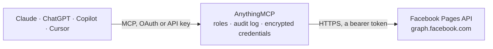

<!-- Generated by scripts/export-github-catalog.mjs in the anythingmcp-website repository. Do not edit by hand. -->

# Facebook Pages MCP connector

Let your AI run a Facebook Page: read posts, comments and Page and post insights, publish, schedule and edit posts and photo posts, reply to, hide or delete comments, and read and answer Messenger conversations. The AnythingMCP connector gives Claude, ChatGPT, Microsoft Copilot, Cursor and Gemini 21 MCP tools for Facebook Pages: 10 read and 11 can change data.

**Category:** [Social Media](../social.md) · **Tools:** 21 · **Setup guide:** [anythingmcp.com](https://anythingmcp.com/guides/facebook-pages-to-mcp) · [Deutsch](https://anythingmcp.com/de/guides/facebook-pages-to-mcp) · [Italiano](https://anythingmcp.com/it/guides/facebook-pages-to-mcp) · [Español](https://anythingmcp.com/es/guides/facebook-pages-to-mcp) · [日本語](https://anythingmcp.com/ja/guides/facebook-pages-to-mcp) · [Русский](https://anythingmcp.com/ru/guides/facebook-pages-to-mcp) · [中文](https://anythingmcp.com/zh/guides/facebook-pages-to-mcp)

## Start without code

No installation and no terminal: AnythingMCP Cloud runs the Facebook Pages connector for you, operated by helpcode.ai in Frankfurt, Germany.

1. **Click the button above** and create an account or sign in. The Facebook Pages connector opens, ready to install.
2. **Paste the API key or token from your Facebook Pages account.** Every click is in the [step-by-step guide](https://anythingmcp.com/guides/facebook-pages-to-mcp).
3. **Click Install.** AnythingMCP shows the address of your MCP server.
4. **Add that address to your assistant:** [Claude](https://anythingmcp.com/guides/connect-facebook-pages-to-claude) · [ChatGPT](https://anythingmcp.com/guides/connect-facebook-pages-to-chatgpt) · [Microsoft Copilot](https://anythingmcp.com/guides/connect-facebook-pages-to-copilot) · [Cursor](https://anythingmcp.com/guides/connect-facebook-pages-to-cursor) · [Gemini CLI](https://anythingmcp.com/guides/connect-facebook-pages-to-gemini) · [Meta Muse](https://anythingmcp.com/guides/connect-facebook-pages-to-muse).
5. **Ask your first question**, for example: *Find any Page feed post by KartonHaus GmbH mentioning invoice INV-2026-045 between 2026-10-01 and 2026-10-31*

Prefer help with the setup? [Talk to us](https://anythingmcp.com/contact).

## How it works

- **The AI client** speaks MCP (Streamable HTTP) to AnythingMCP and only sees tool names, descriptions and results. It never gets the Facebook Pages credentials.
- **AnythingMCP** checks the client's role, builds the call from the tool definition, adds the credentials (a bearer token), calls Facebook Pages, logs the call and returns the result.
- **Facebook Pages** sees an ordinary API client with the rights of the account the credentials belong to.

## Tools

| Tool | What it does | Access |
|---|---|---|
| [`facebook_pages_get_page`](#facebook_pages_get_page) | Get the configured Facebook Page: name, username, link, category, about text, website, contact details, likes (fan_count) and followers_count, verification… | read |
| [`facebook_pages_list_posts`](#facebook_pages_list_posts) | List the Page's own posts, newest first, with text, time, permalink, type, picture, shares and the number of comments and reactions. | read |
| [`facebook_pages_list_feed`](#facebook_pages_list_feed) | List everything on the Page's feed, newest first: the Page's own posts including unpublished ones (is_published false) and posts by visitors (see `from`). | read |
| [`facebook_pages_list_scheduled_posts`](#facebook_pages_list_scheduled_posts) | List the Page's scheduled posts that have not gone live yet, with text, link and scheduled_publish_time (Unix seconds). | read |
| [`facebook_pages_get_post`](#facebook_pages_get_post) | Get one Page post by id: text, time, permalink, type, author, attachments, whether it is published or hidden, its scheduled time, shares and the number of… | read |
| [`facebook_pages_create_post`](#facebook_pages_create_post) | Publish a text or link post on the Page right away, as the Page. | write |
| [`facebook_pages_schedule_post`](#facebook_pages_schedule_post) | Schedule a text or link post to go live on the Page at a set time, between 10 minutes and 30 days ahead. | write |
| [`facebook_pages_create_photo_post`](#facebook_pages_create_photo_post) | Post a photo from a public image URL on the Page, with an optional caption; set published false with scheduled_publish_time to schedule it. | write |
| [`facebook_pages_update_post`](#facebook_pages_update_post) | Change a Page post: replace its text, publish a scheduled or unpublished post now (is_published true), or move a scheduled post to another time. | write |
| [`facebook_pages_delete_post`](#facebook_pages_delete_post) | Delete a Page post permanently, including its comments and reactions. | write |
| [`facebook_pages_list_comments`](#facebook_pages_list_comments) | List the comments on a post, or the replies to a comment when you pass a comment id, with text, author, time, likes, reply count and whether the comment is… | read |
| [`facebook_pages_comment_on_post`](#facebook_pages_comment_on_post) | Write a public comment on a post as the Page, optionally with an image from a URL. | write |
| [`facebook_pages_reply_to_comment`](#facebook_pages_reply_to_comment) | Reply publicly to a comment as the Page, in the comment's thread. | write |
| [`facebook_pages_hide_comment`](#facebook_pages_hide_comment) | Hide or unhide a comment on the Page's posts. | write |
| [`facebook_pages_delete_comment`](#facebook_pages_delete_comment) | Delete a comment on the Page's posts permanently, with its replies. | write |
| [`facebook_pages_get_page_insights`](#facebook_pages_get_page_insights) | Get Page insights per day, week or 28 days: views of the Page's content (page_media_view), unique viewers, post engagements, followers, new follows and… | read |
| [`facebook_pages_get_post_insights`](#facebook_pages_get_post_insights) | Get lifetime insights for one Page post: how often it was displayed (post_media_view), unique viewers, clicks, reactions by type and, for videos, views and… | read |
| [`facebook_pages_list_conversations`](#facebook_pages_list_conversations) | List the Page's Messenger conversations, most recently active first, with the participants (name and Page-scoped id) and the last update time. | read |
| [`facebook_pages_list_messages`](#facebook_pages_list_messages) | List the messages of one Messenger conversation, newest first, with text, sender, recipient and time. | read |
| [`facebook_pages_send_message`](#facebook_pages_send_message) | Send a Messenger text message as the Page to a person who has written to the Page. | write |
| [`facebook_pages_send_private_reply`](#facebook_pages_send_private_reply) | Answer a comment privately: sends one Messenger message as the Page to the person who wrote the comment, with a link to it. | write |

## Tool reference

Every parameter as the AI client sees it in `tools/list`. Source: [`packages/backend/src/adapters/intl/facebook-pages.json`](../../../packages/backend/src/adapters/intl/facebook-pages.json).

### `facebook_pages_get_page`

Get the configured Facebook Page: name, username, link, category, about text, website, contact details, likes (fan_count) and followers_count, verification and whether it is published. Start here to check that the token and Page id work.

**Access:** read · **Call:** `GET /{{FACEBOOK_PAGE_ID}}`

| Parameter | Type | Required | Description |
|---|---|---|---|
| `fields` | string | no | Comma-separated Page fields. Default: id,name,username,link,category,about,description,website,emails,phone,single_line_address,fan_count,followers_count,verification_status,is_published. |

### `facebook_pages_list_posts`

List the Page's own posts, newest first, with text, time, permalink, type, picture, shares and the number of comments and reactions. Posts by visitors and unpublished posts are in facebook_pages_list_feed. Page with `after`; filter by time with since/until.

**Access:** read · **Call:** `GET /{{FACEBOOK_PAGE_ID}}/posts`

| Parameter | Type | Required | Description |
|---|---|---|---|
| `fields` | string | no | Comma-separated post fields. Default: id,message,created_time,permalink_url,status_type,full_picture,shares,comments.limit(0).summary(true),reactions.limit(0).summary(true). |
| `limit` | integer | no | Posts per page, 1 to 100 (default 25). |
| `after` | string | no | Cursor from paging.cursors.after of the previous answer. |
| `since` | string | no | Only posts created at or after this time: a Unix timestamp in seconds or a date such as 2026-09-01. |
| `until` | string | no | Only posts created before this time: a Unix timestamp in seconds or a date. |

### `facebook_pages_list_feed`

List everything on the Page's feed, newest first: the Page's own posts including unpublished ones (is_published false) and posts by visitors (see `from`). Use it to moderate visitor posts or to find unpublished posts; for the Page's own published posts facebook_pages_list_posts is enough.

**Access:** read · **Call:** `GET /{{FACEBOOK_PAGE_ID}}/feed`

| Parameter | Type | Required | Description |
|---|---|---|---|
| `fields` | string | no | Comma-separated post fields. Default: id,message,created_time,from,permalink_url,status_type,is_published,full_picture,comments.limit(0).summary(true),reactions.limit(0).summary(true). |
| `limit` | integer | no | Posts per page, 1 to 100 (default 25). |
| `after` | string | no | Cursor from paging.cursors.after of the previous answer. |
| `since` | string | no | Only posts created at or after this time: a Unix timestamp in seconds or a date such as 2026-09-01. |
| `until` | string | no | Only posts created before this time: a Unix timestamp in seconds or a date. |

### `facebook_pages_list_scheduled_posts`

List the Page's scheduled posts that have not gone live yet, with text, link and scheduled_publish_time (Unix seconds). Use it before scheduling more, or to find a post to reschedule or publish now with facebook_pages_update_post.

**Access:** read · **Call:** `GET /{{FACEBOOK_PAGE_ID}}/scheduled_posts`

| Parameter | Type | Required | Description |
|---|---|---|---|
| `fields` | string | no | Comma-separated post fields. Default: id,message,created_time,scheduled_publish_time,permalink_url,full_picture. |
| `limit` | integer | no | Posts per page, 1 to 100 (default 25). |
| `after` | string | no | Cursor from paging.cursors.after of the previous answer. |

### `facebook_pages_get_post`

Get one Page post by id: text, time, permalink, type, author, attachments, whether it is published or hidden, its scheduled time, shares and the number of comments and reactions. Use it for the details or current counts of a single post.

**Access:** read · **Call:** `GET /{post_id}`

| Parameter | Type | Required | Description |
|---|---|---|---|
| `post_id` | string | yes | Post id ({page-id}_{post-id}) from a list tool. |
| `fields` | string | no | Comma-separated post fields. Default: id,message,created_time,updated_time,from,permalink_url,status_type,is_published,is_hidden,scheduled_publish_time,full_picture,attachments,shares,comments.limit(0).summary(true),reactions.limit(0).summary(true). |

### `facebook_pages_create_post`

Publish a text or link post on the Page right away, as the Page. Needs message or link (or both); a link gets Facebook's preview. Visible to everyone at once, so show the user the exact text and link and wait for their confirmation. Returns the new post id. To post later use facebook_pages_schedule_post; for an image use facebook_pages_create_photo_post.

**Access:** write · **Call:** `POST /{{FACEBOOK_PAGE_ID}}/feed`

| Parameter | Type | Required | Description |
|---|---|---|---|
| `message` | string | no | Text of the post. Mention another Page with @[page-id]. |
| `link` | string | no | URL to share; Facebook builds the preview from the page's Open Graph tags. |

### `facebook_pages_schedule_post`

Schedule a text or link post to go live on the Page at a set time, between 10 minutes and 30 days ahead. Needs message or link and scheduled_publish_time. Show the user the text, link and time (with time zone) and wait for their confirmation. Returns the post id; facebook_pages_list_scheduled_posts lists it until it goes live.

**Access:** write · **Call:** `POST /{{FACEBOOK_PAGE_ID}}/feed`

| Parameter | Type | Required | Description |
|---|---|---|---|
| `message` | string | no | Text of the post. |
| `link` | string | no | URL to share. |
| `scheduled_publish_time` | string | yes | When the post goes live: a Unix timestamp in seconds (e.g. 1767261600) or an ISO 8601 time with offset (e.g. 2026-11-02T09:00:00+01:00). |

### `facebook_pages_create_photo_post`

Post a photo from a public image URL on the Page, with an optional caption; set published false with scheduled_publish_time to schedule it. Facebook downloads the image (JPEG, PNG, GIF, BMP or TIFF, at most 10 MB). Show the user the image link, caption and time and wait for their confirmation. Returns the photo id and the post_id of the new post.

**Access:** write · **Call:** `POST /{{FACEBOOK_PAGE_ID}}/photos`

| Parameter | Type | Required | Description |
|---|---|---|---|
| `url` | string | yes | Public URL of the image. It must be reachable without a login. |
| `caption` | string | no | Text shown with the photo. |
| `alt_text_custom` | string | no | Alternative text for screen readers. |
| `published` | boolean | no | false together with scheduled_publish_time to schedule the post instead of publishing it now. Default true. |
| `scheduled_publish_time` | string | no | With published false: when the post goes live, as a Unix timestamp in seconds or ISO 8601 time with offset, 10 minutes to 30 days ahead. |

### `facebook_pages_update_post`

Change a Page post: replace its text, publish a scheduled or unpublished post now (is_published true), or move a scheduled post to another time. Meta only allows this for posts created through the same app. The old text is overwritten, so show the user the change and wait for their confirmation. Returns success true.

**Access:** write · **Call:** `POST /{post_id}`

| Parameter | Type | Required | Description |
|---|---|---|---|
| `post_id` | string | yes | Post id ({page-id}_{post-id}). |
| `message` | string | no | New text of the post. |
| `is_published` | boolean | no | true publishes a scheduled or unpublished post now. |
| `scheduled_publish_time` | string | no | New time for a scheduled post, as a Unix timestamp in seconds or ISO 8601 time with offset. |

### `facebook_pages_delete_post`

Delete a Page post permanently, including its comments and reactions. This cannot be undone: name the post and wait for the user's confirmation. Meta may refuse this for some apps; deleting in Meta Business Suite always works. Installed switched off. Returns success true.

**Access:** write · **Call:** `DELETE /{post_id}`

| Parameter | Type | Required | Description |
|---|---|---|---|
| `post_id` | string | yes | Post id ({page-id}_{post-id}). |

### `facebook_pages_list_comments`

List the comments on a post, or the replies to a comment when you pass a comment id, with text, author, time, likes, reply count and whether the comment is hidden. Use filter stream to get replies inline in time order, summary true for the total count.

**Access:** read · **Call:** `GET /{object_id}/comments`

| Parameter | Type | Required | Description |
|---|---|---|---|
| `object_id` | string | yes | A post id ({page-id}_{post-id}) for its comments, or a comment id for its replies. |
| `fields` | string | no | Comma-separated comment fields. Default: id,message,from,created_time,like_count,comment_count,is_hidden,parent{id}. |
| `filter` | `toplevel` \| `stream` | no | toplevel (default): only comments made directly on the object. stream: all comments and replies in time order. |
| `order` | `chronological` \| `reverse_chronological` | no | chronological: oldest first. reverse_chronological: newest first. |
| `summary` | boolean | no | true adds summary.total_count and the order used. |
| `limit` | integer | no | Comments per page (default 25). |
| `after` | string | no | Cursor from paging.cursors.after of the previous answer. |

### `facebook_pages_comment_on_post`

Write a public comment on a post as the Page, optionally with an image from a URL. Visible to everyone at once, so show the user the exact text and wait for their confirmation. Returns the new comment id. To answer a comment use facebook_pages_reply_to_comment.

**Access:** write · **Call:** `POST /{post_id}/comments`

| Parameter | Type | Required | Description |
|---|---|---|---|
| `post_id` | string | yes | Post id ({page-id}_{post-id}). |
| `message` | string | yes | Text of the comment. Mention a Page with @[page-id]. |
| `attachment_url` | string | no | Optional public image URL to attach as a photo comment. |

### `facebook_pages_reply_to_comment`

Reply publicly to a comment as the Page, in the comment's thread. To address the commenter by name write @[their id] from the comment's `from`. Visible to everyone at once, so show the user the exact reply and wait for their confirmation. Returns the new comment id.

**Access:** write · **Call:** `POST /{comment_id}/comments`

| Parameter | Type | Required | Description |
|---|---|---|---|
| `comment_id` | string | yes | Id of the comment to answer, from facebook_pages_list_comments. |
| `message` | string | yes | Text of the reply. |

### `facebook_pages_hide_comment`

Hide or unhide a comment on the Page's posts. A hidden comment stays visible to its author and their friends but to nobody else, so it is the gentle way to moderate; it can be shown again any time. Returns success true.

**Access:** write · **Call:** `POST /{comment_id}`

| Parameter | Type | Required | Description |
|---|---|---|---|
| `comment_id` | string | yes | Id of the comment, from facebook_pages_list_comments. |
| `is_hidden` | boolean | yes | true to hide the comment, false to show it again. |

### `facebook_pages_delete_comment`

Delete a comment on the Page's posts permanently, with its replies. This cannot be undone and the author can notice; facebook_pages_hide_comment is usually enough. Name the comment and wait for the user's confirmation. Installed switched off. Returns success true.

**Access:** write · **Call:** `DELETE /{comment_id}`

| Parameter | Type | Required | Description |
|---|---|---|---|
| `comment_id` | string | yes | Id of the comment, from facebook_pages_list_comments. |

### `facebook_pages_get_page_insights`

Get Page insights per day, week or 28 days: views of the Page's content (page_media_view), unique viewers, post engagements, followers, new follows and unfollows, Page views, action-button clicks, video views and reactions. Only current metric names work; the connector instructions list them. Pages below 100 likes return no data.

**Access:** read · **Call:** `GET /{{FACEBOOK_PAGE_ID}}/insights`

| Parameter | Type | Required | Description |
|---|---|---|---|
| `metric` | string | no | Comma-separated metrics. Default: page_media_view,page_total_media_view_unique,page_post_engagements,page_daily_follows_unique,page_daily_unfollows_unique,page_views_total. |
| `period` | `day` \| `week` \| `days_28` \| `month` \| `lifetime` \| `total_over_range` | no | Aggregation: day (default), week or days_28 for most metrics; page_follows and page_actions_post_reactions_total only support day. |
| `since` | string | no | Start of the range: a date such as 2026-09-01 or a Unix timestamp. since and until span at most 90 days. |
| `until` | string | no | End of the range: a date or a Unix timestamp. |
| `date_preset` | `today` \| `yesterday` \| `this_month` \| `last_month` \| `this_quarter` \| `last_3d` \| `last_7d` \| `last_14d` \| `last_28d` \| `last_30d` \| `last_90d` \| `this_week_mon_today` \| `last_week_mon_sun` \| `last_year` | no | A named range instead of since and until. |
| `breakdown` | string | no | Optional split for page_media_view: is_from_ads or is_from_followers. |

### `facebook_pages_get_post_insights`

Get lifetime insights for one Page post: how often it was displayed (post_media_view), unique viewers, clicks, reactions by type and, for videos, views and watch time. Use it to compare how posts performed. Only current metric names work; the connector instructions list them.

**Access:** read · **Call:** `GET /{post_id}/insights`

| Parameter | Type | Required | Description |
|---|---|---|---|
| `post_id` | string | yes | Post id ({page-id}_{post-id}); for a photo post its post_id, not the photo id. |
| `metric` | string | no | Comma-separated metrics. Default: post_media_view,post_total_media_view_unique,post_clicks,post_reactions_by_type_total. Video posts also: post_video_views,post_video_avg_time_watched,post_video_view_time. |
| `breakdown` | string | no | Optional split for post_media_view: is_from_ads or is_from_followers. |

### `facebook_pages_list_conversations`

List the Page's Messenger conversations, most recently active first, with the participants (name and Page-scoped id) and the last update time. Pass user_id to find the conversation with one person. Use the conversation id with facebook_pages_list_messages and the person's id with facebook_pages_send_message.

**Access:** read · **Call:** `GET /{{FACEBOOK_PAGE_ID}}/conversations`

| Parameter | Type | Required | Description |
|---|---|---|---|
| `fields` | string | no | Comma-separated conversation fields. Default: id,updated_time,participants. |
| `user_id` | string | no | Page-scoped id of a person, to return only the conversation with them. |
| `limit` | integer | no | Conversations per page (default 25). |
| `after` | string | no | Cursor from paging.cursors.after of the previous answer. |

### `facebook_pages_list_messages`

List the messages of one Messenger conversation, newest first, with text, sender, recipient and time. Meta returns full details only for the 20 most recent messages. Check the time of the person's last message: replies are only allowed within 24 hours of it.

**Access:** read · **Call:** `GET /{conversation_id}/messages`

| Parameter | Type | Required | Description |
|---|---|---|---|
| `conversation_id` | string | yes | Conversation id (t_...) from facebook_pages_list_conversations. |
| `fields` | string | no | Comma-separated message fields. Default: id,created_time,from,to,message. |
| `limit` | integer | no | Messages per page (default 25). |
| `after` | string | no | Cursor from paging.cursors.after of the previous answer. |

### `facebook_pages_send_message`

Send a Messenger text message as the Page to a person who has written to the Page. Allowed within 24 hours of their last message (messaging_type RESPONSE); later only with messaging_type MESSAGE_TAG and tag HUMAN_AGENT, which needs Meta's approval. The person receives it at once, so show the user the exact text and wait for their confirmation. Returns recipient_id and message_id.

**Access:** write · **Call:** `POST /{{FACEBOOK_PAGE_ID}}/messages`

| Parameter | Type | Required | Description |
|---|---|---|---|
| `recipient_id` | string | yes | The person's Page-scoped id, from the participants of facebook_pages_list_conversations. |
| `text` | string | yes | Message text, up to 2000 characters. |
| `messaging_type` | `RESPONSE` \| `UPDATE` \| `MESSAGE_TAG` | no | RESPONSE (default) answers the person within 24 hours; UPDATE is a message the Page starts, also only within 24 hours; MESSAGE_TAG with tag after 24 hours. |
| `tag` | `HUMAN_AGENT` | no | Only with messaging_type MESSAGE_TAG: a person answering by hand up to 7 days after the last message. Needs the Human Agent permission. |

### `facebook_pages_send_private_reply`

Answer a comment privately: sends one Messenger message as the Page to the person who wrote the comment, with a link to it. Only one private reply per comment, within 7 days of the comment; if the person answers, the conversation continues in Messenger. The person receives it at once, so show the user the exact text and wait for their confirmation.

**Access:** write · **Call:** `POST /{{FACEBOOK_PAGE_ID}}/messages`

| Parameter | Type | Required | Description |
|---|---|---|---|
| `comment_id` | string | yes | Id of the comment, from facebook_pages_list_comments. |
| `text` | string | yes | Message text, up to 2000 characters. |

## Run it yourself

AnythingMCP is open source (AGPL-3.0). [Run it with Docker](../../../README.md#run-it-yourself), open **Connectors → Store**, pick **Facebook Pages** and enter `FACEBOOK_PAGE_ACCESS_TOKEN`, `FACEBOOK_PAGE_ID`, then add your MCP server URL to the AI client.

[← Social Media connectors](../social.md) · [All categories](../README.md)
