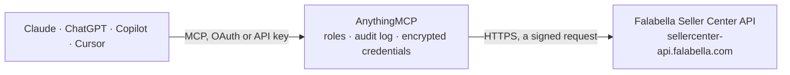

<!-- Generated by scripts/export-github-catalog.mjs in the anythingmcp-website repository. Do not edit by hand. -->

# Falabella Seller Center MCP connector

Let your AI run your falabella.com store in Chile, Colombia or Peru through Falabella Seller Center: products, stock per warehouse, brands, categories and their attributes, orders and their items, … The AnythingMCP connector gives Claude, ChatGPT, Microsoft Copilot, Cursor and Gemini 25 MCP tools for Falabella Seller Center: 16 read and 9 can change data.

**Category:** [E-commerce](../e-commerce.md) · **Tools:** 25 · **Setup guide:** [anythingmcp.com](https://anythingmcp.com/marketplace/falabella-seller-center)

## Start without code

No installation and no terminal: AnythingMCP Cloud runs the Falabella Seller Center connector for you, operated by helpcode.ai in Frankfurt, Germany.

1. **Click the button above** and create an account or sign in. The Falabella Seller Center connector opens, ready to install.
2. **Paste the API key or token from your Falabella Seller Center account.** Every click is in the [step-by-step guide](https://anythingmcp.com/marketplace/falabella-seller-center).
3. **Click Install.** AnythingMCP shows the address of your MCP server.
4. **Add that address to your assistant:** see the [guide](https://anythingmcp.com/marketplace/falabella-seller-center).
5. **Ask your first question.**

Prefer help with the setup? [Talk to us](https://anythingmcp.com/contact).

## How it works

- **The AI client** speaks MCP (Streamable HTTP) to AnythingMCP and only sees tool names, descriptions and results. It never gets the Falabella Seller Center credentials.
- **AnythingMCP** checks the client's role, builds the call from the tool definition, adds the credentials (a signed request), calls Falabella Seller Center, logs the call and returns the result.
- **Falabella Seller Center** sees an ordinary API client with the rights of the account the credentials belong to.

## Tools

| Tool | What it does | Access |
|---|---|---|
| [`falabella_seller_center_get_products`](#falabella_seller_center_get_products) | List the seller's products with SellerSku, ShopSku, name, brand, description, primary category, attributes (ProductData), images, QC status, isPublished,… | read |
| [`falabella_seller_center_get_stock`](#falabella_seller_center_get_stock) | Sellable stock per SellerSku in each of the seller's warehouses (SellerWarehouseId, FacilityId, Quantity) and in Fulfillment by Falabella warehouses… | read |
| [`falabella_seller_center_get_brands`](#falabella_seller_center_get_brands) | Every brand registered on falabella.com, with its BrandId, Name and GlobalIdentifier. | read |
| [`falabella_seller_center_get_category_tree`](#falabella_seller_center_get_category_tree) | The full category tree, nested under Categories, each category with Name, CategoryId, GlobalIdentifier and AttributeSetId. | read |
| [`falabella_seller_center_get_category_attributes`](#falabella_seller_center_get_category_attributes) | The attributes of one category: Name, Label, FeedName (the XML element to use in a product), isMandatory, GroupName, IsGlobalAttribute, InputType,… | read |
| [`falabella_seller_center_get_category_suggestion`](#falabella_seller_center_get_category_suggestion) | Suggest a category for a product from its listing title. | read |
| [`falabella_seller_center_get_warehouses`](#falabella_seller_center_get_warehouses) | The seller's logistics warehouses: name, sellerWarehouseId, facilityId, nodeID, address, working schedule, warehouseType (only_shipments, only_returns),… | read |
| [`falabella_seller_center_feed_list`](#falabella_seller_center_feed_list) | Every feed (asynchronous product, price, stock and image request) of the last 30 days, with Feed id, Status (Queued, Processing, Finished, Canceled, Error),… | read |
| [`falabella_seller_center_feed_offset_list`](#falabella_seller_center_feed_offset_list) | The feeds of the last 30 days, filtered by status or date and paged: Feed id, Status, Action, dates and record counts, like falabella_seller_center_feed_list. | read |
| [`falabella_seller_center_feed_count`](#falabella_seller_center_feed_count) | How many feeds the seller sent in the last 30 days: Total, Queued, Processing, Finished and Canceled. | read |
| [`falabella_seller_center_feed_status`](#falabella_seller_center_feed_status) | The outcome of one feed: Status (Queued, Processing, Finished, Canceled, Error), Action, dates, TotalRecords, ProcessedRecords, FailedRecords and FeedErrors… | read |
| [`falabella_seller_center_get_orders`](#falabella_seller_center_get_orders) | List orders with OrderId, OrderNumber, customer name, payment method, total Price, status of the items (Statuses), item count, gift options, billing and… | read |
| [`falabella_seller_center_get_order`](#falabella_seller_center_get_order) | One order by its OrderId: order number, customer, payment method, total, item statuses, billing and shipping address, gift options and dates. | read |
| [`falabella_seller_center_get_order_items`](#falabella_seller_center_get_order_items) | The items of one order: OrderItemId, SKU, name, ShopSku, status, item and paid price, shipping amount, shipment provider and tracking code, PackageId,… | read |
| [`falabella_seller_center_get_multiple_order_items`](#falabella_seller_center_get_multiple_order_items) | The items of several orders in one call, grouped by order, with the same fields as falabella_seller_center_get_order_items. | read |
| [`falabella_seller_center_get_document`](#falabella_seller_center_get_document) | The shipping label of order items, as Document with DocumentType, MimeType (application/pdf, or text/plain for ZPL labels in Chile) and File, the label… | read |
| [`falabella_seller_center_create_products`](#falabella_seller_center_create_products) | Create one or more products (up to 1000 per call, 500 suggested) from a ProductCreate XML document. | write |
| [`falabella_seller_center_update_products`](#falabella_seller_center_update_products) | Update one or more existing products, matched by SellerSku, from a ProductUpdate XML document. | write |
| [`falabella_seller_center_update_price`](#falabella_seller_center_update_price) | Change the price of one product in one country store (a ProductUpdate for one SellerSku), optionally with a sale price and its period. | write |
| [`falabella_seller_center_update_stock`](#falabella_seller_center_update_stock) | Set the stock of one SellerSku in the seller's default warehouse (UpdateStock). | write |
| [`falabella_seller_center_update_stock_xml`](#falabella_seller_center_update_stock_xml) | Set the stock of several SKUs, or in specific warehouses, from an UpdateStock XML document (up to 1000 Stock entries, 500 suggested). | write |
| [`falabella_seller_center_set_images`](#falabella_seller_center_set_images) | Set the images of one or more products from an Image XML document. | write |
| [`falabella_seller_center_remove_products`](#falabella_seller_center_remove_products) | Remove one or more products by SellerSku from a ProductRemove XML document. | write |
| [`falabella_seller_center_set_status_ready_to_ship`](#falabella_seller_center_set_status_ready_to_ship) | Mark order items as ready to ship (from pending), for orders you ship yourself; every item of the order changes with them. | write |
| [`falabella_seller_center_set_status_canceled`](#falabella_seller_center_set_status_canceled) | Cancel one order item that is still pending, with a reason. | write |

## Tool reference

Every parameter as the AI client sees it in `tools/list`. Source: [`packages/backend/src/adapters/intl/falabella-seller-center.json`](../../../packages/backend/src/adapters/intl/falabella-seller-center.json).

### `falabella_seller_center_get_products`

List the seller's products with SellerSku, ShopSku, name, brand, description, primary category, attributes (ProductData), images, QC status, isPublished, content score and, per BusinessUnit, price, sale price and dates, stock and status. Filter by status, a search text, a list of SKUs or created/updated dates; page with limit and offset (at most 1000 per call).

**Access:** read · **Call:** `GET /`

| Parameter | Type | Required | Description |
|---|---|---|---|
| `filter` | `all` \| `live` \| `inactive` \| `deleted` \| `image-missing` \| `pending` \| `rejected` \| `sold-out` | yes | Product status to return: all, live, inactive, deleted, image-missing, pending, rejected or sold-out. Default all. |
| `search` | string | no | Text contained in the product name or SellerSku. |
| `sku_seller_list` | string | no | Only these SellerSkus, as a JSON array, e.g. ["SKU-1","SKU-2"]. |
| `created_after` | string | no | Only products created on or after this moment. ISO 8601 date and time, e.g. 2026-11-01T00:00:00+00:00. |
| `created_before` | string | no | Only products created on or before this moment. ISO 8601 date and time, e.g. 2026-11-01T00:00:00+00:00. |
| `updated_after` | string | no | Only products updated on or after this moment. ISO 8601 date and time, e.g. 2026-11-01T00:00:00+00:00. |
| `updated_before` | string | no | Only products updated on or before this moment. ISO 8601 date and time, e.g. 2026-11-01T00:00:00+00:00. |
| `limit` | integer | no | Products per page, 1 to 1000. Default 50. |
| `offset` | integer | no | Number of products to skip, for paging. |
| `global_identifier` | `0` \| `1` | no | 1 returns brand, categories and attributes as global identifiers instead of names. Default 0. |

### `falabella_seller_center_get_stock`

Sellable stock per SellerSku in each of the seller's warehouses (SellerWarehouseId, FacilityId, Quantity) and in Fulfillment by Falabella warehouses (FulfillmentWarehouses). Units reserved by open orders are not included. Filter by SKU or warehouse; page with limit and offset.

**Access:** read · **Call:** `GET /`

| Parameter | Type | Required | Description |
|---|---|---|---|
| `seller_sku` | string | no | A SellerSku to look up. The docs allow up to 5 SKUs; pass several as a JSON array, e.g. ["SKU-1","SKU-2"]. |
| `facility_id` | string | no | Only this warehouse, by the FacilityId Falabella assigned (from falabella_seller_center_get_warehouses). |
| `seller_warehouse_id` | string | no | Only this warehouse, by the SellerWarehouseId you assigned (from falabella_seller_center_get_warehouses). |
| `limit` | integer | no | Rows per page, 1 to 1000. Default 100. |
| `offset` | integer | no | Number of rows to skip, for paging. |

### `falabella_seller_center_get_brands`

Every brand registered on falabella.com, with its BrandId, Name and GlobalIdentifier. The Brand of a new product must match one of these names exactly; when the brand is missing, sell under 'Genérico' or ask Falabella to add it. The list is long and changes rarely, so it is cached for a day.

**Access:** read · **Call:** `GET /`

No parameters.

### `falabella_seller_center_get_category_tree`

The full category tree, nested under Categories, each category with Name, CategoryId, GlobalIdentifier and AttributeSetId. Products can only be created in a last-level (leaf) category; its CategoryId is the PrimaryCategory of a product. Large and stable, cached for a day.

**Access:** read · **Call:** `GET /`

No parameters.

### `falabella_seller_center_get_category_attributes`

The attributes of one category: Name, Label, FeedName (the XML element to use in a product), isMandatory, GroupName, IsGlobalAttribute, InputType, AttributeType, MaxLength and the allowed Options. Read it before creating products: mandatory attributes go into ProductData, attributes with GroupName Variation and IsGlobalAttribute 0 go on the Product itself.

**Access:** read · **Call:** `GET /`

| Parameter | Type | Required | Description |
|---|---|---|---|
| `primary_category` | integer | yes | CategoryId of a leaf category, from falabella_seller_center_get_category_tree or falabella_seller_center_get_category_suggestion. |

### `falabella_seller_center_get_category_suggestion`

Suggest a category for a product from its listing title. Returns the suggested CategoryId and CategoryName; confirm it against falabella_seller_center_get_category_tree before using it as PrimaryCategory.

**Access:** read · **Call:** `GET /`

| Parameter | Type | Required | Description |
|---|---|---|---|
| `name` | string | yes | Listing title of the product, in Spanish, e.g. 'Pantalón de trekking hombre'. |

### `falabella_seller_center_get_warehouses`

The seller's logistics warehouses: name, sellerWarehouseId, facilityId, nodeID, address, working schedule, warehouseType (only_shipments, only_returns), whether it is the default and enabled, and whether it is Fulfillment by Falabella. The ids are what get_stock and update_stock_xml use for a specific warehouse.

**Access:** read · **Call:** `GET /`

| Parameter | Type | Required | Description |
|---|---|---|---|
| `facility_id` | string | no | Only the warehouse with this FacilityId (assigned by Falabella). |
| `seller_warehouse_id` | string | no | Only the warehouse with this SellerWarehouseId (assigned by you). |
| `warehouse_type` | string | no | Only warehouses of this type, e.g. only_shipments or only_returns. |
| `is_enabled` | `0` \| `1` | no | 1 for enabled warehouses only, 0 for disabled ones. |
| `is_default` | `0` \| `1` | no | 1 for the default warehouse only, 0 for the others. |
| `limit` | integer | no | Warehouses per page, at most 100. |
| `offset` | integer | no | Number of warehouses to skip, for paging. |

### `falabella_seller_center_feed_list`

Every feed (asynchronous product, price, stock and image request) of the last 30 days, with Feed id, Status (Queued, Processing, Finished, Canceled, Error), Action, creation and update dates, Source, TotalRecords, ProcessedRecords, FailedRecords and a base64 CSV failure report when records failed.

**Access:** read · **Call:** `GET /`

No parameters.

### `falabella_seller_center_feed_offset_list`

The feeds of the last 30 days, filtered by status or date and paged: Feed id, Status, Action, dates and record counts, like falabella_seller_center_feed_list.

**Access:** read · **Call:** `GET /`

| Parameter | Type | Required | Description |
|---|---|---|---|
| `status` | `Queued` \| `Processing` \| `Finished` \| `Canceled` \| `Error` | no | Only feeds with this status. |
| `creation_date` | string | no | Only feeds created after this moment. ISO 8601 date and time, e.g. 2026-11-01T00:00:00+00:00. |
| `updated_date` | string | no | Only feeds updated after this moment. ISO 8601 date and time, e.g. 2026-11-01T00:00:00+00:00. |
| `page_size` | integer | no | Feeds per page. |
| `offset` | integer | no | Zero-based position of the first feed to return. |

### `falabella_seller_center_feed_count`

How many feeds the seller sent in the last 30 days: Total, Queued, Processing, Finished and Canceled. No parameters; a light call that also checks the credentials.

**Access:** read · **Call:** `GET /`

No parameters.

### `falabella_seller_center_feed_status`

The outcome of one feed: Status (Queued, Processing, Finished, Canceled, Error), Action, dates, TotalRecords, ProcessedRecords, FailedRecords and FeedErrors with the SellerSku, field and message of every record that failed. Call it after each write until Status is Finished, Error or Canceled.

**Access:** read · **Call:** `GET /`

| Parameter | Type | Required | Description |
|---|---|---|---|
| `feed_id` | string | yes | Feed id (UUID): the RequestId a write returned, or a Feed from falabella_seller_center_feed_list. |

### `falabella_seller_center_get_orders`

List orders with OrderId, OrderNumber, customer name, payment method, total Price, status of the items (Statuses), item count, gift options, billing and shipping address, promised shipping time and created/updated dates; Head.TotalCount is the number of matches. Filter by created/updated dates, status and fulfillment type; sort and page (at most 100 per call).

**Access:** read · **Call:** `GET /`

| Parameter | Type | Required | Description |
|---|---|---|---|
| `created_after` | string | no | Only orders created on or after this moment. ISO 8601 date and time, e.g. 2026-11-01T00:00:00+00:00. |
| `created_before` | string | no | Only orders created on or before this moment. ISO 8601 date and time, e.g. 2026-11-01T00:00:00+00:00. |
| `updated_after` | string | no | Only orders updated on or after this moment. ISO 8601 date and time, e.g. 2026-11-01T00:00:00+00:00. |
| `updated_before` | string | no | Only orders updated on or before this moment. ISO 8601 date and time, e.g. 2026-11-01T00:00:00+00:00. |
| `status` | `pending` \| `canceled` \| `readytoship` \| `delivered` \| `returned` \| `shipped` | no | Only orders in this status: pending, readytoship, shipped, delivered, canceled or returned. |
| `shipping_type` | `dropshipping` \| `own_warehouse` | no | dropshipping for orders you ship yourself, own_warehouse for Fulfillment by Falabella. |
| `sort_by` | `createdat` \| `updatedat` | no | Sort column: createdat or updatedat. |
| `sort_direction` | `ASC` \| `DESC` | no | ASC or DESC. |
| `limit` | integer | no | Orders per page, 1 to 100 (the default and maximum is 100). |
| `offset` | integer | no | Number of orders to skip, for paging. |

### `falabella_seller_center_get_order`

One order by its OrderId: order number, customer, payment method, total, item statuses, billing and shipping address, gift options and dates.

**Access:** read · **Call:** `GET /`

| Parameter | Type | Required | Description |
|---|---|---|---|
| `order_id` | integer | yes | OrderId assigned by Seller Center (from falabella_seller_center_get_orders), not the OrderNumber. |

### `falabella_seller_center_get_order_items`

The items of one order: OrderItemId, SKU, name, ShopSku, status, item and paid price, shipping amount, shipment provider and tracking code, PackageId, shipping type, warehouse and promised shipping time. OrderItemId and PackageId are what labels and status changes need.

**Access:** read · **Call:** `GET /`

| Parameter | Type | Required | Description |
|---|---|---|---|
| `order_id` | integer | yes | OrderId assigned by Seller Center (from falabella_seller_center_get_orders). |

### `falabella_seller_center_get_multiple_order_items`

The items of several orders in one call, grouped by order, with the same fields as falabella_seller_center_get_order_items.

**Access:** read · **Call:** `GET /`

| Parameter | Type | Required | Description |
|---|---|---|---|
| `order_id_list` | string | yes | OrderIds in brackets, separated by commas, e.g. [123456,123457]. |

### `falabella_seller_center_get_document`

The shipping label of order items, as Document with DocumentType, MimeType (application/pdf, or text/plain for ZPL labels in Chile) and File, the label encoded in base64. Only for items already ready to ship that you ship yourself.

**Access:** read · **Call:** `GET /`

| Parameter | Type | Required | Description |
|---|---|---|---|
| `order_item_ids` | string | yes | OrderItemIds in brackets, separated by commas, e.g. [987654,987655] (from falabella_seller_center_get_order_items). |

### `falabella_seller_center_create_products`

Create one or more products (up to 1000 per call, 500 suggested) from a ProductCreate XML document. Each Product needs SellerSku, Name, PrimaryCategory (a leaf CategoryId), Brand (exact name from get_brands), Description (6 to 25000 characters), ProductData with ConditionType, PackageHeight, PackageWidth, PackageLength (cm) and PackageWeight (kg) plus the category's mandatory attributes from get_category_attributes (TaxPercentage in Colombia), and BusinessUnits/BusinessUnit with OperatorCode (facl, faco, fape), Price, Stock and Status (active or inactive). Variants share a ParentSku. Asynchronous: the answer only confirms the request was accepted. Its SuccessResponse.Head.RequestId is the feed id; check the result with falabella_seller_center_feed_status.

**Access:** write · **Call:** `POST /`

| Parameter | Type | Required | Description |
|---|---|---|---|
| `xml` | string | yes | The whole XML document: <?xml version="1.0" encoding="UTF-8" ?><Request><Product><SellerSku>SKU-1</SellerSku><Name>...</Name><PrimaryCategory>2723</PrimaryCategory><Description>...</Description><Brand>Genérico</Brand><BusinessUnits><BusinessUnit><OperatorCode>facl</OperatorCode><Price>19990</Price><Stock>10</Stock><Status>active</Status></BusinessUnit></BusinessUnits><ProductData><ConditionType>Nuevo</ConditionType><PackageHeight>10</PackageHeight><PackageWidth>10</PackageWidth><PackageLength>10</PackageLength><PackageWeight>1</PackageWeight></ProductData></Product></Request>. Escape & < > in text; wrap an HTML description in <![CDATA[...]]>. Optional: ProductId (EAN/UPC), SpecialPrice with SpecialFromDate and SpecialToDate (YYYY-MM-DD HH:MM:SS), ParentSku and variation attributes on the Product. |

### `falabella_seller_center_update_products`

Update one or more existing products, matched by SellerSku, from a ProductUpdate XML document. Only the elements you send change and empty elements are ignored; each Product needs SellerSku and a BusinessUnit with its OperatorCode (facl, faco, fape) plus at least one field to change: Name, Description, Brand, attributes, ProductData, or Price, SpecialPrice, SpecialFromDate, SpecialToDate, Stock and Status (active, inactive; also restores a removed product) in the BusinessUnit. Asynchronous: the answer only confirms the request was accepted. Its SuccessResponse.Head.RequestId is the feed id; check the result with falabella_seller_center_feed_status.

**Access:** write · **Call:** `POST /`

| Parameter | Type | Required | Description |
|---|---|---|---|
| `xml` | string | yes | The whole XML document: <?xml version="1.0" encoding="UTF-8" ?><Request><Product><SellerSku>SKU-1</SellerSku><BusinessUnits><BusinessUnit><OperatorCode>facl</OperatorCode><Status>inactive</Status></BusinessUnit></BusinessUnits></Product></Request>. Several Product elements per request are allowed (up to 1000). Escape & < > in text; wrap HTML in <![CDATA[...]]>. |

### `falabella_seller_center_update_price`

Change the price of one product in one country store (a ProductUpdate for one SellerSku), optionally with a sale price and its period. Leave the sale fields out to change only the regular price. Asynchronous: the answer only confirms the request was accepted. Its SuccessResponse.Head.RequestId is the feed id; check the result with falabella_seller_center_feed_status.

**Access:** write · **Call:** `POST /`

| Parameter | Type | Required | Description |
|---|---|---|---|
| `seller_sku` | string | yes | SellerSku of the product. |
| `operator_code` | `facl` \| `faco` \| `fape` | yes | Country store of the product, as the lower-case OperatorCode: facl (Chile), faco (Colombia), fape (Peru). Use your connector's country (FALABELLA_BUSINESS_UNIT in lower case). |
| `price` | string | yes | New regular price, with a dot as decimal separator, e.g. 19990 or 1600.00. |
| `special_price` | string | no | Optional sale price, lower than price. Needs special_from_date and special_to_date. |
| `special_from_date` | string | no | Start of the sale, YYYY-MM-DD HH:MM:SS, e.g. 2026-11-20 00:00:00. |
| `special_to_date` | string | no | End of the sale, YYYY-MM-DD HH:MM:SS, e.g. 2026-11-30 23:59:59. |

### `falabella_seller_center_update_stock`

Set the stock of one SellerSku in the seller's default warehouse (UpdateStock). For several SKUs or a specific warehouse use falabella_seller_center_update_stock_xml; Fulfillment by Falabella stock cannot be set. Asynchronous: the feed id is in Body.Stocks.feed; check it with falabella_seller_center_feed_status.

**Access:** write · **Call:** `POST /`

| Parameter | Type | Required | Description |
|---|---|---|---|
| `seller_sku` | string | yes | SellerSku of the product. |
| `quantity` | integer | yes | New sellable quantity in the default warehouse. |

### `falabella_seller_center_update_stock_xml`

Set the stock of several SKUs, or in specific warehouses, from an UpdateStock XML document (up to 1000 Stock entries, 500 suggested). Each Stock has SellerSku and Quantity and, for a warehouse other than the default, either GSCFacilityId or SellerWarehouseId (from get_warehouses), never both in one request. Asynchronous: the feed id is in Body.Stocks.feed; check it with falabella_seller_center_feed_status.

**Access:** write · **Call:** `POST /`

| Parameter | Type | Required | Description |
|---|---|---|---|
| `xml` | string | yes | The whole XML document: <?xml version="1.0" encoding="UTF-8" ?><Request><Warehouse><Stock><SellerWarehouseId>WH-1</SellerWarehouseId><SellerSku>SKU-1</SellerSku><Quantity>25</Quantity></Stock><Stock><SellerWarehouseId>WH-2</SellerWarehouseId><SellerSku>SKU-1</SellerSku><Quantity>5</Quantity></Stock></Warehouse></Request>. Leave out the warehouse elements to use the default warehouse. |

### `falabella_seller_center_set_images`

Set the images of one or more products from an Image XML document. The list replaces every image the product had; the first becomes the main image. At most 8 images per product, JPG or PNG between 500x500 and 2000x2000 pixels, at public URLs that Falabella downloads. Asynchronous: the answer only confirms the request was accepted. Its SuccessResponse.Head.RequestId is the feed id; check the result with falabella_seller_center_feed_status.

**Access:** write · **Call:** `POST /`

| Parameter | Type | Required | Description |
|---|---|---|---|
| `xml` | string | yes | The whole XML document: <?xml version="1.0" encoding="UTF-8" ?><Request><ProductImage><SellerSku>SKU-1</SellerSku><Images><Image>https://cdn.example.com/sku-1-front.jpg</Image><Image>https://cdn.example.com/sku-1-back.jpg</Image></Images></ProductImage></Request>. One ProductImage element per product. |

### `falabella_seller_center_remove_products`

Remove one or more products by SellerSku from a ProductRemove XML document. A removed product can be restored with falabella_seller_center_update_products by sending its Status. Switched off at install. Asynchronous: the answer only confirms the request was accepted. Its SuccessResponse.Head.RequestId is the feed id; check the result with falabella_seller_center_feed_status.

**Access:** write · **Call:** `POST /`

| Parameter | Type | Required | Description |
|---|---|---|---|
| `xml` | string | yes | The whole XML document: <?xml version="1.0" encoding="UTF-8" ?><Request><Product><SellerSku>SKU-1</SellerSku></Product><Product><SellerSku>SKU-2</SellerSku></Product></Request>. |

### `falabella_seller_center_set_status_ready_to_ship`

Mark order items as ready to ship (from pending), for orders you ship yourself; every item of the order changes with them. Returns PurchaseOrderId and PurchaseOrderNumber. Not allowed for Fulfillment by Falabella orders. Switched off at install.

**Access:** write · **Call:** `POST /`

| Parameter | Type | Required | Description |
|---|---|---|---|
| `order_item_ids` | string | yes | OrderItemIds of one order in brackets, separated by commas, e.g. [987654,987655] (from falabella_seller_center_get_order_items). |
| `package_id` | string | yes | PackageId of the items, from falabella_seller_center_get_order_items. |

### `falabella_seller_center_set_status_canceled`

Cancel one order item that is still pending, with a reason. Not allowed for Fulfillment by Falabella orders. Switched off at install.

**Access:** write · **Call:** `POST /`

| Parameter | Type | Required | Description |
|---|---|---|---|
| `order_item_id` | integer | yes | OrderItemId to cancel (from falabella_seller_center_get_order_items). |
| `reason` | string | yes | Reason for the cancellation, e.g. SHORTAGE (out of stock). |
| `reason_detail` | string | no | Optional longer explanation. |

## Run it yourself

AnythingMCP is open source (AGPL-3.0). [Run it with Docker](../../../README.md#run-it-yourself), open **Connectors → Store**, pick **Falabella Seller Center** and enter `FALABELLA_USER_ID`, `FALABELLA_API_KEY`, `FALABELLA_SELLER_ID`, `FALABELLA_BUSINESS_UNIT`, then add your MCP server URL to the AI client.

[← E-commerce connectors](../e-commerce.md) · [All categories](../README.md)
