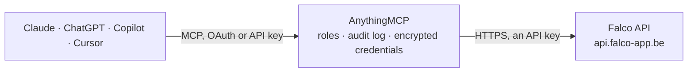

<!-- Generated by scripts/export-github-catalog.mjs in the anythingmcp-website repository. Do not edit by hand. -->

# Falco MCP connector

Falco, Belgian accounting and Peppol e-invoicing: purchase and sale documents with their files, invoices received over Peppol, Peppol participant lookups, and the customers, articles and invoices of … The AnythingMCP connector gives Claude, ChatGPT, Microsoft Copilot, Cursor and Gemini 19 MCP tools for Falco: 17 read and 2 can change data.

**Category:** [Accounting](../accounting.md) · **Tools:** 19 · **Setup guide:** [anythingmcp.com](https://anythingmcp.com/guides/falco-to-mcp) · [Deutsch](https://anythingmcp.com/de/guides/falco-to-mcp) · [Italiano](https://anythingmcp.com/it/guides/falco-to-mcp) · [Español](https://anythingmcp.com/es/guides/falco-to-mcp) · [日本語](https://anythingmcp.com/ja/guides/falco-to-mcp) · [Русский](https://anythingmcp.com/ru/guides/falco-to-mcp) · [中文](https://anythingmcp.com/zh/guides/falco-to-mcp)

## Start without code

No installation and no terminal: AnythingMCP Cloud runs the Falco connector for you, operated by helpcode.ai in Frankfurt, Germany.

1. **Click the button above** and create an account or sign in. The Falco connector opens, ready to install.
2. **Paste the API key or token from your Falco account.** Every click is in the [step-by-step guide](https://anythingmcp.com/guides/falco-to-mcp).
3. **Click Install.** AnythingMCP shows the address of your MCP server.
4. **Add that address to your assistant:** [Claude](https://anythingmcp.com/guides/connect-falco-to-claude) · [ChatGPT](https://anythingmcp.com/guides/connect-falco-to-chatgpt) · [Microsoft Copilot](https://anythingmcp.com/guides/connect-falco-to-copilot) · [Cursor](https://anythingmcp.com/guides/connect-falco-to-cursor) · [Gemini CLI](https://anythingmcp.com/guides/connect-falco-to-gemini) · [Meta Muse](https://anythingmcp.com/guides/connect-falco-to-muse).
5. **Ask your first question**, for example: *Show me the purchase document for supplier Boulangerie Dupré SPRL with number PUR-2026-112*

Prefer help with the setup? [Talk to us](https://anythingmcp.com/contact).

## How it works

- **The AI client** speaks MCP (Streamable HTTP) to AnythingMCP and only sees tool names, descriptions and results. It never gets the Falco credentials.
- **AnythingMCP** checks the client's role, builds the call from the tool definition, adds the credentials (an API key), calls Falco, logs the call and returns the result.
- **Falco** sees an ordinary API client with the rights of the account the credentials belong to.

## Tools

| Tool | What it does | Access |
|---|---|---|
| [`falco_get_organization`](#falco_get_organization) | Get the Falco organization the API key belongs to: name, VAT number, Peppol identifier, address, IBANs, profiles, plan (expert_essential or expert_premium),… | read |
| [`falco_list_purchase_documents`](#falco_list_purchase_documents) | List purchase documents (supplier invoices and credit notes) in Falco, newest first: id, number, invoice and due date, currency, amount, supplier name, VAT… | read |
| [`falco_get_purchase_document`](#falco_get_purchase_document) | Get one purchase document by id: number, dates, amount, supplier, payment and Peppol status, its event history and the list of attached files (id, type pdf,… | read |
| [`falco_download_purchase_document_file`](#falco_download_purchase_document_file) | Download a file of a purchase document: the main file (usually the PDF), the UBL XML, or one attached file. | read |
| [`falco_list_sale_documents`](#falco_list_sale_documents) | List sale documents (sales invoices and credit notes, including those imported as PDF or UBL), newest first: id, number, dates, currency, amount, customer… | read |
| [`falco_get_sale_document`](#falco_get_sale_document) | Get one sale document by id: number, dates, amount, customer, payment status, Peppol send status, event history and attached files. | read |
| [`falco_list_peppol_inbound`](#falco_list_peppol_inbound) | List documents received over Peppol (incoming e-invoices and credit notes), newest first: id, received date, invoice and due date, amount, currency, sender… | read |
| [`falco_get_peppol_inbound_document`](#falco_get_peppol_inbound_document) | Get one document received over Peppol by id: sender, amounts, dates, payment reference, bank account, invoice reference and payment status. | read |
| [`falco_download_peppol_inbound_document`](#falco_download_peppol_inbound_document) | Download the file of a document received over Peppol (the UBL XML as received). | read |
| [`falco_find_peppol_participant`](#falco_find_peppol_participant) | Look up the Peppol participant identifier registered for a VAT number, to see whether a company can receive e-invoices over Peppol. | read |
| [`falco_check_peppol_participant`](#falco_check_peppol_participant) | Check whether a Peppol participant identifier (e.g. 0208:0123456789) is registered to receive invoices or credit notes. | read |
| [`falco_list_customers`](#falco_list_customers) | List customers of the Falco invoicing module: id, name, VAT and company number, language, e-mails, phone, contact, address and Peppol identifier. | read |
| [`falco_get_customer`](#falco_get_customer) | Get one customer of the invoicing module by id with full address, contacts and Peppol identifier. | read |
| [`falco_list_articles`](#falco_list_articles) | List articles (products and services) of the invoicing module: id, descriptions, unit price excluding and including VAT, unit, category, type, cost code and… | read |
| [`falco_list_invoices`](#falco_list_invoices) | List sales invoices and credit notes created in the Falco invoicing module: id, number, type, status (draft, sent, locked), document and due date, customer,… | read |
| [`falco_get_invoice`](#falco_get_invoice) | Get one invoice or credit note of the invoicing module with its lines (article, quantity, unit price, VAT rate, amounts), VAT subtotals, customer and… | read |
| [`falco_download_invoice_pdf`](#falco_download_invoice_pdf) | Download the PDF of an invoice or credit note of the invoicing module. | read |
| [`falco_set_purchase_payment_status`](#falco_set_purchase_payment_status) | Set the payment status of a purchase document to not_paid, partially_paid or paid, e.g. after paying a supplier. | write |
| [`falco_send_invoice_response`](#falco_send_invoice_response) | Send a Peppol invoice response for a received document to its sender: acknowledged, in_process, under_query, conditionally_accepted, rejected, accepted or… | write |

## Tool reference

Every parameter as the AI client sees it in `tools/list`. Source: [`packages/backend/src/adapters/be/falco.json`](../../../packages/backend/src/adapters/be/falco.json).

### `falco_get_organization`

Get the Falco organization the API key belongs to: name, VAT number, Peppol identifier, address, IBANs, profiles, plan (expert_essential or expert_premium), invoices sent over Peppol this month and whether it is linked to accounting. Use it to check the connection.

**Access:** read · **Call:** `GET /organization/whoami`

No parameters.

### `falco_list_purchase_documents`

List purchase documents (supplier invoices and credit notes) in Falco, newest first: id, number, invoice and due date, currency, amount, supplier name, VAT and company number, payment status (not_paid, partially_paid, paid), Peppol status, events and attached files. Filter by creation date, invoice date or supplier name; page with page and page_size.

**Access:** read · **Call:** `GET /documents/purchases`

| Parameter | Type | Required | Description |
|---|---|---|---|
| `page` | integer | no | Page number, starting at 0. |
| `page_size` | integer | no | Rows per page, 20 to 200 (default 50). |
| `created_after` | string | no | Only documents created on or after this day, YYYY-MM-DD. |
| `created_before` | string | no | Only documents created on or before this day, YYYY-MM-DD. |
| `date_from` | string | no | Only documents with an invoice date on or after this day, YYYY-MM-DD. |
| `date_to` | string | no | Only documents with an invoice date on or before this day, YYYY-MM-DD. |
| `supplier_name` | string | no | Supplier name to filter on. |
| `sort_by` | `created_at` \| `invoice_date` | no | Field to sort by (default created_at). |
| `sort_direction` | `asc` \| `desc` | no | Sort direction. Default: newest first for dates. |

### `falco_get_purchase_document`

Get one purchase document by id: number, dates, amount, supplier, payment and Peppol status, its event history and the list of attached files (id, type pdf, image or ubl, file name, size).

**Access:** read · **Call:** `GET /documents/purchases/{document_id}`

| Parameter | Type | Required | Description |
|---|---|---|---|
| `document_id` | string | yes | Purchase document id, from falco_list_purchase_documents. |

### `falco_download_purchase_document_file`

Download a file of a purchase document: the main file (usually the PDF), the UBL XML, or one attached file. The file is handed over as an attachment.

**Access:** read · **Call:** `GET /documents/purchases/{document_id}/download/{file_identifier}`

| Parameter | Type | Required | Description |
|---|---|---|---|
| `document_id` | string | yes | Purchase document id, from falco_list_purchase_documents. |
| `file_identifier` | string | yes | Which file: main, ubl, the position of the file in the files list, or the file id from falco_get_purchase_document. |

### `falco_list_sale_documents`

List sale documents (sales invoices and credit notes, including those imported as PDF or UBL), newest first: id, number, dates, currency, amount, customer name, payment status and Peppol send status. Filter by creation date, invoice date or customer name.

**Access:** read · **Call:** `GET /documents/sales`

| Parameter | Type | Required | Description |
|---|---|---|---|
| `page` | integer | no | Page number, starting at 0. |
| `page_size` | integer | no | Rows per page, 20 to 200 (default 50). |
| `created_after` | string | no | Only documents created on or after this day, YYYY-MM-DD. |
| `created_before` | string | no | Only documents created on or before this day, YYYY-MM-DD. |
| `date_from` | string | no | Only documents with an invoice date on or after this day, YYYY-MM-DD. |
| `date_to` | string | no | Only documents with an invoice date on or before this day, YYYY-MM-DD. |
| `customer_name` | string | no | Customer name to filter on. |
| `sort_by` | `created_at` \| `invoice_date` | no | Field to sort by (default created_at). |
| `sort_direction` | `asc` \| `desc` | no | Sort direction. Default: newest first for dates. |

### `falco_get_sale_document`

Get one sale document by id: number, dates, amount, customer, payment status, Peppol send status, event history and attached files.

**Access:** read · **Call:** `GET /documents/sales/{document_id}`

| Parameter | Type | Required | Description |
|---|---|---|---|
| `document_id` | string | yes | Sale document id, from falco_list_sale_documents. |

### `falco_list_peppol_inbound`

List documents received over Peppol (incoming e-invoices and credit notes), newest first: id, received date, invoice and due date, amount, currency, sender name, VAT number and Peppol id, payment reference, bank account, invoice reference, payment status and whether it is a credit note. Filter by received date, invoice date, sender or number.

**Access:** read · **Call:** `GET /peppol/inbound`

| Parameter | Type | Required | Description |
|---|---|---|---|
| `page` | integer | no | Page number, starting at 0. |
| `page_size` | integer | no | Rows per page, 20 to 200 (default 50). |
| `received_after` | string | no | Only documents received on or after this day, YYYY-MM-DD. |
| `received_before` | string | no | Only documents received on or before this day, YYYY-MM-DD. |
| `date_from` | string | no | Only documents with an invoice date on or after this day, YYYY-MM-DD. |
| `date_to` | string | no | Only documents with an invoice date on or before this day, YYYY-MM-DD. |
| `sender_vat_number` | string | no | Sender VAT number, e.g. BE0123456789. |
| `sender_name` | string | no | Sender name. |
| `number` | string | no | Invoice number. |
| `sort_by` | `received_at` \| `invoice_date` | no | Field to sort by (default received_at). |
| `sort_direction` | `asc` \| `desc` | no | Sort direction. Default: newest first for dates. |

### `falco_get_peppol_inbound_document`

Get one document received over Peppol by id: sender, amounts, dates, payment reference, bank account, invoice reference and payment status.

**Access:** read · **Call:** `GET /peppol/inbound/{document_id}`

| Parameter | Type | Required | Description |
|---|---|---|---|
| `document_id` | string | yes | Inbound document id, from falco_list_peppol_inbound. |

### `falco_download_peppol_inbound_document`

Download the file of a document received over Peppol (the UBL XML as received). The file is handed over as an attachment.

**Access:** read · **Call:** `GET /peppol/inbound/{document_id}/download`

| Parameter | Type | Required | Description |
|---|---|---|---|
| `document_id` | string | yes | Inbound document id, from falco_list_peppol_inbound. |

### `falco_find_peppol_participant`

Look up the Peppol participant identifier registered for a VAT number, to see whether a company can receive e-invoices over Peppol. A 404 means the company is not on Peppol, or the VAT number is not supported.

**Access:** read · **Call:** `GET /peppol/participants/find`

| Parameter | Type | Required | Description |
|---|---|---|---|
| `vat_number` | string | yes | VAT number to look up, e.g. BE0123456789. |
| `document_type` | `invoice` \| `credit_note` | no | Document type the receiver must accept. |
| `test_environment` | boolean | no | true to look on the Peppol test network instead of production. |

### `falco_check_peppol_participant`

Check whether a Peppol participant identifier (e.g. 0208:0123456789) is registered to receive invoices or credit notes. A 404 says why it is not reachable.

**Access:** read · **Call:** `GET /peppol/participants/check`

| Parameter | Type | Required | Description |
|---|---|---|---|
| `participant_identifier` | string | yes | Peppol participant identifier, scheme and value, e.g. 0208:0123456789. |
| `document_type` | `invoice` \| `credit_note` | no | Document type the receiver must accept. |
| `test_environment` | boolean | no | true to check the Peppol test network instead of production. |

### `falco_list_customers`

List customers of the Falco invoicing module: id, name, VAT and company number, language, e-mails, phone, contact, address and Peppol identifier. Search by name or VAT with q, or filter by exact VAT number or e-mail.

**Access:** read · **Call:** `GET /customers`

| Parameter | Type | Required | Description |
|---|---|---|---|
| `page` | integer | no | Page number, starting at 0. |
| `page_size` | integer | no | Rows per page, 20 to 200 (default 50). |
| `q` | string | no | Text search in name and VAT number. |
| `vat` | string | no | Exact VAT number. |
| `email` | string | no | E-mail address. |

### `falco_get_customer`

Get one customer of the invoicing module by id with full address, contacts and Peppol identifier.

**Access:** read · **Call:** `GET /customers/{customer_id}`

| Parameter | Type | Required | Description |
|---|---|---|---|
| `customer_id` | string | yes | Customer id, from falco_list_customers. |

### `falco_list_articles`

List articles (products and services) of the invoicing module: id, descriptions, unit price excluding and including VAT, unit, category, type, cost code and account number. Search with q in reference and description.

**Access:** read · **Call:** `GET /articles`

| Parameter | Type | Required | Description |
|---|---|---|---|
| `page` | integer | no | Page number, starting at 0. |
| `page_size` | integer | no | Rows per page, 20 to 200 (default 50). |
| `q` | string | no | Text search in reference and description. |

### `falco_list_invoices`

List sales invoices and credit notes created in the Falco invoicing module: id, number, type, status (draft, sent, locked), document and due date, customer, currency, amounts excluding and including VAT, payment, e-mail and Peppol status. Filter by type, status, customer, number or dates; at most 100 per page.

**Access:** read · **Call:** `GET /invoices`

| Parameter | Type | Required | Description |
|---|---|---|---|
| `page` | integer | no | Page number, starting at 0. |
| `page_size` | integer | no | Rows per page, 20 to 100 (default 50). |
| `document_type` | `sale_invoice` \| `sale_credit_note` | no | Invoice or credit note. |
| `status` | `draft` \| `sent` \| `locked` | no | Document status. |
| `customer_id` | string | no | Customer id, from falco_list_customers. |
| `number` | string | no | Invoice number. |
| `created_after` | string | no | Created on or after this day, YYYY-MM-DD. |
| `created_before` | string | no | Created on or before this day, YYYY-MM-DD. |
| `date_from` | string | no | Document date on or after this day, YYYY-MM-DD. |
| `date_to` | string | no | Document date on or before this day, YYYY-MM-DD. |
| `sort_by` | `created_at` \| `document_date` \| `number` \| `customer_name` \| `total_amount` | no | Field to sort by (default created_at). |
| `sort_direction` | `asc` \| `desc` | no | Sort direction. Default: newest first for dates. |

### `falco_get_invoice`

Get one invoice or credit note of the invoicing module with its lines (article, quantity, unit price, VAT rate, amounts), VAT subtotals, customer and supplier, payment details and Peppol status.

**Access:** read · **Call:** `GET /invoices/{invoice_id}`

| Parameter | Type | Required | Description |
|---|---|---|---|
| `invoice_id` | string | yes | Invoice id, from falco_list_invoices. |

### `falco_download_invoice_pdf`

Download the PDF of an invoice or credit note of the invoicing module. The file is handed over as an attachment.

**Access:** read · **Call:** `GET /invoices/{invoice_id}/pdf`

| Parameter | Type | Required | Description |
|---|---|---|---|
| `invoice_id` | string | yes | Invoice id, from falco_list_invoices. |

### `falco_set_purchase_payment_status`

Set the payment status of a purchase document to not_paid, partially_paid or paid, e.g. after paying a supplier. Replaces the current status; returns the updated document.

**Access:** write · **Call:** `PUT /documents/purchases/{document_id}/payment-status`

| Parameter | Type | Required | Description |
|---|---|---|---|
| `document_id` | string | yes | Purchase document id, from falco_list_purchase_documents. |
| `payment_status` | `not_paid` \| `partially_paid` \| `paid` | yes | New payment status. |

### `falco_send_invoice_response`

Send a Peppol invoice response for a received document to its sender: acknowledged, in_process, under_query, conditionally_accepted, rejected, accepted or paid, with optional reasons. The supplier receives it at once and it cannot be withdrawn.

**Access:** write · **Call:** `POST /peppol/inbound/{document_id}/response`

| Parameter | Type | Required | Description |
|---|---|---|---|
| `document_id` | string | yes | Inbound document id, from falco_list_peppol_inbound. |
| `response_code` | `acknowledged` \| `in_process` \| `under_query` \| `conditionally_accepted` \| `rejected` \| `accepted` \| `paid` | yes | Response to send. |
| `status` | object[] | no | Optional reasons. status_reason_code is a Peppol OPStatusAction or OPStatusReason code (e.g. NOA, PIN, NIN for actions; REF, LEG, REC, QUA, DEL, PRI, QTY for reasons); status_reason is free text. |

## Run it yourself

AnythingMCP is open source (AGPL-3.0). [Run it with Docker](../../../README.md#run-it-yourself), open **Connectors → Store**, pick **Falco** and enter `FALCO_APP_SECRET`, `FALCO_API_KEY`, then add your MCP server URL to the AI client.

[← Accounting connectors](../accounting.md) · [All categories](../README.md)
