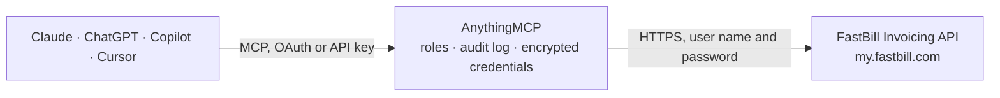

<!-- Generated by scripts/export-github-catalog.mjs in the anythingmcp-website repository. Do not edit by hand. -->

# FastBill Invoicing MCP connector

Manage invoices, customers, expenses, and revenue with FastBill. The AnythingMCP connector gives Claude, ChatGPT, Microsoft Copilot, Cursor and Gemini 5 MCP tools for FastBill Invoicing, all read-only.

**Category:** [Finance](../finance.md) · **Tools:** 5 · **Setup guide:** [anythingmcp.com](https://anythingmcp.com/guides/fastbill-to-mcp) · [Deutsch](https://anythingmcp.com/de/guides/fastbill-to-mcp) · [Italiano](https://anythingmcp.com/it/guides/fastbill-to-mcp) · [Español](https://anythingmcp.com/es/guides/fastbill-to-mcp) · [日本語](https://anythingmcp.com/ja/guides/fastbill-to-mcp) · [Русский](https://anythingmcp.com/ru/guides/fastbill-to-mcp) · [中文](https://anythingmcp.com/zh/guides/fastbill-to-mcp)

## Start without code

No installation and no terminal: AnythingMCP Cloud runs the FastBill Invoicing connector for you, operated by helpcode.ai in Frankfurt, Germany.

1. **Click the button above** and create an account or sign in. The FastBill Invoicing connector opens, ready to install.
2. **Paste the API key or token from your FastBill Invoicing account.** Every click is in the [step-by-step guide](https://anythingmcp.com/guides/fastbill-to-mcp).
3. **Click Install.** AnythingMCP shows the address of your MCP server.
4. **Add that address to your assistant:** [Claude](https://anythingmcp.com/guides/connect-fastbill-to-claude) · [ChatGPT](https://anythingmcp.com/guides/connect-fastbill-to-chatgpt) · [Microsoft Copilot](https://anythingmcp.com/guides/connect-fastbill-to-copilot) · [Cursor](https://anythingmcp.com/guides/connect-fastbill-to-cursor) · [Gemini CLI](https://anythingmcp.com/guides/connect-fastbill-to-gemini) · [Meta Muse](https://anythingmcp.com/guides/connect-fastbill-to-muse).
5. **Ask your first question**, for example: *Show invoice 2026-0457 for customer Müller Energies: date, gross total and payment status.*

Prefer help with the setup? [Talk to us](https://anythingmcp.com/contact).

## How it works

- **The AI client** speaks MCP (Streamable HTTP) to AnythingMCP and only sees tool names, descriptions and results. It never gets the FastBill Invoicing credentials.
- **AnythingMCP** checks the client's role, builds the call from the tool definition, adds the credentials (user name and password), calls FastBill Invoicing, logs the call and returns the result.
- **FastBill Invoicing** sees an ordinary API client with the rights of the account the credentials belong to.

## Tools

| Tool | What it does | Access |
|---|---|---|
| [`fastbill_list_customers`](#fastbill_list_customers) | List customers from FastBill. | read |
| [`fastbill_list_invoices`](#fastbill_list_invoices) | List invoices from FastBill. | read |
| [`fastbill_list_expenses`](#fastbill_list_expenses) | List expenses from FastBill. | read |
| [`fastbill_list_revenues`](#fastbill_list_revenues) | List revenue entries from FastBill. | read |
| [`fastbill_get_invoice`](#fastbill_get_invoice) | Get a specific invoice by ID with full details including line items, taxes, and payment information. | read |

## Tool reference

Every parameter as the AI client sees it in `tools/list`. Source: [`packages/backend/src/adapters/de/fastbill.json`](../../../packages/backend/src/adapters/de/fastbill.json).

### `fastbill_list_customers`

List customers from FastBill. Returns customer number, name, address, email, and payment terms.

**Access:** read · **Call:** `POST /api.php`

| Parameter | Type | Required | Description |
|---|---|---|---|
| `LIMIT` | number | no | Maximum number of results (default: 10, max: 100) |
| `OFFSET` | number | no | Offset for pagination |
| `TERM` | string | no | Search term to filter customers |

### `fastbill_list_invoices`

List invoices from FastBill. Returns invoice number, date, amount, tax, payment status, and customer info.

**Access:** read · **Call:** `POST /api.php`

| Parameter | Type | Required | Description |
|---|---|---|---|
| `LIMIT` | number | no | Maximum number of results (default: 10, max: 100) |
| `OFFSET` | number | no | Offset for pagination |
| `CUSTOMER_ID` | string | no | Filter by customer ID |
| `MONTH` | number | no | Filter by month (1-12) |
| `YEAR` | number | no | Filter by year |

### `fastbill_list_expenses`

List expenses from FastBill. Returns expense date, amount, category, and vendor info.

**Access:** read · **Call:** `POST /api.php`

| Parameter | Type | Required | Description |
|---|---|---|---|
| `LIMIT` | number | no | Maximum number of results (default: 10, max: 100) |
| `OFFSET` | number | no | Offset for pagination |
| `MONTH` | number | no | Filter by month (1-12) |
| `YEAR` | number | no | Filter by year |

### `fastbill_list_revenues`

List revenue entries from FastBill. Returns revenue date, amount, invoice reference, and category.

**Access:** read · **Call:** `POST /api.php`

| Parameter | Type | Required | Description |
|---|---|---|---|
| `LIMIT` | number | no | Maximum number of results (default: 10, max: 100) |
| `OFFSET` | number | no | Offset for pagination |

### `fastbill_get_invoice`

Get a specific invoice by ID with full details including line items, taxes, and payment information.

**Access:** read · **Call:** `POST /api.php`

| Parameter | Type | Required | Description |
|---|---|---|---|
| `INVOICE_ID` | string | yes | The FastBill invoice ID |

## Run it yourself

AnythingMCP is open source (AGPL-3.0). [Run it with Docker](../../../README.md#run-it-yourself), open **Connectors → Store**, pick **FastBill Invoicing** and enter `FASTBILL_EMAIL`, `FASTBILL_API_KEY`, then add your MCP server URL to the AI client.

[← Finance connectors](../finance.md) · [All categories](../README.md)
