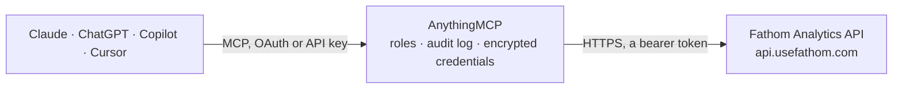

<!-- Generated by scripts/export-github-catalog.mjs in the anythingmcp-website repository. Do not edit by hand. -->

# Fathom Analytics MCP connector

Read Fathom Analytics (privacy-friendly web analytics) from any AI agent: aggregations, pageviews, events, sites, custom domains. 6 tools, Bearer auth. The AnythingMCP connector gives Claude, ChatGPT, Microsoft Copilot, Cursor and Gemini 6 MCP tools for Fathom Analytics: 5 read and 1 can change data.

**Category:** [Analytics](../analytics.md) · **Tools:** 6 · **Setup guide:** [anythingmcp.com](https://anythingmcp.com/guides/fathom-to-mcp) · [Deutsch](https://anythingmcp.com/de/guides/fathom-to-mcp) · [Italiano](https://anythingmcp.com/it/guides/fathom-to-mcp) · [Español](https://anythingmcp.com/es/guides/fathom-to-mcp) · [日本語](https://anythingmcp.com/ja/guides/fathom-to-mcp) · [Русский](https://anythingmcp.com/ru/guides/fathom-to-mcp) · [中文](https://anythingmcp.com/zh/guides/fathom-to-mcp)

## Start without code

No installation and no terminal: AnythingMCP Cloud runs the Fathom Analytics connector for you, operated by helpcode.ai in Frankfurt, Germany.

1. **Click the button above** and create an account or sign in. The Fathom Analytics connector opens, ready to install.
2. **Paste the API key or token from your Fathom Analytics account.** Every click is in the [step-by-step guide](https://anythingmcp.com/guides/fathom-to-mcp).
3. **Click Install.** AnythingMCP shows the address of your MCP server.
4. **Add that address to your assistant:** [Claude](https://anythingmcp.com/guides/connect-fathom-to-claude) · [ChatGPT](https://anythingmcp.com/guides/connect-fathom-to-chatgpt) · [Microsoft Copilot](https://anythingmcp.com/guides/connect-fathom-to-copilot) · [Cursor](https://anythingmcp.com/guides/connect-fathom-to-cursor) · [Gemini CLI](https://anythingmcp.com/guides/connect-fathom-to-gemini) · [Meta Muse](https://anythingmcp.com/guides/connect-fathom-to-muse).
5. **Ask your first question**, for example: *What's the Fathom site id and sharing setting for our 'StellarTech GmbH' site?*

Prefer help with the setup? [Talk to us](https://anythingmcp.com/contact).

## How it works

- **The AI client** speaks MCP (Streamable HTTP) to AnythingMCP and only sees tool names, descriptions and results. It never gets the Fathom Analytics credentials.
- **AnythingMCP** checks the client's role, builds the call from the tool definition, adds the credentials (a bearer token), calls Fathom Analytics, logs the call and returns the result.
- **Fathom Analytics** sees an ordinary API client with the rights of the account the credentials belong to.

## Tools

| Tool | What it does | Access |
|---|---|---|
| [`fathom_current_user`](#fathom_current_user) | Return account info: id, name, email. | read |
| [`fathom_list_sites`](#fathom_list_sites) | List Fathom sites tracked. | read |
| [`fathom_list_events`](#fathom_list_events) | List events (conversion goals) for a site. | read |
| [`fathom_aggregations`](#fathom_aggregations) | Run an aggregation query — Fathom's main analytics endpoint. | read |
| [`fathom_current_visitors`](#fathom_current_visitors) | Get the current number of visitors on a site (real-time). | read |
| [`fathom_create_event`](#fathom_create_event) | Create a new event (conversion goal) for a site. | write |

## Tool reference

Every parameter as the AI client sees it in `tools/list`. Source: [`packages/backend/src/adapters/intl/fathom.json`](../../../packages/backend/src/adapters/intl/fathom.json).

### `fathom_current_user`

Return account info: id, name, email.

**Access:** read · **Call:** `GET /account`

No parameters.

### `fathom_list_sites`

List Fathom sites tracked. Each has id, name, sharing setting, created_at.

**Access:** read · **Call:** `GET /sites`

| Parameter | Type | Required | Description |
|---|---|---|---|
| `limit` | integer | no | Per page (max 100). |
| `starting_after` | string | no | Cursor — next page. |
| `ending_before` | string | no | Cursor — prev page. |

### `fathom_list_events`

List events (conversion goals) for a site. Each has id, object, name, currency, target_conversion_value, etc.

**Access:** read · **Call:** `GET /sites/{site_id}/events`

| Parameter | Type | Required | Description |
|---|---|---|---|
| `site_id` | string | yes | Site ID. |
| `limit` | integer | no | Per page. |
| `starting_after` | string | no | Cursor. |

### `fathom_aggregations`

Run an aggregation query — Fathom's main analytics endpoint. See instructions for common query patterns.

**Access:** read · **Call:** `GET /aggregations`

| Parameter | Type | Required | Description |
|---|---|---|---|
| `entity` | string | yes | pageview, event. |
| `entity_id` | string | yes | Site ID (for pageview) OR event ID. |
| `aggregates` | string | yes | Comma-separated: pageviews, visits, uniques, avg_duration, bounce_rate, conversions, value, etc. |
| `date_grouping` | string | no | hour, day, month, year. |
| `field_grouping` | string | no | Group by field: pathname, referrer_hostname, country, browser, device_type, hostname, utm_source, utm_medium, utm_campaign, utm_term, utm_content. |
| `filters` | string | no | JSON-stringified filter array: [{property:'pathname', operator:'is', value:'/blog'}]. |
| `sort_by` | string | no | Field:asc\|desc, e.g. 'pageviews:desc'. |
| `limit` | integer | no | Max rows. |
| `date_from` | string | no | ISO 8601 date. |
| `date_to` | string | no | ISO 8601 date. |
| `timezone` | string | no | TZ database name. |

### `fathom_current_visitors`

Get the current number of visitors on a site (real-time).

**Access:** read · **Call:** `GET /current_visitors`

| Parameter | Type | Required | Description |
|---|---|---|---|
| `site_id` | string | yes | Site ID. |
| `detailed` | boolean | no | If true, also return arrays of currently-viewed pathnames + countries. |

### `fathom_create_event`

Create a new event (conversion goal) for a site.

**Access:** write · **Call:** `POST /sites/{site_id}/events`

| Parameter | Type | Required | Description |
|---|---|---|---|
| `site_id` | string | yes | Site ID. |
| `name` | string | yes | Event name. |
| `currency` | string | no | ISO 4217 currency for event value tracking. |

## Run it yourself

AnythingMCP is open source (AGPL-3.0). [Run it with Docker](../../../README.md#run-it-yourself), open **Connectors → Store**, pick **Fathom Analytics** and enter `FATHOM_API_TOKEN`, then add your MCP server URL to the AI client.

[← Analytics connectors](../analytics.md) · [All categories](../README.md)
