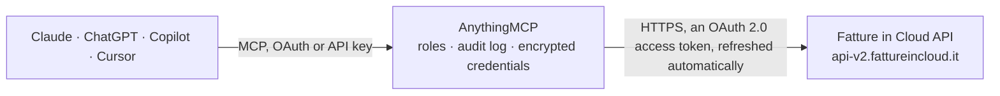

<!-- Generated by scripts/export-github-catalog.mjs in the anythingmcp-website repository. Do not edit by hand. -->

# Fatture in Cloud MCP connector

Fatture in Cloud, the invoicing app of 580,000 Italian partite IVA: issued and received documents, clients, suppliers, products, receipts the VAT-relevant e-invoice status and the FatturaPA XML. The AnythingMCP connector gives Claude, ChatGPT, Microsoft Copilot, Cursor and Gemini 12 MCP tools for Fatture in Cloud, all read-only.

**Category:** [Accounting](../accounting.md) · **Tools:** 12 · **Setup guide:** [anythingmcp.com](https://anythingmcp.com/guides/fatture-in-cloud-to-mcp) · [Deutsch](https://anythingmcp.com/de/guides/fatture-in-cloud-to-mcp) · [Italiano](https://anythingmcp.com/it/guides/fatture-in-cloud-to-mcp) · [Español](https://anythingmcp.com/es/guides/fatture-in-cloud-to-mcp) · [日本語](https://anythingmcp.com/ja/guides/fatture-in-cloud-to-mcp) · [Русский](https://anythingmcp.com/ru/guides/fatture-in-cloud-to-mcp) · [中文](https://anythingmcp.com/zh/guides/fatture-in-cloud-to-mcp)

## Start without code

No installation and no terminal: AnythingMCP Cloud runs the Fatture in Cloud connector for you, operated by helpcode.ai in Frankfurt, Germany.

1. **Click the button above** and create an account or sign in. The Fatture in Cloud connector opens, ready to install.
2. **Sign in with your Fatture in Cloud account** when AnythingMCP asks. The first time, an admin creates a small app in the Fatture in Cloud developer console. Every click is in the [step-by-step guide](https://anythingmcp.com/guides/fatture-in-cloud-to-mcp).
3. **Click Install.** AnythingMCP shows the address of your MCP server.
4. **Add that address to your assistant:** [Claude](https://anythingmcp.com/guides/connect-fatture-in-cloud-to-claude) · [ChatGPT](https://anythingmcp.com/guides/connect-fatture-in-cloud-to-chatgpt) · [Microsoft Copilot](https://anythingmcp.com/guides/connect-fatture-in-cloud-to-copilot) · [Cursor](https://anythingmcp.com/guides/connect-fatture-in-cloud-to-cursor) · [Gemini CLI](https://anythingmcp.com/guides/connect-fatture-in-cloud-to-gemini) · [Meta Muse](https://anythingmcp.com/guides/connect-fatture-in-cloud-to-muse).
5. **Ask your first question**, for example: *Find client record for Rossi Alimentari S.r.l. and give VAT number and codice destinatario.*

Prefer help with the setup? [Talk to us](https://anythingmcp.com/contact).

## How it works

- **The AI client** speaks MCP (Streamable HTTP) to AnythingMCP and only sees tool names, descriptions and results. It never gets the Fatture in Cloud credentials.
- **AnythingMCP** checks the client's role, builds the call from the tool definition, adds the credentials (an OAuth 2.0 access token, refreshed automatically), calls Fatture in Cloud, logs the call and returns the result.
- **Fatture in Cloud** sees an ordinary API client with the rights of the account the credentials belong to.

## Tools

| Tool | What it does | Access |
|---|---|---|
| [`fatture_in_cloud_list_companies`](#fatture_in_cloud_list_companies) | List the companies (aziende) this account can reach, with their id, name and VAT number. | read |
| [`fatture_in_cloud_list_issued_documents`](#fatture_in_cloud_list_issued_documents) | List documents you issued (invoices, quotes, credit notes, proformas) with their number, date, client, total and payment status. | read |
| [`fatture_in_cloud_get_issued_document`](#fatture_in_cloud_get_issued_document) | Read one issued document in full: every line item with VAT rate, the payment schedule, the client's details and the e-invoice status in the Sistema di… | read |
| [`fatture_in_cloud_list_received_documents`](#fatture_in_cloud_list_received_documents) | List supplier documents you have recorded (purchase invoices, credit notes and expenses) with their supplier, date, total and deductibility. | read |
| [`fatture_in_cloud_list_clients`](#fatture_in_cloud_list_clients) | List clients with their name, VAT number, codice fiscale, address and the e-invoice routing code (codice destinatario or PEC). | read |
| [`fatture_in_cloud_list_suppliers`](#fatture_in_cloud_list_suppliers) | List suppliers with their name, VAT number, codice fiscale and address, for the purchasing side of the ledger. | read |
| [`fatture_in_cloud_list_products`](#fatture_in_cloud_list_products) | List products and services from the catalogue with their code, description, net price, VAT rate and stock level. | read |
| [`fatture_in_cloud_list_receipts`](#fatture_in_cloud_list_receipts) | List receipts (corrispettivi) with their date, amount and payment method: the till-side record, separate from invoices. | read |
| [`fatture_in_cloud_list_f24`](#fatture_in_cloud_list_f24) | List the F24 tax payments recorded in the Tasse section (VAT, withholding, contributions): description, amount, due date, paid or not paid, and the payment… | read |
| [`fatture_in_cloud_get_company_info`](#fatture_in_cloud_get_company_info) | Read the configured company's own details: name, VAT number, tax regime, address and plan. | read |
| [`fatture_in_cloud_get_e_invoice_xml`](#fatture_in_cloud_get_e_invoice_xml) | Download the FatturaPA XML of an issued electronic invoice (or credit note), exactly as sent to the Sistema di Interscambio: the authoritative source for… | read |
| [`fatture_in_cloud_get_received_document`](#fatture_in_cloud_get_received_document) | Read one received document (supplier invoice, passive credit note) in full: supplier, category, invoice number, amounts with VAT, line items and the payment… | read |

## Tool reference

Every parameter as the AI client sees it in `tools/list`. Source: [`packages/backend/src/adapters/it/fatture-in-cloud.json`](../../../packages/backend/src/adapters/it/fatture-in-cloud.json).

### `fatture_in_cloud_list_companies`

List the companies (aziende) this account can reach, with their id, name and VAT number. The one call that works without a company id; use it to find the right FIC_COMPANY_ID.

**Access:** read · **Call:** `GET /user/companies`

No parameters.

### `fatture_in_cloud_list_issued_documents`

List documents you issued (invoices, quotes, credit notes, proformas) with their number, date, client, total and payment status.

**Access:** read · **Call:** `GET /c/{FIC_COMPANY_ID}/issued_documents`

| Parameter | Type | Required | Description |
|---|---|---|---|
| `type` | `invoice` \| `quote` \| `proforma` \| `receipt` \| `delivery_note` \| `credit_note` \| `order` \| `work_report` \| `supplier_order` \| `self_own_invoice` \| `self_supplier_invoice` | yes | Document type: invoice, quote, proforma, receipt, delivery_note, credit_note, order, work_report, supplier_order, self_own_invoice, self_supplier_invoice. |
| `fieldset` | string | no | `basic` (default) or `detailed` to include line items and the payment schedule. |
| `filter` | string | no | Filter expression (sent as the `q` query), e.g. date >= '2026-01-01'. Strings in single quotes; combine with and/or. |
| `sort` | string | no | Sort field, prefix with `-` for descending, e.g. -date. |
| `page` | number | no | Page number, starting at 1. |
| `per_page` | number | no | Rows per page, 1–100 (default 5). |

### `fatture_in_cloud_get_issued_document`

Read one issued document in full: every line item with VAT rate, the payment schedule, the client's details and the e-invoice status in the Sistema di Interscambio.

**Access:** read · **Call:** `GET /c/{FIC_COMPANY_ID}/issued_documents/{documentId}`

| Parameter | Type | Required | Description |
|---|---|---|---|
| `documentId` | number | yes | Numeric document id. |

### `fatture_in_cloud_list_received_documents`

List supplier documents you have recorded (purchase invoices, credit notes and expenses) with their supplier, date, total and deductibility.

**Access:** read · **Call:** `GET /c/{FIC_COMPANY_ID}/received_documents`

| Parameter | Type | Required | Description |
|---|---|---|---|
| `type` | `expense` \| `passive_credit_note` \| `passive_delivery_note` \| `self_invoice` | yes | Document type: expense, passive_credit_note, passive_delivery_note or self_invoice. Required by the API. |
| `fieldset` | string | no | `basic` (default) or `detailed`. |
| `filter` | string | no | Filter expression (sent as the `q` query), e.g. date >= '2026-01-01'. |
| `sort` | string | no | Sort field, prefix with `-` for descending. |
| `page` | number | no | Page number, starting at 1. |
| `per_page` | number | no | Rows per page, 1–100 (default 5). |

### `fatture_in_cloud_list_clients`

List clients with their name, VAT number, codice fiscale, address and the e-invoice routing code (codice destinatario or PEC).

**Access:** read · **Call:** `GET /c/{FIC_COMPANY_ID}/entities/clients`

| Parameter | Type | Required | Description |
|---|---|---|---|
| `filter` | string | no | Filter expression (sent as the `q` query), e.g. name = 'Rossi' or vat_number = 'IT01234567890'. |
| `sort` | string | no | Sort field, prefix with `-` for descending. |
| `page` | number | no | Page number, starting at 1. |
| `per_page` | number | no | Rows per page, 1–100 (default 5). |

### `fatture_in_cloud_list_suppliers`

List suppliers with their name, VAT number, codice fiscale and address, for the purchasing side of the ledger.

**Access:** read · **Call:** `GET /c/{FIC_COMPANY_ID}/entities/suppliers`

| Parameter | Type | Required | Description |
|---|---|---|---|
| `filter` | string | no | Filter expression (sent as the `q` query), e.g. name = 'Bianchi'. |
| `page` | number | no | Page number, starting at 1. |
| `per_page` | number | no | Rows per page, 1–100 (default 5). |

### `fatture_in_cloud_list_products`

List products and services from the catalogue with their code, description, net price, VAT rate and stock level.

**Access:** read · **Call:** `GET /c/{FIC_COMPANY_ID}/products`

| Parameter | Type | Required | Description |
|---|---|---|---|
| `filter` | string | no | Filter expression (sent as the `q` query), e.g. code = 'ART001'. |
| `page` | number | no | Page number, starting at 1. |
| `per_page` | number | no | Rows per page, 1–100 (default 5). |

### `fatture_in_cloud_list_receipts`

List receipts (corrispettivi) with their date, amount and payment method: the till-side record, separate from invoices.

**Access:** read · **Call:** `GET /c/{FIC_COMPANY_ID}/receipts`

| Parameter | Type | Required | Description |
|---|---|---|---|
| `filter` | string | no | Filter expression (sent as the `q` query), e.g. date >= '2026-09-01'. |
| `page` | number | no | Page number, starting at 1. |
| `per_page` | number | no | Rows per page, 1–100 (default 5). |

### `fatture_in_cloud_list_f24`

List the F24 tax payments recorded in the Tasse section (VAT, withholding, contributions): description, amount, due date, paid or not paid, and the payment account. Needs the taxes:r scope.

**Access:** read · **Call:** `GET /c/{FIC_COMPANY_ID}/taxes`

| Parameter | Type | Required | Description |
|---|---|---|---|
| `filter` | string | no | Filter expression (sent as the `q` query), e.g. due_date >= '2026-01-01' or status = 'not_paid'. |
| `sort` | string | no | Field to sort by; prefix with - for descending, e.g. -due_date. |
| `page` | number | no | Page number, starting at 1. |
| `per_page` | number | no | Rows per page, 1–100 (default 5). |

### `fatture_in_cloud_get_company_info`

Read the configured company's own details: name, VAT number, tax regime, address and plan. Confirms FIC_COMPANY_ID points where you think it does.

**Access:** read · **Call:** `GET /c/{FIC_COMPANY_ID}/company/info`

No parameters.

### `fatture_in_cloud_get_e_invoice_xml`

Download the FatturaPA XML of an issued electronic invoice (or credit note), exactly as sent to the Sistema di Interscambio: the authoritative source for VAT breakdown, payment terms and the codes the SdI checked. Returned as XML text, which can be large (hundreds of KB when the document embeds a PDF). Only for documents with e_invoice true.

**Access:** read · **Call:** `GET /c/{FIC_COMPANY_ID}/issued_documents/{documentId}/e_invoice/xml`

| Parameter | Type | Required | Description |
|---|---|---|---|
| `documentId` | number | yes | Numeric id of the issued document. |
| `include_attachment` | boolean | no | Embed the attached files in the XML. Default false. |

### `fatture_in_cloud_get_received_document`

Read one received document (supplier invoice, passive credit note) in full: supplier, category, invoice number, amounts with VAT, line items and the payment schedule.

**Access:** read · **Call:** `GET /c/{FIC_COMPANY_ID}/received_documents/{documentId}`

| Parameter | Type | Required | Description |
|---|---|---|---|
| `documentId` | number | yes | Numeric id of the received document, from fatture_in_cloud_list_received_documents. |

## Run it yourself

AnythingMCP is open source (AGPL-3.0). [Run it with Docker](../../../README.md#run-it-yourself), open **Connectors → Store**, pick **Fatture in Cloud** and enter `FIC_CLIENT_ID`, `FIC_CLIENT_SECRET`, `FIC_COMPANY_ID`, then add your MCP server URL to the AI client.

[← Accounting connectors](../accounting.md) · [All categories](../README.md)
