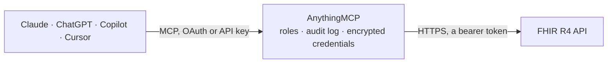

<!-- Generated by scripts/export-github-catalog.mjs in the anythingmcp-website repository. Do not edit by hand. -->

# FHIR R4 MCP connector

Any HL7 FHIR R4 server: search and read Patients, Observations, Conditions, Encounters, MedicationRequests, DiagnosticReports and any other resource type, plus the server's own capability statement. The AnythingMCP connector gives Claude, ChatGPT, Microsoft Copilot, Cursor and Gemini 11 MCP tools for FHIR R4, all read-only.

**Category:** [Healthcare](../healthcare.md) · **Tools:** 11 · **Setup guide:** [anythingmcp.com](https://anythingmcp.com/guides/fhir-to-mcp) · [Deutsch](https://anythingmcp.com/de/guides/fhir-to-mcp) · [Italiano](https://anythingmcp.com/it/guides/fhir-to-mcp) · [Español](https://anythingmcp.com/es/guides/fhir-to-mcp) · [日本語](https://anythingmcp.com/ja/guides/fhir-to-mcp) · [Русский](https://anythingmcp.com/ru/guides/fhir-to-mcp) · [中文](https://anythingmcp.com/zh/guides/fhir-to-mcp)

## Start without code

No installation and no terminal: AnythingMCP Cloud runs the FHIR R4 connector for you, operated by helpcode.ai in Frankfurt, Germany.

1. **Click the button above** and create an account or sign in. The FHIR R4 connector opens, ready to install.
2. **Paste the API key or token from your FHIR R4 account.** Every click is in the [step-by-step guide](https://anythingmcp.com/guides/fhir-to-mcp).
3. **Click Install.** AnythingMCP shows the address of your MCP server.
4. **Add that address to your assistant:** [Claude](https://anythingmcp.com/guides/connect-fhir-to-claude) · [ChatGPT](https://anythingmcp.com/guides/connect-fhir-to-chatgpt) · [Microsoft Copilot](https://anythingmcp.com/guides/connect-fhir-to-copilot) · [Cursor](https://anythingmcp.com/guides/connect-fhir-to-cursor) · [Gemini CLI](https://anythingmcp.com/guides/connect-fhir-to-gemini) · [Meta Muse](https://anythingmcp.com/guides/connect-fhir-to-muse).
5. **Ask your first question**, for example: *Retrieve Patient record for Lena Müller MRN MRN-2026-1134, DOB 1989-07-22 — I need identifiers and active status*

Prefer help with the setup? [Talk to us](https://anythingmcp.com/contact).

## How it works

- **The AI client** speaks MCP (Streamable HTTP) to AnythingMCP and only sees tool names, descriptions and results. It never gets the FHIR R4 credentials.
- **AnythingMCP** checks the client's role, builds the call from the tool definition, adds the credentials (a bearer token), calls FHIR R4, logs the call and returns the result.
- **FHIR R4** sees an ordinary API client with the rights of the account the credentials belong to.

## Tools

| Tool | What it does | Access |
|---|---|---|
| [`fhir_get_capability_statement`](#fhir_get_capability_statement) | Read the server's CapabilityStatement: which resource types it holds, which interactions and search parameters each supports, and its FHIR version. | read |
| [`fhir_search`](#fhir_search) | Search any resource type with FHIR's standard parameters. | read |
| [`fhir_next_page`](#fhir_next_page) | Fetch the next page of a search result. | read |
| [`fhir_read_resource`](#fhir_read_resource) | Read one resource instance by type and id, returning the full resource rather than a Bundle entry. | read |
| [`fhir_search_patients`](#fhir_search_patients) | Search Patients by name, identifier, birth date or family name. | read |
| [`fhir_get_patient_observations`](#fhir_get_patient_observations) | Read the Observations recorded for one patient — vital signs, laboratory results, measurements — optionally narrowed to one LOINC code or category. | read |
| [`fhir_get_patient_conditions`](#fhir_get_patient_conditions) | Read the Conditions recorded for one patient — the problem list — with their clinical and verification status. | read |
| [`fhir_get_patient_encounters`](#fhir_get_patient_encounters) | Read the Encounters for one patient — admissions, visits and consultations — with their class, period and the practitioners involved. | read |
| [`fhir_get_patient_medications`](#fhir_get_patient_medications) | Read the MedicationRequests for one patient — what has been prescribed, in what dosage, by whom and with what status. | read |
| [`fhir_get_patient_reports`](#fhir_get_patient_reports) | Read the DiagnosticReports for one patient — laboratory panels, imaging reports and pathology — with their category, status and conclusions. | read |
| [`fhir_get_patient_everything`](#fhir_get_patient_everything) | Run the $everything operation on one patient: every resource the server associates with them, in one Bundle. | read |

## Tool reference

Every parameter as the AI client sees it in `tools/list`. Source: [`packages/backend/src/adapters/intl/fhir.json`](../../../packages/backend/src/adapters/intl/fhir.json).

### `fhir_get_capability_statement`

Read the server's CapabilityStatement: which resource types it holds, which interactions and search parameters each supports, and its FHIR version. Start here — servers differ enormously.

**Access:** read · **Call:** `GET /metadata`

No parameters.

### `fhir_search`

Search any resource type with FHIR's standard parameters. The general-purpose tool — the capability statement tells you which parameters this particular server supports.

**Access:** read · **Call:** `GET /{resourceType}`

| Parameter | Type | Required | Description |
|---|---|---|---|
| `resourceType` | string | yes | FHIR resource type, e.g. Patient, Observation, Condition, Encounter, MedicationRequest. |
| `query` | string | no | Search parameters as a query-string fragment, e.g. `name:contains=smith&birthdate=ge1980-01-01`. |
| `count` | number | no | Requested page size (_count). Servers may ignore it. |
| `sort` | string | no | Sort parameter (_sort), e.g. -date for newest first. |
| `include` | string | no | Related resources to pull into the Bundle (_include), e.g. Observation:patient. |

### `fhir_next_page`

Fetch the next page of a search result. Take the Bundle's `link` entry with `relation: "next"` and pass the part of its URL after `?`. Use this when that URL points at the server base with no resource type (HAPI's `…/baseR4?_getpages=…&_getpagesoffset=…`). When the next URL is on a resource path (`…/Observation?…`), call fhir_search with that resourceType and the same query instead.

**Access:** read · **Call:** `GET /`

| Parameter | Type | Required | Description |
|---|---|---|---|
| `query` | string | yes | Query string of the next link without the leading `?`, copied unchanged, e.g. `_getpages=43a7…&_getpagesoffset=20&_count=20&_bundletype=searchset`. |

### `fhir_read_resource`

Read one resource instance by type and id, returning the full resource rather than a Bundle entry.

**Access:** read · **Call:** `GET /{resourceType}/{id}`

| Parameter | Type | Required | Description |
|---|---|---|---|
| `resourceType` | string | yes | FHIR resource type, e.g. Patient. |
| `id` | string | yes | Resource logical id, as it appeared in a Bundle entry. |

### `fhir_search_patients`

Search Patients by name, identifier, birth date or family name. Modifiers matter: `name:contains` for a partial match, `ge`/`le` prefixes on dates.

**Access:** read · **Call:** `GET /Patient`

| Parameter | Type | Required | Description |
|---|---|---|---|
| `name` | string | no | Name search across given and family names. |
| `family` | string | no | Family name only. |
| `identifier` | string | no | Patient identifier, optionally `system\|value`. |
| `birthdate` | string | no | Birth date with an optional prefix, e.g. 1980-01-01 or ge1980-01-01. |
| `count` | number | no | Requested page size (_count). |

### `fhir_get_patient_observations`

Read the Observations recorded for one patient — vital signs, laboratory results, measurements — optionally narrowed to one LOINC code or category.

**Access:** read · **Call:** `GET /Observation`

| Parameter | Type | Required | Description |
|---|---|---|---|
| `patientId` | string | yes | Patient logical id. |
| `code` | string | no | Observation code as `system\|code`, e.g. http://loinc.org\|85354-9. |
| `category` | string | no | Observation category, e.g. vital-signs, laboratory, imaging. |
| `date` | string | no | Effective date with an optional prefix, e.g. ge2026-01-01. |
| `count` | number | no | Requested page size (_count). |
| `sort` | string | no | Sort parameter (_sort), e.g. -date. |

### `fhir_get_patient_conditions`

Read the Conditions recorded for one patient — the problem list — with their clinical and verification status.

**Access:** read · **Call:** `GET /Condition`

| Parameter | Type | Required | Description |
|---|---|---|---|
| `patientId` | string | yes | Patient logical id. |
| `clinical_status` | string | no | Clinical status, e.g. active, recurrence, resolved. |
| `count` | number | no | Requested page size (_count). |

### `fhir_get_patient_encounters`

Read the Encounters for one patient — admissions, visits and consultations — with their class, period and the practitioners involved.

**Access:** read · **Call:** `GET /Encounter`

| Parameter | Type | Required | Description |
|---|---|---|---|
| `patientId` | string | yes | Patient logical id. |
| `status` | string | no | Encounter status, e.g. finished, in-progress, planned. |
| `date` | string | no | Encounter period with an optional prefix, e.g. ge2026-01-01. |
| `count` | number | no | Requested page size (_count). |
| `sort` | string | no | Sort parameter (_sort), e.g. -date. |

### `fhir_get_patient_medications`

Read the MedicationRequests for one patient — what has been prescribed, in what dosage, by whom and with what status.

**Access:** read · **Call:** `GET /MedicationRequest`

| Parameter | Type | Required | Description |
|---|---|---|---|
| `patientId` | string | yes | Patient logical id. |
| `status` | string | no | Request status, e.g. active, completed, stopped, on-hold. |
| `count` | number | no | Requested page size (_count). |

### `fhir_get_patient_reports`

Read the DiagnosticReports for one patient — laboratory panels, imaging reports and pathology — with their category, status and conclusions.

**Access:** read · **Call:** `GET /DiagnosticReport`

| Parameter | Type | Required | Description |
|---|---|---|---|
| `patientId` | string | yes | Patient logical id. |
| `category` | string | no | Report category, e.g. LAB, RAD. |
| `date` | string | no | Report date with an optional prefix, e.g. ge2026-01-01. |
| `count` | number | no | Requested page size (_count). |

### `fhir_get_patient_everything`

Run the $everything operation on one patient: every resource the server associates with them, in one Bundle. Powerful, large, and not supported by every server.

**Access:** read · **Call:** `GET /Patient/{patientId}/$everything`

| Parameter | Type | Required | Description |
|---|---|---|---|
| `patientId` | string | yes | Patient logical id. |
| `since` | string | no | Only resources changed after this instant (_since), ISO 8601. |
| `count` | number | no | Requested page size (_count). |

## Run it yourself

AnythingMCP is open source (AGPL-3.0). [Run it with Docker](../../../README.md#run-it-yourself), open **Connectors → Store**, pick **FHIR R4** and enter `FHIR_BASE_URL`, `FHIR_ACCESS_TOKEN`, then add your MCP server URL to the AI client.

[← Healthcare connectors](../healthcare.md) · [All categories](../README.md)
