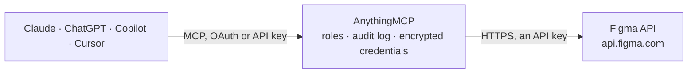

<!-- Generated by scripts/export-github-catalog.mjs in the anythingmcp-website repository. Do not edit by hand. -->

# Figma MCP connector

Let your AI read your Figma designs: browse team folders and files, inspect pages, frames and layers, export images, look up components and styles, follow version history, read and post comments, and … The AnythingMCP connector gives Claude, ChatGPT, Microsoft Copilot, Cursor and Gemini 28 MCP tools for Figma: 22 read and 6 can change data.

**Category:** [Productivity](../productivity.md) · **Tools:** 28 · **Setup guide:** [anythingmcp.com](https://anythingmcp.com/guides/figma-to-mcp) · [Deutsch](https://anythingmcp.com/de/guides/figma-to-mcp) · [Italiano](https://anythingmcp.com/it/guides/figma-to-mcp) · [Español](https://anythingmcp.com/es/guides/figma-to-mcp) · [日本語](https://anythingmcp.com/ja/guides/figma-to-mcp) · [Русский](https://anythingmcp.com/ru/guides/figma-to-mcp) · [中文](https://anythingmcp.com/zh/guides/figma-to-mcp)

## Start without code

No installation and no terminal: AnythingMCP Cloud runs the Figma connector for you, operated by helpcode.ai in Frankfurt, Germany.

1. **Click the button above** and create an account or sign in. The Figma connector opens, ready to install.
2. **Paste the API key or token from your Figma account.** Every click is in the [step-by-step guide](https://anythingmcp.com/guides/figma-to-mcp).
3. **Click Install.** AnythingMCP shows the address of your MCP server.
4. **Add that address to your assistant:** [Claude](https://anythingmcp.com/guides/connect-figma-to-claude) · [ChatGPT](https://anythingmcp.com/guides/connect-figma-to-chatgpt) · [Microsoft Copilot](https://anythingmcp.com/guides/connect-figma-to-copilot) · [Cursor](https://anythingmcp.com/guides/connect-figma-to-cursor) · [Gemini CLI](https://anythingmcp.com/guides/connect-figma-to-gemini) · [Meta Muse](https://anythingmcp.com/guides/connect-figma-to-muse).
5. **Ask your first question**, for example: *Show files in folder 1122334455 that might contain invoice INV-2026-042*

Prefer help with the setup? [Talk to us](https://anythingmcp.com/contact).

## How it works

- **The AI client** speaks MCP (Streamable HTTP) to AnythingMCP and only sees tool names, descriptions and results. It never gets the Figma credentials.
- **AnythingMCP** checks the client's role, builds the call from the tool definition, adds the credentials (an API key), calls Figma, logs the call and returns the result.
- **Figma** sees an ordinary API client with the rights of the account the credentials belong to.

## Tools

| Tool | What it does | Access |
|---|---|---|
| [`figma_get_me`](#figma_get_me) | Get the Figma user the token belongs to: id, handle, email and avatar URL. | read |
| [`figma_get_file_meta`](#figma_get_file_meta) | Get a file's metadata without its content: name, folder name, editor type (figma, figjam, slides ...), creator, last_touched_at and by whom, thumbnail,… | read |
| [`figma_get_file`](#figma_get_file) | Read a file's document tree: pages, frames and layers with their ids, names, types, sizes, fills, text and layout, plus the components and styles it uses. | read |
| [`figma_get_file_nodes`](#figma_get_file_nodes) | Read specific nodes (frames, components, layers) of a file with everything below them: type, name, absolute bounding box, fills, strokes, effects, text and… | read |
| [`figma_render_images`](#figma_render_images) | Render nodes of a file as PNG, JPG, SVG or PDF and get a download URL per node id (null when a node could not be rendered). | read |
| [`figma_get_image_fills`](#figma_get_image_fills) | Get download URLs for every image used as a fill in a file, keyed by imageRef (the imageRef in a node's fills). | read |
| [`figma_list_versions`](#figma_list_versions) | List a file's version history, newest first: id, label and description of named versions, created_at, the user and thumbnail. | read |
| [`figma_list_comments`](#figma_list_comments) | List all comments on a file: id, message, user, created_at, resolved_at, parent_id (for replies), client_meta (where it is pinned: node_id and offset, or… | read |
| [`figma_post_comment`](#figma_post_comment) | Post a comment on a file as the token's user, optionally pinned to a node or a point, or as a reply to a top-level comment (comment_id). | write |
| [`figma_delete_comment`](#figma_delete_comment) | Delete a comment. | write |
| [`figma_list_comment_reactions`](#figma_list_comment_reactions) | List the emoji reactions on a comment: emoji, user and created_at. | read |
| [`figma_add_comment_reaction`](#figma_add_comment_reaction) | React to a comment with an emoji shortcode, as the token's user; it shows next to the comment. | write |
| [`figma_list_team_folders`](#figma_list_team_folders) | List the top-level folders (formerly called projects) of a team that the token's user can see: id, name, parent_folder_id (null at the top),… | read |
| [`figma_list_subfolders`](#figma_list_subfolders) | List the folders directly inside a folder (folders can be nested): id, name, parent_folder_id and created_at, plus the parent folder's name. | read |
| [`figma_list_folder_files`](#figma_list_folder_files) | List the files directly in a folder (not in its subfolders): key, name, thumbnail_url and last_modified, plus the folder's name. | read |
| [`figma_list_team_components`](#figma_list_team_components) | List the published components of a team library: key, name, description, the file and node they live in, thumbnail and who last updated them. | read |
| [`figma_list_team_component_sets`](#figma_list_team_component_sets) | List the published component sets (components with variants) of a team library: key, name, description, the file and node they live in, thumbnail and who… | read |
| [`figma_list_team_styles`](#figma_list_team_styles) | List the published styles (colors, text, effects, grids) of a team library: key, name, description, the file and node they live in, thumbnail and who last… | read |
| [`figma_list_file_components`](#figma_list_file_components) | List the published components of a library file: key, name, description, node_id and thumbnail. | read |
| [`figma_list_file_component_sets`](#figma_list_file_component_sets) | List the published component sets of a library file: key, name, description, node_id and thumbnail. | read |
| [`figma_list_file_styles`](#figma_list_file_styles) | List the published styles of a library file: key, name, description, node_id and thumbnail. | read |
| [`figma_get_component`](#figma_get_component) | Get one published component by its key: name, description, the file and node it lives in, its containing frame and component set, thumbnail and timestamps. | read |
| [`figma_get_component_set`](#figma_get_component_set) | Get one published component set (a component with variants) by its key: name, description, file, node and thumbnail. | read |
| [`figma_get_style`](#figma_get_style) | Get one published style by its key: name, description, style_type (FILL, TEXT, EFFECT, GRID), the file and node it lives in and thumbnail. | read |
| [`figma_list_dev_resources`](#figma_list_dev_resources) | List the dev resources of a file: links that developers attached to nodes in Dev Mode (tickets, docs, code), each with id, name, url and node_id. | read |
| [`figma_create_dev_resource`](#figma_create_dev_resource) | Attach a link (a ticket, a doc, a code file) to a node as a dev resource, visible to everyone in Dev Mode. | write |
| [`figma_update_dev_resource`](#figma_update_dev_resource) | Change the name or URL of a dev resource. | write |
| [`figma_delete_dev_resource`](#figma_delete_dev_resource) | Remove a dev resource link from a node, for everyone. | write |

## Tool reference

Every parameter as the AI client sees it in `tools/list`. Source: [`packages/backend/src/adapters/intl/figma.json`](../../../packages/backend/src/adapters/intl/figma.json).

### `figma_get_me`

Get the Figma user the token belongs to: id, handle, email and avatar URL. A cheap check that the token works.

**Access:** read · **Call:** `GET /v1/me`

No parameters.

### `figma_get_file_meta`

Get a file's metadata without its content: name, folder name, editor type (figma, figjam, slides ...), creator, last_touched_at and by whom, thumbnail, version, link access and the user's role. Cheap; use it before reading the file itself.

**Access:** read · **Call:** `GET /v1/files/{file_key}/meta`

| Parameter | Type | Required | Description |
|---|---|---|---|
| `file_key` | string | yes | File key: the part after /design/ (or /file/, /board/, /slides/) in the file's URL, e.g. aBcD1234EfGh for https://www.figma.com/design/aBcD1234EfGh/Website. |

### `figma_get_file`

Read a file's document tree: pages, frames and layers with their ids, names, types, sizes, fills, text and layout, plus the components and styles it uses. Keep depth low (1 = pages only, 2 = pages and top-level frames) and then read single frames with figma_get_file_nodes; whole files are huge and cut at 200 KB. Counts against Figma's strictest rate limit tier.

**Access:** read · **Call:** `GET /v1/files/{file_key}`

| Parameter | Type | Required | Description |
|---|---|---|---|
| `file_key` | string | yes | File key: the part after /design/ (or /file/, /board/, /slides/) in the file's URL, e.g. aBcD1234EfGh for https://www.figma.com/design/aBcD1234EfGh/Website. |
| `depth` | integer | no | How deep to walk the tree: 1 = pages, 2 = pages and their top-level frames (default 2). |
| `ids` | string | no | Only these node ids (comma-separated, e.g. 1:2,4:17) and their ancestors. |
| `version` | string | no | A version id from figma_list_versions, to read the file as it was then; the current version when left out. |
| `geometry` | `paths` | no | paths to include vector path data. |
| `plugin_data` | string | no | Comma-separated plugin ids, or shared, to include plugin data. |
| `branch_data` | boolean | no | Include the file's branches. |

### `figma_get_file_nodes`

Read specific nodes (frames, components, layers) of a file with everything below them: type, name, absolute bounding box, fills, strokes, effects, text and style, auto layout and constraints. The way to inspect one screen or component in detail. Cut at 200 KB; lower depth for big frames.

**Access:** read · **Call:** `GET /v1/files/{file_key}/nodes`

| Parameter | Type | Required | Description |
|---|---|---|---|
| `file_key` | string | yes | File key: the part after /design/ (or /file/, /board/, /slides/) in the file's URL, e.g. aBcD1234EfGh for https://www.figma.com/design/aBcD1234EfGh/Website. |
| `ids` | string | yes | Comma-separated node ids with a colon, e.g. 1:2,4:17. A node-id=1-2 in a URL is 1:2 here. |
| `depth` | integer | no | How many levels below each node to include; everything when left out. |
| `version` | string | no | A version id from figma_list_versions, to read the file as it was then; the current version when left out. |
| `geometry` | `paths` | no | paths to include vector path data. |
| `plugin_data` | string | no | Comma-separated plugin ids, or shared, to include plugin data. |

### `figma_render_images`

Render nodes of a file as PNG, JPG, SVG or PDF and get a download URL per node id (null when a node could not be rendered). The URLs stay valid for 30 days. Renders over 32 megapixels are scaled down.

**Access:** read · **Call:** `GET /v1/images/{file_key}`

| Parameter | Type | Required | Description |
|---|---|---|---|
| `file_key` | string | yes | File key: the part after /design/ (or /file/, /board/, /slides/) in the file's URL, e.g. aBcD1234EfGh for https://www.figma.com/design/aBcD1234EfGh/Website. |
| `ids` | string | yes | Comma-separated node ids with a colon, e.g. 1:2,4:17. A node-id=1-2 in a URL is 1:2 here. |
| `format` | `png` \| `jpg` \| `svg` \| `pdf` | no | png (default), jpg, svg or pdf. |
| `scale` | number | no | Scale factor from 0.01 to 4 (default 1). |
| `version` | string | no | A version id from figma_list_versions, to read the file as it was then; the current version when left out. |
| `svg_outline_text` | boolean | no | SVG only: draw text as outlines (default true); false keeps it as text elements. |
| `svg_include_id` | boolean | no | SVG only: add each layer's name as an id attribute. |
| `svg_include_node_id` | boolean | no | SVG only: add each layer's node id as a data-node-id attribute. |
| `svg_simplify_stroke` | boolean | no | SVG only: simplify inside and outside strokes (default true). |
| `contents_only` | boolean | no | Leave out overlapping content outside the node (default true). |
| `use_absolute_bounds` | boolean | no | Render the node's full bounds, ignoring cropping and empty space (default false). |

### `figma_get_image_fills`

Get download URLs for every image used as a fill in a file, keyed by imageRef (the imageRef in a node's fills). The URLs expire within 14 days.

**Access:** read · **Call:** `GET /v1/files/{file_key}/images`

| Parameter | Type | Required | Description |
|---|---|---|---|
| `file_key` | string | yes | File key: the part after /design/ (or /file/, /board/, /slides/) in the file's URL, e.g. aBcD1234EfGh for https://www.figma.com/design/aBcD1234EfGh/Website. |

### `figma_list_versions`

List a file's version history, newest first: id, label and description of named versions, created_at, the user and thumbnail. Pass an id as version to the file tools to read an older state.

**Access:** read · **Call:** `GET /v1/files/{file_key}/versions`

| Parameter | Type | Required | Description |
|---|---|---|---|
| `file_key` | string | yes | File key: the part after /design/ (or /file/, /board/, /slides/) in the file's URL, e.g. aBcD1234EfGh for https://www.figma.com/design/aBcD1234EfGh/Website. |
| `page_size` | integer | no | Versions per page, up to 50 (default 30). |
| `before` | integer | no | Only versions older than this version id (from pagination.next_page). |
| `after` | integer | no | Only versions newer than this version id. |

### `figma_list_comments`

List all comments on a file: id, message, user, created_at, resolved_at, parent_id (for replies), client_meta (where it is pinned: node_id and offset, or x/y) and reactions.

**Access:** read · **Call:** `GET /v1/files/{file_key}/comments`

| Parameter | Type | Required | Description |
|---|---|---|---|
| `file_key` | string | yes | File key: the part after /design/ (or /file/, /board/, /slides/) in the file's URL, e.g. aBcD1234EfGh for https://www.figma.com/design/aBcD1234EfGh/Website. |
| `as_md` | boolean | no | Return messages as Markdown. |

### `figma_post_comment`

Post a comment on a file as the token's user, optionally pinned to a node or a point, or as a reply to a top-level comment (comment_id). Everyone with access to the file sees it and may be notified. Show the user the text and wait for confirmation first.

**Access:** write · **Call:** `POST /v1/files/{file_key}/comments`

| Parameter | Type | Required | Description |
|---|---|---|---|
| `file_key` | string | yes | File key: the part after /design/ (or /file/, /board/, /slides/) in the file's URL, e.g. aBcD1234EfGh for https://www.figma.com/design/aBcD1234EfGh/Website. |
| `message` | string | yes | Comment text. |
| `comment_id` | string | no | Id of a top-level comment to reply to. Replies to replies are not possible. |
| `client_meta` | object | no | Where to pin the comment: {"node_id": "1:2", "node_offset": {"x": 10, "y": 20}} for a spot on a node, {"x": 100, "y": 200} for a canvas point, or add region_width and region_height for an area. Left out, it is a file-level comment. |

### `figma_delete_comment`

Delete a comment. Figma lets only the person who wrote it delete it, so this works on the token user's own comments.

**Access:** write · **Call:** `DELETE /v1/files/{file_key}/comments/{comment_id}`

| Parameter | Type | Required | Description |
|---|---|---|---|
| `file_key` | string | yes | File key: the part after /design/ (or /file/, /board/, /slides/) in the file's URL, e.g. aBcD1234EfGh for https://www.figma.com/design/aBcD1234EfGh/Website. |
| `comment_id` | string | yes | Comment id. |

### `figma_list_comment_reactions`

List the emoji reactions on a comment: emoji, user and created_at. Pages with cursor (pagination.next_page).

**Access:** read · **Call:** `GET /v1/files/{file_key}/comments/{comment_id}/reactions`

| Parameter | Type | Required | Description |
|---|---|---|---|
| `file_key` | string | yes | File key: the part after /design/ (or /file/, /board/, /slides/) in the file's URL, e.g. aBcD1234EfGh for https://www.figma.com/design/aBcD1234EfGh/Website. |
| `comment_id` | string | yes | Comment id. |
| `cursor` | string | no | Cursor from the previous page. |

### `figma_add_comment_reaction`

React to a comment with an emoji shortcode, as the token's user; it shows next to the comment.

**Access:** write · **Call:** `POST /v1/files/{file_key}/comments/{comment_id}/reactions`

| Parameter | Type | Required | Description |
|---|---|---|---|
| `file_key` | string | yes | File key: the part after /design/ (or /file/, /board/, /slides/) in the file's URL, e.g. aBcD1234EfGh for https://www.figma.com/design/aBcD1234EfGh/Website. |
| `comment_id` | string | yes | Comment id. |
| `emoji` | string | yes | Emoji shortcode, e.g. :+1:, :heart: or :eyes:. |

### `figma_list_team_folders`

List the top-level folders (formerly called projects) of a team that the token's user can see: id, name, parent_folder_id (null at the top), sharing_audience_control and created_at, plus the team's name. Figma cannot list a user's teams through the API; take the team id from the team page's URL.

**Access:** read · **Call:** `GET /v2/teams/{team_id}/folders`

| Parameter | Type | Required | Description |
|---|---|---|---|
| `team_id` | string | yes | Team id: the number after /team/ in the URL of the team's page in the Figma file browser. |

### `figma_list_subfolders`

List the folders directly inside a folder (folders can be nested): id, name, parent_folder_id and created_at, plus the parent folder's name. Call it again on a subfolder to go deeper.

**Access:** read · **Call:** `GET /v2/folders/{folder_id}/folders`

| Parameter | Type | Required | Description |
|---|---|---|---|
| `folder_id` | string | yes | Folder id, from figma_list_team_folders or figma_list_subfolders (or the long number in a folder's URL in the Figma file browser). |

### `figma_list_folder_files`

List the files directly in a folder (not in its subfolders): key, name, thumbnail_url and last_modified, plus the folder's name.

**Access:** read · **Call:** `GET /v2/folders/{folder_id}/files`

| Parameter | Type | Required | Description |
|---|---|---|---|
| `folder_id` | string | yes | Folder id, from figma_list_team_folders or figma_list_subfolders (or the long number in a folder's URL in the Figma file browser). |
| `branch_data` | boolean | no | Include each file's branches. |

### `figma_list_team_components`

List the published components of a team library: key, name, description, the file and node they live in, thumbnail and who last updated them. Pages with meta.cursor (after / before).

**Access:** read · **Call:** `GET /v1/teams/{team_id}/components`

| Parameter | Type | Required | Description |
|---|---|---|---|
| `team_id` | string | yes | Team id: the number after /team/ in the URL of the team's page in the Figma file browser. |
| `page_size` | integer | no | Items per page (default 30). |
| `after` | integer | no | meta.cursor.after from the previous page, for the next page. |
| `before` | integer | no | meta.cursor.before from the previous page, for the previous page. |

### `figma_list_team_component_sets`

List the published component sets (components with variants) of a team library: key, name, description, the file and node they live in, thumbnail and who last updated them. Pages with meta.cursor (after / before).

**Access:** read · **Call:** `GET /v1/teams/{team_id}/component_sets`

| Parameter | Type | Required | Description |
|---|---|---|---|
| `team_id` | string | yes | Team id: the number after /team/ in the URL of the team's page in the Figma file browser. |
| `page_size` | integer | no | Items per page (default 30). |
| `after` | integer | no | meta.cursor.after from the previous page, for the next page. |
| `before` | integer | no | meta.cursor.before from the previous page, for the previous page. |

### `figma_list_team_styles`

List the published styles (colors, text, effects, grids) of a team library: key, name, description, the file and node they live in, thumbnail and who last updated them. Pages with meta.cursor (after / before).

**Access:** read · **Call:** `GET /v1/teams/{team_id}/styles`

| Parameter | Type | Required | Description |
|---|---|---|---|
| `team_id` | string | yes | Team id: the number after /team/ in the URL of the team's page in the Figma file browser. |
| `page_size` | integer | no | Items per page (default 30). |
| `after` | integer | no | meta.cursor.after from the previous page, for the next page. |
| `before` | integer | no | meta.cursor.before from the previous page, for the previous page. |

### `figma_list_file_components`

List the published components of a library file: key, name, description, node_id and thumbnail. Use the main file's key, not a branch's.

**Access:** read · **Call:** `GET /v1/files/{file_key}/components`

| Parameter | Type | Required | Description |
|---|---|---|---|
| `file_key` | string | yes | File key: the part after /design/ (or /file/, /board/, /slides/) in the file's URL, e.g. aBcD1234EfGh for https://www.figma.com/design/aBcD1234EfGh/Website. |

### `figma_list_file_component_sets`

List the published component sets of a library file: key, name, description, node_id and thumbnail. Use the main file's key, not a branch's.

**Access:** read · **Call:** `GET /v1/files/{file_key}/component_sets`

| Parameter | Type | Required | Description |
|---|---|---|---|
| `file_key` | string | yes | File key: the part after /design/ (or /file/, /board/, /slides/) in the file's URL, e.g. aBcD1234EfGh for https://www.figma.com/design/aBcD1234EfGh/Website. |

### `figma_list_file_styles`

List the published styles of a library file: key, name, description, node_id and thumbnail. Use the main file's key, not a branch's.

**Access:** read · **Call:** `GET /v1/files/{file_key}/styles`

| Parameter | Type | Required | Description |
|---|---|---|---|
| `file_key` | string | yes | File key: the part after /design/ (or /file/, /board/, /slides/) in the file's URL, e.g. aBcD1234EfGh for https://www.figma.com/design/aBcD1234EfGh/Website. |

### `figma_get_component`

Get one published component by its key: name, description, the file and node it lives in, its containing frame and component set, thumbnail and timestamps.

**Access:** read · **Call:** `GET /v1/components/{key}`

| Parameter | Type | Required | Description |
|---|---|---|---|
| `key` | string | yes | Component key (not the node id), from a component list or a file's components map. |

### `figma_get_component_set`

Get one published component set (a component with variants) by its key: name, description, file, node and thumbnail.

**Access:** read · **Call:** `GET /v1/component_sets/{key}`

| Parameter | Type | Required | Description |
|---|---|---|---|
| `key` | string | yes | Component set key. |

### `figma_get_style`

Get one published style by its key: name, description, style_type (FILL, TEXT, EFFECT, GRID), the file and node it lives in and thumbnail.

**Access:** read · **Call:** `GET /v1/styles/{key}`

| Parameter | Type | Required | Description |
|---|---|---|---|
| `key` | string | yes | Style key. |

### `figma_list_dev_resources`

List the dev resources of a file: links that developers attached to nodes in Dev Mode (tickets, docs, code), each with id, name, url and node_id. Needs Dev Mode access to the file (a paid plan with a Full or Dev seat); without it Figma answers "File not found" although the file exists.

**Access:** read · **Call:** `GET /v1/files/{file_key}/dev_resources`

| Parameter | Type | Required | Description |
|---|---|---|---|
| `file_key` | string | yes | File key: the part after /design/ (or /file/, /board/, /slides/) in the file's URL, e.g. aBcD1234EfGh for https://www.figma.com/design/aBcD1234EfGh/Website. |
| `node_ids` | string | no | Only resources on these node ids (comma-separated). |

### `figma_create_dev_resource`

Attach a link (a ticket, a doc, a code file) to a node as a dev resource, visible to everyone in Dev Mode. A node holds at most 10, each URL once. Returns links_created, or errors naming what was refused. Needs Dev Mode access to the file (a paid plan with a Full or Dev seat); without it the refusal reads "File not found" although the file exists.

**Access:** write · **Call:** `POST /v1/dev_resources`

| Parameter | Type | Required | Description |
|---|---|---|---|
| `file_key` | string | yes | File key: the part after /design/ (or /file/, /board/, /slides/) in the file's URL, e.g. aBcD1234EfGh for https://www.figma.com/design/aBcD1234EfGh/Website. |
| `node_id` | string | yes | Node id with a colon, e.g. 1:2. |
| `name` | string | yes | Link title shown in Dev Mode. |
| `url` | string | yes | The link. |

### `figma_update_dev_resource`

Change the name or URL of a dev resource. Returns links_updated, or errors naming what was refused.

**Access:** write · **Call:** `PUT /v1/dev_resources`

| Parameter | Type | Required | Description |
|---|---|---|---|
| `dev_resource_id` | string | yes | Dev resource id, from figma_list_dev_resources. |
| `name` | string | no | New title. |
| `url` | string | no | New link. |

### `figma_delete_dev_resource`

Remove a dev resource link from a node, for everyone. Switched off at install.

**Access:** write · **Call:** `DELETE /v1/files/{file_key}/dev_resources/{dev_resource_id}`

| Parameter | Type | Required | Description |
|---|---|---|---|
| `file_key` | string | yes | File key: the part after /design/ (or /file/, /board/, /slides/) in the file's URL, e.g. aBcD1234EfGh for https://www.figma.com/design/aBcD1234EfGh/Website. |
| `dev_resource_id` | string | yes | Dev resource id. |

## Run it yourself

AnythingMCP is open source (AGPL-3.0). [Run it with Docker](../../../README.md#run-it-yourself), open **Connectors → Store**, pick **Figma** and enter `FIGMA_ACCESS_TOKEN`, then add your MCP server URL to the AI client.

[← Productivity connectors](../productivity.md) · [All categories](../README.md)
