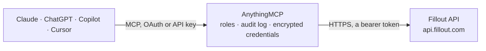

<!-- Generated by scripts/export-github-catalog.mjs in the anythingmcp-website repository. Do not edit by hand. -->

# Fillout MCP connector

Read Fillout (modern form/survey builder) form definitions and submissions from any AI agent. 6 tools, Bearer auth. The AnythingMCP connector gives Claude, ChatGPT, Microsoft Copilot, Cursor and Gemini 6 MCP tools for Fillout: 4 read and 2 can change data.

**Category:** [Forms & Surveys](../forms.md) · **Tools:** 6 · **Setup guide:** [anythingmcp.com](https://anythingmcp.com/guides/fillout-to-mcp) · [Deutsch](https://anythingmcp.com/de/guides/fillout-to-mcp) · [Italiano](https://anythingmcp.com/it/guides/fillout-to-mcp) · [Español](https://anythingmcp.com/es/guides/fillout-to-mcp) · [日本語](https://anythingmcp.com/ja/guides/fillout-to-mcp) · [Русский](https://anythingmcp.com/ru/guides/fillout-to-mcp) · [中文](https://anythingmcp.com/zh/guides/fillout-to-mcp)

## Start without code

No installation and no terminal: AnythingMCP Cloud runs the Fillout connector for you, operated by helpcode.ai in Frankfurt, Germany.

1. **Click the button above** and create an account or sign in. The Fillout connector opens, ready to install.
2. **Paste the API key or token from your Fillout account.** Every click is in the [step-by-step guide](https://anythingmcp.com/guides/fillout-to-mcp).
3. **Click Install.** AnythingMCP shows the address of your MCP server.
4. **Add that address to your assistant:** [Claude](https://anythingmcp.com/guides/connect-fillout-to-claude) · [ChatGPT](https://anythingmcp.com/guides/connect-fillout-to-chatgpt) · [Microsoft Copilot](https://anythingmcp.com/guides/connect-fillout-to-copilot) · [Cursor](https://anythingmcp.com/guides/connect-fillout-to-cursor) · [Gemini CLI](https://anythingmcp.com/guides/connect-fillout-to-gemini) · [Meta Muse](https://anythingmcp.com/guides/connect-fillout-to-muse).
5. **Ask your first question**, for example: *Find the submission for invoice INV-2026-118 on the 'Supplier Invoice Upload' form this month.*

Prefer help with the setup? [Talk to us](https://anythingmcp.com/contact).

## How it works

- **The AI client** speaks MCP (Streamable HTTP) to AnythingMCP and only sees tool names, descriptions and results. It never gets the Fillout credentials.
- **AnythingMCP** checks the client's role, builds the call from the tool definition, adds the credentials (a bearer token), calls Fillout, logs the call and returns the result.
- **Fillout** sees an ordinary API client with the rights of the account the credentials belong to.

## Tools

| Tool | What it does | Access |
|---|---|---|
| [`fillout_list_forms`](#fillout_list_forms) | List forms in the workspace. | read |
| [`fillout_get_form`](#fillout_get_form) | Fetch a form's full definition: questions[] (id, name, type, options), settings. | read |
| [`fillout_list_submissions`](#fillout_list_submissions) | List submissions for a form, with optional date range filter. | read |
| [`fillout_get_submission`](#fillout_get_submission) | Fetch one submission with full answers. | read |
| [`fillout_delete_submissions`](#fillout_delete_submissions) | Delete one submission by ID. | write |
| [`fillout_create_submission`](#fillout_create_submission) | Programmatically create a submission. | write |

## Tool reference

Every parameter as the AI client sees it in `tools/list`. Source: [`packages/backend/src/adapters/intl/fillout.json`](../../../packages/backend/src/adapters/intl/fillout.json).

### `fillout_list_forms`

List forms in the workspace.

**Access:** read · **Call:** `GET /forms`

No parameters.

### `fillout_get_form`

Fetch a form's full definition: questions[] (id, name, type, options), settings.

**Access:** read · **Call:** `GET /forms/{formId}`

| Parameter | Type | Required | Description |
|---|---|---|---|
| `formId` | string | yes | Form ID. |

### `fillout_list_submissions`

List submissions for a form, with optional date range filter.

**Access:** read · **Call:** `GET /forms/{formId}/submissions`

| Parameter | Type | Required | Description |
|---|---|---|---|
| `formId` | string | yes | Form ID. |
| `limit` | integer | no | Per page (default 50, max 150). |
| `offset` | integer | no | Pagination offset. |
| `afterDate` | string | no | ISO 8601 — submissions after this. |
| `beforeDate` | string | no | ISO 8601 — submissions before this. |
| `status` | string | no | finished, in_progress. |
| `includeEditLink` | boolean | no | If true, include the edit link for each submission. |
| `search` | string | no | Substring search across answer values. |
| `sort` | string | no | asc or desc by submitted time. |

### `fillout_get_submission`

Fetch one submission with full answers.

**Access:** read · **Call:** `GET /forms/{formId}/submissions/{submissionId}`

| Parameter | Type | Required | Description |
|---|---|---|---|
| `formId` | string | yes | Form ID. |
| `submissionId` | string | yes | Submission ID. |
| `includeEditLink` | boolean | no | Include edit link. |

### `fillout_delete_submissions`

Delete one submission by ID. Fillout has no bulk delete: call once per submission.

**Access:** write · **Call:** `DELETE /forms/{formId}/submissions/{submissionId}`

| Parameter | Type | Required | Description |
|---|---|---|---|
| `formId` | string | yes | Form ID. |
| `submissionId` | string | yes | Submission ID. |

### `fillout_create_submission`

Programmatically create a submission. submissions array has {questions:[{id, value}], hiddenFields?, urlParameters?}.

**Access:** write · **Call:** `POST /forms/{formId}/submissions`

| Parameter | Type | Required | Description |
|---|---|---|---|
| `formId` | string | yes | Form ID. |
| `submissions` | any[] | yes | Array of submissions: [{questions:[{id, value}], submissionTime?, hiddenFields?, urlParameters?}]. |

## Run it yourself

AnythingMCP is open source (AGPL-3.0). [Run it with Docker](../../../README.md#run-it-yourself), open **Connectors → Store**, pick **Fillout** and enter `FILLOUT_API_KEY`, then add your MCP server URL to the AI client.

[← Forms & Surveys connectors](../forms.md) · [All categories](../README.md)
