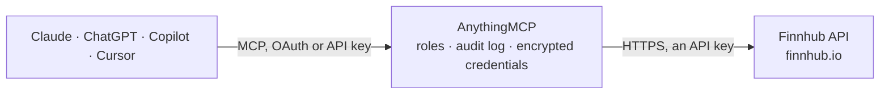

<!-- Generated by scripts/export-github-catalog.mjs in the anythingmcp-website repository. Do not edit by hand. -->

# Finnhub MCP connector

Give your AI live market data from Finnhub: stock, forex and crypto quotes, company profiles and key financials, company and market news, analyst recommendations, earnings and IPO calendars, insider … The AnythingMCP connector gives Claude, ChatGPT, Microsoft Copilot, Cursor and Gemini 22 MCP tools for Finnhub, all read-only.

**Category:** [Finance](../finance.md) · **Tools:** 22 · **Setup guide:** [anythingmcp.com](https://anythingmcp.com/guides/finnhub-to-mcp) · [Deutsch](https://anythingmcp.com/de/guides/finnhub-to-mcp) · [Italiano](https://anythingmcp.com/it/guides/finnhub-to-mcp) · [Español](https://anythingmcp.com/es/guides/finnhub-to-mcp) · [日本語](https://anythingmcp.com/ja/guides/finnhub-to-mcp) · [Русский](https://anythingmcp.com/ru/guides/finnhub-to-mcp) · [中文](https://anythingmcp.com/zh/guides/finnhub-to-mcp)

## Start without code

No installation and no terminal: AnythingMCP Cloud runs the Finnhub connector for you, operated by helpcode.ai in Frankfurt, Germany.

1. **Click the button above** and create an account or sign in. The Finnhub connector opens, ready to install.
2. **Paste the API key or token from your Finnhub account.** Every click is in the [step-by-step guide](https://anythingmcp.com/guides/finnhub-to-mcp).
3. **Click Install.** AnythingMCP shows the address of your MCP server.
4. **Add that address to your assistant:** [Claude](https://anythingmcp.com/guides/connect-finnhub-to-claude) · [ChatGPT](https://anythingmcp.com/guides/connect-finnhub-to-chatgpt) · [Microsoft Copilot](https://anythingmcp.com/guides/connect-finnhub-to-copilot) · [Cursor](https://anythingmcp.com/guides/connect-finnhub-to-cursor) · [Gemini CLI](https://anythingmcp.com/guides/connect-finnhub-to-gemini) · [Meta Muse](https://anythingmcp.com/guides/connect-finnhub-to-muse).
5. **Ask your first question**, for example: *Lookup profile and market cap for Helion Energy GmbH, ticker HEN.DE, I need country and market cap.*

Prefer help with the setup? [Talk to us](https://anythingmcp.com/contact).

## How it works

- **The AI client** speaks MCP (Streamable HTTP) to AnythingMCP and only sees tool names, descriptions and results. It never gets the Finnhub credentials.
- **AnythingMCP** checks the client's role, builds the call from the tool definition, adds the credentials (an API key), calls Finnhub, logs the call and returns the result.
- **Finnhub** sees an ordinary API client with the rights of the account the credentials belong to.

## Tools

| Tool | What it does | Access |
|---|---|---|
| [`finnhub_search_symbols`](#finnhub_search_symbols) | Find tickers by company name, symbol, ISIN or CUSIP: symbol, display symbol, description and security type. | read |
| [`finnhub_get_quote`](#finnhub_get_quote) | Latest price of a stock, ETF, forex or crypto symbol: current (c), change (d), percent change (dp), day high (h) and low (l), open (o), previous close (pc)… | read |
| [`finnhub_get_company_profile`](#finnhub_get_company_profile) | Company profile: name, country, currency, exchange, industry, IPO date, logo, market capitalisation (millions), shares outstanding (millions), phone and… | read |
| [`finnhub_get_basic_financials`](#finnhub_get_basic_financials) | Key figures of a company: 52-week high and low, beta, P/E, P/B, EPS, margins, ROE, dividend yield and more (metric), with annual and quarterly series (series). | read |
| [`finnhub_get_company_news`](#finnhub_get_company_news) | News articles about one company between two dates: headline, source, summary, URL, image and time (Unix seconds). | read |
| [`finnhub_get_market_news`](#finnhub_get_market_news) | Latest market news by category: general, forex, crypto or merger. | read |
| [`finnhub_get_peers`](#finnhub_get_peers) | Companies in the same country and sector, industry or sub-industry as the given one, as a list of symbols. | read |
| [`finnhub_get_recommendation_trends`](#finnhub_get_recommendation_trends) | Analyst recommendations per month: number of strong buy, buy, hold, sell and strong sell ratings. | read |
| [`finnhub_get_earnings_surprises`](#finnhub_get_earnings_surprises) | Reported versus estimated EPS per quarter (actual, estimate, surprise, surprise percent). | read |
| [`finnhub_get_earnings_calendar`](#finnhub_get_earnings_calendar) | Earnings release dates with EPS and revenue estimates and actuals, for a date range or one symbol. | read |
| [`finnhub_get_ipo_calendar`](#finnhub_get_ipo_calendar) | Recent and upcoming IPOs between two dates: symbol, name, exchange, date, price range, number of shares and status. | read |
| [`finnhub_get_insider_transactions`](#finnhub_get_insider_transactions) | Insider buys and sells (SEC Form 3, 4, 5) for a company: who, share change, shares held, price, transaction code and dates. | read |
| [`finnhub_get_insider_sentiment`](#finnhub_get_insider_sentiment) | Monthly insider sentiment of a US company: net share purchases (change) and the monthly share purchase ratio (mspr, -100 to 100). | read |
| [`finnhub_get_financials_reported`](#finnhub_get_financials_reported) | Financial statements as reported to the SEC (balance sheet, income and cash flow from 10-K and 10-Q), annual or quarterly, with the original XBRL concepts. | read |
| [`finnhub_get_sec_filings`](#finnhub_get_sec_filings) | SEC filings of a company: form type (10-K, 10-Q, 8-K...), filed and accepted dates and links to the documents. | read |
| [`finnhub_get_market_status`](#finnhub_get_market_status) | Whether an exchange is open right now, the session (pre-market, regular, post-market) and the holiday if any. | read |
| [`finnhub_get_market_holidays`](#finnhub_get_market_holidays) | Holidays and shortened trading days of an exchange. | read |
| [`finnhub_list_forex_exchanges`](#finnhub_list_forex_exchanges) | Forex data providers Finnhub supports (e.g. oanda, fxcm), for finnhub_list_forex_symbols. | read |
| [`finnhub_list_forex_symbols`](#finnhub_list_forex_symbols) | Currency pairs of one forex provider with the symbol to use in finnhub_get_quote (e.g. OANDA:EUR_USD). | read |
| [`finnhub_list_crypto_exchanges`](#finnhub_list_crypto_exchanges) | Crypto exchanges Finnhub supports (e.g. BINANCE, COINBASE), for finnhub_list_crypto_symbols. | read |
| [`finnhub_list_crypto_symbols`](#finnhub_list_crypto_symbols) | Crypto pairs of one exchange with the symbol to use in finnhub_get_quote (e.g. BINANCE:BTCUSDT). | read |
| [`finnhub_get_stock_candles`](#finnhub_get_stock_candles) | Price history (OHLCV candles) of a stock between two Unix timestamps at a resolution of 1, 5, 15, 30 or 60 minutes, or D, W, M. | read |

## Tool reference

Every parameter as the AI client sees it in `tools/list`. Source: [`packages/backend/src/adapters/intl/finnhub.json`](../../../packages/backend/src/adapters/intl/finnhub.json).

### `finnhub_search_symbols`

Find tickers by company name, symbol, ISIN or CUSIP: symbol, display symbol, description and security type. Start here when the user names a company. Free plan.

**Access:** read · **Call:** `GET /search`

| Parameter | Type | Required | Description |
|---|---|---|---|
| `q` | string | yes | Name, symbol, ISIN or CUSIP, e.g. apple or US0378331005. |
| `exchange` | string | no | Limit to one exchange code, e.g. US. |

### `finnhub_get_quote`

Latest price of a stock, ETF, forex or crypto symbol: current (c), change (d), percent change (dp), day high (h) and low (l), open (o), previous close (pc) and time (t, Unix seconds). Real time for US stocks on the free plan.

**Access:** read · **Call:** `GET /quote`

| Parameter | Type | Required | Description |
|---|---|---|---|
| `symbol` | string | yes | Symbol, e.g. AAPL, or for crypto and forex the exchange symbol such as BINANCE:BTCUSDT or OANDA:EUR_USD. |

### `finnhub_get_company_profile`

Company profile: name, country, currency, exchange, industry, IPO date, logo, market capitalisation (millions), shares outstanding (millions), phone and website. By symbol, ISIN or CUSIP. Free plan.

**Access:** read · **Call:** `GET /stock/profile2`

| Parameter | Type | Required | Description |
|---|---|---|---|
| `symbol` | string | no | Ticker symbol as Finnhub lists it, e.g. AAPL; find it with finnhub_search_symbols. |
| `isin` | string | no | ISIN instead of the symbol. |
| `cusip` | string | no | CUSIP instead of the symbol. |

### `finnhub_get_basic_financials`

Key figures of a company: 52-week high and low, beta, P/E, P/B, EPS, margins, ROE, dividend yield and more (metric), with annual and quarterly series (series). Free plan.

**Access:** read · **Call:** `GET /stock/metric`

| Parameter | Type | Required | Description |
|---|---|---|---|
| `symbol` | string | yes | Ticker symbol as Finnhub lists it, e.g. AAPL; find it with finnhub_search_symbols. |

### `finnhub_get_company_news`

News articles about one company between two dates: headline, source, summary, URL, image and time (Unix seconds). The free plan covers one year back.

**Access:** read · **Call:** `GET /company-news`

| Parameter | Type | Required | Description |
|---|---|---|---|
| `symbol` | string | yes | Ticker symbol as Finnhub lists it, e.g. AAPL; find it with finnhub_search_symbols. |
| `from` | string | yes | From date, YYYY-MM-DD. |
| `to` | string | yes | To date, YYYY-MM-DD. |

### `finnhub_get_market_news`

Latest market news by category: general, forex, crypto or merger. Pass min_id to get only articles newer than one you have. Free plan.

**Access:** read · **Call:** `GET /news`

| Parameter | Type | Required | Description |
|---|---|---|---|
| `category` | `general` \| `forex` \| `crypto` \| `merger` | yes | News category. |
| `min_id` | integer | no | Only news with an id above this one. |

### `finnhub_get_peers`

Companies in the same country and sector, industry or sub-industry as the given one, as a list of symbols. Free plan.

**Access:** read · **Call:** `GET /stock/peers`

| Parameter | Type | Required | Description |
|---|---|---|---|
| `symbol` | string | yes | Ticker symbol as Finnhub lists it, e.g. AAPL; find it with finnhub_search_symbols. |
| `grouping` | `sector` \| `industry` \| `subIndustry` | no | Grouping: sector, industry or subIndustry (default industry). |

### `finnhub_get_recommendation_trends`

Analyst recommendations per month: number of strong buy, buy, hold, sell and strong sell ratings. Free plan.

**Access:** read · **Call:** `GET /stock/recommendation`

| Parameter | Type | Required | Description |
|---|---|---|---|
| `symbol` | string | yes | Ticker symbol as Finnhub lists it, e.g. AAPL; find it with finnhub_search_symbols. |

### `finnhub_get_earnings_surprises`

Reported versus estimated EPS per quarter (actual, estimate, surprise, surprise percent). The free plan returns the last 4 quarters.

**Access:** read · **Call:** `GET /stock/earnings`

| Parameter | Type | Required | Description |
|---|---|---|---|
| `symbol` | string | yes | Ticker symbol as Finnhub lists it, e.g. AAPL; find it with finnhub_search_symbols. |
| `limit` | integer | no | Number of quarters. |

### `finnhub_get_earnings_calendar`

Earnings release dates with EPS and revenue estimates and actuals, for a date range or one symbol. The free plan covers one month of history plus upcoming dates.

**Access:** read · **Call:** `GET /calendar/earnings`

| Parameter | Type | Required | Description |
|---|---|---|---|
| `from` | string | no | From date, YYYY-MM-DD. Optional. |
| `to` | string | no | To date, YYYY-MM-DD. Optional. |
| `symbol` | string | no | Only this symbol, e.g. AAPL. |
| `international` | boolean | no | true to include non-US markets. |

### `finnhub_get_ipo_calendar`

Recent and upcoming IPOs between two dates: symbol, name, exchange, date, price range, number of shares and status. Free plan.

**Access:** read · **Call:** `GET /calendar/ipo`

| Parameter | Type | Required | Description |
|---|---|---|---|
| `from` | string | yes | From date, YYYY-MM-DD. |
| `to` | string | yes | To date, YYYY-MM-DD. |

### `finnhub_get_insider_transactions`

Insider buys and sells (SEC Form 3, 4, 5) for a company: who, share change, shares held, price, transaction code and dates. Free plan.

**Access:** read · **Call:** `GET /stock/insider-transactions`

| Parameter | Type | Required | Description |
|---|---|---|---|
| `symbol` | string | yes | Ticker symbol as Finnhub lists it, e.g. AAPL; find it with finnhub_search_symbols. |
| `from` | string | no | From date, YYYY-MM-DD. Optional. |
| `to` | string | no | To date, YYYY-MM-DD. Optional. |

### `finnhub_get_insider_sentiment`

Monthly insider sentiment of a US company: net share purchases (change) and the monthly share purchase ratio (mspr, -100 to 100). Free plan.

**Access:** read · **Call:** `GET /stock/insider-sentiment`

| Parameter | Type | Required | Description |
|---|---|---|---|
| `symbol` | string | yes | Ticker symbol as Finnhub lists it, e.g. AAPL; find it with finnhub_search_symbols. |
| `from` | string | yes | From date, YYYY-MM-DD. |
| `to` | string | yes | To date, YYYY-MM-DD. |

### `finnhub_get_financials_reported`

Financial statements as reported to the SEC (balance sheet, income and cash flow from 10-K and 10-Q), annual or quarterly, with the original XBRL concepts. Free plan; large answers, so narrow with from and to.

**Access:** read · **Call:** `GET /stock/financials-reported`

| Parameter | Type | Required | Description |
|---|---|---|---|
| `symbol` | string | no | Ticker symbol as Finnhub lists it, e.g. AAPL; find it with finnhub_search_symbols. |
| `cik` | string | no | SEC CIK instead of the symbol. |
| `access_number` | string | no | Access number of one filing. |
| `freq` | `annual` \| `quarterly` | no | annual (default) or quarterly. |
| `from` | string | no | From date, YYYY-MM-DD. Optional. |
| `to` | string | no | To date, YYYY-MM-DD. Optional. |

### `finnhub_get_sec_filings`

SEC filings of a company: form type (10-K, 10-Q, 8-K...), filed and accepted dates and links to the documents. Free plan.

**Access:** read · **Call:** `GET /stock/filings`

| Parameter | Type | Required | Description |
|---|---|---|---|
| `symbol` | string | no | Ticker symbol as Finnhub lists it, e.g. AAPL; find it with finnhub_search_symbols. |
| `cik` | string | no | SEC CIK instead of the symbol. |
| `form` | string | no | Only this form, e.g. 10-K or 8-K. |
| `from` | string | no | From date, YYYY-MM-DD. Optional. |
| `to` | string | no | To date, YYYY-MM-DD. Optional. |

### `finnhub_get_market_status`

Whether an exchange is open right now, the session (pre-market, regular, post-market) and the holiday if any. Free plan.

**Access:** read · **Call:** `GET /stock/market-status`

| Parameter | Type | Required | Description |
|---|---|---|---|
| `exchange` | string | yes | Exchange code, e.g. US, L (London), DE (XETRA), T (Tokyo). |

### `finnhub_get_market_holidays`

Holidays and shortened trading days of an exchange. Free plan.

**Access:** read · **Call:** `GET /stock/market-holiday`

| Parameter | Type | Required | Description |
|---|---|---|---|
| `exchange` | string | yes | Exchange code, e.g. US. |

### `finnhub_list_forex_exchanges`

Forex data providers Finnhub supports (e.g. oanda, fxcm), for finnhub_list_forex_symbols. Free plan.

**Access:** read · **Call:** `GET /forex/exchange`

No parameters.

### `finnhub_list_forex_symbols`

Currency pairs of one forex provider with the symbol to use in finnhub_get_quote (e.g. OANDA:EUR_USD). Free plan.

**Access:** read · **Call:** `GET /forex/symbol`

| Parameter | Type | Required | Description |
|---|---|---|---|
| `exchange` | string | yes | Provider from finnhub_list_forex_exchanges, e.g. oanda. |

### `finnhub_list_crypto_exchanges`

Crypto exchanges Finnhub supports (e.g. BINANCE, COINBASE), for finnhub_list_crypto_symbols. Free plan.

**Access:** read · **Call:** `GET /crypto/exchange`

No parameters.

### `finnhub_list_crypto_symbols`

Crypto pairs of one exchange with the symbol to use in finnhub_get_quote (e.g. BINANCE:BTCUSDT). Free plan; long list.

**Access:** read · **Call:** `GET /crypto/symbol`

| Parameter | Type | Required | Description |
|---|---|---|---|
| `exchange` | string | yes | Exchange from finnhub_list_crypto_exchanges, e.g. binance. |

### `finnhub_get_stock_candles`

Price history (OHLCV candles) of a stock between two Unix timestamps at a resolution of 1, 5, 15, 30 or 60 minutes, or D, W, M. PAID PLAN ONLY: Finnhub answers 403 on free keys; on a free plan use finnhub_get_quote and the 52-week figures of finnhub_get_basic_financials instead.

**Access:** read · **Call:** `GET /stock/candle`

| Parameter | Type | Required | Description |
|---|---|---|---|
| `symbol` | string | yes | Ticker symbol as Finnhub lists it, e.g. AAPL; find it with finnhub_search_symbols. |
| `resolution` | `1` \| `5` \| `15` \| `30` \| `60` \| `D` \| `W` \| `M` | yes | Candle size. |
| `from` | integer | yes | Start, Unix seconds. |
| `to` | integer | yes | End, Unix seconds. |

## Run it yourself

AnythingMCP is open source (AGPL-3.0). [Run it with Docker](../../../README.md#run-it-yourself), open **Connectors → Store**, pick **Finnhub** and enter `FINNHUB_API_KEY`, then add your MCP server URL to the AI client.

[← Finance connectors](../finance.md) · [All categories](../README.md)
