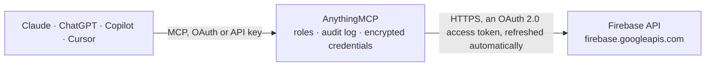

<!-- Generated by scripts/export-github-catalog.mjs in the anythingmcp-website repository. Do not edit by hand. -->

# Firebase MCP connector

Let your AI work with Firebase: list projects and apps, browse and query Cloud Firestore, create and update documents, look up and disable Authentication users, read Remote Config, and (switched off … The AnythingMCP connector gives Claude, ChatGPT, Microsoft Copilot, Cursor and Gemini 17 MCP tools for Firebase: 11 read and 6 can change data.

**Category:** [Databases](../database.md) · **Tools:** 17 · **Setup guide:** [anythingmcp.com](https://anythingmcp.com/guides/firebase-to-mcp) · [Deutsch](https://anythingmcp.com/de/guides/firebase-to-mcp) · [Italiano](https://anythingmcp.com/it/guides/firebase-to-mcp) · [Español](https://anythingmcp.com/es/guides/firebase-to-mcp) · [日本語](https://anythingmcp.com/ja/guides/firebase-to-mcp) · [Русский](https://anythingmcp.com/ru/guides/firebase-to-mcp) · [中文](https://anythingmcp.com/zh/guides/firebase-to-mcp)

## Start without code

No installation and no terminal: AnythingMCP Cloud runs the Firebase connector for you, operated by helpcode.ai in Frankfurt, Germany.

1. **Click the button above** and create an account or sign in. The Firebase connector opens, ready to install.
2. **Sign in with your Firebase account** when AnythingMCP asks. The first time, an admin creates a small app in the Google Cloud console. Every click is in the [step-by-step guide](https://anythingmcp.com/guides/firebase-to-mcp).
3. **Click Install.** AnythingMCP shows the address of your MCP server.
4. **Add that address to your assistant:** [Claude](https://anythingmcp.com/guides/connect-firebase-to-claude) · [ChatGPT](https://anythingmcp.com/guides/connect-firebase-to-chatgpt) · [Microsoft Copilot](https://anythingmcp.com/guides/connect-firebase-to-copilot) · [Cursor](https://anythingmcp.com/guides/connect-firebase-to-cursor) · [Gemini CLI](https://anythingmcp.com/guides/connect-firebase-to-gemini) · [Meta Muse](https://anythingmcp.com/guides/connect-firebase-to-muse).
5. **Ask your first question**, for example: *Show me the Firestore document for order ORD-2026-045 in collection orders for project softrack-prod.*

Prefer help with the setup? [Talk to us](https://anythingmcp.com/contact).

## How it works

- **The AI client** speaks MCP (Streamable HTTP) to AnythingMCP and only sees tool names, descriptions and results. It never gets the Firebase credentials.
- **AnythingMCP** checks the client's role, builds the call from the tool definition, adds the credentials (an OAuth 2.0 access token, refreshed automatically), calls Firebase, logs the call and returns the result.
- **Firebase** sees an ordinary API client with the rights of the account the credentials belong to.

## Tools

| Tool | What it does | Access |
|---|---|---|
| [`firebase_list_projects`](#firebase_list_projects) | List the Firebase projects the signed-in account can access, with projectId, display name, project number and state. | read |
| [`firebase_get_project`](#firebase_get_project) | Get one Firebase project: display name, project number, state and its default resources (Hosting site, Realtime Database instance, Storage bucket, location). | read |
| [`firebase_list_apps`](#firebase_list_apps) | List the apps registered in a Firebase project (Android, iOS and web) with appId, display name, platform, bundle or package namespace and state. | read |
| [`firebase_list_collections`](#firebase_list_collections) | List Firestore collection ids: the top-level collections of the database, or the subcollections of one document. | read |
| [`firebase_list_documents`](#firebase_list_documents) | List the documents of a Firestore collection with their typed fields, a page at a time (default 20). | read |
| [`firebase_get_document`](#firebase_get_document) | Get one Firestore document with its typed fields and create and update times. | read |
| [`firebase_query_documents`](#firebase_query_documents) | Query a Firestore collection with filters, ordering and a limit (structured query, read-only). | read |
| [`firebase_create_document`](#firebase_create_document) | Create a Firestore document in a collection with typed fields. | write |
| [`firebase_update_document`](#firebase_update_document) | Update fields of an existing Firestore document. | write |
| [`firebase_delete_document`](#firebase_delete_document) | Permanently delete a Firestore document (its subcollections stay). | write |
| [`firebase_lookup_users`](#firebase_lookup_users) | Find Firebase Authentication users by email address, uid or phone number: sign-in providers, verified email, disabled flag, creation and last sign-in times,… | read |
| [`firebase_list_users`](#firebase_list_users) | List the Firebase Authentication users of a project, a page at a time (default 100), with email, providers, disabled flag and sign-in times. | read |
| [`firebase_set_user_disabled`](#firebase_set_user_disabled) | Disable or re-enable a Firebase Authentication user's sign-in. | write |
| [`firebase_get_remote_config`](#firebase_get_remote_config) | Get the current Remote Config template of a project: conditions, parameters with default and conditional values, parameter groups and version, plus its etag… | read |
| [`firebase_list_remote_config_versions`](#firebase_list_remote_config_versions) | List the published Remote Config versions of a project, newest first: version number, update time, who published it, how (console, REST, rollback) and the… | read |
| [`firebase_publish_remote_config`](#firebase_publish_remote_config) | Publish a new Remote Config template. | write |
| [`firebase_send_message`](#firebase_send_message) | Send one Firebase Cloud Messaging notification or data message to a device token, a topic or a condition. | write |

## Tool reference

Every parameter as the AI client sees it in `tools/list`. Source: [`packages/backend/src/adapters/intl/firebase.json`](../../../packages/backend/src/adapters/intl/firebase.json).

### `firebase_list_projects`

List the Firebase projects the signed-in account can access, with projectId, display name, project number and state. Start here: every other tool needs the projectId.

**Access:** read · **Call:** `GET /v1beta1/projects`

| Parameter | Type | Required | Description |
|---|---|---|---|
| `pageSize` | integer | no | Projects per page, default 50. |
| `pageToken` | string | no | nextPageToken from the previous page. |

### `firebase_get_project`

Get one Firebase project: display name, project number, state and its default resources (Hosting site, Realtime Database instance, Storage bucket, location).

**Access:** read · **Call:** `GET /v1beta1/projects/{project_id}`

| Parameter | Type | Required | Description |
|---|---|---|---|
| `project_id` | string | yes | Firebase project id, e.g. 'my-app-12345' (projectId from firebase_list_projects). |

### `firebase_list_apps`

List the apps registered in a Firebase project (Android, iOS and web) with appId, display name, platform, bundle or package namespace and state.

**Access:** read · **Call:** `GET /v1beta1/projects/{project_id}:searchApps`

| Parameter | Type | Required | Description |
|---|---|---|---|
| `project_id` | string | yes | Firebase project id, e.g. 'my-app-12345' (projectId from firebase_list_projects). |
| `pageSize` | integer | no | Apps per page, default 100. |
| `pageToken` | string | no | nextPageToken from the previous page. |
| `filter` | string | no | Optional filter, e.g. 'platform="IOS"'. |

### `firebase_list_collections`

List Firestore collection ids: the top-level collections of the database, or the subcollections of one document. Free of document reads. Start here to explore a database.

**Access:** read · **Call:** `POST https://firestore.googleapis.com/v1/projects/{project_id}/databases/{database_id}/{parent}:listCollectionIds`

| Parameter | Type | Required | Description |
|---|---|---|---|
| `project_id` | string | yes | Firebase project id, e.g. 'my-app-12345' (projectId from firebase_list_projects). |
| `database_id` | string | no | Firestore database id. Default '(default)', the database every project starts with; pass another id only for a named database. |
| `parent` | string | no | Where to look: 'documents' (the default) for top-level collections, or 'documents/<collection>/<document id>' for the subcollections of one document. |
| `pageSize` | integer | no | Collection ids per page, default 100. |
| `pageToken` | string | no | nextPageToken from the previous page. |

### `firebase_list_documents`

List the documents of a Firestore collection with their typed fields, a page at a time (default 20). Each returned document counts as one billed read. Use fields to return only some fields.

**Access:** read · **Call:** `GET https://firestore.googleapis.com/v1/projects/{project_id}/databases/{database_id}/documents/{collection_path}`

| Parameter | Type | Required | Description |
|---|---|---|---|
| `project_id` | string | yes | Firebase project id, e.g. 'my-app-12345' (projectId from firebase_list_projects). |
| `database_id` | string | no | Firestore database id. Default '(default)', the database every project starts with; pass another id only for a named database. |
| `collection_path` | string | yes | Collection path relative to the database: a top-level collection 'users', or a subcollection 'users/<user id>/orders'. |
| `pageSize` | integer | no | Documents per page, default 20, at most 100. |
| `pageToken` | string | no | nextPageToken from the previous page. |
| `orderBy` | string | no | Order, e.g. 'createdAt desc' or 'priority desc, __name__'. |
| `fields` | string[] | no | Return only these field paths, e.g. ['name', 'address.city']. |
| `showMissing` | boolean | no | Also list documents that do not exist but have subcollections. |

### `firebase_get_document`

Get one Firestore document with its typed fields and create and update times. One billed read.

**Access:** read · **Call:** `GET https://firestore.googleapis.com/v1/projects/{project_id}/databases/{database_id}/documents/{document_path}`

| Parameter | Type | Required | Description |
|---|---|---|---|
| `project_id` | string | yes | Firebase project id, e.g. 'my-app-12345' (projectId from firebase_list_projects). |
| `database_id` | string | no | Firestore database id. Default '(default)', the database every project starts with; pass another id only for a named database. |
| `document_path` | string | yes | Document path relative to the database: 'users/<user id>' or 'users/<user id>/orders/<order id>'. |
| `fields` | string[] | no | Return only these field paths. |

### `firebase_query_documents`

Query a Firestore collection with filters, ordering and a limit (structured query, read-only). Set all_descendants to search every collection with that id (a collection group). Each returned document counts as one billed read; keep limit small (default 20).

**Access:** read · **Call:** `POST https://firestore.googleapis.com/v1/projects/{project_id}/databases/{database_id}/{parent}:runQuery`

| Parameter | Type | Required | Description |
|---|---|---|---|
| `project_id` | string | yes | Firebase project id, e.g. 'my-app-12345' (projectId from firebase_list_projects). |
| `database_id` | string | no | Firestore database id. Default '(default)', the database every project starts with; pass another id only for a named database. |
| `parent` | string | no | 'documents' (default) to query a top-level collection or a collection group, or 'documents/<collection>/<document id>' to query a subcollection of that document. |
| `collection_id` | string | yes | Collection id (one segment, no slashes), e.g. 'orders'. |
| `all_descendants` | boolean | no | true = query every collection named collection_id below parent (collection group query). Default false. |
| `where` | object | no | Filter, e.g. {"fieldFilter": {"field": {"fieldPath": "status"}, "op": "EQUAL", "value": {"stringValue": "open"}}} or a compositeFilter with op AND/OR. For null or NaN use unaryFilter {"op": "IS_NULL"}. |
| `order_by` | object[] | no | Ordering, e.g. [{"field": {"fieldPath": "createdAt"}, "direction": "DESCENDING"}]. |
| `select` | object | no | Return only some fields: {"fields": [{"fieldPath": "name"}, {"fieldPath": "total"}]}. |
| `limit` | integer | no | Maximum documents to return, default 20, at most 100. |
| `offset` | integer | no | Documents to skip (still billed as reads). Prefer narrower filters. |

### `firebase_create_document`

Create a Firestore document in a collection with typed fields. Confirm with the user first: the app sees it at once. Pass document_id to choose the id, otherwise Firestore generates one; an existing id fails with 409.

**Access:** write · **Call:** `POST https://firestore.googleapis.com/v1/projects/{project_id}/databases/{database_id}/documents/{collection_path}`

| Parameter | Type | Required | Description |
|---|---|---|---|
| `project_id` | string | yes | Firebase project id, e.g. 'my-app-12345' (projectId from firebase_list_projects). |
| `database_id` | string | no | Firestore database id. Default '(default)', the database every project starts with; pass another id only for a named database. |
| `collection_path` | string | yes | Collection path relative to the database: a top-level collection 'users', or a subcollection 'users/<user id>/orders'. |
| `document_id` | string | no | Id for the new document. Leave out for an automatic id. |
| `fields` | object | yes | The document's fields in Firestore's typed format, e.g. {"name": {"stringValue": "Anna"}, "age": {"integerValue": "31"}}. |

### `firebase_update_document`

Update fields of an existing Firestore document. Confirm with the user first. With update_fields only those fields change (a listed field missing from fields is deleted); without it the whole document is replaced. It never creates a document: a missing one fails with 404 (use firebase_create_document).

**Access:** write · **Call:** `PATCH https://firestore.googleapis.com/v1/projects/{project_id}/databases/{database_id}/documents/{document_path}`

| Parameter | Type | Required | Description |
|---|---|---|---|
| `project_id` | string | yes | Firebase project id, e.g. 'my-app-12345' (projectId from firebase_list_projects). |
| `database_id` | string | no | Firestore database id. Default '(default)', the database every project starts with; pass another id only for a named database. |
| `document_path` | string | yes | Document path relative to the database: 'users/<user id>' or 'users/<user id>/orders/<order id>'. |
| `fields` | object | yes | New values in Firestore's typed format, e.g. {"status": {"stringValue": "shipped"}}. |
| `update_fields` | string[] | no | Field paths to change, e.g. ['status', 'address.city']. Strongly recommended. |

### `firebase_delete_document`

Permanently delete a Firestore document (its subcollections stay). Switched off at install. Confirm with the user first and name the exact document path; there is no undo.

**Access:** write · **Call:** `DELETE https://firestore.googleapis.com/v1/projects/{project_id}/databases/{database_id}/documents/{document_path}`

| Parameter | Type | Required | Description |
|---|---|---|---|
| `project_id` | string | yes | Firebase project id, e.g. 'my-app-12345' (projectId from firebase_list_projects). |
| `database_id` | string | no | Firestore database id. Default '(default)', the database every project starts with; pass another id only for a named database. |
| `document_path` | string | yes | Document path relative to the database: 'users/<user id>' or 'users/<user id>/orders/<order id>'. |

### `firebase_lookup_users`

Find Firebase Authentication users by email address, uid or phone number: sign-in providers, verified email, disabled flag, creation and last sign-in times, custom claims. Password hashes are never returned.

**Access:** read · **Call:** `POST https://identitytoolkit.googleapis.com/v1/projects/{project_id}/accounts:lookup`

| Parameter | Type | Required | Description |
|---|---|---|---|
| `project_id` | string | yes | Firebase project id, e.g. 'my-app-12345' (projectId from firebase_list_projects). |
| `emails` | string[] | no | Email addresses to look up. |
| `uids` | string[] | no | User ids (uid / localId) to look up. |
| `phone_numbers` | string[] | no | Phone numbers in E.164 format, e.g. '+4917612345678'. |
| `tenant_id` | string | no | Identity Platform tenant id, only for multi-tenant projects. |

### `firebase_list_users`

List the Firebase Authentication users of a project, a page at a time (default 100), with email, providers, disabled flag and sign-in times. Password hashes are never returned. Continue with nextPageToken.

**Access:** read · **Call:** `GET https://identitytoolkit.googleapis.com/v1/projects/{project_id}/accounts:batchGet`

| Parameter | Type | Required | Description |
|---|---|---|---|
| `project_id` | string | yes | Firebase project id, e.g. 'my-app-12345' (projectId from firebase_list_projects). |
| `maxResults` | integer | no | Users per page, default 100, at most 1000. |
| `nextPageToken` | string | no | nextPageToken from the previous page. |
| `tenant_id` | string | no | Identity Platform tenant id, only for multi-tenant projects. |

### `firebase_set_user_disabled`

Disable or re-enable a Firebase Authentication user's sign-in. Confirm with the user first and name the account. A disabled user cannot sign in or refresh tokens; an already issued ID token stays valid until it expires (at most one hour).

**Access:** write · **Call:** `POST https://identitytoolkit.googleapis.com/v1/projects/{project_id}/accounts:update`

| Parameter | Type | Required | Description |
|---|---|---|---|
| `project_id` | string | yes | Firebase project id, e.g. 'my-app-12345' (projectId from firebase_list_projects). |
| `uid` | string | yes | The user's uid (localId) from firebase_lookup_users. |
| `disabled` | boolean | yes | true = disable the account, false = enable it again. |
| `tenant_id` | string | no | Identity Platform tenant id, only for multi-tenant projects. |

### `firebase_get_remote_config`

Get the current Remote Config template of a project: conditions, parameters with default and conditional values, parameter groups and version, plus its etag (in _headers.etag), which publishing needs. Pass version_number to read an older version.

**Access:** read · **Call:** `GET https://firebaseremoteconfig.googleapis.com/v1/projects/{project_id}/remoteConfig`

| Parameter | Type | Required | Description |
|---|---|---|---|
| `project_id` | string | yes | Firebase project id, e.g. 'my-app-12345' (projectId from firebase_list_projects). |
| `version_number` | string | no | Read this version instead of the current one, e.g. '42'. |

### `firebase_list_remote_config_versions`

List the published Remote Config versions of a project, newest first: version number, update time, who published it, how (console, REST, rollback) and the description.

**Access:** read · **Call:** `GET https://firebaseremoteconfig.googleapis.com/v1/projects/{project_id}/remoteConfig:listVersions`

| Parameter | Type | Required | Description |
|---|---|---|---|
| `project_id` | string | yes | Firebase project id, e.g. 'my-app-12345' (projectId from firebase_list_projects). |
| `pageSize` | integer | no | Versions per page, default 20. |
| `pageToken` | string | no | nextPageToken from the previous page. |
| `startTime` | string | no | Only versions updated at or after this time, RFC 3339. |
| `endTime` | string | no | Only versions updated before this time, RFC 3339. |

### `firebase_publish_remote_config`

Publish a new Remote Config template. Switched off at install. It REPLACES the whole live template for every app: send all conditions, parameters and groups to keep, with the etag from firebase_get_remote_config. Validate first with validate_only true, show the user the change and confirm with the user: publish only after an explicit yes.

**Access:** write · **Call:** `PUT https://firebaseremoteconfig.googleapis.com/v1/projects/{project_id}/remoteConfig`

| Parameter | Type | Required | Description |
|---|---|---|---|
| `project_id` | string | yes | Firebase project id, e.g. 'my-app-12345' (projectId from firebase_list_projects). |
| `etag` | string | yes | etag from the last firebase_get_remote_config (_headers.etag). Use '*' only to overwrite regardless of concurrent changes. |
| `conditions` | object[] | no | Complete list of conditions, as in the current template. |
| `parameters` | object | yes | Complete map of parameters, as in the current template, with your change applied. |
| `parameter_groups` | object | no | Complete map of parameter groups, if the template has any. |
| `validate_only` | boolean | no | true = only check the template, publish nothing. Default false. |

### `firebase_send_message`

Send one Firebase Cloud Messaging notification or data message to a device token, a topic or a condition. Switched off at install. It reaches real users: confirm the audience and text with the user first, and test with validate_only true.

**Access:** write · **Call:** `POST https://fcm.googleapis.com/v1/projects/{project_id}/messages:send`

| Parameter | Type | Required | Description |
|---|---|---|---|
| `project_id` | string | yes | Firebase project id, e.g. 'my-app-12345' (projectId from firebase_list_projects). |
| `token` | string | no | Registration token of one device. Use exactly one of token, topic or condition. |
| `topic` | string | no | Topic name without '/topics/', e.g. 'news'. |
| `condition` | string | no | Topic condition, e.g. "'news' in topics && 'de' in topics". |
| `notification` | object | no | Visible notification: {"title": "...", "body": "...", "image": "https://..."}. |
| `data` | object | no | Custom key-value data for the app; values must be strings. |
| `android` | object | no | Android options, e.g. {"priority": "HIGH"}. |
| `apns` | object | no | Apple options (headers and payload). |
| `webpush` | object | no | Web push options. |
| `validate_only` | boolean | no | true = validate the message without sending it. |

## Run it yourself

AnythingMCP is open source (AGPL-3.0). [Run it with Docker](../../../README.md#run-it-yourself), open **Connectors → Store**, pick **Firebase** and enter `GOOGLE_CLIENT_ID`, `GOOGLE_CLIENT_SECRET`, then add your MCP server URL to the AI client.

[← Databases connectors](../database.md) · [All categories](../README.md)
