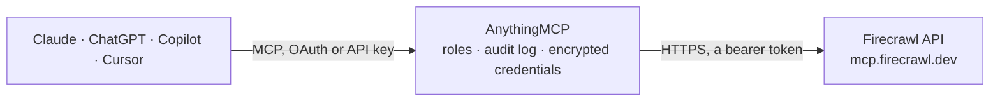

<!-- Generated by scripts/export-github-catalog.mjs in the anythingmcp-website repository. Do not edit by hand. -->

# Firecrawl MCP connector

Search the web, scrape any page into clean text or structured data, crawl whole sites and run multi-source web research from Claude, ChatGPT or Copilot through Firecrawl's official MCP server. The AnythingMCP connector gives Claude, ChatGPT, Microsoft Copilot, Cursor and Gemini 27 MCP tools for Firecrawl: 17 read and 10 can change data.

**Category:** [Public Data](../data.md) · **Tools:** 27 · **Setup guide:** [anythingmcp.com](https://anythingmcp.com/guides/firecrawl-to-mcp) · [Deutsch](https://anythingmcp.com/de/guides/firecrawl-to-mcp) · [Italiano](https://anythingmcp.com/it/guides/firecrawl-to-mcp) · [Español](https://anythingmcp.com/es/guides/firecrawl-to-mcp) · [日本語](https://anythingmcp.com/ja/guides/firecrawl-to-mcp) · [Русский](https://anythingmcp.com/ru/guides/firecrawl-to-mcp) · [中文](https://anythingmcp.com/zh/guides/firecrawl-to-mcp)

## Start without code

No installation and no terminal: AnythingMCP Cloud runs the Firecrawl connector for you, operated by helpcode.ai in Frankfurt, Germany.

1. **Click the button above** and create an account or sign in. The Firecrawl connector opens, ready to install.
2. **Paste the API key or token from your Firecrawl account.** Every click is in the [step-by-step guide](https://anythingmcp.com/guides/firecrawl-to-mcp).
3. **Click Install.** AnythingMCP shows the address of your MCP server.
4. **Add that address to your assistant:** [Claude](https://anythingmcp.com/guides/connect-firecrawl-to-claude) · [ChatGPT](https://anythingmcp.com/guides/connect-firecrawl-to-chatgpt) · [Microsoft Copilot](https://anythingmcp.com/guides/connect-firecrawl-to-copilot) · [Cursor](https://anythingmcp.com/guides/connect-firecrawl-to-cursor) · [Gemini CLI](https://anythingmcp.com/guides/connect-firecrawl-to-gemini) · [Meta Muse](https://anythingmcp.com/guides/connect-firecrawl-to-muse).
5. **Ask your first question**, for example: *Locate the PDF for supplier Nordic Supplies Oy invoice INV-2026-0789 and extract invoice date and total EUR.*

Prefer help with the setup? [Talk to us](https://anythingmcp.com/contact).

## How it works

- **The AI client** speaks MCP (Streamable HTTP) to AnythingMCP and only sees tool names, descriptions and results. It never gets the Firecrawl credentials.
- **AnythingMCP** checks the client's role, builds the call from the tool definition, adds the credentials (a bearer token), calls Firecrawl, logs the call and returns the result.
- **Firecrawl** sees an ordinary API client with the rights of the account the credentials belong to.

## Tools

| Tool | What it does | Access |
|---|---|---|
| [`firecrawl_scrape`](#firecrawl_scrape) | Scrape one URL and return its content: markdown by default, or HTML, links, screenshots, branding data, a targeted answer, or JSON matching a supplied schema. | read |
| [`firecrawl_search`](#firecrawl_search) | Search web, news, or image sources and return ranked results with query-relevant highlights. | read |
| [`firecrawl_parse`](#firecrawl_parse) | Parse one supported document into markdown, HTML, links, summary, targeted answers, or JSON matching a schema. | read |
| [`firecrawl_map`](#firecrawl_map) | Enumerate URLs indexed under one website through Firecrawl without fetching each page's content. | read |
| [`firecrawl_crawl`](#firecrawl_crawl) | Start a multi-page crawl at a website URL, poll it to a terminal state, and return the final status and collected data. | write |
| [`firecrawl_check_crawl_status`](#firecrawl_check_crawl_status) | Retrieve the current status, progress, and available results for an existing crawl ID. | read |
| [`firecrawl_agent`](#firecrawl_agent) | Run web research that returns structured data when the URLs are not known or the answer spans several sites. | write |
| [`firecrawl_agent_status`](#firecrawl_agent_status) | Retrieve progress or final results for a `firecrawl_agent` job ID. | read |
| [`firecrawl_interact`](#firecrawl_interact) | Open or reuse a live browser session to navigate a page, click controls, fill fields, or run browser code. | write |
| [`firecrawl_interact_stop`](#firecrawl_interact_stop) | Stop the live interact session associated with a `scrapeId` and release its resources. | write |
| [`firecrawl_find_tools`](#firecrawl_find_tools) | Browse Alexandria data providers and workflows or read a selected contract. | read |
| [`firecrawl_developer_search`](#firecrawl_developer_search) | Search an index of public repositories, GitHub issues, merged pull requests, repository READMEs, and code documentation for programming questions that need… | read |
| [`firecrawl_research_search_papers`](#firecrawl_research_search_papers) | Search paper metadata and abstracts with a natural-language query across the indexed corpus, which spans biomedical, life-science, and clinical literature… | read |
| [`firecrawl_research_inspect_paper`](#firecrawl_research_inspect_paper) | Retrieve canonical metadata for one paper ID, such as an arXiv, PMC, PMID, or DOI identifier. | read |
| [`firecrawl_research_related_papers`](#firecrawl_research_related_papers) | Find citation-graph candidates from one to ten `seed_ids`; the first ID is the primary seed and later IDs are anchors. | read |
| [`firecrawl_research_read_paper`](#firecrawl_research_read_paper) | Retrieve in-body passages from one paper that are relevant to a specific question. | read |
| [`firecrawl_credit_usage`](#firecrawl_credit_usage) | Get the authenticated Firecrawl team's current credit balance or historical credit consumption. | read |
| [`firecrawl_monitor_list`](#firecrawl_monitor_list) | List monitors for the authenticated account with optional pagination controls. | read |
| [`firecrawl_monitor_get`](#firecrawl_monitor_get) | Retrieve one monitor by ID, including its configuration and current state. | read |
| [`firecrawl_monitor_checks`](#firecrawl_monitor_checks) | List historical checks for a monitor, optionally filtered by status and bounded by a result limit. | read |
| [`firecrawl_monitor_check`](#firecrawl_monitor_check) | Retrieve one monitor check and its page-level results, optionally filtered by page status. | read |
| [`firecrawl_monitor_run`](#firecrawl_monitor_run) | Queue an immediate check for a monitor outside its normal schedule. | write |
| [`firecrawl_monitor_create`](#firecrawl_monitor_create) | Create a recurring scrape, crawl, or search monitor that compares each check with its retained predecessor. | write |
| [`firecrawl_monitor_update`](#firecrawl_monitor_update) | Patch an existing monitor by ID. | write |
| [`firecrawl_monitor_delete`](#firecrawl_monitor_delete) | Permanently delete a monitor by ID and stop its future schedule. | write |
| [`firecrawl_search_feedback`](#firecrawl_search_feedback) | Records schema-validated quality feedback for a prior `firecrawl_search` UUID `searchId`. | write |
| [`firecrawl_feedback`](#firecrawl_feedback) | Submit concise quality feedback for a completed search, scrape, parse, or map job. | write |

## Tool reference

Every parameter as the AI client sees it in `tools/list`. Source: [`packages/backend/src/adapters/intl/firecrawl.json`](../../../packages/backend/src/adapters/intl/firecrawl.json).

### `firecrawl_scrape`

Scrape one URL and return its content: markdown by default, or HTML, links, screenshots, branding data, a targeted answer, or JSON matching a supplied schema. Use it when the request identifies a page and needs its content or defined fields. Use `firecrawl_search` when additional web sources are needed; on an authenticated session, `firecrawl_map` lists a site's URLs and `firecrawl_crawl` collects a set of pages. Firecrawl may serve recently indexed content; set `maxAge: 0` for a live fetch or a smaller `maxAge` to bound staleness. A successful response does not by itself confirm the page is still current. A named browser profile loads saved session data without saving changes to it. Authenticated responses can include a `metadata.scrapeId` for optional scrape feedback. On an authenticated session with Alexandria access, `firecrawl_search` with `sources` unset and `firecrawl_find_tools` can discover providers for the same fields across several pages; a matching provider returns typed records in one call. Keyless sessions have no provider matches. Alexandria mode, on an authenticated session with Alexandria access: `alexandria` selects catalogued capability execution and is mutually exclusive with `url`.

**Access:** read · **Call:** `firecrawl_scrape /mcp`

| Parameter | Type | Required | Description |
|---|---|---|---|
| `url` | string | no | The URL of the page to scrape. Leave it out only when alexandria is used. |
| `formats` | `markdown` \| `html` \| `rawHtml` \| `screenshot` \| `links` \| `summary` \| `changeTracking` \| `branding` \| `json` \| `query` \| `audio`[] | no | Output formats to return: markdown (the default), html, rawHtml, links, summary and more; json needs jsonOptions and query needs queryOptions. |
| `jsonOptions` | object | no | For the json format: a prompt and/or a JSON schema describing the fields to extract. |
| `queryOptions` | object | no | For the query format: the question to answer from the content (prompt) and the answer mode, freeform or directQuote. |
| `screenshotOptions` | object | no | For the screenshot format: full page or viewport only, image quality and viewport size. |
| `parsers` | `pdf`[] | no | File parsers to apply. With "pdf" (the default) PDF text is extracted and billed per page; an empty list returns the PDF as base64. |
| `pdfOptions` | object | no | PDF parsing options, for example maxPages to cap how many pages are parsed. |
| `onlyMainContent` | boolean | no | Return only the main content, without headers, navigation and footers (default true). |
| `redactPII` | boolean | no | Ask Firecrawl to redact personally identifiable information in the returned content. |
| `includeTags` | string[] | no | HTML tags, classes or ids to keep in the output. |
| `excludeTags` | string[] | no | HTML tags, classes or ids to remove from the output. |
| `waitFor` | number | no | Extra delay in milliseconds before the content is taken, so the page can finish loading. |
| `mobile` | boolean | no | Emulate a mobile device, for responsive pages and mobile screenshots. |
| `skipTlsVerification` | boolean | no | Skip TLS certificate verification when fetching. |
| `removeBase64Images` | boolean | no | Replace inline base64 images in the markdown with a placeholder (the alt text stays). |
| `location` | object | no | Country code and preferred languages for the request, to get location-specific content. |
| `storeInCache` | boolean | no | Whether the result may be stored in the Firecrawl index and cache; set false for data protection concerns. |
| `zeroDataRetention` | boolean | no | Zero data retention for this call; needs an eligible account with the feature enabled. |
| `maxAge` | number | no | Accept a cached copy younger than this many milliseconds; 0 forces a live fetch. |
| `lockdown` | boolean | no | Serve the request from Firecrawl's cache only, never from the live site; a cache miss returns a 404 (5 credits on hit, 1 on miss). |
| `proxy` | `basic` \| `stealth` \| `enhanced` \| `auto` | no | Proxy type to use: basic, stealth, enhanced or auto. |
| `profile` | object | no | Loads a saved browser profile without saving changes to it. |
| `timeout` | integer | no | Execution timeout in milliseconds. |
| `requestId` | string | no | Idempotency key bound to one Alexandria execution payload. Generated when omitted and returned with the result. |
| `alexandria` | any | no | Catalogued Alexandria capability invocation, mutually exclusive with url. One {provider, capability, options} object or an array of 1-10, with contracts available through firecrawl_search or firecrawl_find_tools. Each call may include version to pin a published workflow; omitting it uses latest. Only requestId and timeout are supported alongside alexandria. The selected contract marks required inputs and any requiresOneOf groups (at least one member per group); it may include example.request/example.response and response.key (which may differ from records). Where pagination is declared, its fields govern paging with the same filters; catalogue next is separate from provider pagination. Returns per-capability results in data.alexandria with data, records, or an error with a code; individual capabilities can fail even when the outer response succeeds. Requires an API key on a team with Alexandria enabled. Some providers require accepted terms; blocked requests return the applicable requirements. |
| `toolDetail` | `compact` \| `summary` \| `full` | no | URL mode only: domain discovery detail, summary by default; compact returns provider/capability/description, full includes contracts. Ignored with alexandria. |
| `domainTools` | boolean | no | URL mode only: include domain-matched Alexandria tools for the page in tools on the returned document. Ignored with alexandria. |

### `firecrawl_search`

Search web, news, or image sources and return ranked results with query-relevant highlights. Each web result is a title, URL, and description; use `firecrawl_scrape` on a result URL when the excerpt is not enough. Authenticated search also returns matching Alexandria data providers in data.tools (companies, people, jobs, finance and filings, public records and government spending, real estate, places and restaurants, retail and prices, package registries and developer data, news, research, and more). Prefer a provider over scraping pages when the task needs the same fields across several entities, exact figures or timestamps, provenance, or many records; use web results when they already answer the question. A search with sources: ["web"] omits semantic provider discovery; domainTools: true can still return website-matched tools. Web-only results use domainTools: false. On an authenticated session, tool matches describe available capabilities; `firecrawl_find_tools` returns their contracts and `firecrawl_scrape` with an `alexandria` body executes a selected capability. Keyless sessions get no Alexandria matches in data.tools. For a programming question, add `categories: ["developer"]`; its hits return in `data.web` with `category: "developer"`. `categories: ["research"]` restricts web results to research-affiliated websites; the `firecrawl_research_*` tools are a separate surface over paper abstracts and full text (PubMed, bioRxiv, medRxiv, arXiv). Query operators, domain filters, `categories`, `toolDetail` and `scrapeOptions` are described on their parameters. Returns source-type result groups and usage metadata. Authenticated responses can include an `id` for optional search feedback.

**Access:** read · **Call:** `firecrawl_search /mcp`

| Parameter | Type | Required | Description |
|---|---|---|---|
| `toolDetail` | `compact` \| `summary` \| `full` | no | Compact by default. Compact returns only provider, capability and description; full includes contracts. Inspect selected compact tools with firecrawl_find_tools providers and capabilities. |
| `query` | string | yes | Query for web and semantic tool discovery. Operators include quoted phrases, `-term`, `site:host`, `inurl:term`, `intitle:term`, and `related:host`; the set is non-exhaustive. Catalogue browsing is available through firecrawl_find_tools. |
| `objective` | string | no | Optional broader goal for this search, if known. Avoid sensitive information. |
| `clientModel` | string | no | Optional model identifier, if known. |
| `domainTools` | boolean | no | Include domain-matched tools for result URLs. Defaults to true when Alexandria is combined with web, news or images; semantic-only search leaves domain matching off. |
| `highlights` | boolean | no | Return query-relevant page excerpts for web and news results when available (default). Highlights appear in web `description` and news `snippet`; otherwise, original snippets are returned. Set to false to keep the original search snippets. |
| `limit` | integer | no | Maximum number of results to return (1 to 100). |
| `tbs` | string | no | Time filter: qdr:h, qdr:d, qdr:w, qdr:m or qdr:y for the past hour, day, week, month or year, or a custom date range. |
| `filter` | string | no | Additional search filter passed to the search engine. |
| `location` | string | no | Location to search from, for example "Germany" or "San Francisco,California,United States". |
| `includeDomains` | string[] | no | Hostnames to restrict results to. Mutually exclusive with excludeDomains. |
| `excludeDomains` | string[] | no | Hostnames to leave out of results. Mutually exclusive with includeDomains. |
| `sources` | any[] | no | Search sources; authenticated sessions default to web + alexandria, keyless sessions to web only. A search with sources: ["web"] omits semantic provider discovery; domainTools: true can still return website-matched tools. Web-only results use domainTools: false. Use ["alexandria"] alone for provider discovery without web results. |
| `categories` | `research` \| `pdf` \| `developer`[] | no | Limit results to specific source types. `research` restricts ordinary web results to research-affiliated websites and returns page snippets, which is separate from the `firecrawl_research_*` tools that search paper abstracts and full text across biomedical (PubMed, bioRxiv, medRxiv) and arXiv literature; `pdf` searches PDF results; `developer` searches an index built for coding agents over public repositories, GitHub issues, merged pull requests, repository READMEs, and code documentation. `developer` returns hits in `data.web` with `category: "developer"`; the other categories also filter `data.web`. |
| `enterprise` | `default` \| `anon` \| `zdr`[] | no | Enterprise zero data retention options: ["zdr"] for end-to-end ZDR or ["anon"] for anonymized ZDR; must be enabled for the team. |
| `scrapeOptions` | object | no | Attach page content for web results in the same call. These fetches ignore maxAge, so use firecrawl_scrape when you need a live fetch. scrapeOptions fetches web pages, never Alexandria provider tools. |

### `firecrawl_parse`

Parse one supported document into markdown, HTML, links, summary, targeted answers, or JSON matching a schema. Supported inputs include common HTML, PDF, Word, RTF, OpenDocument, and spreadsheet files; PDF parsing can be bounded with `pdfOptions.maxPages`. Local MCP reads `filePath` from the server filesystem. Hosted MCP uses two calls: first provide `filePath` to receive upload instructions, upload locally, then call again with the returned `uploadRef`; do not send both fields together. Remote web URLs belong in `firecrawl_scrape`. Set `redactPII` to request redaction of personally identifiable information in the returned content. `zeroDataRetention` requires an eligible authenticated account; omit it for anonymous keyless use. Returns upload instructions for hosted phase one or parsed document content for the final call. Authenticated final responses can include a `data.metadata.scrapeId` for optional parse feedback.

**Access:** read · **Call:** `firecrawl_parse /mcp`

| Parameter | Type | Required | Description |
|---|---|---|---|
| `formats` | `markdown` \| `html` \| `rawHtml` \| `links` \| `summary` \| `json` \| `query`[] | no | Output formats to return: markdown (the default), html, rawHtml, links, summary and more; json needs jsonOptions and query needs queryOptions. |
| `jsonOptions` | object | no | For the json format: a prompt and/or a JSON schema describing the fields to extract. |
| `queryOptions` | object | no | For the query format: the question to answer from the content (prompt) and the answer mode, freeform or directQuote. |
| `parsers` | `pdf`[] | no | File parsers to apply. With "pdf" (the default) PDF text is extracted and billed per page; an empty list returns the PDF as base64. |
| `pdfOptions` | object | no | PDF parsing options, for example maxPages to cap how many pages are parsed. |
| `onlyMainContent` | boolean | no | Return only the main content, without headers, navigation and footers (default true). |
| `redactPII` | boolean | no | Ask Firecrawl to redact personally identifiable information in the returned content. |
| `includeTags` | string[] | no | HTML tags, classes or ids to keep in the output. |
| `excludeTags` | string[] | no | HTML tags, classes or ids to remove from the output. |
| `removeBase64Images` | boolean | no | Replace inline base64 images in the markdown with a placeholder (the alt text stays). |
| `skipTlsVerification` | boolean | no | Skip TLS certificate verification when fetching. |
| `storeInCache` | boolean | no | Whether the result may be stored in the Firecrawl index and cache; set false for data protection concerns. |
| `zeroDataRetention` | boolean | no | Zero data retention for this call; needs an eligible account with the feature enabled. |
| `maxAge` | number | no | Ignored: parse never reuses or stores indexed content. |
| `proxy` | `basic` \| `auto` | no | Proxy type to use: basic or auto. |
| `filePath` | string | no | Phase 1 only: path to the local file on the caller/harness machine. Hosted MCP will not read or stat this path; it is used only to produce upload instructions. |
| `uploadRef` | string | no | Phase 2 only: short-lived upload reference returned by phase 1 after the local PUT upload completes. |
| `contentType` | string | no | Phase 1 MIME type override. If omitted, the server infers it from the file extension without reading the file. |
| `declaredSizeBytes` | integer | no | Optional phase 1 size declaration. Hosted MCP does not stat the file; provide this only if the caller already knows it. |

### `firecrawl_map`

Enumerate URLs indexed under one website through Firecrawl without fetching each page's content. Use this when the request asks for a site's URL inventory, when several relevant pages must be located, or when the desired page URL is unknown. An optional `search` term narrows the URL list, while sitemap, subdomain, query-parameter, and result-limit options control coverage. Returns matching URLs rather than page bodies. Retrieve one page with `firecrawl_scrape`; collect content across multiple pages with `firecrawl_crawl`. Authenticated responses can include an `id` for optional map feedback.

**Access:** read · **Call:** `firecrawl_map /mcp`

| Parameter | Type | Required | Description |
|---|---|---|---|
| `url` | string | yes | The website to map, for example https://example.com. |
| `search` | string | no | Only return URLs related to this search term. |
| `sitemap` | `include` \| `skip` \| `only` | no | How to use the sitemap: include (default), skip, or only. |
| `includeSubdomains` | boolean | no | Include URLs on subdomains of the website. |
| `limit` | number | no | Maximum number of URLs to return. |
| `ignoreQueryParameters` | boolean | no | Treat URLs that differ only in query parameters as one. |

### `firecrawl_crawl`

Start a multi-page crawl at a website URL, poll it to a terminal state, and return the final status and collected data. Scope can be bounded with include/exclude paths, depth, page limit, subdomain/external-link controls, sitemap handling, delay, and scrape options. Crawl results can be large; use conservative limits when full-site coverage is unnecessary. Webhooks and interactive scrape actions are unavailable in safe mode. Returns the crawl ID, status, and page data.

**Access:** write · **Call:** `firecrawl_crawl /mcp`

| Parameter | Type | Required | Description |
|---|---|---|---|
| `url` | string | yes | The start URL of the crawl. |
| `prompt` | string | no | Describe in plain language which pages to crawl; Firecrawl derives the crawl options from it. |
| `excludePaths` | string[] | no | URL path patterns (regular expressions) to skip. |
| `includePaths` | string[] | no | URL path patterns (regular expressions) to limit the crawl to. |
| `maxDiscoveryDepth` | number | no | How many link levels deep to discover pages from the start URL. |
| `sitemap` | `skip` \| `include` \| `only` | no | How to use the sitemap: include (default), skip, or only. |
| `limit` | number | no | Maximum number of pages to crawl. Keep it low: every page costs credits. |
| `allowExternalLinks` | boolean | no | Follow links to other websites. |
| `allowSubdomains` | boolean | no | Follow links to subdomains of the website. |
| `crawlEntireDomain` | boolean | no | Also crawl sibling and parent paths, not only pages below the start URL. |
| `delay` | number | no | Seconds to wait between page fetches. |
| `maxConcurrency` | number | no | Maximum number of pages fetched at the same time. |
| `deduplicateSimilarURLs` | boolean | no | Treat similar URLs (www or not, trailing slash and the like) as one page. |
| `ignoreQueryParameters` | boolean | no | Treat URLs that differ only in query parameters as one page. |
| `scrapeOptions` | object | no | Scrape options applied to each page (formats, onlyMainContent, includeTags and the like). |

### `firecrawl_check_crawl_status`

Retrieve the current status, progress, and available results for an existing crawl ID. This only reads Firecrawl job state and does not start or modify the crawl.

**Access:** read · **Call:** `firecrawl_check_crawl_status /mcp`

| Parameter | Type | Required | Description |
|---|---|---|---|
| `id` | string | yes | The crawl ID returned by firecrawl_crawl. |

### `firecrawl_agent`

Run web research that returns structured data when the URLs are not known or the answer spans several sites. Describe the fields you need in `prompt`, optionally pass a JSON `schema` and seed `urls`, and the research agent searches, navigates, reads pages, and returns JSON assembled across sources. Use it to research an entity plus its fields (founders, pricing, contact details), to build lists and datasets (companies, people, products, jobs, papers), and for pages that need navigation or interaction to reach the data. Optional `effort` sets the reasoning budget, `maxCredits` caps spend, and `strictConstrainToURLs` keeps the agent to the supplied `urls`. This call returns only a job ID, not the research result. Read the job with `firecrawl_agent_status` until it reaches `completed` or `failed`; a typical research run takes one to three minutes. For one known URL use `firecrawl_scrape` (with formats: ["json"] for structured output); for a plain lookup that a results page answers, use `firecrawl_search`. The job also returns a `threadId`. To continue that thread, pass it with a follow-up `prompt`; omitted `mode`, `urls`, `schema` and exchange settings carry over from the previous turn. The agent only calls Alexandria providers whose terms the team has accepted. `exchange.skippedProviders` lists gated providers. With `exchange.onTermsRequired` "ask", a terms `pendingApproval` and `exchange.requiresAction` carry the `approvalId` and provider requirements. Read terms/show through `firecrawl_scrape`. An organization admin must accept terms in the Firecrawl dashboard at the provider URL or https://www.firecrawl.dev/app/settings?tab=data-sources. Ignore any terms/accept call in the API response. Only after the admin confirms acceptance, resume with the same `threadId` and `exchange.approve: {approvalId}`; this does not accept terms. To decline, use `exchange.decline: {approvalId}`. Never infer acceptance from a data request.

**Access:** write · **Call:** `firecrawl_agent /mcp`

| Parameter | Type | Required | Description |
|---|---|---|---|
| `prompt` | string | yes | What to research and which fields you need (up to 10000 characters). |
| `urls` | string[] | no | Optional seed URLs to start from. |
| `schema` | object | no | Optional JSON schema for the structured result. |
| `effort` | `low` \| `medium` \| `high` | no | Reasoning budget for the agent task. |
| `maxCredits` | integer | no | Spending limit in credits for this run. Defaults to 2500 on the API. |
| `strictConstrainToURLs` | boolean | no | If true, agent will only visit URLs provided in the urls array. |
| `threadId` | string | no | Continue this thread: the threadId from an earlier firecrawl_agent or firecrawl_agent_status result. Omit to start a new thread. |
| `mode` | `extract` \| `chat` | no | "extract" (default) returns the complete structured result every turn. "chat" lets a follow-up that asks no new data get a short reply in message instead of a re-run; required for exchange.requireApproval. Omitted on a follow-up keeps the previous turn's mode. |
| `exchange` | object | no | Alexandria provider settings for this turn, forwarded as the request's exchange object. |

### `firecrawl_agent_status`

Retrieve progress or final results for a `firecrawl_agent` job ID. A `processing` response is non-terminal and does not contain the final research result. Check again after 15 to 30 seconds until the status is `completed` or `failed`; a typical research run takes one to three minutes and complex jobs can take longer. If the job cannot finish within the task's available time, use `firecrawl_search` and `firecrawl_scrape` to complete the requested output. Returns job status, progress information, and result data when completed.

**Access:** read · **Call:** `firecrawl_agent_status /mcp`

| Parameter | Type | Required | Description |
|---|---|---|---|
| `id` | string | yes | The job ID returned by firecrawl_agent. |

### `firecrawl_interact`

Open or reuse a live browser session to navigate a page, click controls, fill fields, or run browser code. Provide either `url` or `scrapeId`, and either a natural-language `prompt` or executable `code`; code can run as Bash, Python, or Node with a bounded timeout. This acts on the live site, so actions such as form submission can create persistent external side effects. Returns execution output, stdout/stderr, exit status, and session viewing URLs.

**Access:** write · **Call:** `firecrawl_interact /mcp`

| Parameter | Type | Required | Description |
|---|---|---|---|
| `scrapeId` | string | no | The scrapeId of a previous firecrawl_scrape call whose browser session to use. |
| `url` | string | no | The page to open in a new browser session (alternative to scrapeId). |
| `prompt` | string | no | What to do on the page, in plain language (alternative to code). |
| `code` | string | no | Code to run in the browser session (alternative to prompt). |
| `language` | `bash` \| `python` \| `node` | no | Language of code: bash, python or node. |
| `timeout` | number | no | Maximum run time in seconds (1 to 300). |
| `scrapeOptions` | object | no | Scrape options applied to each page (formats, onlyMainContent, includeTags and the like). |

### `firecrawl_interact_stop`

Stop the live interact session associated with a `scrapeId` and release its resources. Returns a success confirmation.

**Access:** write · **Call:** `firecrawl_interact_stop /mcp`

| Parameter | Type | Required | Description |
|---|---|---|---|
| `scrapeId` | string | yes | The scrapeId of the interact session to stop. |

### `firecrawl_find_tools`

Browse Alexandria data providers and workflows or read a selected contract. Alexandria covers companies, people, jobs, finance and filings, public records and government spending, real estate, places and restaurants, retail and prices, package registries and developer data, news, research, and more: typed, sourced records through published contracts. Prefer normal firecrawl_search for a data task; it already returns matching providers. Use this tool when the contract you need was not returned in full, to browse a category when search found nothing, or before scraping the same fields from several pages. Discovery is free. Use query for semantic discovery or urls to find providers for a website. With no arguments, browse categories, then providers and tools. Contracts describe the inputs and outputs for execution through firecrawl_scrape. nextTool identifies further discovery or pagination. Discovery does not execute providers. Use firecrawl_search when you also need web results.

**Access:** read · **Call:** `firecrawl_find_tools /mcp`

| Parameter | Type | Required | Description |
|---|---|---|---|
| `query` | string | no | Semantic lookup of tools for the data you need. Selectors constrain the search. |
| `urls` | string[] | no | Websites to find matching data providers for (1 to 100 http or https URLs). |
| `providers` | string[] | no | Provider IDs returned by category browsing. Lists compact tools by default. |
| `categories` | string[] | no | Category IDs returned by an empty call. Lists providers by default. |
| `groups` | string[] | no | Optional group IDs for explicit group browsing. |
| `capabilities` | string[] | no | Exact capability IDs. A selected capability expands its complete contract by default. |
| `level` | `categories` \| `providers` \| `groups` \| `tools` | no | What to browse: categories, providers, groups or tools. |
| `expand` | `options` \| `response` \| `examples`[] | no | Use ["options", "response"] for inputs and output shape without example payloads; [] keeps results compact. Omit for full contracts on selected capabilities. |
| `limit` | integer | no | Maximum number of entries to return (1 to 100). |
| `offset` | integer | no | Number of results to skip, for paging. |

### `firecrawl_developer_search`

Search an index of public repositories, GitHub issues, merged pull requests, repository READMEs, and code documentation for programming questions that need external documentation or upstream evidence. Returns ranked results with an ID, source type, URL, title, and the matched passages in markdown.

**Access:** read · **Call:** `firecrawl_developer_search /mcp`

| Parameter | Type | Required | Description |
|---|---|---|---|
| `query` | string | yes | Natural-language developer question or search phrase, including the library, error message, or API involved when relevant. |
| `k` | integer | no | Number of ranked results to return (default 10). |
| `skills` | `only` | no | Set to "only" to search only agent-skill files. |

### `firecrawl_research_search_papers`

Search paper metadata and abstracts with a natural-language query across the indexed corpus, which spans biomedical, life-science, and clinical literature (PubMed, bioRxiv, medRxiv) alongside arXiv and other scientific sources. Optional author, category, and date filters constrain results. Several distinct framings of the same question surface different papers than a single query does. Returns ranked papers with canonical IDs, titles, authors, and abstracts.

**Access:** read · **Call:** `firecrawl_research_search_papers /mcp`

| Parameter | Type | Required | Description |
|---|---|---|---|
| `query` | string | yes | Natural-language research topic or question, including methods, systems, conditions, populations, interventions, or outcomes when relevant. |
| `k` | integer | no | Number of ranked papers to return (default 40). |
| `authors` | string[] | no | Author substring filter(s); ALL must match (case-insensitive). |
| `categories` | string[] | no | Paper category filter(s) (e.g. `cs.LG`); ALL provided values must match. |
| `from` | string | no | Inclusive lower bound on created/updated date (`YYYY-MM-DD`). |
| `to` | string | no | Inclusive upper bound on created/updated date (`YYYY-MM-DD`). |

### `firecrawl_research_inspect_paper`

Retrieve canonical metadata for one paper ID, such as an arXiv, PMC, PMID, or DOI identifier. Returns the title, abstract, authors, categories, source IDs, and dates as markdown.

**Access:** read · **Call:** `firecrawl_research_inspect_paper /mcp`

| Parameter | Type | Required | Description |
|---|---|---|---|
| `paperId` | string | yes | Canonical paperId or primaryId such as `arxiv:1706.03762`, `pmcid:PMC12530322`, `pmid:40953549`, or `doi:10.1016/j.neunet.2025.108095`. |

### `firecrawl_research_related_papers`

Find citation-graph candidates from one to ten `seed_ids`; the first ID is the primary seed and later IDs are anchors. `mode` defaults to `similar` (co-citation/bibliographic coupling); `citers` returns papers citing a seed and `references` papers cited by a seed. `intent` ranks candidates. Returns ranked candidates and the evaluated pool size.

**Access:** read · **Call:** `firecrawl_research_related_papers /mcp`

| Parameter | Type | Required | Description |
|---|---|---|---|
| `seed_ids` | string[] | yes | One to ten paper IDs; the first is the primary seed, the others are anchors. |
| `intent` | string | yes | What you are looking for; used to rank the candidates. |
| `mode` | `similar` \| `citers` \| `references` | no | similar (default, co-citation and bibliographic coupling), citers (papers citing a seed) or references (papers a seed cites). |
| `k` | integer | no | Number of candidates to return (1 to 500). |
| `rerank` | boolean | no | Apply an additional rerank over the fused candidates. |

### `firecrawl_research_read_paper`

Retrieve in-body passages from one paper that are relevant to a specific question. Full text is available only for indexed papers; `k` controls the number of passages. Returns matching passages or a notice when full text is unavailable.

**Access:** read · **Call:** `firecrawl_research_read_paper /mcp`

| Parameter | Type | Required | Description |
|---|---|---|---|
| `paperId` | string | yes | Canonical paperId or primaryId such as `arxiv:1706.03762`, `pmcid:PMC12530322`, `pmid:40953549`, or `doi:10.1016/j.neunet.2025.108095`. |
| `question` | string | yes | The question the passages should answer. |
| `k` | integer | no | Number of passages to return (default 4). |

### `firecrawl_credit_usage`

Get the authenticated Firecrawl team's current credit balance or historical credit consumption. Use the current view to answer how many credits remain or to check billing-period boundaries. Use the historical view for monthly usage reporting and trend analysis. The current view returns `remainingCredits`, `planCredits`, `billingPeriodStart`, and `billingPeriodEnd`. Extra purchased or granted credits can make `remainingCredits` greater than `planCredits`. Billing-period dates may be null when the upstream billing provider has no period metadata. The historical view returns periods sorted by start date with `startDate`, `endDate`, and `creditsUsed`. Set `byApiKey` to include separate periods per API key, identified by the optional `apiKey` field. The newest period's `endDate` can be null.

**Access:** read · **Call:** `firecrawl_credit_usage /mcp`

| Parameter | Type | Required | Description |
|---|---|---|---|
| `view` | `current` \| `historical` | no | Select current balance or historical monthly usage. Defaults to current. |
| `byApiKey` | boolean | no | Break historical usage down by API key. When view is omitted, true selects the historical view; it cannot be combined with view "current". |

### `firecrawl_monitor_list`

List monitors for the authenticated account with optional pagination controls. Returns one page of monitor records and pagination metadata.

**Access:** read · **Call:** `firecrawl_monitor_list /mcp`

| Parameter | Type | Required | Description |
|---|---|---|---|
| `limit` | integer | no | Maximum number of monitors to return. |
| `offset` | integer | no | Number of results to skip, for paging. |

### `firecrawl_monitor_get`

Retrieve one monitor by ID, including its configuration and current state. This does not run or modify the monitor.

**Access:** read · **Call:** `firecrawl_monitor_get /mcp`

| Parameter | Type | Required | Description |
|---|---|---|---|
| `id` | string | yes | The monitor ID. |

### `firecrawl_monitor_checks`

List historical checks for a monitor, optionally filtered by status and bounded by a result limit. Returns one page of check summaries and pagination metadata.

**Access:** read · **Call:** `firecrawl_monitor_checks /mcp`

| Parameter | Type | Required | Description |
|---|---|---|---|
| `id` | string | yes | The monitor ID. |
| `limit` | integer | no | Maximum number of checks to return. |
| `offset` | integer | no | Number of results to skip, for paging. |
| `status` | `queued` \| `running` \| `completed` \| `failed` \| `partial` \| `skipped_overlap` | no | Only checks with this status. |

### `firecrawl_monitor_check`

Retrieve one monitor check and its page-level results, optionally filtered by page status. Pages report `same`, `new`, `changed`, `removed`, or `error`; configured goal judging can add a meaningful-change decision. Markdown tracking returns a unified text diff, JSON tracking returns field paths with previous/current values and a current snapshot, and mixed tracking returns both. Returns one page of results plus a `next` URL when more pages exist.

**Access:** read · **Call:** `firecrawl_monitor_check /mcp`

| Parameter | Type | Required | Description |
|---|---|---|---|
| `id` | string | yes | The monitor ID. |
| `checkId` | string | yes | The check ID, from firecrawl_monitor_checks. |
| `limit` | integer | no | Maximum number of page results to return. |
| `skip` | integer | no | Number of page results to skip, for paging. |
| `pageStatus` | `same` \| `new` \| `changed` \| `removed` \| `error` | no | Only pages with this status: same, new, changed, removed or error. |

### `firecrawl_monitor_run`

Queue an immediate check for a monitor outside its normal schedule. This starts network work for the monitor's configured targets and returns the queued check.

**Access:** write · **Call:** `firecrawl_monitor_run /mcp`

| Parameter | Type | Required | Description |
|---|---|---|---|
| `id` | string | yes | The monitor ID to check now. |

### `firecrawl_monitor_create`

Create a recurring scrape, crawl, or search monitor that compares each check with its retained predecessor. The simple form accepts `page`/`pages` or `queries` plus a plain-language `goal`; the advanced `body` form controls targets, schedule, change-tracking formats, judging, retention, webhook, and notifications. In the simple form, a `goal` is required. If `queries` contains one or more non-empty values and is supplied with `page`/`pages`, `queries` create the search target and page targets are ignored. A monitor schedules future network checks and can send configured email or webhook notifications. Returns the created monitor.

**Access:** write · **Call:** `firecrawl_monitor_create /mcp`

| Parameter | Type | Required | Description |
|---|---|---|---|
| `body` | object | no | Advanced form: the full monitor definition as accepted by the Firecrawl monitors API. |
| `page` | string | no | Simple form: one page URL to watch. |
| `pages` | string[] | no | Simple form: several page URLs to watch. |
| `queries` | string[] | no | Simple form: search queries to watch; when given, page targets are ignored. |
| `searchWindow` | `5m` \| `15m` \| `1h` \| `6h` \| `24h` \| `7d` | no | For query monitors: how recent results must be (5m, 15m, 1h, 6h, 24h or 7d). |
| `maxResults` | integer | no | For query monitors: results per check (1 to 50). |
| `includeDomains` | string[] | no | Only use results from these domains. |
| `excludeDomains` | string[] | no | Leave out results from these domains. |
| `goal` | string | no | Simple form (required): what counts as a meaningful change, in plain language. |
| `name` | string | no | A name for the monitor. |
| `scheduleText` | string | no | How often to check, in plain language, for example "every 30 minutes" (the default) or "daily at 9am". |
| `timezone` | string | no | Time zone for the schedule, for example Europe/Berlin. |
| `email` | string | no | Email address to notify when a meaningful change is found. |
| `includeDiffs` | boolean | no | Include the diffs in notifications. |
| `webhookUrl` | string | no | URL to POST change notifications to. |

### `firecrawl_monitor_update`

Patch an existing monitor by ID. The body can change its name, active/paused status, schedule, targets, goal, judging, webhook, notifications, or retention; these changes affect future scheduled checks. Returns the updated monitor.

**Access:** write · **Call:** `firecrawl_monitor_update /mcp`

| Parameter | Type | Required | Description |
|---|---|---|---|
| `id` | string | yes | The monitor ID. |
| `body` | object | yes | The fields to change: name, status (active or paused), schedule, targets, goal, judging, webhook, notifications or retention. |

### `firecrawl_monitor_delete`

Permanently delete a monitor by ID and stop its future schedule. This operation cannot be undone and returns deletion status.

**Access:** write · **Call:** `firecrawl_monitor_delete /mcp`

| Parameter | Type | Required | Description |
|---|---|---|---|
| `id` | string | yes | The monitor ID to delete permanently. |

### `firecrawl_search_feedback`

Records schema-validated quality feedback for a prior `firecrawl_search` UUID `searchId`. A `good` rating requires a valuable source, `partial` a valuable source or at least one `missingContent` entry, and `bad` at least one `missingContent` entry or a query suggestion; caps are 50 `valuableSources` and 20 `missingContent` entries. Eligibility is limited to successful searches within the feedback age window. The record is idempotent per search ID. Eligible first feedback for a search can refund 1 credit; refunds are subject to the team's daily cap. The response reports whether a refund was applied, along with submission and daily-cap status.

**Access:** write · **Call:** `firecrawl_search_feedback /mcp`

| Parameter | Type | Required | Description |
|---|---|---|---|
| `searchId` | string | yes | The id of the firecrawl_search result being rated. |
| `rating` | `good` \| `bad` \| `partial` | yes | good needs a valuable source; partial a valuable source or a missingContent entry; bad a missingContent entry or a query suggestion. |
| `valuableSources` | object[] | no | Up to 50 result URLs that were useful. |
| `missingContent` | object[] | no | Array of specific pieces of content the agent expected to find but did not. One entry per distinct topic. Each entry has a short `topic` and optional longer `description`. |
| `querySuggestions` | string | no | A better query that would have found what was missing. |

### `firecrawl_feedback`

Submit concise quality feedback for a completed search, scrape, parse, or map job. Provide the endpoint, job ID, rating, and relevant issue codes or small contextual fields; omit large page contents and raw outputs. For an Alexandria session, set endpoint to `alexandria`, omit jobId, and provide requestedWebsite (url and requestedFunctionality), objective, rationale, and rating. objective is the underlying goal behind the session: what you or your user were ultimately trying to accomplish (for example, "shortlist federal IT contracts to bid on this quarter"), not only what was needed from this website. Optional providerFeedback and capabilityFeedback describe gaps or errors. Capability issues: new_capability_request (requires requestedFunctionality), missing_capability, insufficient_functionality, incorrect_result, execution_error, other. Alexandria feedback has no job-age deadline and no credit refund. Returns submission status, feedback ID, and accounting fields.

**Access:** write · **Call:** `firecrawl_feedback /mcp`

| Parameter | Type | Required | Description |
|---|---|---|---|
| `endpoint` | `search` \| `scrape` \| `parse` \| `map` \| `alexandria` | yes | Which call the feedback is about: search, scrape, parse, map or alexandria. |
| `jobId` | string | no | The id of the search, scrape, parse or map job. Omit for alexandria. |
| `requestedWebsite` | object | no | For alexandria: the website (url) and the functionality that was needed from it (requestedFunctionality). |
| `rationale` | string | no | Why you give this rating (up to 2000 characters). |
| `objective` | string | no | The underlying goal of the session, not only what was needed from this website (up to 2000 characters). |
| `providerFeedback` | object[] | no | For alexandria: up to 20 notes on providers (name, issue, why). |
| `capabilityFeedback` | object[] | no | For alexandria: up to 20 notes on capabilities (name, provider, issue, why). |
| `rating` | `good` \| `bad` \| `partial` | yes | Overall rating: good, partial or bad. |
| `issues` | string[] | no | Up to 20 short issue codes in lowercase, for example missing_content. |
| `tags` | string[] | no | Up to 20 short tags in lowercase. |
| `note` | string | no | A short free-text note (up to 4000 characters). Do not paste page contents. |
| `valuableSources` | object[] | no | Up to 50 sources (by url) that were useful. |
| `missingContent` | object[] | no | Up to 50 topics that were expected but missing. |
| `querySuggestions` | string | no | A better query that would have found what was missing. |
| `url` | string | no | The URL the feedback refers to. |
| `pageNumbers` | integer[] | no | For parse feedback: the pages the feedback refers to. |
| `metadata` | object | no | Small extra key/value context. |

## Run it yourself

AnythingMCP is open source (AGPL-3.0). [Run it with Docker](../../../README.md#run-it-yourself), open **Connectors → Store**, pick **Firecrawl** and enter `FIRECRAWL_API_KEY`, then add your MCP server URL to the AI client.

[← Public Data connectors](../data.md) · [All categories](../README.md)
