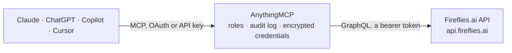

<!-- Generated by scripts/export-github-catalog.mjs in the anythingmcp-website repository. Do not edit by hand. -->

# Fireflies.ai MCP connector

Let your AI work with your Fireflies.ai meeting notes: find recorded meetings, read AI summaries, action items and transcripts, search what was said, ask AskFred about one or many meetings, and with … The AnythingMCP connector gives Claude, ChatGPT, Microsoft Copilot, Cursor and Gemini 21 MCP tools for Fireflies.ai: 13 read and 8 can change data.

**Category:** [Productivity](../productivity.md) · **Tools:** 21 · **Setup guide:** [anythingmcp.com](https://anythingmcp.com/guides/fireflies-to-mcp) · [Deutsch](https://anythingmcp.com/de/guides/fireflies-to-mcp) · [Italiano](https://anythingmcp.com/it/guides/fireflies-to-mcp) · [Español](https://anythingmcp.com/es/guides/fireflies-to-mcp) · [日本語](https://anythingmcp.com/ja/guides/fireflies-to-mcp) · [Русский](https://anythingmcp.com/ru/guides/fireflies-to-mcp) · [中文](https://anythingmcp.com/zh/guides/fireflies-to-mcp)

## Start without code

No installation and no terminal: AnythingMCP Cloud runs the Fireflies.ai connector for you, operated by helpcode.ai in Frankfurt, Germany.

1. **Click the button above** and create an account or sign in. The Fireflies.ai connector opens, ready to install.
2. **Paste the API key or token from your Fireflies.ai account.** Every click is in the [step-by-step guide](https://anythingmcp.com/guides/fireflies-to-mcp).
3. **Click Install.** AnythingMCP shows the address of your MCP server.
4. **Add that address to your assistant:** [Claude](https://anythingmcp.com/guides/connect-fireflies-to-claude) · [ChatGPT](https://anythingmcp.com/guides/connect-fireflies-to-chatgpt) · [Microsoft Copilot](https://anythingmcp.com/guides/connect-fireflies-to-copilot) · [Cursor](https://anythingmcp.com/guides/connect-fireflies-to-cursor) · [Gemini CLI](https://anythingmcp.com/guides/connect-fireflies-to-gemini) · [Meta Muse](https://anythingmcp.com/guides/connect-fireflies-to-muse).
5. **Ask your first question**, for example: *Show the Oct 14 meeting with NordicTools GmbH about invoice INV-2026-091 — who attended and the short AI summary?*

Prefer help with the setup? [Talk to us](https://anythingmcp.com/contact).

## How it works

- **The AI client** speaks MCP (Streamable HTTP) to AnythingMCP and only sees tool names, descriptions and results. It never gets the Fireflies.ai credentials.
- **AnythingMCP** checks the client's role, builds the call from the tool definition, adds the credentials (a bearer token), calls Fireflies.ai, logs the call and returns the result.
- **Fireflies.ai** sees an ordinary API client with the rights of the account the credentials belong to.

## Tools

| Tool | What it does | Access |
|---|---|---|
| [`fireflies_get_current_user`](#fireflies_get_current_user) | Read the Fireflies account that owns the API key: user id, name, email, whether it is a team admin, number of meetings, minutes used, the most recent… | read |
| [`fireflies_list_users`](#fireflies_list_users) | List the members of the Fireflies team: user id, name, email, admin flag, number of meetings, minutes used and most recent meeting. | read |
| [`fireflies_list_channels`](#fireflies_list_channels) | List the channels (folders) that organise meetings in Fireflies: id, title, whether it is private, and when it was created. | read |
| [`fireflies_list_transcripts`](#fireflies_list_transcripts) | List recorded meetings, newest first, with id, title, date, duration in minutes, organizer, participant emails, a short summary and the link in Fireflies. | read |
| [`fireflies_search_transcripts`](#fireflies_search_transcripts) | Search meetings for a word or phrase in the title, in what was said, or both, and return the matching meetings (id, title, date, duration, organizer,… | read |
| [`fireflies_get_transcript`](#fireflies_get_transcript) | Read one meeting without its full text: title, date, duration, organizer, participants, speakers, attendees with join and leave times, channels, privacy,… | read |
| [`fireflies_get_transcript_text`](#fireflies_get_transcript_text) | Read what was said in a meeting, lines 1 to 700: each line is [start second, speaker, text]. | read |
| [`fireflies_get_transcript_text_more`](#fireflies_get_transcript_text_more) | Read lines 701 to 1400 of what was said in a long meeting, each line [start second, speaker, text], after fireflies_get_transcript_text showed totalLines… | read |
| [`fireflies_list_bites`](#fireflies_list_bites) | List soundbites (short clips cut from meetings): id, meeting id, name, start and end second, summary, status, media type, privacy and creator. | read |
| [`fireflies_get_bite`](#fireflies_get_bite) | Read one soundbite: name, meeting id, start and end second, summary, status, privacy, the captions (speaker and text) and the media links. | read |
| [`fireflies_create_bite`](#fireflies_create_bite) | Cut a soundbite (a short shareable clip) from a recorded meeting, between two moments in seconds, with an optional name, summary and privacy. | write |
| [`fireflies_ask_about_meeting`](#fireflies_ask_about_meeting) | Ask Fireflies' AskFred a question about one meeting and get its answer, the thread id for follow-ups, and suggested next questions. | write |
| [`fireflies_ask_across_meetings`](#fireflies_ask_across_meetings) | Ask AskFred a question across many meetings, narrowed by date range (default: the last 30 days, at most one year back), organizers, participants, channels… | write |
| [`fireflies_ask_follow_up`](#fireflies_ask_follow_up) | Ask a follow-up question in an existing AskFred thread, which keeps the context of the earlier questions and answers. | write |
| [`fireflies_list_askfred_threads`](#fireflies_list_askfred_threads) | List the AskFred conversations of the key owner: thread id, title, meeting id (when it was about one meeting) and creation time. | read |
| [`fireflies_get_askfred_thread`](#fireflies_get_askfred_thread) | Read one AskFred conversation with every question and answer in order. | read |
| [`fireflies_list_active_meetings`](#fireflies_list_active_meetings) | List the meetings Fireflies is recording right now: id, title, organizer, meeting link, start and end time, privacy and state (active or paused). | read |
| [`fireflies_upload_audio`](#fireflies_upload_audio) | Send a recording to Fireflies to be transcribed, from a public https link to an mp3, mp4, wav, m4a or ogg file (audio up to 200 MB). | write |
| [`fireflies_add_bot_to_live_meeting`](#fireflies_add_bot_to_live_meeting) | Send the Fireflies notetaker bot into a meeting that is running now (Zoom, Google Meet, Teams and others) to record and transcribe it. | write |
| [`fireflies_delete_transcript`](#fireflies_delete_transcript) | Delete a meeting with its recording, transcript and notes from Fireflies for good. | write |
| [`fireflies_set_user_role`](#fireflies_set_user_role) | Make a team member a Fireflies admin or a regular user. | write |

## Tool reference

Every parameter as the AI client sees it in `tools/list`. Source: [`packages/backend/src/adapters/intl/fireflies.json`](../../../packages/backend/src/adapters/intl/fireflies.json).

### `fireflies_get_current_user`

Read the Fireflies account that owns the API key: user id, name, email, whether it is a team admin, number of meetings, minutes used, the most recent meeting and the connected integrations. Read-only.

**Access:** read · **Call:** `query query CurrentUser { user { user_id email name is_admin num_transcripts minutes_consumed recent_meeting integrations user_groups { id name handle } } }`

No parameters.

### `fireflies_list_users`

List the members of the Fireflies team: user id, name, email, admin flag, number of meetings, minutes used and most recent meeting. The user ids filter fireflies_list_transcripts. Read-only.

**Access:** read · **Call:** `query query Users { users { user_id email name is_admin num_transcripts minutes_consumed recent_meeting } }`

No parameters.

### `fireflies_list_channels`

List the channels (folders) that organise meetings in Fireflies: id, title, whether it is private, and when it was created. A channel id filters fireflies_list_transcripts and AskFred questions. Read-only.

**Access:** read · **Call:** `query query Channels { channels { id title is_private created_at } }`

No parameters.

### `fireflies_list_transcripts`

List recorded meetings, newest first, with id, title, date, duration in minutes, organizer, participant emails, a short summary and the link in Fireflies. Filter by date range, organizers, participants, a team member, a channel, or only the key owner's meetings. Page with limit and skip. Read-only.

**Access:** read · **Call:** `query query Transcripts($fromDate: DateTime, $toDate: DateTime, $organizers: [String!], $participants: [String!], $userId: String, $mine: Boolean, $channelId: String, $limit: Int, $skip: Int) { transcripts(fromDate: $fromDate, toDate: $toDate, organizers: $organizers, participants: $participants, user_id: $userId, mine: $mine, channel_id: $channelId, limit: $limit, skip: $skip) { id title dateString duration organizer_email participants transcript_url is_live summary { short_summary } } }`

| Parameter | Type | Required | Description |
|---|---|---|---|
| `from_date` | string | no | Only meetings on or after this moment, ISO 8601 date-time such as 2026-10-01T00:00:00.000Z. |
| `to_date` | string | no | Only meetings before this moment, ISO 8601 date-time such as 2026-10-31T23:59:59.000Z. |
| `organizers` | string[] | no | Only meetings organized by any of these email addresses. |
| `participants` | string[] | no | Only meetings attended by any of these email addresses. |
| `user_id` | string | no | Only meetings where this team member (user_id from fireflies_list_users) is organizer or participant. |
| `mine` | boolean | no | true: only meetings organized by the owner of the API key. |
| `channel_id` | string | no | Only meetings in this channel (id from fireflies_list_channels). |
| `limit` | integer | no | Meetings per page, 1 to 50 (default 20). |
| `skip` | integer | no | How many meetings to skip, for the next page: add the limit to the previous skip. |

### `fireflies_search_transcripts`

Search meetings for a word or phrase in the title, in what was said, or both, and return the matching meetings (id, title, date, duration, organizer, participants, short summary, link). Optional date range and participants. Page with limit and skip. Read-only.

**Access:** read · **Call:** `query query SearchTranscripts($keyword: String!, $scope: String, $fromDate: DateTime, $toDate: DateTime, $participants: [String!], $limit: Int, $skip: Int) { transcripts(keyword: $keyword, scope: $scope, fromDate: $fromDate, toDate: $toDate, participants: $participants, limit: $limit, skip: $skip) { id title dateString duration organizer_email participants transcript_url is_live summary { short_summary } } }`

| Parameter | Type | Required | Description |
|---|---|---|---|
| `keyword` | string | yes | Word or phrase to look for, up to 255 characters. |
| `scope` | `title` \| `sentences` \| `all` | no | Where to look: title, sentences (what was said) or all (default). |
| `from_date` | string | no | Only meetings on or after this moment, ISO 8601 date-time such as 2026-10-01T00:00:00.000Z. |
| `to_date` | string | no | Only meetings before this moment, ISO 8601 date-time such as 2026-10-31T23:59:59.000Z. |
| `participants` | string[] | no | Only meetings attended by any of these email addresses. |
| `limit` | integer | no | Meetings per page, 1 to 50 (default 20). |
| `skip` | integer | no | How many meetings to skip, for the next page: add the limit to the previous skip. |

### `fireflies_get_transcript`

Read one meeting without its full text: title, date, duration, organizer, participants, speakers, attendees with join and leave times, channels, privacy, and Fireflies' AI notes (overview, short summary, action items, keywords, outline, topics, meeting type). Use fireflies_get_transcript_text for what was said. Read-only.

**Access:** read · **Call:** `query query Transcript($id: String!) { transcript(id: $id) { id title dateString duration organizer_email participants transcript_url meeting_link privacy is_live speakers { id name } meeting_attendees { displayName email name } meeting_attendance { name join_time leave_time } meeting_info { summary_status silent_meeting fred_joined } channels { id title } summary { overview short_summary gist action_items keywords outline topics_discussed meeting_type } } }`

| Parameter | Type | Required | Description |
|---|---|---|---|
| `transcript_id` | string | yes | Meeting (transcript) id from fireflies_list_transcripts or fireflies_search_transcripts. |

### `fireflies_get_transcript_text`

Read what was said in a meeting, lines 1 to 700: each line is [start second, speaker, text]. totalLines tells how long the meeting is; when it is over 700, read the rest with fireflies_get_transcript_text_more. For a live meeting it returns the captions so far. Read-only.

**Access:** read · **Call:** `query query TranscriptText($id: String!) { transcript(id: $id) { id title is_live sentences { start_time speaker_name text } } }`

| Parameter | Type | Required | Description |
|---|---|---|---|
| `transcript_id` | string | yes | Meeting (transcript) id from fireflies_list_transcripts or fireflies_search_transcripts. |

### `fireflies_get_transcript_text_more`

Read lines 701 to 1400 of what was said in a long meeting, each line [start second, speaker, text], after fireflies_get_transcript_text showed totalLines over 700. Fireflies sends no further pages: for longer meetings use fireflies_search_transcripts with scope sentences or ask AskFred. Read-only.

**Access:** read · **Call:** `query query TranscriptTextMore($id: String!) { transcript(id: $id) { id title is_live sentences { start_time speaker_name text } } }`

| Parameter | Type | Required | Description |
|---|---|---|---|
| `transcript_id` | string | yes | Meeting (transcript) id from fireflies_list_transcripts or fireflies_search_transcripts. |

### `fireflies_list_bites`

List soundbites (short clips cut from meetings): id, meeting id, name, start and end second, summary, status, media type, privacy and creator. Pass at least one of mine, my_team or transcript_id. Page with limit and skip. Read-only.

**Access:** read · **Call:** `query query Bites($mine: Boolean, $myTeam: Boolean, $transcriptId: ID, $limit: Int, $skip: Int) { bites(mine: $mine, my_team: $myTeam, transcript_id: $transcriptId, limit: $limit, skip: $skip) { id transcript_id name start_time end_time summary status media_type privacies created_at user { name } } }`

| Parameter | Type | Required | Description |
|---|---|---|---|
| `mine` | boolean | no | true: only soundbites created by the owner of the API key. |
| `my_team` | boolean | no | true: soundbites of the whole team. |
| `transcript_id` | string | no | Only soundbites cut from this meeting. |
| `limit` | integer | no | Soundbites per page, 1 to 50 (default 20). |
| `skip` | integer | no | How many soundbites to skip, for the next page. |

### `fireflies_get_bite`

Read one soundbite: name, meeting id, start and end second, summary, status, privacy, the captions (speaker and text) and the media links. Read-only.

**Access:** read · **Call:** `query query Bite($id: ID!) { bite(id: $id) { id transcript_id name start_time end_time summary status media_type privacies created_at user { name } captions { speaker_name text start_time end_time } sources { src type } } }`

| Parameter | Type | Required | Description |
|---|---|---|---|
| `bite_id` | string | yes | Soundbite id from fireflies_list_bites. |

### `fireflies_create_bite`

Cut a soundbite (a short shareable clip) from a recorded meeting, between two moments in seconds, with an optional name, summary and privacy. Creates content others may see: Confirm with the user before calling it and wait for their yes. Returns the new soundbite id and status.

**Access:** write · **Call:** `mutation mutation CreateBite($transcriptId: ID!, $startTime: Float!, $endTime: Float!, $name: String, $summary: String, $mediaType: String, $privacies: [BitePrivacy!]) { createBite(transcript_id: $transcriptId, start_time: $startTime, end_time: $endTime, name: $name, summary: $summary, media_type: $mediaType, privacies: $privacies) { id name status } }`

| Parameter | Type | Required | Description |
|---|---|---|---|
| `transcript_id` | string | yes | Meeting (transcript) id from fireflies_list_transcripts or fireflies_search_transcripts. |
| `start_second` | number | yes | Where the clip starts, in seconds from the beginning of the meeting. |
| `end_second` | number | yes | Where the clip ends, in seconds; after start_second. |
| `name` | string | no | Name of the soundbite, up to 256 characters. |
| `summary` | string | no | Short summary of the clip, up to 500 characters. |
| `media_type` | `audio` \| `video` | no | audio or video. |
| `privacies` | `public` \| `team` \| `participants`[] | no | Who may see it: any of public, team, participants. |

### `fireflies_ask_about_meeting`

Ask Fireflies' AskFred a question about one meeting and get its answer, the thread id for follow-ups, and suggested next questions. Each answer uses AskFred AI credits of the Fireflies plan: before the first question in a conversation, tell the user and wait for their yes. Starts a new AskFred thread.

**Access:** write · **Call:** `mutation mutation AskAboutMeeting($transcriptId: String!, $question: String!) { createAskFredThread(input: { query: $question, transcript_id: $transcriptId }) { message { id thread_id query answer suggested_queries status } cost } }`

| Parameter | Type | Required | Description |
|---|---|---|---|
| `transcript_id` | string | yes | Meeting (transcript) id from fireflies_list_transcripts or fireflies_search_transcripts. |
| `question` | string | yes | The question, up to 2000 characters. |

### `fireflies_ask_across_meetings`

Ask AskFred a question across many meetings, narrowed by date range (default: the last 30 days, at most one year back), organizers, participants, channels or meeting ids. Returns the answer, the thread id and suggested next questions. Uses AskFred AI credits: before the first question in a conversation, tell the user and wait for their yes.

**Access:** write · **Call:** `mutation mutation AskAcrossMeetings($question: String!, $startTime: String, $endTime: String, $organizers: [String!], $participants: [String!], $channelIds: [String!], $transcriptIds: [String!]) { createAskFredThread(input: { query: $question, filters: { start_time: $startTime, end_time: $endTime, organizers: $organizers, participants: $participants, channel_ids: $channelIds, transcript_ids: $transcriptIds } }) { message { id thread_id query answer suggested_queries status } cost } }`

| Parameter | Type | Required | Description |
|---|---|---|---|
| `question` | string | yes | The question, up to 2000 characters. |
| `start_time` | string | no | Meetings from this moment, ISO 8601, not more than a year ago. Default: 30 days before end_time. |
| `end_time` | string | no | Meetings until this moment, ISO 8601. Default: today. |
| `organizers` | string[] | no | Only meetings organized by these email addresses. |
| `participants` | string[] | no | Only meetings with these participant email addresses. |
| `channel_ids` | string[] | no | Only meetings in these channels (ids from fireflies_list_channels). |
| `transcript_ids` | string[] | no | Only these meetings (ids from fireflies_list_transcripts). |

### `fireflies_ask_follow_up`

Ask a follow-up question in an existing AskFred thread, which keeps the context of the earlier questions and answers. Uses AskFred AI credits like the first question. Returns the answer and suggested next questions.

**Access:** write · **Call:** `mutation mutation AskFollowUp($threadId: String!, $question: String!) { continueAskFredThread(input: { thread_id: $threadId, query: $question }) { message { id thread_id query answer suggested_queries status } cost } }`

| Parameter | Type | Required | Description |
|---|---|---|---|
| `thread_id` | string | yes | threadId returned by fireflies_ask_about_meeting or fireflies_ask_across_meetings, or an id from fireflies_list_askfred_threads. |
| `question` | string | yes | The follow-up question, up to 2000 characters. |

### `fireflies_list_askfred_threads`

List the AskFred conversations of the key owner: thread id, title, meeting id (when it was about one meeting) and creation time. Optionally only those about one meeting. Read-only.

**Access:** read · **Call:** `query query AskFredThreads($transcriptId: String) { askfred_threads(transcript_id: $transcriptId) { id title transcript_id created_at } }`

| Parameter | Type | Required | Description |
|---|---|---|---|
| `transcript_id` | string | no | Only threads about this meeting. |

### `fireflies_get_askfred_thread`

Read one AskFred conversation with every question and answer in order. Read-only.

**Access:** read · **Call:** `query query AskFredThread($id: String!) { askfred_thread(id: $id) { id title transcript_id created_at messages { query answer status created_at } } }`

| Parameter | Type | Required | Description |
|---|---|---|---|
| `thread_id` | string | yes | Thread id from fireflies_list_askfred_threads. |

### `fireflies_list_active_meetings`

List the meetings Fireflies is recording right now: id, title, organizer, meeting link, start and end time, privacy and state (active or paused). Admins can look at another team member by email. Read-only.

**Access:** read · **Call:** `query query ActiveMeetings($email: String) { active_meetings(input: { email: $email }) { id title organizer_email meeting_link start_time end_time privacy state } }`

| Parameter | Type | Required | Description |
|---|---|---|---|
| `email` | string | no | Only this team member's live meetings; regular users can only use their own email or leave it out. |

### `fireflies_upload_audio`

Send a recording to Fireflies to be transcribed, from a public https link to an mp3, mp4, wav, m4a or ogg file (audio up to 200 MB). Fireflies downloads it and creates a new meeting in the account. Confirm with the user before calling it and wait for their yes. Returns whether the upload was accepted; the transcript appears in fireflies_list_transcripts after processing.

**Access:** write · **Call:** `mutation mutation UploadAudio($url: String!, $title: String!, $customLanguage: String, $meetingDate: String, $saveVideo: Boolean, $clientReferenceId: String) { uploadAudio(input: { url: $url, title: $title, custom_language: $customLanguage, meeting_date: $meetingDate, save_video: $saveVideo, client_reference_id: $clientReferenceId }) { success title message } }`

| Parameter | Type | Required | Description |
|---|---|---|---|
| `url` | string | yes | Public https link that downloads the media file directly (not a preview page). |
| `title` | string | yes | Title of the new meeting. |
| `language` | string | no | Language code of the recording, e.g. en, de, es (see Fireflies' language codes). Default: English. |
| `meeting_date` | string | no | When the meeting took place, ISO 8601 such as 2026-03-14T15:00:00Z, not in the future. Default: now. |
| `save_video` | boolean | no | true: keep the video as well, for a video file. |
| `client_reference_id` | string | no | Your own reference for this upload. |

### `fireflies_add_bot_to_live_meeting`

Send the Fireflies notetaker bot into a meeting that is running now (Zoom, Google Meet, Teams and others) to record and transcribe it. The bot joins as a visible participant and everyone in the call sees that the meeting is being recorded: tell the user this, confirm the meeting link and wait for their yes. Limited to 3 calls per 20 minutes per user.

**Access:** write · **Call:** `mutation mutation AddToLiveMeeting($meetingLink: String!, $title: String, $meetingPassword: String, $duration: Int, $language: String, $attendees: [AttendeeInput!]) { addToLiveMeeting(meeting_link: $meetingLink, title: $title, meeting_password: $meetingPassword, duration: $duration, language: $language, attendees: $attendees) { success message } }`

| Parameter | Type | Required | Description |
|---|---|---|---|
| `meeting_link` | string | yes | Join link of the running meeting, e.g. https://meet.google.com/abc-defg-hij. |
| `title` | string | no | Title for the recording, up to 256 characters. |
| `meeting_password` | string | no | Meeting passcode, if the meeting needs one (up to 32 characters). |
| `duration_minutes` | integer | no | How long the bot stays, 15 to 120 minutes (default 60). |
| `language` | string | no | Language code of the meeting, e.g. en, de, es. Default: English. |
| `attendees` | object[] | no | Expected participants, each with displayName, email and optionally phoneNumber. |

### `fireflies_delete_transcript`

Delete a meeting with its recording, transcript and notes from Fireflies for good. Installed switched off. Only on an explicit request: name the meeting (title and date) to the user and wait for their yes. Owners can delete their own meetings, admins any meeting of the team.

**Access:** write · **Call:** `mutation mutation DeleteTranscript($id: String!) { deleteTranscript(id: $id) { id title } }`

| Parameter | Type | Required | Description |
|---|---|---|---|
| `transcript_id` | string | yes | Meeting (transcript) id from fireflies_list_transcripts or fireflies_search_transcripts. |

### `fireflies_set_user_role`

Make a team member a Fireflies admin or a regular user. Changes who can see and manage the team's meetings. Installed switched off; needs an admin key. Name the person and the new role to the user and wait for their yes.

**Access:** write · **Call:** `mutation mutation SetUserRole($userId: String!, $role: Role!) { setUserRole(user_id: $userId, role: $role) { user_id email name is_admin } }`

| Parameter | Type | Required | Description |
|---|---|---|---|
| `user_id` | string | yes | user_id from fireflies_list_users. |
| `role` | `admin` \| `user` | yes | New role: admin or user. |

## Run it yourself

AnythingMCP is open source (AGPL-3.0). [Run it with Docker](../../../README.md#run-it-yourself), open **Connectors → Store**, pick **Fireflies.ai** and enter `FIREFLIES_API_KEY`, then add your MCP server URL to the AI client.

[← Productivity connectors](../productivity.md) · [All categories](../README.md)
