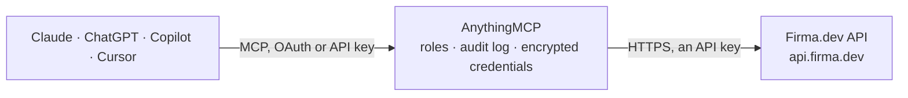

<!-- Generated by scripts/export-github-catalog.mjs in the anythingmcp-website repository. Do not edit by hand. -->

# Firma.dev MCP connector

Firma.dev e-signature from any AI agent: templates, signing requests from a template, sending and reminders, recipient status, audit trail and signed PDFs. 13 tools, API-key auth, with free test keys. The AnythingMCP connector gives Claude, ChatGPT, Microsoft Copilot, Cursor and Gemini 13 MCP tools for Firma.dev: 9 read and 4 can change data.

**Category:** [E-Signature](../e-signature.md) · **Tools:** 13 · **Setup guide:** [anythingmcp.com](https://anythingmcp.com/guides/firma-to-mcp) · [Deutsch](https://anythingmcp.com/de/guides/firma-to-mcp) · [Italiano](https://anythingmcp.com/it/guides/firma-to-mcp) · [Español](https://anythingmcp.com/es/guides/firma-to-mcp) · [日本語](https://anythingmcp.com/ja/guides/firma-to-mcp) · [Русский](https://anythingmcp.com/ru/guides/firma-to-mcp) · [中文](https://anythingmcp.com/zh/guides/firma-to-mcp)

## Start without code

No installation and no terminal: AnythingMCP Cloud runs the Firma.dev connector for you, operated by helpcode.ai in Frankfurt, Germany.

1. **Click the button above** and create an account or sign in. The Firma.dev connector opens, ready to install.
2. **Paste the API key or token from your Firma.dev account.** Every click is in the [step-by-step guide](https://anythingmcp.com/guides/firma-to-mcp).
3. **Click Install.** AnythingMCP shows the address of your MCP server.
4. **Add that address to your assistant:** [Claude](https://anythingmcp.com/guides/connect-firma-to-claude) · [ChatGPT](https://anythingmcp.com/guides/connect-firma-to-chatgpt) · [Microsoft Copilot](https://anythingmcp.com/guides/connect-firma-to-copilot) · [Cursor](https://anythingmcp.com/guides/connect-firma-to-cursor) · [Gemini CLI](https://anythingmcp.com/guides/connect-firma-to-gemini) · [Meta Muse](https://anythingmcp.com/guides/connect-firma-to-muse).
5. **Ask your first question**, for example: *Find the template named 'Supplier Agreement v2' in our workspace and show its details.*

Prefer help with the setup? [Talk to us](https://anythingmcp.com/contact).

## How it works

- **The AI client** speaks MCP (Streamable HTTP) to AnythingMCP and only sees tool names, descriptions and results. It never gets the Firma.dev credentials.
- **AnythingMCP** checks the client's role, builds the call from the tool definition, adds the credentials (an API key), calls Firma.dev, logs the call and returns the result.
- **Firma.dev** sees an ordinary API client with the rights of the account the credentials belong to.

## Tools

| Tool | What it does | Access |
|---|---|---|
| [`firma_get_company`](#firma_get_company) | The Firma.dev company account behind the key: name, owner, language and the remaining envelope credits. | read |
| [`firma_list_templates`](#firma_list_templates) | List the workspace's templates (reusable documents with recipient slots and fields), newest first unless sorted otherwise. | read |
| [`firma_get_template`](#firma_get_template) | One template in full: its settings, document, fields and reminders, as it would be copied into a signing request. | read |
| [`firma_list_template_recipients`](#firma_list_template_recipients) | The recipient slots of a template: id (pass it as template_user_id when creating a signing request), designation (Signer, Approver, CC), signing order and… | read |
| [`firma_list_signing_requests`](#firma_list_signing_requests) | List signing requests (envelopes) with their status and dates, filtered by status, name, signer or creation date. | read |
| [`firma_get_signing_request`](#firma_get_signing_request) | One signing request in full: status flags (sent, finished, cancelled, declined, expired), timestamps, expiry, credit cost and settings. | read |
| [`firma_list_signing_request_recipients`](#firma_list_signing_request_recipients) | The recipients of a signing request with where each one stands: finished_on (signed), declined_on and decline_reason, signing order, and missing_fields /… | read |
| [`firma_get_signing_request_audit`](#firma_get_signing_request_audit) | The audit trail of a signing request in chronological order: created, edited, sent and cancelled by the sender; viewed, signed, declined and downloaded by… | read |
| [`firma_get_signed_document_url`](#firma_get_signed_document_url) | A short-lived download URL for the signed PDF of a finished signing request (or the partially signed PDF when partial download is enabled). | read |
| [`firma_create_signing_request_from_template`](#firma_create_signing_request_from_template) | Create a DRAFT signing request from a template, with the real recipients filled into the template's slots. | write |
| [`firma_send_signing_request`](#firma_send_signing_request) | Send a draft signing request: every signer gets the signing email. | write |
| [`firma_resend_signing_request`](#firma_resend_signing_request) | Email the signing link again to recipients who can sign now and have not signed yet, optionally with a short message. | write |
| [`firma_cancel_signing_request`](#firma_cancel_signing_request) | Cancel a sent signing request that is not finished yet; signers can no longer sign it. | write |

## Tool reference

Every parameter as the AI client sees it in `tools/list`. Source: [`packages/backend/src/adapters/intl/firma.json`](../../../packages/backend/src/adapters/intl/firma.json).

### `firma_get_company`

The Firma.dev company account behind the key: name, owner, language and the remaining envelope credits. Use it before sending to check credits. Needs the account's main key; a workspace key may get 403.

**Access:** read · **Call:** `GET /company`

No parameters.

### `firma_list_templates`

List the workspace's templates (reusable documents with recipient slots and fields), newest first unless sorted otherwise. Filter by name to find the one to send.

**Access:** read · **Call:** `GET /templates`

| Parameter | Type | Required | Description |
|---|---|---|---|
| `name` | string | no | Part of the template name, case-insensitive. |
| `page` | integer | no | Page number, starting at 1. |
| `page_size` | integer | no | Items per page (default 20). |
| `sort_by` | `name` \| `created_on` \| `last_changed_on` | no | Field to sort by. |
| `sort_order` | `asc` \| `desc` | no | Sort direction. |

### `firma_get_template`

One template in full: its settings, document, fields and reminders, as it would be copied into a signing request.

**Access:** read · **Call:** `GET /templates/{template_id}`

| Parameter | Type | Required | Description |
|---|---|---|---|
| `template_id` | string | yes | The template id, as returned by the list tools. |

### `firma_list_template_recipients`

The recipient slots of a template: id (pass it as template_user_id when creating a signing request), designation (Signer, Approver, CC), signing order and any preset name or email. Call it before firma_create_signing_request_from_template.

**Access:** read · **Call:** `GET /templates/{template_id}/users`

| Parameter | Type | Required | Description |
|---|---|---|---|
| `template_id` | string | yes | The template id, as returned by the list tools. |

### `firma_list_signing_requests`

List signing requests (envelopes) with their status and dates, filtered by status, name, signer or creation date. Returns a trimmed view; use firma_get_signing_request for one request in full.

**Access:** read · **Call:** `GET /signing-requests`

| Parameter | Type | Required | Description |
|---|---|---|---|
| `status` | string | no | not_sent, in_progress, finished, cancelled, declined or expired; comma-separate several, e.g. 'in_progress,declined'. |
| `name` | string | no | Part of the request name, case-insensitive. |
| `signer_email` | string | no | Exact email of a signer. |
| `signer_name` | string | no | Part of a signer's name. |
| `created_after` | string | no | ISO 8601 date or timestamp. |
| `created_before` | string | no | ISO 8601 date or timestamp. |
| `page` | integer | no | Page number, starting at 1. |
| `page_size` | integer | no | Items per page (default 20). |
| `sort_by` | `name` \| `created_on` \| `expiration_hours` \| `sent_on` \| `finished_on` | no | Field to sort by. |
| `sort_order` | `asc` \| `desc` | no | Sort direction. |

### `firma_get_signing_request`

One signing request in full: status flags (sent, finished, cancelled, declined, expired), timestamps, expiry, credit cost and settings.

**Access:** read · **Call:** `GET /signing-requests/{signing_request_id}`

| Parameter | Type | Required | Description |
|---|---|---|---|
| `signing_request_id` | string | yes | The signing request id, as returned by the list tools. |

### `firma_list_signing_request_recipients`

The recipients of a signing request with where each one stands: finished_on (signed), declined_on and decline_reason, signing order, and missing_fields / ready_to_send before sending. Use it to answer 'who still has to sign'.

**Access:** read · **Call:** `GET /signing-requests/{signing_request_id}/users`

| Parameter | Type | Required | Description |
|---|---|---|---|
| `signing_request_id` | string | yes | The signing request id, as returned by the list tools. |

### `firma_get_signing_request_audit`

The audit trail of a signing request in chronological order: created, edited, sent and cancelled by the sender; viewed, signed, declined and downloaded by each signer.

**Access:** read · **Call:** `GET /signing-requests/{signing_request_id}/audit`

| Parameter | Type | Required | Description |
|---|---|---|---|
| `signing_request_id` | string | yes | The signing request id, as returned by the list tools. |

### `firma_get_signed_document_url`

A short-lived download URL for the signed PDF of a finished signing request (or the partially signed PDF when partial download is enabled). Give the user the URL; it expires at expires_at.

**Access:** read · **Call:** `GET /signing-requests/{signing_request_id}/download`

| Parameter | Type | Required | Description |
|---|---|---|---|
| `signing_request_id` | string | yes | The signing request id, as returned by the list tools. |

### `firma_create_signing_request_from_template`

Create a DRAFT signing request from a template, with the real recipients filled into the template's slots. Nothing is emailed and no credit is used until firma_send_signing_request. Get the slot ids with firma_list_template_recipients.

**Access:** write · **Call:** `POST /signing-requests`

| Parameter | Type | Required | Description |
|---|---|---|---|
| `template_id` | string | yes | The template id, as returned by the list tools. |
| `name` | string | no | Name of the signing request, e.g. 'NDA - Acme GmbH'. Defaults to the template's name. |
| `recipients` | object[] | no | One entry per template slot you fill: {"template_user_id": "<slot id>", "first_name": "Ada", "last_name": "Lovelace", "email": "ada@example.com", "designation": "Signer"}. designation is Signer, Approver or CC; first_name, email and designation are required. Omit to keep the template's own recipients. |
| `expiration_hours` | integer | no | Hours until the request expires once sent (default 168 = 7 days). |
| `description` | string | no | Optional description shown to recipients. |

### `firma_send_signing_request`

Send a draft signing request: every signer gets the signing email. On a live key this consumes one credit and cannot be undone (only cancelled). Ask the user to confirm the recipients first.

**Access:** write · **Call:** `POST /signing-requests/{signing_request_id}/send`

| Parameter | Type | Required | Description |
|---|---|---|---|
| `signing_request_id` | string | yes | The signing request id, as returned by the list tools. |

### `firma_resend_signing_request`

Email the signing link again to recipients who can sign now and have not signed yet, optionally with a short message. Recipient ids come from firma_list_signing_request_recipients.

**Access:** write · **Call:** `POST /signing-requests/{signing_request_id}/resend`

| Parameter | Type | Required | Description |
|---|---|---|---|
| `signing_request_id` | string | yes | The signing request id, as returned by the list tools. |
| `recipient_ids` | string[] | yes | Ids of the recipients to remind. |
| `custom_message` | string | no | Optional message added to the reminder email. |

### `firma_cancel_signing_request`

Cancel a sent signing request that is not finished yet; signers can no longer sign it. Only with the user's explicit go-ahead.

**Access:** write · **Call:** `POST /signing-requests/{signing_request_id}/cancel`

| Parameter | Type | Required | Description |
|---|---|---|---|
| `signing_request_id` | string | yes | The signing request id, as returned by the list tools. |
| `reason` | string | no | Optional reason, shown to signers when they are notified. |
| `notify_signers` | boolean | no | Email the signers about the cancellation. |

## Run it yourself

AnythingMCP is open source (AGPL-3.0). [Run it with Docker](../../../README.md#run-it-yourself), open **Connectors → Store**, pick **Firma.dev** and enter `FIRMA_API_KEY`, then add your MCP server URL to the AI client.

[← E-Signature connectors](../e-signature.md) · [All categories](../README.md)
