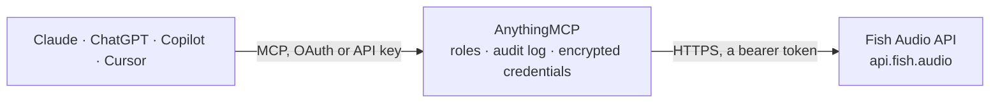

<!-- Generated by scripts/export-github-catalog.mjs in the anythingmcp-website repository. Do not edit by hand. -->

# Fish Audio MCP connector

Text to speech, voice cloning and speech to text with Fish Audio: search a library of community and licensed voices, generate natural multilingual speech with emotion tags as audio files, transcribe … The AnythingMCP connector gives Claude, ChatGPT, Microsoft Copilot, Cursor and Gemini 9 MCP tools for Fish Audio: 4 read and 5 can change data.

**Category:** [Publishing](../publishing.md) · **Tools:** 9 · **Setup guide:** [anythingmcp.com](https://anythingmcp.com/guides/fish-audio-to-mcp) · [Deutsch](https://anythingmcp.com/de/guides/fish-audio-to-mcp) · [Italiano](https://anythingmcp.com/it/guides/fish-audio-to-mcp) · [Español](https://anythingmcp.com/es/guides/fish-audio-to-mcp) · [日本語](https://anythingmcp.com/ja/guides/fish-audio-to-mcp) · [Русский](https://anythingmcp.com/ru/guides/fish-audio-to-mcp) · [中文](https://anythingmcp.com/zh/guides/fish-audio-to-mcp)

## Start without code

No installation and no terminal: AnythingMCP Cloud runs the Fish Audio connector for you, operated by helpcode.ai in Frankfurt, Germany.

1. **Click the button above** and create an account or sign in. The Fish Audio connector opens, ready to install.
2. **Paste the API key or token from your Fish Audio account.** Every click is in the [step-by-step guide](https://anythingmcp.com/guides/fish-audio-to-mcp).
3. **Click Install.** AnythingMCP shows the address of your MCP server.
4. **Add that address to your assistant:** [Claude](https://anythingmcp.com/guides/connect-fish-audio-to-claude) · [ChatGPT](https://anythingmcp.com/guides/connect-fish-audio-to-chatgpt) · [Microsoft Copilot](https://anythingmcp.com/guides/connect-fish-audio-to-copilot) · [Cursor](https://anythingmcp.com/guides/connect-fish-audio-to-cursor) · [Gemini CLI](https://anythingmcp.com/guides/connect-fish-audio-to-gemini) · [Meta Muse](https://anythingmcp.com/guides/connect-fish-audio-to-muse).
5. **Ask your first question**, for example: *Do we have a trained account voice called 'Eva_narration_2026' in our Fish Audio voices?*

Prefer help with the setup? [Talk to us](https://anythingmcp.com/contact).

## How it works

- **The AI client** speaks MCP (Streamable HTTP) to AnythingMCP and only sees tool names, descriptions and results. It never gets the Fish Audio credentials.
- **AnythingMCP** checks the client's role, builds the call from the tool definition, adds the credentials (a bearer token), calls Fish Audio, logs the call and returns the result.
- **Fish Audio** sees an ordinary API client with the rights of the account the credentials belong to.

## Tools

| Tool | What it does | Access |
|---|---|---|
| [`fish_audio_get_api_credit`](#fish_audio_get_api_credit) | The prepaid developer API credit of the Fish Audio account, in US dollars (credit, as a decimal string), with the total ever topped up. | read |
| [`fish_audio_get_package`](#fish_audio_get_package) | The Fish Audio subscription package of the account (type, total and remaining balance, billing period, renewal and cancellation dates). | read |
| [`fish_audio_list_voices`](#fish_audio_list_voices) | Search the Fish Audio voice library (hundreds of thousands of community and licensed voices) or list the account's own voice models, filtered by name, tag… | read |
| [`fish_audio_get_voice`](#fish_audio_get_voice) | Details of one Fish Audio voice model by id: title, description, tags, languages, visibility, training state (trained means ready to use), samples with… | read |
| [`fish_audio_text_to_speech`](#fish_audio_text_to_speech) | Turn text into natural speech with a Fish Audio voice and return the audio file (MP3 by default) attached to the result. | write |
| [`fish_audio_transcribe`](#fish_audio_transcribe) | Transcribe speech in an audio or video file to text with Fish Audio (transcribe-1-pro by default: up to 60 minutes, speaker turns, emotion and sound cues). | write |
| [`fish_audio_create_voice`](#fish_audio_create_voice) | Create a custom voice model (voice clone) from a recording of the voice, ready to use at once with fish_audio_text_to_speech. | write |
| [`fish_audio_update_voice`](#fish_audio_update_voice) | Change the title, description or visibility of one of the account's voice models. | write |
| [`fish_audio_delete_voice`](#fish_audio_delete_voice) | Delete one of the account's voice models permanently. | write |

## Tool reference

Every parameter as the AI client sees it in `tools/list`. Source: [`packages/backend/src/adapters/intl/fish-audio.json`](../../../packages/backend/src/adapters/intl/fish-audio.json).

### `fish_audio_get_api_credit`

The prepaid developer API credit of the Fish Audio account, in US dollars (credit, as a decimal string), with the total ever topped up. Text to speech and transcription draw from it. Free.

**Access:** read · **Call:** `GET /wallet/self/api-credit`

No parameters.

### `fish_audio_get_package`

The Fish Audio subscription package of the account (type, total and remaining balance, billing period, renewal and cancellation dates). This is the web app plan, separate from the developer API credit. Free.

**Access:** read · **Call:** `GET /wallet/self/package`

No parameters.

### `fish_audio_list_voices`

Search the Fish Audio voice library (hundreds of thousands of community and licensed voices) or list the account's own voice models, filtered by name, tag and language and sorted by popularity. Returns the voice id (use it as reference_id in fish_audio_text_to_speech), title, description, tags, languages and a sample audio link. Free.

**Access:** read · **Call:** `GET /model`

| Parameter | Type | Required | Description |
|---|---|---|---|
| `title` | string | no | Words in the voice name, e.g. "narrator" or "Morgan". |
| `tag` | string[] | no | Tags the voices must have, e.g. ["male", "deep"], ["female", "calm", "narration"]. |
| `language` | string[] | no | Languages the voice speaks, as codes, e.g. ["en"], ["de"], ["zh", "ja"]. |
| `self` | boolean | no | true lists only the voice models of this account (including private ones) instead of the public library. |
| `visibility` | `public` \| `unlist` \| `private` | no | With self true: only voices with this visibility. |
| `author_id` | string | no | Only public voices by this author id. |
| `licensed` | boolean | no | true returns only voices licensed by Fish Audio from the voice owner (safe for commercial use). |
| `sort_by` | `score` \| `task_count` \| `created_at` | no | score (default, relevance and quality), task_count (most used) or created_at (newest). |
| `page_size` | integer | no | Voices per page, default 20 here. |
| `page_number` | integer | no | Page number, starting at 1. |

### `fish_audio_get_voice`

Details of one Fish Audio voice model by id: title, description, tags, languages, visibility, training state (trained means ready to use), samples with audio links and usage counts. Free.

**Access:** read · **Call:** `GET /model/{id}`

| Parameter | Type | Required | Description |
|---|---|---|---|
| `id` | string | yes | Voice model id (32 hex characters), from fish_audio_list_voices or the voice page URL on fish.audio. |

### `fish_audio_text_to_speech`

Turn text into natural speech with a Fish Audio voice and return the audio file (MP3 by default) attached to the result. Pick a voice with fish_audio_list_voices and pass its id as reference_id; without one a default voice is used. Emotion and delivery cues in square brackets, such as [happy], [whispering] or [laughing], can be written in the text. COSTS MONEY from the developer API credit: s2.1-pro and s2-pro $15 per million UTF-8 bytes of text (about $0.015 per 1,000 characters), drama-3 $50 per million; s2.1-pro-free is free with limits. Tell the user the length and confirm before long texts.

**Access:** write · **Call:** `POST /v1/tts`

| Parameter | Type | Required | Description |
|---|---|---|---|
| `text` | string | yes | The text to speak. Long texts are split into chunks automatically; the result is one file. |
| `reference_id` | string | no | Voice model id from fish_audio_list_voices or the account's own voices. |
| `model` | `s2.1-pro` \| `s2.1-pro-free` \| `s2-pro` \| `drama-3` \| `s1` | no | s2.1-pro (default, best value), s2.1-pro-free (free developer tier with limits), s2-pro, drama-3 (most expressive, higher price), s1 (deprecated). |
| `format` | `mp3` \| `wav` \| `opus` \| `pcm` | no | Audio format, default mp3 (smallest). |
| `mp3_bitrate` | `64` \| `128` \| `192` | no | MP3 bitrate in kbps, default 128. |
| `sample_rate` | integer | no | Sample rate in Hz; default 44100 (48000 for opus). |
| `language` | string | no | Language of the text as a BCP-47 tag (en, de, es-MX, zh-CN); used to read numbers, dates and units aloud correctly. |
| `speed` | number | no | Speaking rate, 0.5 to 2, default 1. |
| `volume` | number | no | Volume change in dB, default 0. |
| `temperature` | number | no | Expressiveness 0 to 1, default 0.7: higher is more varied. |
| `top_p` | number | no | Nucleus sampling 0 to 1, default 0.7. |
| `latency` | `normal` \| `balanced` \| `low` | no | normal (default, best quality), balanced or low latency. |
| `normalize` | boolean | no | Read numbers, dates and symbols as words before speaking, default true. |

### `fish_audio_transcribe`

Transcribe speech in an audio or video file to text with Fish Audio (transcribe-1-pro by default: up to 60 minutes, speaker turns, emotion and sound cues). Pass a public link to the file (up to 10 MB). Returns text, duration in seconds, detected language and, with timestamps, word segments and speaker turns. COSTS MONEY from the developer API credit: $0.36 per hour of audio, billed per second. Confirm before long recordings.

**Access:** write · **Call:** `POST /v1/asr`

| Parameter | Type | Required | Description |
|---|---|---|---|
| `audio_url` | string | yes | Public https link to the audio or video file (mp3, wav, m4a, ogg, flac, webm, mp4 ...), up to 10 MB; AnythingMCP downloads and uploads it. |
| `model` | `transcribe-1-pro` \| `transcribe-1` | no | transcribe-1-pro (default, recommended) or transcribe-1 (deprecated, short recordings; ignores the speaker options). |
| `language` | string | no | Optional language hint as an ISO 639-1 code (en, de, zh); detected automatically anyway. |
| `ignore_timestamps` | boolean | no | true (the API default) returns no timestamps; false returns word segments and speaker_turns. |
| `tag_audio_events` | boolean | no | false removes cues such as [laughter] from the text; default true. |
| `diarize` | `auto` \| `true` \| `false` | no | Speaker turns: auto (default) or true returns them with timestamps; false removes speaker markers. |
| `num_speakers` | integer | no | Expected number of speakers; not with min_speakers or max_speakers. |
| `min_speakers` | integer | no | Lower bound for the number of speakers. |
| `max_speakers` | integer | no | Upper bound for the number of speakers. |

### `fish_audio_create_voice`

Create a custom voice model (voice clone) from a recording of the voice, ready to use at once with fish_audio_text_to_speech. Pass a public link to a clean 10 to 30 second sample of one speaker; the transcript is detected automatically unless given. The model is private unless visibility says otherwise. Only clone voices the user has the right to use. Creates a model in the account (counts towards the plan's voice limit).

**Access:** write · **Call:** `POST /model`

| Parameter | Type | Required | Description |
|---|---|---|---|
| `title` | string | yes | Name of the voice. |
| `voice_url` | string | yes | Public https link to the voice recording (mp3, wav, m4a ...), up to 10 MB. |
| `text` | string | no | Optional exact transcript of the recording; improves quality. Detected by speech recognition when left out. |
| `description` | string | no | Optional description of the voice. |
| `visibility` | `private` \| `unlist` | no | private (default, only this account) or unlist (anyone with the link). Publishing publicly is done in the web app. |
| `enhance_audio_quality` | boolean | no | Clean up noise in the recording, default true. |

### `fish_audio_update_voice`

Change the title, description or visibility of one of the account's voice models.

**Access:** write · **Call:** `PATCH /model/{id}`

| Parameter | Type | Required | Description |
|---|---|---|---|
| `id` | string | yes | Voice model id of the account (fish_audio_list_voices with self true). |
| `title` | string | no | New name. |
| `description` | string | no | New description. |
| `visibility` | `public` \| `unlist` \| `private` | no | New visibility. |

### `fish_audio_delete_voice`

Delete one of the account's voice models permanently. Speech can no longer be generated with it. Confirm with the user first.

**Access:** write · **Call:** `DELETE /model/{id}`

| Parameter | Type | Required | Description |
|---|---|---|---|
| `id` | string | yes | Voice model id of the account. |

## Run it yourself

AnythingMCP is open source (AGPL-3.0). [Run it with Docker](../../../README.md#run-it-yourself), open **Connectors → Store**, pick **Fish Audio** and enter `FISH_AUDIO_API_KEY`, then add your MCP server URL to the AI client.

[← Publishing connectors](../publishing.md) · [All categories](../README.md)
