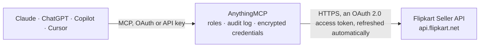

<!-- Generated by scripts/export-github-catalog.mjs in the anythingmcp-website repository. Do not edit by hand. -->

# Flipkart Seller MCP connector

Flipkart Marketplace Seller API v3 for your own seller account: listings with price and stock updates, order shipments (search, details, labels and invoices, ready to dispatch, cancellation, handover … The AnythingMCP connector gives Claude, ChatGPT, Microsoft Copilot, Cursor and Gemini 19 MCP tools for Flipkart Seller: 14 read and 5 can change data.

**Category:** [E-commerce](../e-commerce.md) · **Tools:** 19 · **Setup guide:** [anythingmcp.com](https://anythingmcp.com/guides/flipkart-seller-to-mcp) · [Deutsch](https://anythingmcp.com/de/guides/flipkart-seller-to-mcp) · [Italiano](https://anythingmcp.com/it/guides/flipkart-seller-to-mcp) · [Español](https://anythingmcp.com/es/guides/flipkart-seller-to-mcp) · [日本語](https://anythingmcp.com/ja/guides/flipkart-seller-to-mcp) · [Русский](https://anythingmcp.com/ru/guides/flipkart-seller-to-mcp) · [中文](https://anythingmcp.com/zh/guides/flipkart-seller-to-mcp)

## Start without code

No installation and no terminal: AnythingMCP Cloud runs the Flipkart Seller connector for you, operated by helpcode.ai in Frankfurt, Germany.

1. **Click the button above** and create an account or sign in. The Flipkart Seller connector opens, ready to install.
2. **Sign in with your Flipkart Seller account** when AnythingMCP asks. The first time, an admin creates a small app in the Flipkart Seller developer console. Every click is in the [step-by-step guide](https://anythingmcp.com/guides/flipkart-seller-to-mcp).
3. **Click Install.** AnythingMCP shows the address of your MCP server.
4. **Add that address to your assistant:** [Claude](https://anythingmcp.com/guides/connect-flipkart-seller-to-claude) · [ChatGPT](https://anythingmcp.com/guides/connect-flipkart-seller-to-chatgpt) · [Microsoft Copilot](https://anythingmcp.com/guides/connect-flipkart-seller-to-copilot) · [Cursor](https://anythingmcp.com/guides/connect-flipkart-seller-to-cursor) · [Gemini CLI](https://anythingmcp.com/guides/connect-flipkart-seller-to-gemini) · [Meta Muse](https://anythingmcp.com/guides/connect-flipkart-seller-to-muse).
5. **Ask your first question**, for example: *I need the shipping details for shipment SHP-2026-0457, who is the courier and tracking ID?*

Prefer help with the setup? [Talk to us](https://anythingmcp.com/contact).

## How it works

- **The AI client** speaks MCP (Streamable HTTP) to AnythingMCP and only sees tool names, descriptions and results. It never gets the Flipkart Seller credentials.
- **AnythingMCP** checks the client's role, builds the call from the tool definition, adds the credentials (an OAuth 2.0 access token, refreshed automatically), calls Flipkart Seller, logs the call and returns the result.
- **Flipkart Seller** sees an ordinary API client with the rights of the account the credentials belong to.

## Tools

| Tool | What it does | Access |
|---|---|---|
| [`flipkart_seller_search_listings`](#flipkart_seller_search_listings) | Page through all of the seller's listings, 500 per page: listing id, product id (FSN) and SKU. | read |
| [`flipkart_seller_search_products`](#flipkart_seller_search_products) | Listings with product details, 20 per batch: listing id, product id, SKU, status, product name, image, vertical, selling price (ssp), effective selling… | read |
| [`flipkart_seller_get_listings`](#flipkart_seller_get_listings) | Details of up to 10 listings by SKU: listing id, product id, title and URL, MRP and selling price, tax (HSN), status, shipping fees, fulfilment profile and… | read |
| [`flipkart_seller_update_price`](#flipkart_seller_update_price) | Set the MRP and selling price of one listing. | write |
| [`flipkart_seller_update_inventory`](#flipkart_seller_update_inventory) | Set the available stock of one listing at one or more seller locations. | write |
| [`flipkart_seller_search_shipments`](#flipkart_seller_search_shipments) | Search the seller's shipments (orders) by state and dates. | read |
| [`flipkart_seller_next_shipments_page`](#flipkart_seller_next_shipments_page) | The next page of a shipment search. | read |
| [`flipkart_seller_get_shipments`](#flipkart_seller_get_shipments) | Shipments with their order items by shipment ids, order ids or order item ids (give exactly one of the three): dates, hold flag, location, packaging policy,… | read |
| [`flipkart_seller_get_shipment_details`](#flipkart_seller_get_shipment_details) | Shipping details of up to 25 shipments: delivery and billing address, courier and tracking id, dispatch and delivery dates and sub-shipments. | read |
| [`flipkart_seller_generate_labels`](#flipkart_seller_generate_labels) | Pack shipments: sends the invoice and package details and asks Flipkart to generate the shipping label and invoice. | write |
| [`flipkart_seller_download_labels`](#flipkart_seller_download_labels) | Download the shipping labels, with the invoice when the seller uses Flipkart's auto invoicing, of packed shipments as one PDF. | read |
| [`flipkart_seller_download_invoices`](#flipkart_seller_download_invoices) | Download the customer invoices of packed shipments as a PDF. | read |
| [`flipkart_seller_mark_ready_to_dispatch`](#flipkart_seller_mark_ready_to_dispatch) | Mark packed shipments of one location as Ready to Dispatch, which books the courier pickup. | write |
| [`flipkart_seller_cancel_shipments`](#flipkart_seller_cancel_shipments) | Cancel order items of a shipment the seller cannot fulfil. | write |
| [`flipkart_seller_get_handover_counts`](#flipkart_seller_get_handover_counts) | Shipments ready for pickup at a location, per courier: `vendorGroupCode`, whether they are multi-pack shipments (`isMps`), the count, the pickup window and… | read |
| [`flipkart_seller_download_manifest`](#flipkart_seller_download_manifest) | Download the manifest PDF (the list of shipments to hand over) for one courier at a location, using the `vendorGroupCode` from… | read |
| [`flipkart_seller_list_returns`](#flipkart_seller_list_returns) | Returns of one kind, filtered by created or modified date and location, 25 per page: return id, order and order item id, shipment id, quantity, status,… | read |
| [`flipkart_seller_get_returns`](#flipkart_seller_get_returns) | Returns by return ids or by courier tracking ids (up to 25 each), with the same fields as flipkart_seller_list_returns. | read |
| [`flipkart_seller_next_returns_page`](#flipkart_seller_next_returns_page) | The next page of returns. | read |

## Tool reference

Every parameter as the AI client sees it in `tools/list`. Source: [`packages/backend/src/adapters/in/flipkart-seller.json`](../../../packages/backend/src/adapters/in/flipkart-seller.json).

### `flipkart_seller_search_listings`

Page through all of the seller's listings, 500 per page: listing id, product id (FSN) and SKU. Answers `has_more` and `next_page_id`; pass `next_page_id` as `page_id` for the next page. Read-only although sent as POST.

**Access:** read · **Call:** `POST /listings/v3/search`

| Parameter | Type | Required | Description |
|---|---|---|---|
| `listing_status` | `ACTIVE` \| `INACTIVE` | no | Only ACTIVE or INACTIVE listings. Leave out for all. |
| `page_id` | string | no | `next_page_id` from the previous answer. Leave out for the first page. |

### `flipkart_seller_search_products`

Listings with product details, 20 per batch: listing id, product id, SKU, status, product name, image, vertical, selling price (ssp), effective selling price (esp), MRP and package dimensions (cm, kg), plus `totalListingsCount`. Filter by listing state and an optional search text. Read-only although sent as POST.

**Access:** read · **Call:** `POST /listings/v3/product/search`

| Parameter | Type | Required | Description |
|---|---|---|---|
| `internal_state` | `ACTIVE` \| `INACTIVE` \| `READY_FOR_ACTIVATION` \| `ARCHIVED` \| `INACTIVATED_BY_FLIPKART` | no | Listing state to return (default ACTIVE). |
| `search_text` | string | no | Optional text to search in the listings, e.g. part of a title or SKU. |
| `batch_no` | integer | no | Batch index, 0 for the first 20, 1 for the next 20, and so on. |

### `flipkart_seller_get_listings`

Details of up to 10 listings by SKU: listing id, product id, title and URL, MRP and selling price, tax (HSN), status, shipping fees, fulfilment profile and dispatch SLA, packages, stock per location and `orders_to_be_fulfilled`. Unknown SKUs come back under `unavailable`, malformed ones under `invalid`. Read-only although sent as POST.

**Access:** read · **Call:** `POST /listings/v3/details`

| Parameter | Type | Required | Description |
|---|---|---|---|
| `skus` | string[] | yes | Seller SKUs, at most 10. |

### `flipkart_seller_update_price`

Set the MRP and selling price of one listing. Changes the live price on Flipkart: confirm the SKU and both prices with the user first. The answer is keyed by SKU with `status` success, warning or failure and the reasons in `errors` / `attribute_errors`.

**Access:** write · **Call:** `POST /listings/v3/update/price`

| Parameter | Type | Required | Description |
|---|---|---|---|
| `sku` | string | yes | Seller SKU of the listing. |
| `product_id` | string | yes | Flipkart product id (FSN) of the listing, from flipkart_seller_get_listings or flipkart_seller_search_listings. |
| `mrp` | integer | yes | Maximum retail price in whole rupees. |
| `selling_price` | integer | yes | Selling price in whole rupees, not above the MRP. |
| `currency` | `INR` | no | Currency, INR. |

### `flipkart_seller_update_inventory`

Set the available stock of one listing at one or more seller locations. Overwrites the current stock: confirm the SKU, locations and quantities with the user first. The answer is keyed by SKU with `status` success, warning or failure and the reasons in `errors` / `attribute_errors`.

**Access:** write · **Call:** `POST /listings/v3/update/inventory`

| Parameter | Type | Required | Description |
|---|---|---|---|
| `sku` | string | yes | Seller SKU of the listing. |
| `product_id` | string | yes | Flipkart product id (FSN) of the listing, from flipkart_seller_get_listings or flipkart_seller_search_listings. |
| `locations` | object[] | yes | One entry per seller location: the location id (see `locations` in flipkart_seller_get_listings) and the new stock. |

### `flipkart_seller_search_shipments`

Search the seller's shipments (orders) by state and dates. Each shipment has its id, dispatch-by and dispatch-after dates, hold flag, location and order items (order id, order item id, SKU, FSN, quantity, status, prices). Up to 20 per page; when `hasMore` is true use flipkart_seller_next_shipments_page. Read-only although sent as POST.

**Access:** read · **Call:** `POST /v3/shipments/filter`

| Parameter | Type | Required | Description |
|---|---|---|---|
| `type` | `preDispatch` \| `postDispatch` \| `cancelled` | no | preDispatch: not yet handed over; postDispatch: shipped or delivered; cancelled: cancelled shipments. |
| `states` | `APPROVED` \| `PACKING_IN_PROGRESS` \| `PACKED` \| `FORM_FAILED` \| `READY_TO_DISPATCH` \| `SHIPPED` \| `DELIVERED` \| `PICKUP_COMPLETE` \| `CANCELLED`[] | yes | Shipment states matching the type. preDispatch: APPROVED, PACKING_IN_PROGRESS, PACKED, FORM_FAILED, READY_TO_DISPATCH. postDispatch: SHIPPED, DELIVERED, PICKUP_COMPLETE. cancelled: CANCELLED. |
| `cancellation_type` | `marketplaceCancellation` \| `sellerCancellation` \| `buyerCancellation` | no | Required with type cancelled: who cancelled. |
| `skus` | string[] | no | Only shipments with these seller SKUs. |
| `location_id` | string | no | The seller location id (`locationId` on the shipment, e.g. LOC...). |
| `shipment_types` | `NORMAL` \| `SELF` \| `EXPRESS`[] | no | NORMAL (Flipkart logistics) or SELF (self ship). For postDispatch, search NORMAL and SELF separately. |
| `order_date` | object | no | Only shipments whose order date lies in this range. ISO 8601 date-times; without a time zone Flipkart assumes IST. |
| `dispatch_by_date` | object | no | Only shipments whose dispatch-by date lies in this range. ISO 8601 date-times; without a time zone Flipkart assumes IST. |
| `dispatch_after_date` | object | no | Only shipments whose dispatch-after date lies in this range. ISO 8601 date-times; without a time zone Flipkart assumes IST. |
| `modified_date` | object | no | Only shipments whose last modification lies in this range. ISO 8601 date-times; without a time zone Flipkart assumes IST. |
| `cancellation_date` | object | no | Only shipments whose cancellation date lies in this range. ISO 8601 date-times; without a time zone Flipkart assumes IST. |
| `page_size` | integer | no | Shipments per page, at most 20. |
| `sort` | object | no | Sort order; by default dispatchByDate ascending. |

### `flipkart_seller_next_shipments_page`

The next page of a shipment search. Take `next_token` from the `nextPageUrl` of the previous flipkart_seller_search_shipments or flipkart_seller_next_shipments_page answer (the value after next_token=, URL-decoded) and call again until `hasMore` is false.

**Access:** read · **Call:** `GET /v3/shipments/filter`

| Parameter | Type | Required | Description |
|---|---|---|---|
| `next_token` | string | yes | The next_token value from `nextPageUrl`. |

### `flipkart_seller_get_shipments`

Shipments with their order items by shipment ids, order ids or order item ids (give exactly one of the three): dates, hold flag, location, packaging policy, sub-shipments and per item the status, SKU, quantity and price components.

**Access:** read · **Call:** `GET /v3/shipments`

| Parameter | Type | Required | Description |
|---|---|---|---|
| `shipment_ids` | string | no | Comma-separated shipment ids. |
| `order_ids` | string | no | Comma-separated order ids (OD...). |
| `order_item_ids` | string | no | Comma-separated order item ids. |

### `flipkart_seller_get_shipment_details`

Shipping details of up to 25 shipments: delivery and billing address, courier and tracking id, dispatch and delivery dates and sub-shipments. Buyer phone and email are only given for self ship shipments.

**Access:** read · **Call:** `GET /v3/shipments/{shipment_ids}`

| Parameter | Type | Required | Description |
|---|---|---|---|
| `shipment_ids` | string | yes | Comma-separated shipment ids (`shipmentId` from flipkart_seller_search_shipments), without spaces. |

### `flipkart_seller_generate_labels`

Pack shipments: sends the invoice and package details and asks Flipkart to generate the shipping label and invoice. The shipments move from APPROVED to PACKING_IN_PROGRESS and then PACKED (usually within seconds, at times up to 30 minutes). Only for shipments that are not on hold and past `dispatchAfterDate`. Confirm with the user first. The answer gives `processingStatus` and an error code per shipment.

**Access:** write · **Call:** `POST /v3/shipments/labels`

| Parameter | Type | Required | Description |
|---|---|---|---|
| `shipments` | object[] | yes | One entry per shipment, as Flipkart's pack request: {shipmentId, locationId, taxItems: [{orderItemId, taxRate, quantity}], invoices: [{orderId, invoiceNumber (only without auto invoicing), invoiceDate (YYYY-MM-DD)}], subShipments: [{subShipmentId, dimensions: {length, breadth, height (cm), weight (kg)}}], serialNumbers: [{orderItemId, serialNumbers: [[...]]}] for serialised products only}. |

### `flipkart_seller_download_labels`

Download the shipping labels, with the invoice when the seller uses Flipkart's auto invoicing, of packed shipments as one PDF. At most 100 shipment ids.

**Access:** read · **Call:** `GET /v3/shipments/{shipment_ids}/labels`

| Parameter | Type | Required | Description |
|---|---|---|---|
| `shipment_ids` | string | yes | Comma-separated shipment ids (`shipmentId` from flipkart_seller_search_shipments), without spaces. |

### `flipkart_seller_download_invoices`

Download the customer invoices of packed shipments as a PDF.

**Access:** read · **Call:** `GET /v3/shipments/{shipment_ids}/invoices`

| Parameter | Type | Required | Description |
|---|---|---|---|
| `shipment_ids` | string | yes | Comma-separated shipment ids (`shipmentId` from flipkart_seller_search_shipments), without spaces. |

### `flipkart_seller_mark_ready_to_dispatch`

Mark packed shipments of one location as Ready to Dispatch, which books the courier pickup. Do it once the shipments are packed and labelled. Confirm with the user first. The answer gives `processingStatus` per shipment.

**Access:** write · **Call:** `POST /v3/shipments/dispatch`

| Parameter | Type | Required | Description |
|---|---|---|---|
| `shipment_ids` | string[] | yes | Shipment ids, all from the same location. |
| `location_id` | string | yes | The seller location id (`locationId` on the shipment, e.g. LOC...). |

### `flipkart_seller_cancel_shipments`

Cancel order items of a shipment the seller cannot fulfil. Cannot be undone, sets the product out of stock and counts against the seller's cancellation rate (too many cancellations get the account or location suspended). Installed switched off; only call after the user explicitly asked to cancel and confirmed.

**Access:** write · **Call:** `POST /v3/shipments/cancel`

| Parameter | Type | Required | Description |
|---|---|---|---|
| `shipment_id` | string | yes | The shipment id. |
| `location_id` | string | yes | The seller location id (`locationId` on the shipment, e.g. LOC...). |
| `cancellation_group_ids` | string[] | yes | `cancellationGroupId` of the order items to cancel, from flipkart_seller_get_shipments. |
| `reason` | `cannot_procure_item` \| `not_enough_inventory` \| `b2b_order` | yes | Why the seller cancels. |

### `flipkart_seller_get_handover_counts`

Shipments ready for pickup at a location, per courier: `vendorGroupCode`, whether they are multi-pack shipments (`isMps`), the count, the pickup window and the one time code (`otc.code`) to give the pickup executive.

**Access:** read · **Call:** `GET /v3/shipments/handover/counts`

| Parameter | Type | Required | Description |
|---|---|---|---|
| `location_id` | string | yes | The seller location id (`locationId` on the shipment, e.g. LOC...). |

### `flipkart_seller_download_manifest`

Download the manifest PDF (the list of shipments to hand over) for one courier at a location, using the `vendorGroupCode` from flipkart_seller_get_handover_counts. Read-only although sent as POST.

**Access:** read · **Call:** `POST /v3/shipments/manifest`

| Parameter | Type | Required | Description |
|---|---|---|---|
| `vendor_group_code` | string | yes | `vendorGroupCode` from flipkart_seller_get_handover_counts. |
| `location_id` | string | yes | The seller location id (`locationId` on the shipment, e.g. LOC...). |
| `is_mps` | boolean | no | true for multi-pack shipments (`isMps` in the handover counts). |

### `flipkart_seller_list_returns`

Returns of one kind, filtered by created or modified date and location, 25 per page: return id, order and order item id, shipment id, quantity, status, type, reason and sub-reason, tracking id, courier and dates. When `hasMore` is true use flipkart_seller_next_returns_page.

**Access:** read · **Call:** `GET /v2/returns`

| Parameter | Type | Required | Description |
|---|---|---|---|
| `source` | `customer_return` \| `courier_return` | no | customer_return: returned by the buyer; courier_return: undelivered and coming back from the courier. |
| `created_after` | string | no | Only returns created after this ISO 8601 date-time. |
| `created_before` | string | no | Only returns created before this ISO 8601 date-time. |
| `modified_after` | string | no | Only returns changed after this ISO 8601 date-time. |
| `modified_before` | string | no | Only returns changed before this ISO 8601 date-time. |
| `location_id` | string | no | The seller location id (`locationId` on the shipment, e.g. LOC...). |

### `flipkart_seller_get_returns`

Returns by return ids or by courier tracking ids (up to 25 each), with the same fields as flipkart_seller_list_returns.

**Access:** read · **Call:** `GET /v2/returns`

| Parameter | Type | Required | Description |
|---|---|---|---|
| `return_ids` | string | no | Comma-separated return ids, at most 25. |
| `tracking_ids` | string | no | Comma-separated courier tracking ids, at most 25. |

### `flipkart_seller_next_returns_page`

The next page of returns. Pass the `nextUrl` of the previous flipkart_seller_list_returns or flipkart_seller_next_returns_page answer exactly as returned (it starts with /returns) and call again until `hasMore` is false.

**Access:** read · **Call:** `GET /v2{next_url}`

| Parameter | Type | Required | Description |
|---|---|---|---|
| `next_url` | string | yes | `nextUrl` from the previous answer, e.g. /returns?source=customer_return&... |

## Run it yourself

AnythingMCP is open source (AGPL-3.0). [Run it with Docker](../../../README.md#run-it-yourself), open **Connectors → Store**, pick **Flipkart Seller** and enter `FLIPKART_APP_ID`, `FLIPKART_APP_SECRET`, then add your MCP server URL to the AI client.

[← E-commerce connectors](../e-commerce.md) · [All categories](../README.md)
