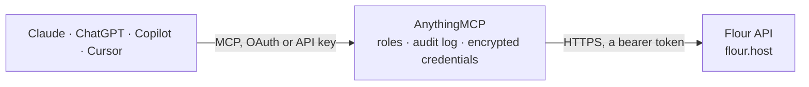

<!-- Generated by scripts/export-github-catalog.mjs in the anythingmcp-website repository. Do not edit by hand. -->

# Flour MCP connector

Flour cloud POS and merchandise management (Germany), read-only: articles with prices and stock per warehouse, stock movements, receipts, invoices and other documents, sold articles per period and … The AnythingMCP connector gives Claude, ChatGPT, Microsoft Copilot, Cursor and Gemini 17 MCP tools for Flour, all read-only.

**Category:** [ERP](../erp.md) · **Tools:** 17 · **Setup guide:** [anythingmcp.com](https://anythingmcp.com/guides/flour-to-mcp) · [Deutsch](https://anythingmcp.com/de/guides/flour-to-mcp) · [Italiano](https://anythingmcp.com/it/guides/flour-to-mcp) · [Español](https://anythingmcp.com/es/guides/flour-to-mcp) · [日本語](https://anythingmcp.com/ja/guides/flour-to-mcp) · [Русский](https://anythingmcp.com/ru/guides/flour-to-mcp) · [中文](https://anythingmcp.com/zh/guides/flour-to-mcp)

## Start without code

No installation and no terminal: AnythingMCP Cloud runs the Flour connector for you, operated by helpcode.ai in Frankfurt, Germany.

1. **Click the button above** and create an account or sign in. The Flour connector opens, ready to install.
2. **Paste the API key or token from your Flour account.** Every click is in the [step-by-step guide](https://anythingmcp.com/guides/flour-to-mcp).
3. **Click Install.** AnythingMCP shows the address of your MCP server.
4. **Add that address to your assistant:** [Claude](https://anythingmcp.com/guides/connect-flour-to-claude) · [ChatGPT](https://anythingmcp.com/guides/connect-flour-to-chatgpt) · [Microsoft Copilot](https://anythingmcp.com/guides/connect-flour-to-copilot) · [Cursor](https://anythingmcp.com/guides/connect-flour-to-cursor) · [Gemini CLI](https://anythingmcp.com/guides/connect-flour-to-gemini) · [Meta Muse](https://anythingmcp.com/guides/connect-flour-to-muse).
5. **Ask your first question**, for example: *Show me invoice INV-2026-319 for Bäckerei Schmitt GmbH from 2026-10-15, I need totals and payment status.*

Prefer help with the setup? [Talk to us](https://anythingmcp.com/contact).

## How it works

- **The AI client** speaks MCP (Streamable HTTP) to AnythingMCP and only sees tool names, descriptions and results. It never gets the Flour credentials.
- **AnythingMCP** checks the client's role, builds the call from the tool definition, adds the credentials (a bearer token), calls Flour, logs the call and returns the result.
- **Flour** sees an ordinary API client with the rights of the account the credentials belong to.

## Tools

| Tool | What it does | Access |
|---|---|---|
| [`flour_list_stocks`](#flour_list_stocks) | List the stocks (warehouses, shop floors, online stock) with id, name and address. | read |
| [`flour_list_branches`](#flour_list_branches) | List the branches (shops or locations) with id, name, address and opening hours for pickup. | read |
| [`flour_list_points_of_sale`](#flour_list_points_of_sale) | List the points of sale (cash registers) with id, name, branch, default stock and mode. | read |
| [`flour_search_articles`](#flour_search_articles) | Search articles (products): id, article number, title, EAN, manufacturer, sales prices per price list, purchase prices, stock per stock (physical and… | read |
| [`flour_find_article`](#flour_find_article) | Find articles by article number or EAN in one call (the barcode scanned at the till or printed on a label). | read |
| [`flour_get_article`](#flour_get_article) | Get one article with every field: prices per price list, purchase data, stock settings and availability, variants, bundle parts, allergens, custom… | read |
| [`flour_get_article_stock`](#flour_get_article_stock) | Get the total stock of one article, physical (counted) and calculated (after open orders), across all stocks or in one stock. | read |
| [`flour_get_article_stock_availability`](#flour_get_article_stock_availability) | Get the stock availability of one article per stock, physical and calculated, optionally for a period. | read |
| [`flour_list_article_stock_movements`](#flour_list_article_stock_movements) | List the stock movements (stock item entries) of one article in a period: goods received, sales, corrections, transfers, with amount and stock. | read |
| [`flour_list_documents`](#flour_list_documents) | List sales and purchase documents (receipts and invoices, quotes, orders, delivery notes, credit notes, purchase orders) in a date range: number, type,… | read |
| [`flour_get_document`](#flour_get_document) | Get one document with every field: items with prices, discounts and VAT, payments, billing and shipping address, point of sale and cash register data,… | read |
| [`flour_get_sold_articles`](#flour_get_sold_articles) | Get the articles sold in a period (invoices and receipts minus credit notes), one row per article with quantity sold and revenue without VAT, plus article… | read |
| [`flour_list_business_partners`](#flour_list_business_partners) | List business partners (customers and suppliers): id, name, debtor and creditor number, addresses, contacts, discount, credit limit and tags. | read |
| [`flour_list_pos_journals`](#flour_list_pos_journals) | List the cash register journals (one per opening and closing of a till): number, point of sale, opening and closing cash, withdrawals, when it was closed… | read |
| [`flour_list_inventories`](#flour_list_inventories) | List the stocktakes (Inventuren) with id, name, creation date and closing date (null while still open). | read |
| [`flour_get_inventory`](#flour_get_inventory) | Get one stocktake with its counted items (article number, title, EAN, counted amount, purchase price) and the totals. | read |
| [`flour_list_statistics`](#flour_list_statistics) | List the saved statistics of the account (each a key, e.g. a top-seller list, with its rows of article, amount and revenue). | read |

## Tool reference

Every parameter as the AI client sees it in `tools/list`. Source: [`packages/backend/src/adapters/de/flour.json`](../../../packages/backend/src/adapters/de/flour.json).

### `flour_list_stocks`

List the stocks (warehouses, shop floors, online stock) with id, name and address. The id is what the stock filters take, and the key of each stock in an article's stock availability. Use it to check the connection.

**Access:** read · **Call:** `GET /v3/stocks`

| Parameter | Type | Required | Description |
|---|---|---|---|
| `name` | string | no | Stock name. |
| `limit` | integer | no | Rows to return, at most 1000. |
| `skip` | integer | no | Rows to skip, for paging. |

### `flour_list_branches`

List the branches (shops or locations) with id, name, address and opening hours for pickup. Fiscal and payment credentials of the branch are never returned.

**Access:** read · **Call:** `GET /v3/branches`

| Parameter | Type | Required | Description |
|---|---|---|---|
| `name` | string | no | Branch name. |
| `limit` | integer | no | Rows to return, at most 1000. |
| `skip` | integer | no | Rows to skip, for paging. |

### `flour_list_points_of_sale`

List the points of sale (cash registers) with id, name, branch, default stock and mode. The id is what pointofsale takes in the document and sales tools. Payment terminal and fiscal settings are never returned.

**Access:** read · **Call:** `GET /v3/pointofsales`

| Parameter | Type | Required | Description |
|---|---|---|---|
| `name` | string | no | Point of sale name. |
| `limit` | integer | no | Rows to return, at most 1000. |
| `skip` | integer | no | Rows to skip, for paging. |

### `flour_search_articles`

Search articles (products): id, article number, title, EAN, manufacturer, sales prices per price list, purchase prices, stock per stock (physical and calculated) and reorder levels. Filter by number, EAN, code, tag, stock level or creation and update time. Results are a plain list without a total; page with skip.

**Access:** read · **Call:** `GET /v3/articles`

| Parameter | Type | Required | Description |
|---|---|---|---|
| `number` | string | no | Article number. |
| `ean` | string | no | EAN / barcode. |
| `code` | string | no | Additional article code. |
| `inStock` | boolean | no | true for articles with stock only. |
| `outOfStock` | boolean | no | true for articles without stock only. |
| `stock` | string | no | Stock id (flour_list_stocks) the stock filters apply to. |
| `stockOperator` | `lt` \| `lte` \| `gt` \| `gte` | no | Comparison for stockAmount. |
| `stockAmount` | number | no | Stock level to compare with, e.g. 5 with stockOperator lte for low stock. |
| `updatedAfter` | string | no | Changed at or after. ISO 8601, e.g. 2026-10-01T00:00:00.000Z (UTC; Germany is UTC+1 in winter, UTC+2 in summer). |
| `createdAfter` | string | no | Created at or after. ISO 8601, e.g. 2026-10-01T00:00:00.000Z (UTC; Germany is UTC+1 in winter, UTC+2 in summer). |
| `limit` | integer | no | Rows to return, at most 100. |
| `skip` | integer | no | Rows to skip, for paging. |

### `flour_find_article`

Find articles by article number or EAN in one call (the barcode scanned at the till or printed on a label).

**Access:** read · **Call:** `GET /v3/articles/find-by-number-or-ean`

| Parameter | Type | Required | Description |
|---|---|---|---|
| `number` | string | yes | Article number or EAN, e.g. 0843820155747. |

### `flour_get_article`

Get one article with every field: prices per price list, purchase data, stock settings and availability, variants, bundle parts, allergens, custom attributes, tags and images.

**Access:** read · **Call:** `GET /v3/articles/{id}`

| Parameter | Type | Required | Description |
|---|---|---|---|
| `id` | string | yes | Article id (_id). |

### `flour_get_article_stock`

Get the total stock of one article, physical (counted) and calculated (after open orders), across all stocks or in one stock.

**Access:** read · **Call:** `GET /v3/articles/{id}/stock/total`

| Parameter | Type | Required | Description |
|---|---|---|---|
| `id` | string | yes | Article id (_id). |
| `stock` | string | no | Only this stock id. |

### `flour_get_article_stock_availability`

Get the stock availability of one article per stock, physical and calculated, optionally for a period.

**Access:** read · **Call:** `GET /v3/articles/{id}/stockavailability`

| Parameter | Type | Required | Description |
|---|---|---|---|
| `id` | string | yes | Article id (_id). |
| `from` | string | no | Start. ISO 8601, e.g. 2026-10-01T00:00:00.000Z (UTC; Germany is UTC+1 in winter, UTC+2 in summer). |
| `to` | string | no | End. ISO 8601, e.g. 2026-10-01T00:00:00.000Z (UTC; Germany is UTC+1 in winter, UTC+2 in summer). |
| `stocks` | string | no | Comma-separated stock ids. |

### `flour_list_article_stock_movements`

List the stock movements (stock item entries) of one article in a period: goods received, sales, corrections, transfers, with amount and stock.

**Access:** read · **Call:** `GET /v3/articles/{id}/stockitementries`

| Parameter | Type | Required | Description |
|---|---|---|---|
| `id` | string | yes | Article id (_id). |
| `from` | string | no | Start. ISO 8601, e.g. 2026-10-01T00:00:00.000Z (UTC; Germany is UTC+1 in winter, UTC+2 in summer). |
| `to` | string | no | End. ISO 8601, e.g. 2026-10-01T00:00:00.000Z (UTC; Germany is UTC+1 in winter, UTC+2 in summer). |
| `stocks` | string | no | Comma-separated stock ids. |

### `flour_list_documents`

List sales and purchase documents (receipts and invoices, quotes, orders, delivery notes, credit notes, purchase orders) in a date range: number, type, date, customer, point of sale, totals with and without VAT, VAT breakdown, payment status and the items (number, title, amount, price). Filter by type, point of sale, business partner or article. Keep the range short (a day or a week) on busy tills; page with skip.

**Access:** read · **Call:** `GET /v3/documents`

| Parameter | Type | Required | Description |
|---|---|---|---|
| `type` | `N` \| `A` \| `L` \| `R` \| `r` \| `G` \| `b` | no | Document type: N quote (Angebot), A order (Auftrag), L delivery note (Lieferschein), R invoice or receipt (Rechnung), r purchase invoice (Einkaufsrechnung), G credit note (Gutschrift), b purchase order (Bestellung). |
| `dateAfter` | string | no | Document date at or after. ISO 8601, e.g. 2026-10-01T00:00:00.000Z (UTC; Germany is UTC+1 in winter, UTC+2 in summer). |
| `dateBefore` | string | no | Document date at or before. ISO 8601, e.g. 2026-10-01T00:00:00.000Z (UTC; Germany is UTC+1 in winter, UTC+2 in summer). |
| `pointofsale` | string | no | Point of sale id (flour_list_points_of_sale). |
| `businesspartner` | string | no | Business partner id (flour_list_business_partners). |
| `article` | string | no | Only documents containing this article id. |
| `visible` | boolean | no | false to include hidden documents. |
| `limit` | integer | no | Rows to return, at most 500. |
| `skip` | integer | no | Rows to skip, for paging. |

### `flour_get_document`

Get one document with every field: items with prices, discounts and VAT, payments, billing and shipping address, point of sale and cash register data, status flags.

**Access:** read · **Call:** `GET /v3/documents/{id}`

| Parameter | Type | Required | Description |
|---|---|---|---|
| `id` | string | yes | Document id (_id). |

### `flour_get_sold_articles`

Get the articles sold in a period (invoices and receipts minus credit notes), one row per article with quantity sold and revenue without VAT, plus article number, title, EAN and manufacturer. Optional per point of sale. The best tool for "what sold best this week"; sort the rows by amount or totalExVat yourself.

**Access:** read · **Call:** `GET /v3/documents/sold-articles`

| Parameter | Type | Required | Description |
|---|---|---|---|
| `dateAfter` | string | yes | Start. ISO 8601, e.g. 2026-10-01T00:00:00.000Z (UTC; Germany is UTC+1 in winter, UTC+2 in summer). |
| `dateBefore` | string | yes | End. ISO 8601, e.g. 2026-10-01T00:00:00.000Z (UTC; Germany is UTC+1 in winter, UTC+2 in summer). |
| `pointofsale` | string | no | Only this point of sale id. |

### `flour_list_business_partners`

List business partners (customers and suppliers): id, name, debtor and creditor number, addresses, contacts, discount, credit limit and tags. Bank details are never returned. Filter by e-mail, debtor or creditor number, or change time.

**Access:** read · **Call:** `GET /v3/businesspartners`

| Parameter | Type | Required | Description |
|---|---|---|---|
| `email` | string | no | E-mail address. |
| `debitorNumber` | string | no | Debtor (customer) number. |
| `creditorNumber` | string | no | Creditor (supplier) number. |
| `updatedAfter` | string | no | Changed at or after. ISO 8601, e.g. 2026-10-01T00:00:00.000Z (UTC; Germany is UTC+1 in winter, UTC+2 in summer). |
| `limit` | integer | no | Rows to return, at most 500. |
| `skip` | integer | no | Rows to skip, for paging. |

### `flour_list_pos_journals`

List the cash register journals (one per opening and closing of a till): number, point of sale, opening and closing cash, withdrawals, when it was closed and by whom. Filter by closing or creation date.

**Access:** read · **Call:** `GET /v3/posjournals`

| Parameter | Type | Required | Description |
|---|---|---|---|
| `closedAfter` | string | no | Closed at or after. ISO 8601, e.g. 2026-10-01T00:00:00.000Z (UTC; Germany is UTC+1 in winter, UTC+2 in summer). |
| `closedBefore` | string | no | Closed at or before. ISO 8601, e.g. 2026-10-01T00:00:00.000Z (UTC; Germany is UTC+1 in winter, UTC+2 in summer). |
| `number` | string | no | Journal number. |
| `limit` | integer | no | Rows to return, at most 500. |
| `skip` | integer | no | Rows to skip, for paging. |

### `flour_list_inventories`

List the stocktakes (Inventuren) with id, name, creation date and closing date (null while still open). Read one with flour_get_inventory.

**Access:** read · **Call:** `GET /v3/inventories/simple`

| Parameter | Type | Required | Description |
|---|---|---|---|
| `name` | string | no | Stocktake name. |
| `open` | boolean | no | true for open stocktakes only. |
| `locked` | boolean | no | Locked or not. |
| `limit` | integer | no | Rows to return, at most 500. |
| `skip` | integer | no | Rows to skip, for paging. |

### `flour_get_inventory`

Get one stocktake with its counted items (article number, title, EAN, counted amount, purchase price) and the totals.

**Access:** read · **Call:** `GET /v3/inventories/{id}`

| Parameter | Type | Required | Description |
|---|---|---|---|
| `id` | string | yes | Stocktake id (_id). |

### `flour_list_statistics`

List the saved statistics of the account (each a key, e.g. a top-seller list, with its rows of article, amount and revenue).

**Access:** read · **Call:** `GET /v3/statistics`

| Parameter | Type | Required | Description |
|---|---|---|---|
| `limit` | integer | no | Rows to return, at most 100. |
| `skip` | integer | no | Rows to skip, for paging. |

## Run it yourself

AnythingMCP is open source (AGPL-3.0). [Run it with Docker](../../../README.md#run-it-yourself), open **Connectors → Store**, pick **Flour** and enter `FLOUR_API_TOKEN`, then add your MCP server URL to the AI client.

[← ERP connectors](../erp.md) · [All categories](../README.md)
