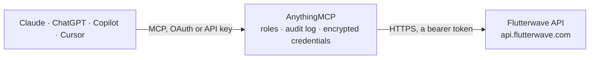

<!-- Generated by scripts/export-github-catalog.mjs in the anythingmcp-website repository. Do not edit by hand. -->

# Flutterwave MCP connector

Manage Flutterwave (Africa payments: payments, customers, subscriptions, transfers, refunds, payouts) from any AI agent. 10 tools, Bearer secret. The AnythingMCP connector gives Claude, ChatGPT, Microsoft Copilot, Cursor and Gemini 10 MCP tools for Flutterwave: 5 read and 5 can change data.

**Category:** [Payments](../payments.md) · **Tools:** 10 · **Setup guide:** [anythingmcp.com](https://anythingmcp.com/guides/flutterwave-to-mcp) · [Deutsch](https://anythingmcp.com/de/guides/flutterwave-to-mcp) · [Italiano](https://anythingmcp.com/it/guides/flutterwave-to-mcp) · [Español](https://anythingmcp.com/es/guides/flutterwave-to-mcp) · [日本語](https://anythingmcp.com/ja/guides/flutterwave-to-mcp) · [Русский](https://anythingmcp.com/ru/guides/flutterwave-to-mcp) · [中文](https://anythingmcp.com/zh/guides/flutterwave-to-mcp)

## Start without code

No installation and no terminal: AnythingMCP Cloud runs the Flutterwave connector for you, operated by helpcode.ai in Frankfurt, Germany.

1. **Click the button above** and create an account or sign in. The Flutterwave connector opens, ready to install.
2. **Paste the API key or token from your Flutterwave account.** Every click is in the [step-by-step guide](https://anythingmcp.com/guides/flutterwave-to-mcp).
3. **Click Install.** AnythingMCP shows the address of your MCP server.
4. **Add that address to your assistant:** [Claude](https://anythingmcp.com/guides/connect-flutterwave-to-claude) · [ChatGPT](https://anythingmcp.com/guides/connect-flutterwave-to-chatgpt) · [Microsoft Copilot](https://anythingmcp.com/guides/connect-flutterwave-to-copilot) · [Cursor](https://anythingmcp.com/guides/connect-flutterwave-to-cursor) · [Gemini CLI](https://anythingmcp.com/guides/connect-flutterwave-to-gemini) · [Meta Muse](https://anythingmcp.com/guides/connect-flutterwave-to-muse).
5. **Ask your first question**, for example: *Show me successful Flutterwave transactions for customer accounts@kintulogistics.com in September 2026*

Prefer help with the setup? [Talk to us](https://anythingmcp.com/contact).

## How it works

- **The AI client** speaks MCP (Streamable HTTP) to AnythingMCP and only sees tool names, descriptions and results. It never gets the Flutterwave credentials.
- **AnythingMCP** checks the client's role, builds the call from the tool definition, adds the credentials (a bearer token), calls Flutterwave, logs the call and returns the result.
- **Flutterwave** sees an ordinary API client with the rights of the account the credentials belong to.

## Tools

| Tool | What it does | Access |
|---|---|---|
| [`flutterwave_create_payment`](#flutterwave_create_payment) | Create a payment — returns a hosted checkout URL (`data.link`) to redirect the customer to. | write |
| [`flutterwave_verify_transaction`](#flutterwave_verify_transaction) | Verify a transaction by Flutterwave's `transaction_id` (NOT your tx_ref). | read |
| [`flutterwave_verify_by_reference`](#flutterwave_verify_by_reference) | Verify a transaction by your `tx_ref`. | read |
| [`flutterwave_list_transactions`](#flutterwave_list_transactions) | List transactions. | read |
| [`flutterwave_create_subscription_plan`](#flutterwave_create_subscription_plan) | Create a recurring payment plan. | write |
| [`flutterwave_list_subscriptions`](#flutterwave_list_subscriptions) | List subscriptions. | read |
| [`flutterwave_cancel_subscription`](#flutterwave_cancel_subscription) | Cancel a subscription. | write |
| [`flutterwave_initiate_transfer`](#flutterwave_initiate_transfer) | Initiate a transfer (payout to a bank account). | write |
| [`flutterwave_refund_transaction`](#flutterwave_refund_transaction) | Refund a transaction. | write |
| [`flutterwave_list_banks`](#flutterwave_list_banks) | List supported banks for a country. | read |

## Tool reference

Every parameter as the AI client sees it in `tools/list`. Source: [`packages/backend/src/adapters/intl/flutterwave.json`](../../../packages/backend/src/adapters/intl/flutterwave.json).

### `flutterwave_create_payment`

Create a payment — returns a hosted checkout URL (`data.link`) to redirect the customer to.

**Access:** write · **Call:** `POST /payments`

| Parameter | Type | Required | Description |
|---|---|---|---|
| `tx_ref` | string | yes | Your unique transaction reference. |
| `amount` | number | yes | Amount in major units (e.g. 1.50). |
| `currency` | string | yes | NGN, USD, GHS, ZAR, KES, UGX, RWF, TZS, ... |
| `redirect_url` | string | yes | Where to send the customer after payment. |
| `customer` | object | yes | {email, name, phonenumber}. |
| `customizations` | object | no | {title, description, logo} for the hosted page. |
| `payment_options` | string | no | Comma-separated methods: card, banktransfer, mobilemoneyghana, mpesa, ussd, ... |
| `meta` | object | no | Custom metadata. |

### `flutterwave_verify_transaction`

Verify a transaction by Flutterwave's `transaction_id` (NOT your tx_ref). Always run this after the customer returns from the hosted page.

**Access:** read · **Call:** `GET /transactions/{transaction_id}/verify`

| Parameter | Type | Required | Description |
|---|---|---|---|
| `transaction_id` | integer | yes | Numeric transaction_id returned by Flutterwave. |

### `flutterwave_verify_by_reference`

Verify a transaction by your `tx_ref`. Use this when you don't have the Flutterwave transaction_id.

**Access:** read · **Call:** `GET /transactions/verify_by_reference`

| Parameter | Type | Required | Description |
|---|---|---|---|
| `tx_ref` | string | yes | Your transaction reference. |

### `flutterwave_list_transactions`

List transactions.

**Access:** read · **Call:** `GET /transactions`

| Parameter | Type | Required | Description |
|---|---|---|---|
| `from` | string | no | YYYY-MM-DD. |
| `to` | string | no | YYYY-MM-DD. |
| `status` | string | no | successful, failed, pending. |
| `customer_email` | string | no | Filter by email. |
| `page` | integer | no | 1-based. |

### `flutterwave_create_subscription_plan`

Create a recurring payment plan.

**Access:** write · **Call:** `POST /payment-plans`

| Parameter | Type | Required | Description |
|---|---|---|---|
| `amount` | number | yes | Amount in major units. |
| `name` | string | yes | Plan name. |
| `interval` | string | yes | hourly, daily, weekly, monthly, quarterly, bi-annually, annually. |
| `duration` | integer | no | Number of times to charge. Omit for indefinite. |
| `currency` | string | no | ISO 4217. |

### `flutterwave_list_subscriptions`

List subscriptions.

**Access:** read · **Call:** `GET /subscriptions`

| Parameter | Type | Required | Description |
|---|---|---|---|
| `email` | string | no | Filter by subscriber email. |
| `from` | string | no | YYYY-MM-DD. |
| `to` | string | no | YYYY-MM-DD. |
| `page` | integer | no | 1-based. |

### `flutterwave_cancel_subscription`

Cancel a subscription.

**Access:** write · **Call:** `PUT /subscriptions/{subscription_id}/cancel`

| Parameter | Type | Required | Description |
|---|---|---|---|
| `subscription_id` | integer | yes | Subscription ID. |

### `flutterwave_initiate_transfer`

Initiate a transfer (payout to a bank account).

**Access:** write · **Call:** `POST /transfers`

| Parameter | Type | Required | Description |
|---|---|---|---|
| `account_bank` | string | yes | Bank code (from /banks endpoint). |
| `account_number` | string | yes | Account number. |
| `amount` | number | yes | Amount in major units. |
| `currency` | string | yes | ISO 4217. |
| `narration` | string | no | Description shown on statement. |
| `reference` | string | no | Your unique reference. |
| `beneficiary_name` | string | no | Beneficiary's full name. |

### `flutterwave_refund_transaction`

Refund a transaction.

**Access:** write · **Call:** `POST /transactions/{transaction_id}/refund`

| Parameter | Type | Required | Description |
|---|---|---|---|
| `transaction_id` | integer | yes | Transaction ID to refund. |
| `amount` | number | no | Amount in major units (omit for full refund). |

### `flutterwave_list_banks`

List supported banks for a country. Use to find bank codes for transfers.

**Access:** read · **Call:** `GET /banks/{country}`

| Parameter | Type | Required | Description |
|---|---|---|---|
| `country` | string | yes | ISO 3166-1 alpha-2: NG, GH, KE, UG, ZA, ... |

## Run it yourself

AnythingMCP is open source (AGPL-3.0). [Run it with Docker](../../../README.md#run-it-yourself), open **Connectors → Store**, pick **Flutterwave** and enter `FLUTTERWAVE_SECRET_KEY`, then add your MCP server URL to the AI client.

[← Payments connectors](../payments.md) · [All categories](../README.md)
