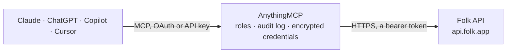

<!-- Generated by scripts/export-github-catalog.mjs in the anythingmcp-website repository. Do not edit by hand. -->

# Folk MCP connector

Drive Folk (modern relationship CRM) from any AI agent: people, companies, groups, deals, custom fields. 9 tools, Bearer auth. The AnythingMCP connector gives Claude, ChatGPT, Microsoft Copilot, Cursor and Gemini 9 MCP tools for Folk: 6 read and 3 can change data.

**Category:** [CRM](../crm.md) · **Tools:** 9 · **Setup guide:** [anythingmcp.com](https://anythingmcp.com/guides/folk-to-mcp) · [Deutsch](https://anythingmcp.com/de/guides/folk-to-mcp) · [Italiano](https://anythingmcp.com/it/guides/folk-to-mcp) · [Español](https://anythingmcp.com/es/guides/folk-to-mcp) · [日本語](https://anythingmcp.com/ja/guides/folk-to-mcp) · [Русский](https://anythingmcp.com/ru/guides/folk-to-mcp) · [中文](https://anythingmcp.com/zh/guides/folk-to-mcp)

## Start without code

No installation and no terminal: AnythingMCP Cloud runs the Folk connector for you, operated by helpcode.ai in Frankfurt, Germany.

1. **Click the button above** and create an account or sign in. The Folk connector opens, ready to install.
2. **Paste the API key or token from your Folk account.** Every click is in the [step-by-step guide](https://anythingmcp.com/guides/folk-to-mcp).
3. **Click Install.** AnythingMCP shows the address of your MCP server.
4. **Add that address to your assistant:** [Claude](https://anythingmcp.com/guides/connect-folk-to-claude) · [ChatGPT](https://anythingmcp.com/guides/connect-folk-to-chatgpt) · [Microsoft Copilot](https://anythingmcp.com/guides/connect-folk-to-copilot) · [Cursor](https://anythingmcp.com/guides/connect-folk-to-cursor) · [Gemini CLI](https://anythingmcp.com/guides/connect-folk-to-gemini) · [Meta Muse](https://anythingmcp.com/guides/connect-folk-to-muse).
5. **Ask your first question**, for example: *What's Lina Moreno at Marisol GmbH's email, job title and which groups is she in?*

Prefer help with the setup? [Talk to us](https://anythingmcp.com/contact).

## How it works

- **The AI client** speaks MCP (Streamable HTTP) to AnythingMCP and only sees tool names, descriptions and results. It never gets the Folk credentials.
- **AnythingMCP** checks the client's role, builds the call from the tool definition, adds the credentials (a bearer token), calls Folk, logs the call and returns the result.
- **Folk** sees an ordinary API client with the rights of the account the credentials belong to.

## Tools

| Tool | What it does | Access |
|---|---|---|
| [`folk_me`](#folk_me) | Return the user the token belongs to. | read |
| [`folk_list_people`](#folk_list_people) | List people with cursor pagination. | read |
| [`folk_get_person`](#folk_get_person) | Fetch a person by ID with full contact details + groups + companies. | read |
| [`folk_create_person`](#folk_create_person) | Create a person. | write |
| [`folk_update_person`](#folk_update_person) | Update a person (PATCH). | write |
| [`folk_list_companies`](#folk_list_companies) | List companies. | read |
| [`folk_create_company`](#folk_create_company) | Create a company. | write |
| [`folk_list_groups`](#folk_list_groups) | List groups (collections). | read |
| [`folk_list_group_custom_fields`](#folk_list_group_custom_fields) | List custom fields defined on a specific group. | read |

## Tool reference

Every parameter as the AI client sees it in `tools/list`. Source: [`packages/backend/src/adapters/intl/folk.json`](../../../packages/backend/src/adapters/intl/folk.json).

### `folk_me`

Return the user the token belongs to.

**Access:** read · **Call:** `GET /users/me`

No parameters.

### `folk_list_people`

List people with cursor pagination.

**Access:** read · **Call:** `GET /people`

| Parameter | Type | Required | Description |
|---|---|---|---|
| `limit` | integer | no | Per page (default 100). |
| `cursor` | string | no | nextPageToken from prior response. |
| `groupId` | string | no | Filter to people in this group. |

### `folk_get_person`

Fetch a person by ID with full contact details + groups + companies.

**Access:** read · **Call:** `GET /people/{personId}`

| Parameter | Type | Required | Description |
|---|---|---|---|
| `personId` | string | yes | Person ID. |

### `folk_create_person`

Create a person. Required: fullName OR firstName OR lastName.

**Access:** write · **Call:** `POST /people`

| Parameter | Type | Required | Description |
|---|---|---|---|
| `fullName` | string | no | Full name. |
| `firstName` | string | no | First name. |
| `lastName` | string | no | Last name. |
| `emails` | any[] | no | [{value:'a@b.com'}]. |
| `phones` | any[] | no | [{value:'+1...'}]. |
| `jobTitle` | string | no | Title. |
| `companies` | any[] | no | [{id?:'companyId', name?:'Acme'}] — link to existing or create-by-name. |
| `groupIds` | any[] | no | Array of group IDs to add this person to. |
| `urls` | any[] | no | [{value:'https://...'}]. |
| `addresses` | any[] | no | [{value:'free-text address'}]. |
| `customFieldValues` | object | no | Map of {custom_field_id: value}. |

### `folk_update_person`

Update a person (PATCH).

**Access:** write · **Call:** `PATCH /people/{personId}`

| Parameter | Type | Required | Description |
|---|---|---|---|
| `personId` | string | yes | Person ID. |
| `fullName` | string | no | New full name. |
| `emails` | any[] | no | Replace emails. |
| `phones` | any[] | no | Replace phones. |
| `jobTitle` | string | no | New title. |
| `companies` | any[] | no | Replace companies. |
| `groupIds` | any[] | no | Replace group memberships. |
| `customFieldValues` | object | no | Update custom fields. |

### `folk_list_companies`

List companies.

**Access:** read · **Call:** `GET /companies`

| Parameter | Type | Required | Description |
|---|---|---|---|
| `limit` | integer | no | Per page. |
| `cursor` | string | no | Cursor. |

### `folk_create_company`

Create a company.

**Access:** write · **Call:** `POST /companies`

| Parameter | Type | Required | Description |
|---|---|---|---|
| `name` | string | yes | Company name. |
| `domains` | any[] | no | ['acme.com']. |
| `addresses` | any[] | no | [{value:'...'}]. |
| `phones` | any[] | no | [{value:'...'}]. |
| `customFieldValues` | object | no | Custom fields. |

### `folk_list_groups`

List groups (collections). Each group has id, name, type, peopleCount.

**Access:** read · **Call:** `GET /groups`

| Parameter | Type | Required | Description |
|---|---|---|---|
| `limit` | integer | no | Per page. |
| `cursor` | string | no | Cursor. |

### `folk_list_group_custom_fields`

List custom fields defined on a specific group. Folk fields are group-scoped.

**Access:** read · **Call:** `GET /groups/{groupId}/customFields`

| Parameter | Type | Required | Description |
|---|---|---|---|
| `groupId` | string | yes | Group ID. |

## Run it yourself

AnythingMCP is open source (AGPL-3.0). [Run it with Docker](../../../README.md#run-it-yourself), open **Connectors → Store**, pick **Folk** and enter `FOLK_API_TOKEN`, then add your MCP server URL to the AI client.

[← CRM connectors](../crm.md) · [All categories](../README.md)
