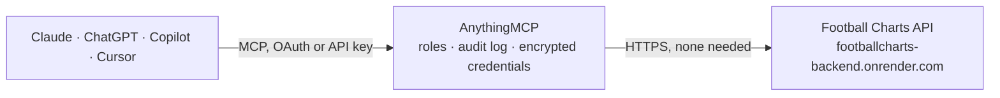

<!-- Generated by scripts/export-github-catalog.mjs in the anythingmcp-website repository. Do not edit by hand. -->

# Football Charts MCP connector

Football Charts API v1: football league tables, match results, upcoming fixtures with calibrated Dixon-Coles probabilities, 10,000-run Monte Carlo season projections, 15-minute goal-timing … The AnythingMCP connector gives Claude, ChatGPT, Microsoft Copilot, Cursor and Gemini 10 MCP tools for Football Charts, all read-only.

**Category:** [Sports](../sports.md) · **Tools:** 10 · **Setup guide:** [anythingmcp.com](https://anythingmcp.com/guides/football-charts-to-mcp) · [Deutsch](https://anythingmcp.com/de/guides/football-charts-to-mcp) · [Italiano](https://anythingmcp.com/it/guides/football-charts-to-mcp) · [Español](https://anythingmcp.com/es/guides/football-charts-to-mcp) · [日本語](https://anythingmcp.com/ja/guides/football-charts-to-mcp) · [Русский](https://anythingmcp.com/ru/guides/football-charts-to-mcp) · [中文](https://anythingmcp.com/zh/guides/football-charts-to-mcp)

## Start without code

No installation and no terminal: AnythingMCP Cloud runs the Football Charts connector for you, operated by helpcode.ai in Frankfurt, Germany.

1. **Click the button above** and create an account or sign in. The Football Charts connector opens, ready to install.
2. **Nothing to enter:** this connector needs no credentials. Every click is in the [step-by-step guide](https://anythingmcp.com/guides/football-charts-to-mcp).
3. **Click Install.** AnythingMCP shows the address of your MCP server.
4. **Add that address to your assistant:** [Claude](https://anythingmcp.com/guides/connect-football-charts-to-claude) · [ChatGPT](https://anythingmcp.com/guides/connect-football-charts-to-chatgpt) · [Microsoft Copilot](https://anythingmcp.com/guides/connect-football-charts-to-copilot) · [Cursor](https://anythingmcp.com/guides/connect-football-charts-to-cursor) · [Gemini CLI](https://anythingmcp.com/guides/connect-football-charts-to-gemini) · [Meta Muse](https://anythingmcp.com/guides/connect-football-charts-to-muse).
5. **Ask your first question**, for example: *How many points is SC Freiburg over their expected points in the Bundesliga this season, and what position are they in?*

Prefer help with the setup? [Talk to us](https://anythingmcp.com/contact).

## How it works

- **The AI client** speaks MCP (Streamable HTTP) to AnythingMCP and only sees tool names, descriptions and results. It never gets the Football Charts credentials.
- **AnythingMCP** checks the client's role, builds the call from the tool definition, adds the credentials (none needed), calls Football Charts, logs the call and returns the result.
- **Football Charts** sees an ordinary API client with the rights of the account the credentials belong to.

## Tools

| Tool | What it does | Access |
|---|---|---|
| [`football_charts_list_leagues`](#football_charts_list_leagues) | List all 98 football leagues covered across 44 countries with their competition key, display name, country, available season strings (newest first) and… | read |
| [`football_charts_get_league_table`](#football_charts_get_league_table) | Get the standings table of a league season: position, played, won, drawn, lost, goals for and against, goal difference, points, last-five form, expected… | read |
| [`football_charts_get_results`](#football_charts_get_results) | List finished matches of a league season in chronological order with UTC date and kickoff time, home and away teams, full-time and half-time scores,… | read |
| [`football_charts_get_fixtures`](#football_charts_get_fixtures) | List upcoming fixtures for a league ordered by kickoff time with UTC date and time, match slug and calibrated Dixon-Coles (dc_v2) probabilities for home… | read |
| [`football_charts_get_season_projection`](#football_charts_get_season_projection) | Get the daily 10,000-run Monte Carlo season projection for a league's current season: each team's title, top-four and relegation (bottom-three)… | read |
| [`football_charts_get_goal_timing`](#football_charts_get_goal_timing) | Get goals scored per 15-minute match interval (0-15, 15-30, 30-45, 45+, 46-60, 60-75, 75-90, 90+) for every team in a league season, with each team's peak… | read |
| [`football_charts_list_teams`](#football_charts_list_teams) | List all teams competing in a league season in standings order with their team slugs and summary records. | read |
| [`football_charts_get_team`](#football_charts_get_team) | Get one team's season profile in a league: standings row with expected points and luck classification, full match log, 15-minute goal-timing breakdown,… | read |
| [`football_charts_get_match`](#football_charts_get_match) | Get one match in full by its slug (country/league-slug/YYYY-MM-DD-home-vs-away): calibrated and raw Dixon-Coles probabilities, team attack and defence… | read |
| [`football_charts_get_track_record`](#football_charts_get_track_record) | Get the public calibration track record of the Football Charts probability model over settled matches: total scored predictions, hit rate, Brier score,… | read |

## Tool reference

Every parameter as the AI client sees it in `tools/list`. Source: [`packages/backend/src/adapters/intl/football-charts.json`](../../../packages/backend/src/adapters/intl/football-charts.json).

### `football_charts_list_leagues`

List all 98 football leagues covered across 44 countries with their competition key, display name, country, available season strings (newest first) and canonical football-charts.com URL. Call this first to find valid league keys and season strings.

**Access:** read · **Call:** `GET /leagues/`

No parameters.

### `football_charts_get_league_table`

Get the standings table of a league season: position, played, won, drawn, lost, goals for and against, goal difference, points, last-five form, expected points and luck classification. Supports ordering by points (classic), over/under-performance (luck) or goals scored (goals).

**Access:** read · **Call:** `GET /leagues/{league}/table/`

| Parameter | Type | Required | Description |
|---|---|---|---|
| `league` | string | yes | League key from football_charts_list_leagues, e.g. premier, cha, spain1, germany1, italy1, france1, brazil1, sweden1 or wgermany1. |
| `season` | string | no | Season string from football_charts_list_leagues, e.g. 2026-2027 for winter leagues or 2026 for summer leagues. Defaults to the current season. |
| `view` | `classic` \| `luck` \| `goals` | no | Table ordering: classic (by points), luck (by points minus expected points) or goals (by goals scored). |

### `football_charts_get_results`

List finished matches of a league season in chronological order with UTC date and kickoff time, home and away teams, full-time and half-time scores, first-goal minute and stoppage-time offset. Optionally filter by team name substring.

**Access:** read · **Call:** `GET /leagues/{league}/results/`

| Parameter | Type | Required | Description |
|---|---|---|---|
| `league` | string | yes | League key from football_charts_list_leagues, e.g. premier, spain1 or brazil1. |
| `season` | string | no | Season string from football_charts_list_leagues, e.g. 2026-2027 or 2026. Defaults to the current season. |
| `team` | string | no | Case-insensitive team name substring to filter matches where either side matches, e.g. Liverpool or Flamengo. |

### `football_charts_get_fixtures`

List upcoming fixtures for a league ordered by kickoff time with UTC date and time, match slug and calibrated Dixon-Coles (dc_v2) probabilities for home win, away win, over/under goal lines and both teams to score (draw probability is 1 minus home minus away).

**Access:** read · **Call:** `GET /leagues/{league}/fixtures/`

| Parameter | Type | Required | Description |
|---|---|---|---|
| `league` | string | yes | League key from football_charts_list_leagues, e.g. premier, spain1 or germany1. |

### `football_charts_get_season_projection`

Get the daily 10,000-run Monte Carlo season projection for a league's current season: each team's title, top-four and relegation (bottom-three) probabilities, current points, mean final points, 10th-to-90th percentile points range, finishing-position matrix and change since the previous run.

**Access:** read · **Call:** `GET /leagues/{league}/projection/`

| Parameter | Type | Required | Description |
|---|---|---|---|
| `league` | string | yes | League key from football_charts_list_leagues, e.g. premier, spain1 or italy1. |

### `football_charts_get_goal_timing`

Get goals scored per 15-minute match interval (0-15, 15-30, 30-45, 45+, 46-60, 60-75, 75-90, 90+) for every team in a league season, with each team's peak scoring period(s), late-goal share from minute 75 onward and first-half share.

**Access:** read · **Call:** `GET /leagues/{league}/goal-timing/`

| Parameter | Type | Required | Description |
|---|---|---|---|
| `league` | string | yes | League key from football_charts_list_leagues, e.g. premier, spain1 or brazil1. |
| `season` | string | no | Season string from football_charts_list_leagues, e.g. 2026-2027 or 2026. Defaults to the current season. |
| `team` | string | no | Optional case-insensitive team name substring to narrow the output to matching teams. |

### `football_charts_list_teams`

List all teams competing in a league season in standings order with their team slugs and summary records. Use the returned slug values with football_charts_get_team.

**Access:** read · **Call:** `GET /leagues/{league}/teams/`

| Parameter | Type | Required | Description |
|---|---|---|---|
| `league` | string | yes | League key from football_charts_list_leagues, e.g. premier, spain1 or germany1. |
| `season` | string | no | Season string from football_charts_list_leagues, e.g. 2026-2027 or 2026. Defaults to the current season. |

### `football_charts_get_team`

Get one team's season profile in a league: standings row with expected points and luck classification, full match log, 15-minute goal-timing breakdown, first-goal distribution and season match-statistic averages where covered.

**Access:** read · **Call:** `GET /leagues/{league}/teams/{team}/`

| Parameter | Type | Required | Description |
|---|---|---|---|
| `league` | string | yes | League key from football_charts_list_leagues, e.g. premier or spain1. |
| `team` | string | yes | Lowercase hyphenated team slug from football_charts_list_teams, e.g. arsenal or manchester-city. |
| `season` | string | no | Season string from football_charts_list_leagues, e.g. 2026-2027 or 2026. Defaults to the current season. |

### `football_charts_get_match`

Get one match in full by its slug (country/league-slug/YYYY-MM-DD-home-vs-away): calibrated and raw Dixon-Coles probabilities, team attack and defence ratings, first-goal-time histograms for both sides and full-time/half-time scores once played.

**Access:** read · **Call:** `GET /matches/{slug}/`

| Parameter | Type | Required | Description |
|---|---|---|---|
| `slug` | string | yes | Match slug from football_charts_get_fixtures, e.g. england/premier-league/2026-09-05-brentford-vs-sunderland. |

### `football_charts_get_track_record`

Get the public calibration track record of the Football Charts probability model over settled matches: total scored predictions, hit rate, Brier score, reliability buckets comparing predicted probabilities with observed frequencies, breakdown by market and recent settled predictions.

**Access:** read · **Call:** `GET /track-record/`

| Parameter | Type | Required | Description |
|---|---|---|---|
| `days` | integer | no | Lookback window in days (1 to 365, default 90). |

## Run it yourself

AnythingMCP is open source (AGPL-3.0). [Run it with Docker](../../../README.md#run-it-yourself), open **Connectors → Store**, pick **Football Charts**, then add your MCP server URL to the AI client.

[← Sports connectors](../sports.md) · [All categories](../README.md)
