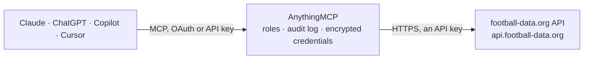

<!-- Generated by scripts/export-github-catalog.mjs in the anythingmcp-website repository. Do not edit by hand. -->

# football-data.org MCP connector

football-data.org API v4: football competitions, league tables, fixtures and results, head-to-head, teams, squads, players and top scorers. The AnythingMCP connector gives Claude, ChatGPT, Microsoft Copilot, Cursor and Gemini 16 MCP tools for football-data.org, all read-only.

**Category:** [Sports](../sports.md) · **Tools:** 16 · **Setup guide:** [anythingmcp.com](https://anythingmcp.com/guides/football-data-to-mcp) · [Deutsch](https://anythingmcp.com/de/guides/football-data-to-mcp) · [Italiano](https://anythingmcp.com/it/guides/football-data-to-mcp) · [Español](https://anythingmcp.com/es/guides/football-data-to-mcp) · [日本語](https://anythingmcp.com/ja/guides/football-data-to-mcp) · [Русский](https://anythingmcp.com/ru/guides/football-data-to-mcp) · [中文](https://anythingmcp.com/zh/guides/football-data-to-mcp)

## Start without code

No installation and no terminal: AnythingMCP Cloud runs the football-data.org connector for you, operated by helpcode.ai in Frankfurt, Germany.

1. **Click the button above** and create an account or sign in. The football-data.org connector opens, ready to install.
2. **Paste the API key or token from your football-data.org account.** Every click is in the [step-by-step guide](https://anythingmcp.com/guides/football-data-to-mcp).
3. **Click Install.** AnythingMCP shows the address of your MCP server.
4. **Add that address to your assistant:** [Claude](https://anythingmcp.com/guides/connect-football-data-to-claude) · [ChatGPT](https://anythingmcp.com/guides/connect-football-data-to-chatgpt) · [Microsoft Copilot](https://anythingmcp.com/guides/connect-football-data-to-copilot) · [Cursor](https://anythingmcp.com/guides/connect-football-data-to-cursor) · [Gemini CLI](https://anythingmcp.com/guides/connect-football-data-to-gemini) · [Meta Muse](https://anythingmcp.com/guides/connect-football-data-to-muse).
5. **Ask your first question**, for example: *Give me full details for match 394512: kickoff, teams, status and final score.*

Prefer help with the setup? [Talk to us](https://anythingmcp.com/contact).

## How it works

- **The AI client** speaks MCP (Streamable HTTP) to AnythingMCP and only sees tool names, descriptions and results. It never gets the football-data.org credentials.
- **AnythingMCP** checks the client's role, builds the call from the tool definition, adds the credentials (an API key), calls football-data.org, logs the call and returns the result.
- **football-data.org** sees an ordinary API client with the rights of the account the credentials belong to.

## Tools

| Tool | What it does | Access |
|---|---|---|
| [`football_data_list_competitions`](#football_data_list_competitions) | List the competitions the token can access (with a token) with id, code, name, type (LEAGUE, CUP, LEAGUE_CUP, PLAYOFFS), area and current season with its… | read |
| [`football_data_get_competition`](#football_data_get_competition) | Get one competition with its area, type, current season and the list of past seasons (id, start and end date, winner). | read |
| [`football_data_get_standings`](#football_data_get_standings) | Get the league table of a competition: position, points, played, won, draw, lost, goals for and against, goal difference and recent form per team. | read |
| [`football_data_list_competition_matches`](#football_data_list_competition_matches) | List the matches of a competition (fixtures and results) with date in UTC, status, matchday, stage, group, teams and score. | read |
| [`football_data_list_competition_teams`](#football_data_list_competition_teams) | List the teams taking part in a competition's season, with id, name, short name, three-letter code, crest, venue and, depending on the plan, coach and squad. | read |
| [`football_data_get_top_scorers`](#football_data_get_top_scorers) | Get the top scorers of a competition's season: player, team, goals, assists, penalties and matches played, sorted by goals. | read |
| [`football_data_list_matches`](#football_data_list_matches) | List matches across all competitions the plan covers: today's matches by default, or a single date, a date range (max 10 days), a list of match ids, or a… | read |
| [`football_data_get_match`](#football_data_get_match) | Get one match in full: competition, season, kickoff in UTC, status, venue, referees, teams, score (half time, full time, extra time, penalties), goals,… | read |
| [`football_data_get_head2head`](#football_data_get_head2head) | Get the previous meetings of the two teams of a match, with an aggregate of wins, draws, losses and goals for each side. | read |
| [`football_data_list_teams`](#football_data_list_teams) | List all teams in the database page by page, with id, name, short name, three-letter code and crest. | read |
| [`football_data_get_team`](#football_data_get_team) | Get one team: name, area, address, website, founding year, club colours, venue, running competitions, coach and squad with positions and dates of birth. | read |
| [`football_data_list_team_matches`](#football_data_list_team_matches) | List the matches of one team across competitions, with a summary of wins, draws and losses. | read |
| [`football_data_get_person`](#football_data_get_person) | Get one person (player, coach or referee): name, date of birth, nationality, position, shirt number and current team with contract dates. | read |
| [`football_data_list_person_matches`](#football_data_list_person_matches) | List the matches of one player with an aggregate (matches, minutes, goals, assists, cards, subbed in and out). | read |
| [`football_data_list_areas`](#football_data_list_areas) | List the areas (countries and continents) with id, name, country code, flag and parent area. | read |
| [`football_data_get_area`](#football_data_get_area) | Get one area with its parent area and its child areas, e.g. a continent with its countries. | read |

## Tool reference

Every parameter as the AI client sees it in `tools/list`. Source: [`packages/backend/src/adapters/intl/football-data.json`](../../../packages/backend/src/adapters/intl/football-data.json).

### `football_data_list_competitions`

List the competitions the token can access (with a token) with id, code, name, type (LEAGUE, CUP, LEAGUE_CUP, PLAYOFFS), area and current season with its current matchday. Call this first to learn which codes your plan covers.

**Access:** read · **Call:** `GET /competitions`

| Parameter | Type | Required | Description |
|---|---|---|---|
| `areas` | string | no | Comma separated area ids to narrow down, e.g. 2072 for England. Area ids come from football_data_list_areas. |

### `football_data_get_competition`

Get one competition with its area, type, current season and the list of past seasons (id, start and end date, winner). Use it to see how far back the data for a league goes.

**Access:** read · **Call:** `GET /competitions/{competition}`

| Parameter | Type | Required | Description |
|---|---|---|---|
| `competition` | string | yes | Competition code or numeric id, e.g. PL (Premier League), BL1 (Bundesliga), SA (Serie A), PD (LaLiga), FL1 (Ligue 1), CL (Champions League), WC (World Cup). Codes come from football_data_list_competitions. |

### `football_data_get_standings`

Get the league table of a competition: position, points, played, won, draw, lost, goals for and against, goal difference and recent form per team. Leagues return TOTAL, HOME and AWAY tables; group competitions return one table per group; cups answer 404.

**Access:** read · **Call:** `GET /competitions/{competition}/standings`

| Parameter | Type | Required | Description |
|---|---|---|---|
| `competition` | string | yes | Competition code or numeric id, e.g. PL (Premier League), BL1 (Bundesliga), SA (Serie A), PD (LaLiga), FL1 (Ligue 1), CL (Champions League), WC (World Cup). Codes come from football_data_list_competitions. |
| `season` | integer | no | Starting year of the season, 4 digits: 2025 for 2025/26. Defaults to the current season. |
| `matchday` | integer | no | Table as it stood after this matchday. Combined with season it is computed from results only, without point deductions. |
| `date` | string | no | Table as it stood on this date, yyyy-MM-dd. |

### `football_data_list_competition_matches`

List the matches of a competition (fixtures and results) with date in UTC, status, matchday, stage, group, teams and score. Defaults to the whole current season; narrow it with matchday, a date range, status or stage.

**Access:** read · **Call:** `GET /competitions/{competition}/matches`

| Parameter | Type | Required | Description |
|---|---|---|---|
| `competition` | string | yes | Competition code or numeric id, e.g. PL (Premier League), BL1 (Bundesliga), SA (Serie A), PD (LaLiga), FL1 (Ligue 1), CL (Champions League), WC (World Cup). Codes come from football_data_list_competitions. |
| `season` | integer | no | Starting year of the season, 4 digits: 2025 for 2025/26. Defaults to the current season. |
| `matchday` | integer | no | Matchday (round) number, e.g. 15. |
| `status` | string | no | Match status, or a comma separated list: SCHEDULED, TIMED, IN_PLAY, PAUSED, EXTRA_TIME, PENALTY_SHOOTOUT, FINISHED, SUSPENDED, POSTPONED, CANCELLED, AWARDED. LIVE is a shortcut for IN_PLAY and PAUSED. |
| `date_from` | string | no | Start date, yyyy-MM-dd. Use together with date_to. |
| `date_to` | string | no | End date, yyyy-MM-dd, inclusive. Use together with date_from. |
| `stage` | string | no | Stage, e.g. REGULAR_SEASON, GROUP_STAGE, LAST_16, QUARTER_FINALS, SEMI_FINALS, FINAL. |
| `group` | string | no | Group, e.g. GROUP_A. |
| `unfold_goals` | boolean | no | true to include goals (scorer, assist, minute) in each match of the list. Off by default in lists. |
| `unfold_bookings` | boolean | no | true to include yellow and red cards in each match of the list. |
| `unfold_lineups` | boolean | no | true to include lineups and benches in each match of the list (paid plans). |
| `unfold_subs` | boolean | no | true to include substitutions in each match of the list. |

### `football_data_list_competition_teams`

List the teams taking part in a competition's season, with id, name, short name, three-letter code, crest, venue and, depending on the plan, coach and squad. Use it to find team ids for a league.

**Access:** read · **Call:** `GET /competitions/{competition}/teams`

| Parameter | Type | Required | Description |
|---|---|---|---|
| `competition` | string | yes | Competition code or numeric id, e.g. PL (Premier League), BL1 (Bundesliga), SA (Serie A), PD (LaLiga), FL1 (Ligue 1), CL (Champions League), WC (World Cup). Codes come from football_data_list_competitions. |
| `season` | integer | no | Starting year of the season, 4 digits: 2025 for 2025/26. Defaults to the current season. |

### `football_data_get_top_scorers`

Get the top scorers of a competition's season: player, team, goals, assists, penalties and matches played, sorted by goals. Use it for golden boot and assist questions.

**Access:** read · **Call:** `GET /competitions/{competition}/scorers`

| Parameter | Type | Required | Description |
|---|---|---|---|
| `competition` | string | yes | Competition code or numeric id, e.g. PL (Premier League), BL1 (Bundesliga), SA (Serie A), PD (LaLiga), FL1 (Ligue 1), CL (Champions League), WC (World Cup). Codes come from football_data_list_competitions. |
| `season` | integer | no | Starting year of the season, 4 digits: 2025 for 2025/26. Defaults to the current season. |
| `matchday` | integer | no | Scorer list as it stood after this matchday. |
| `limit` | integer | no | Number of players to return. |

### `football_data_list_matches`

List matches across all competitions the plan covers: today's matches by default, or a single date, a date range (max 10 days), a list of match ids, or a status such as LIVE. Use it for 'what is on today' and live scores.

**Access:** read · **Call:** `GET /matches`

| Parameter | Type | Required | Description |
|---|---|---|---|
| `date` | string | no | One day, yyyy-MM-dd. Defaults to today (UTC). |
| `date_from` | string | no | Start date, yyyy-MM-dd. Must be used with date_to; the range may span at most 10 days. |
| `date_to` | string | no | End date, yyyy-MM-dd, inclusive. Use together with date_from. |
| `status` | string | no | Match status, or a comma separated list: SCHEDULED, TIMED, IN_PLAY, PAUSED, EXTRA_TIME, PENALTY_SHOOTOUT, FINISHED, SUSPENDED, POSTPONED, CANCELLED, AWARDED. LIVE is a shortcut for IN_PLAY and PAUSED. |
| `competitions` | string | no | Comma separated competition codes to narrow down, e.g. PL,CL. |
| `ids` | string | no | Comma separated match ids to fetch in one call, e.g. 330299,330300. |
| `unfold_goals` | boolean | no | true to include goals (scorer, assist, minute) in each match of the list. Off by default in lists. |
| `unfold_bookings` | boolean | no | true to include yellow and red cards in each match of the list. |
| `unfold_lineups` | boolean | no | true to include lineups and benches in each match of the list (paid plans). |
| `unfold_subs` | boolean | no | true to include substitutions in each match of the list. |

### `football_data_get_match`

Get one match in full: competition, season, kickoff in UTC, status, venue, referees, teams, score (half time, full time, extra time, penalties), goals, bookings and substitutions. Lineups and statistics need a paid plan.

**Access:** read · **Call:** `GET /matches/{match_id}`

| Parameter | Type | Required | Description |
|---|---|---|---|
| `match_id` | integer | yes | Match id, from any match list. |

### `football_data_get_head2head`

Get the previous meetings of the two teams of a match, with an aggregate of wins, draws, losses and goals for each side. Pass the id of the upcoming match; use it for previews.

**Access:** read · **Call:** `GET /matches/{match_id}/head2head`

| Parameter | Type | Required | Description |
|---|---|---|---|
| `match_id` | integer | yes | Id of the match whose two teams are compared. |
| `limit` | integer | no | Number of previous meetings to return. |
| `date_from` | string | no | Only meetings on or after this date, yyyy-MM-dd. |
| `date_to` | string | no | Only meetings on or before this date, yyyy-MM-dd. |
| `competitions` | string | no | Comma separated competition codes to narrow down, e.g. PL,CL. |

### `football_data_list_teams`

List all teams in the database page by page, with id, name, short name, three-letter code and crest. Prefer football_data_list_competition_teams to find a team of a known league.

**Access:** read · **Call:** `GET /teams`

| Parameter | Type | Required | Description |
|---|---|---|---|
| `limit` | integer | no | Teams per page, 1 to 500 (default 50). |
| `offset` | integer | no | Number of teams to skip, for paging. |

### `football_data_get_team`

Get one team: name, area, address, website, founding year, club colours, venue, running competitions, coach and squad with positions and dates of birth.

**Access:** read · **Call:** `GET /teams/{team_id}`

| Parameter | Type | Required | Description |
|---|---|---|---|
| `team_id` | integer | yes | Team id, e.g. 5 for FC Bayern Muenchen. Ids come from football_data_list_competition_teams or any match. |

### `football_data_list_team_matches`

List the matches of one team across competitions, with a summary of wins, draws and losses. Filter by date range, season, competitions, status or home and away. Use it for form and upcoming fixtures.

**Access:** read · **Call:** `GET /teams/{team_id}/matches`

| Parameter | Type | Required | Description |
|---|---|---|---|
| `team_id` | integer | yes | Team id. |
| `date_from` | string | no | Start date, yyyy-MM-dd. Use together with date_to. |
| `date_to` | string | no | End date, yyyy-MM-dd, inclusive. Use together with date_from. |
| `season` | integer | no | Starting year of the season, 4 digits: 2025 for 2025/26. Defaults to the current season. |
| `competitions` | string | no | Comma separated competition codes to narrow down, e.g. PL,CL. |
| `status` | string | no | Match status, or a comma separated list: SCHEDULED, TIMED, IN_PLAY, PAUSED, EXTRA_TIME, PENALTY_SHOOTOUT, FINISHED, SUSPENDED, POSTPONED, CANCELLED, AWARDED. LIVE is a shortcut for IN_PLAY and PAUSED. |
| `venue` | `HOME` \| `AWAY` | no | HOME or AWAY matches only. |
| `limit` | integer | no | Maximum matches, 1 to 500 (default 100). |
| `unfold_goals` | boolean | no | true to include goals (scorer, assist, minute) in each match of the list. Off by default in lists. |
| `unfold_bookings` | boolean | no | true to include yellow and red cards in each match of the list. |
| `unfold_lineups` | boolean | no | true to include lineups and benches in each match of the list (paid plans). |
| `unfold_subs` | boolean | no | true to include substitutions in each match of the list. |

### `football_data_get_person`

Get one person (player, coach or referee): name, date of birth, nationality, position, shirt number and current team with contract dates.

**Access:** read · **Call:** `GET /persons/{person_id}`

| Parameter | Type | Required | Description |
|---|---|---|---|
| `person_id` | integer | yes | Person id, from a squad, a lineup, a goal or the scorer list. |

### `football_data_list_person_matches`

List the matches of one player with an aggregate (matches, minutes, goals, assists, cards, subbed in and out). Filter by event (GOAL, ASSIST, SUB_IN, SUB_OUT), starting or bench, competitions and dates.

**Access:** read · **Call:** `GET /persons/{person_id}/matches`

| Parameter | Type | Required | Description |
|---|---|---|---|
| `person_id` | integer | yes | Person id. |
| `lineup` | `STARTING` \| `BENCH` | no | STARTING for matches started, BENCH for matches begun on the bench. |
| `event` | `GOAL` \| `ASSIST` \| `SUB_IN` \| `SUB_OUT` | no | Only matches in which the player had this event. |
| `date_from` | string | no | Start date, yyyy-MM-dd. Use together with date_to. |
| `date_to` | string | no | End date, yyyy-MM-dd, inclusive. Use together with date_from. |
| `competitions` | string | no | Comma separated competition codes to narrow down, e.g. PL,CL. |
| `limit` | integer | no | Maximum matches, 1 to 100 (default 15). |
| `offset` | integer | no | Number of matches to skip, for paging. |

### `football_data_list_areas`

List the areas (countries and continents) with id, name, country code, flag and parent area. Area ids filter football_data_list_competitions.

**Access:** read · **Call:** `GET /areas`

No parameters.

### `football_data_get_area`

Get one area with its parent area and its child areas, e.g. a continent with its countries.

**Access:** read · **Call:** `GET /areas/{area_id}`

| Parameter | Type | Required | Description |
|---|---|---|---|
| `area_id` | integer | yes | Area id, e.g. 2072 for England or 2077 for Europe. |

## Run it yourself

AnythingMCP is open source (AGPL-3.0). [Run it with Docker](../../../README.md#run-it-yourself), open **Connectors → Store**, pick **football-data.org** and enter `FOOTBALL_DATA_API_TOKEN`, then add your MCP server URL to the AI client.

[← Sports connectors](../sports.md) · [All categories](../README.md)
