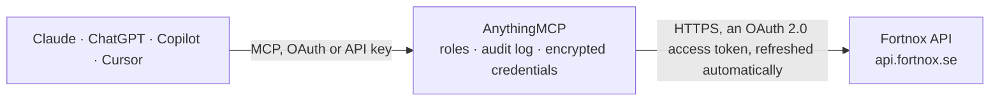

<!-- Generated by scripts/export-github-catalog.mjs in the anythingmcp-website repository. Do not edit by hand. -->

# Fortnox MCP connector

Fortnox, the Swedish SMB accounting standard: customers, invoices, supplier invoices, articles, orders, vouchers and the account chart. The AnythingMCP connector gives Claude, ChatGPT, Microsoft Copilot, Cursor and Gemini 15 MCP tools for Fortnox: 12 read and 3 can change data.

**Category:** [Accounting](../accounting.md) · **Tools:** 15 · **Setup guide:** [anythingmcp.com](https://anythingmcp.com/guides/fortnox-to-mcp) · [Deutsch](https://anythingmcp.com/de/guides/fortnox-to-mcp) · [Italiano](https://anythingmcp.com/it/guides/fortnox-to-mcp) · [Español](https://anythingmcp.com/es/guides/fortnox-to-mcp) · [日本語](https://anythingmcp.com/ja/guides/fortnox-to-mcp) · [Русский](https://anythingmcp.com/ru/guides/fortnox-to-mcp) · [中文](https://anythingmcp.com/zh/guides/fortnox-to-mcp)

## Start without code

No installation and no terminal: AnythingMCP Cloud runs the Fortnox connector for you, operated by helpcode.ai in Frankfurt, Germany.

1. **Click the button above** and create an account or sign in. The Fortnox connector opens, ready to install.
2. **Sign in with your Fortnox account** when AnythingMCP asks. The first time, an admin creates a small app in the Fortnox developer console. Every click is in the [step-by-step guide](https://anythingmcp.com/guides/fortnox-to-mcp).
3. **Click Install.** AnythingMCP shows the address of your MCP server.
4. **Add that address to your assistant:** [Claude](https://anythingmcp.com/guides/connect-fortnox-to-claude) · [ChatGPT](https://anythingmcp.com/guides/connect-fortnox-to-chatgpt) · [Microsoft Copilot](https://anythingmcp.com/guides/connect-fortnox-to-copilot) · [Cursor](https://anythingmcp.com/guides/connect-fortnox-to-cursor) · [Gemini CLI](https://anythingmcp.com/guides/connect-fortnox-to-gemini) · [Meta Muse](https://anythingmcp.com/guides/connect-fortnox-to-muse).
5. **Ask your first question**, for example: *Show full details for invoice 2026-045 to customer 3007, I need date, due date, total and balance.*

Prefer help with the setup? [Talk to us](https://anythingmcp.com/contact).

## How it works

- **The AI client** speaks MCP (Streamable HTTP) to AnythingMCP and only sees tool names, descriptions and results. It never gets the Fortnox credentials.
- **AnythingMCP** checks the client's role, builds the call from the tool definition, adds the credentials (an OAuth 2.0 access token, refreshed automatically), calls Fortnox, logs the call and returns the result.
- **Fortnox** sees an ordinary API client with the rights of the account the credentials belong to.

## Tools

| Tool | What it does | Access |
|---|---|---|
| [`fortnox_get_company_settings`](#fortnox_get_company_settings) | Read the connected company's settings: name, organisation number, VAT number, address and currency. | read |
| [`fortnox_list_customers`](#fortnox_list_customers) | List customers with their number, name, organisation number, address and payment terms. | read |
| [`fortnox_get_customer`](#fortnox_get_customer) | Read one customer by their customer number, with addresses, delivery defaults, VAT settings and price list. | read |
| [`fortnox_list_invoices`](#fortnox_list_invoices) | List invoices with their number, date, due date, customer, total and balance. | read |
| [`fortnox_get_invoice`](#fortnox_get_invoice) | Read one invoice in full: every row with article, quantity, price and VAT, the totals, the payment terms and the balance outstanding. | read |
| [`fortnox_create_invoice`](#fortnox_create_invoice) | Create a customer invoice as an unbooked draft: customer, dates and rows. | write |
| [`fortnox_list_attachments`](#fortnox_list_attachments) | List the files attached to one invoice, order or offer: attachment id, fileId and whether the file goes out with the document (includeOnSend). | read |
| [`fortnox_attach_files`](#fortnox_attach_files) | Attach files that are already in the Fortnox inbox or archive to one or more invoices, orders or offers, optionally to be sent with the document. | write |
| [`fortnox_detach_file`](#fortnox_detach_file) | Detach one file from its invoice, order or offer by attachment id; the file itself stays in the Fortnox archive. | write |
| [`fortnox_list_supplier_invoices`](#fortnox_list_supplier_invoices) | List supplier invoices with their supplier, date, due date, total and payment state: the payables side of the ledger. | read |
| [`fortnox_list_orders`](#fortnox_list_orders) | List sales orders with their number, customer, date, delivery state and total, for the pipeline between quote and invoice. | read |
| [`fortnox_list_articles`](#fortnox_list_articles) | List articles with their number, description, sales price, purchase price, stock quantity and unit. | read |
| [`fortnox_list_vouchers`](#fortnox_list_vouchers) | List bookkeeping vouchers in a financial year with their series, number, date and description: the ledger underneath the documents. | read |
| [`fortnox_list_accounts`](#fortnox_list_accounts) | List the chart of accounts for a financial year with each account's number, description, VAT code and balance-carry setting. | read |
| [`fortnox_list_inbox`](#fortnox_list_inbox) | List the files and sub-folders of the Fortnox inbox (Inkorgen) or of one of its folders, with each file's Id, Name, Size and ArchiveFileId. | read |

## Tool reference

Every parameter as the AI client sees it in `tools/list`. Source: [`packages/backend/src/adapters/se/fortnox.json`](../../../packages/backend/src/adapters/se/fortnox.json).

### `fortnox_get_company_settings`

Read the connected company's settings: name, organisation number, VAT number, address and currency. The fastest proof that the OAuth client works.

**Access:** read · **Call:** `GET /settings/company`

No parameters.

### `fortnox_list_customers`

List customers with their number, name, organisation number, address and payment terms. Filter by name or organisation number to find one.

**Access:** read · **Call:** `GET /customers`

| Parameter | Type | Required | Description |
|---|---|---|---|
| `limit` | number | no | Rows per page (default 100, max 500). |
| `page` | number | no | Page number, starting at 1. |
| `filter` | string | no | Named filter, e.g. active or inactive. |
| `name` | string | no | Name fragment to search for. |
| `organisationnumber` | string | no | Exact organisation number to look up. |

### `fortnox_get_customer`

Read one customer by their customer number, with addresses, delivery defaults, VAT settings and price list.

**Access:** read · **Call:** `GET /customers/{customerNumber}`

| Parameter | Type | Required | Description |
|---|---|---|---|
| `customerNumber` | string | yes | Fortnox customer number. |

### `fortnox_list_invoices`

List invoices with their number, date, due date, customer, total and balance. Filter `unpaidoverdue` answers 'who is late' directly.

**Access:** read · **Call:** `GET /invoices`

| Parameter | Type | Required | Description |
|---|---|---|---|
| `limit` | number | no | Rows per page (default 100, max 500). |
| `page` | number | no | Page number, starting at 1. |
| `filter` | string | no | Named filter: cancelled, fullypaid, unpaid, unpaidoverdue, unbooked. |
| `fromdate` | string | no | Earliest invoice date, YYYY-MM-DD. |
| `todate` | string | no | Latest invoice date, YYYY-MM-DD. |
| `customernumber` | string | no | Restrict to one customer's invoices. |

### `fortnox_get_invoice`

Read one invoice in full: every row with article, quantity, price and VAT, the totals, the payment terms and the balance outstanding.

**Access:** read · **Call:** `GET /invoices/{documentNumber}`

| Parameter | Type | Required | Description |
|---|---|---|---|
| `documentNumber` | string | yes | Fortnox invoice document number. |

### `fortnox_create_invoice`

Create a customer invoice as an unbooked draft: customer, dates and rows. Fields left out take the predefined values from the Fortnox settings (terms of payment, accounts). The draft is neither booked nor sent; booking and sending happen in Fortnox. Installed switched off. Show the user the customer, rows and totals and get their confirmation before calling.

**Access:** write · **Call:** `POST /invoices`

| Parameter | Type | Required | Description |
|---|---|---|---|
| `Invoice` | object | yes | The invoice. CustomerNumber is required; usual fields: InvoiceDate and DueDate (YYYY-MM-DD), YourReference, OurReference, YourOrderNumber, Currency, Comments, Remarks and InvoiceRows, e.g. [{"ArticleNumber": "100", "DeliveredQuantity": 2, "Price": 450}] or a free-text row [{"Description": "Consulting May", "DeliveredQuantity": 8, "Price": 950, "AccountNumber": 3041}]. |

### `fortnox_list_attachments`

List the files attached to one invoice, order or offer: attachment id, fileId and whether the file goes out with the document (includeOnSend). Uses the Fortnox File Attachments API.

**Access:** read · **Call:** `GET https://api.fortnox.se/api/fileattachments/attachments-v1`

| Parameter | Type | Required | Description |
|---|---|---|---|
| `entity_id` | integer | yes | Internal id of the document (the invoice DocumentNumber for type F). |
| `entity_type` | `F` \| `O` \| `OF` \| `C` \| `LGR_IO` \| `LGR_IG` | yes | Document type: F customer invoice, O order, OF offer, C contract, LGR_IO / LGR_IG warehouse documents. |

### `fortnox_attach_files`

Attach files that are already in the Fortnox inbox or archive to one or more invoices, orders or offers, optionally to be sent with the document. Detaching later leaves the file in the archive. Changes the customer's documents in Fortnox: tell the user what will be attached where and get their confirmation before calling.

**Access:** write · **Call:** `POST https://api.fortnox.se/api/fileattachments/attachments-v1`

| Parameter | Type | Required | Description |
|---|---|---|---|
| `attachments` | object[] | yes | One entry per file and document: entityId (document id), entityType (F invoice, O order, OF offer), fileId (the ArchiveFileId from fortnox_list_inbox) and includeOnSend (true to send it with the document). |

### `fortnox_detach_file`

Detach one file from its invoice, order or offer by attachment id; the file itself stays in the Fortnox archive. Installed switched off. Confirm the document and file with the user before calling.

**Access:** write · **Call:** `DELETE https://api.fortnox.se/api/fileattachments/attachments-v1/{attachment_id}`

| Parameter | Type | Required | Description |
|---|---|---|---|
| `attachment_id` | string | yes | Attachment id (a UUID) from fortnox_list_attachments, not the fileId. |

### `fortnox_list_supplier_invoices`

List supplier invoices with their supplier, date, due date, total and payment state: the payables side of the ledger.

**Access:** read · **Call:** `GET /supplierinvoices`

| Parameter | Type | Required | Description |
|---|---|---|---|
| `limit` | number | no | Rows per page. |
| `page` | number | no | Page number, starting at 1. |
| `filter` | string | no | Named filter: cancelled, fullypaid, unpaid, unpaidoverdue, unbooked. |
| `fromdate` | string | no | Earliest invoice date, YYYY-MM-DD. |
| `todate` | string | no | Latest invoice date, YYYY-MM-DD. |

### `fortnox_list_orders`

List sales orders with their number, customer, date, delivery state and total, for the pipeline between quote and invoice.

**Access:** read · **Call:** `GET /orders`

| Parameter | Type | Required | Description |
|---|---|---|---|
| `limit` | number | no | Rows per page. |
| `page` | number | no | Page number, starting at 1. |
| `filter` | string | no | Named filter: cancelled, expired, invoicecreated, invoicenotcreated. |
| `fromdate` | string | no | Earliest order date, YYYY-MM-DD. |

### `fortnox_list_articles`

List articles with their number, description, sales price, purchase price, stock quantity and unit.

**Access:** read · **Call:** `GET /articles`

| Parameter | Type | Required | Description |
|---|---|---|---|
| `limit` | number | no | Rows per page. |
| `page` | number | no | Page number, starting at 1. |
| `filter` | string | no | Named filter, e.g. active. |
| `articlenumber` | string | no | Exact article number to look up. |

### `fortnox_list_vouchers`

List bookkeeping vouchers in a financial year with their series, number, date and description: the ledger underneath the documents.

**Access:** read · **Call:** `GET /vouchers`

| Parameter | Type | Required | Description |
|---|---|---|---|
| `limit` | number | no | Rows per page. |
| `page` | number | no | Page number, starting at 1. |
| `financialyear` | number | no | Financial year id. Omitted, Fortnox uses the current year, a surprise in January. |
| `fromdate` | string | no | Earliest voucher date, YYYY-MM-DD. |
| `todate` | string | no | Latest voucher date, YYYY-MM-DD. |

### `fortnox_list_accounts`

List the chart of accounts for a financial year with each account's number, description, VAT code and balance-carry setting.

**Access:** read · **Call:** `GET /accounts`

| Parameter | Type | Required | Description |
|---|---|---|---|
| `limit` | number | no | Rows per page. |
| `page` | number | no | Page number, starting at 1. |
| `financialyear` | number | no | Financial year id. |

### `fortnox_list_inbox`

List the files and sub-folders of the Fortnox inbox (Inkorgen) or of one of its folders, with each file's Id, Name, Size and ArchiveFileId. The ArchiveFileId is what fortnox_attach_files needs.

**Access:** read · **Call:** `GET /inbox`

| Parameter | Type | Required | Description |
|---|---|---|---|
| `path` | string | no | Folder path: Inbox_kf customer invoices, Inbox_s supplier invoices, Inbox_v vouchers, Inbox_o orders, Inbox_of offers, Inbox_a asset register, Inbox_d daily takings, Inbox_b bank files, Inbox_l payroll. Left out: the root with its folders. |

## Run it yourself

AnythingMCP is open source (AGPL-3.0). [Run it with Docker](../../../README.md#run-it-yourself), open **Connectors → Store**, pick **Fortnox** and enter `FORTNOX_CLIENT_ID`, `FORTNOX_CLIENT_SECRET`, then add your MCP server URL to the AI client.

[← Accounting connectors](../accounting.md) · [All categories](../README.md)
