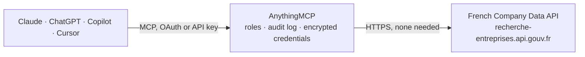

<!-- Generated by scripts/export-github-catalog.mjs in the anythingmcp-website repository. Do not edit by hand. -->

# French Company Data MCP connector

French company register and legal notices, no API key: search companies by name, SIREN/SIRET, activity, place, size or officer (official SIRENE and RNE data), their BODACC notices (insolvency … The AnythingMCP connector gives Claude, ChatGPT, Microsoft Copilot, Cursor and Gemini 7 MCP tools for French Company Data, all read-only.

**Category:** [Government](../government.md) · **Tools:** 7 · **Setup guide:** [anythingmcp.com](https://anythingmcp.com/guides/fr-company-data-to-mcp) · [Deutsch](https://anythingmcp.com/de/guides/fr-company-data-to-mcp) · [Italiano](https://anythingmcp.com/it/guides/fr-company-data-to-mcp) · [Español](https://anythingmcp.com/es/guides/fr-company-data-to-mcp) · [日本語](https://anythingmcp.com/ja/guides/fr-company-data-to-mcp) · [Русский](https://anythingmcp.com/ru/guides/fr-company-data-to-mcp) · [中文](https://anythingmcp.com/zh/guides/fr-company-data-to-mcp)

## Start without code

No installation and no terminal: AnythingMCP Cloud runs the French Company Data connector for you, operated by helpcode.ai in Frankfurt, Germany.

1. **Click the button above** and create an account or sign in. The French Company Data connector opens, ready to install.
2. **Nothing to enter:** this connector needs no credentials. Every click is in the [step-by-step guide](https://anythingmcp.com/guides/fr-company-data-to-mcp).
3. **Click Install.** AnythingMCP shows the address of your MCP server.
4. **Add that address to your assistant:** [Claude](https://anythingmcp.com/guides/connect-fr-company-data-to-claude) · [ChatGPT](https://anythingmcp.com/guides/connect-fr-company-data-to-chatgpt) · [Microsoft Copilot](https://anythingmcp.com/guides/connect-fr-company-data-to-copilot) · [Cursor](https://anythingmcp.com/guides/connect-fr-company-data-to-cursor) · [Gemini CLI](https://anythingmcp.com/guides/connect-fr-company-data-to-gemini) · [Meta Muse](https://anythingmcp.com/guides/connect-fr-company-data-to-muse).
5. **Ask your first question**, for example: *Find the SIREN, VAT and latest published revenue for Boulangerie Duval SARL in Lyon*

Prefer help with the setup? [Talk to us](https://anythingmcp.com/contact).

## How it works

- **The AI client** speaks MCP (Streamable HTTP) to AnythingMCP and only sees tool names, descriptions and results. It never gets the French Company Data credentials.
- **AnythingMCP** checks the client's role, builds the call from the tool definition, adds the credentials (none needed), calls French Company Data, logs the call and returns the result.
- **French Company Data** sees an ordinary API client with the rights of the account the credentials belong to.

## Tools

| Tool | What it does | Access |
|---|---|---|
| [`fr_company_data_search`](#fr_company_data_search) | Search the French company register (SIRENE, the official Annuaire des Entreprises data): by name, address, officer or SIREN/SIRET in q, and by activity… | read |
| [`fr_company_data_get`](#fr_company_data_get) | Get one French company by its SIREN (9 digits) or one establishment by its SIRET (14 digits): legal name, legal form, NAF activity, size band, creation and… | read |
| [`fr_company_data_near_point`](#fr_company_data_near_point) | Find companies with an establishment within a radius of a point (latitude, longitude), optionally of a given activity: e.g. bakeries within 1 km of an address. | read |
| [`fr_company_data_bodacc_announcements`](#fr_company_data_bodacc_announcements) | List the BODACC legal notices of one company by SIREN, newest first: insolvency proceedings and court judgments, sales and transfers of the business,… | read |
| [`fr_company_data_bodacc_search`](#fr_company_data_bodacc_search) | Search all BODACC legal notices (about 51 million since 2008, updated daily), newest first: e.g. new insolvency proceedings in a department this week,… | read |
| [`fr_company_data_balo_announcements`](#fr_company_data_balo_announcements) | List the BALO notices (Bulletin des annonces légales obligatoires, for listed companies and other issuers) of a company by SIREN, newest first: notices of… | read |
| [`fr_company_data_financial_ratios`](#fr_company_data_financial_ratios) | Get the financial figures and ratios computed by the French Ministry of the Economy from the annual accounts filed with INPI, one row per closing date and… | read |

## Tool reference

Every parameter as the AI client sees it in `tools/list`. Source: [`packages/backend/src/adapters/fr/fr-company-data.json`](../../../packages/backend/src/adapters/fr/fr-company-data.json).

### `fr_company_data_search`

Search the French company register (SIRENE, the official Annuaire des Entreprises data): by name, address, officer or SIREN/SIRET in q, and by activity (NAF), place, size, legal form, revenue or officer name. Each result: SIREN, name, legal form, NAF code, size, creation date, active or ceased, head office (SIRET, address, coordinates), officers, latest revenue and net income, labels (RGE, ESS, Qualiopi...) and the matching establishments. 1 to 25 per page; total_results is capped at 10,000.

**Access:** read · **Call:** `GET /search`

| Parameter | Type | Required | Description |
|---|---|---|---|
| `q` | string | no | Name, address, officer name, SIREN or SIRET. At least 3 characters, unless a filter is set. |
| `activite_principale` | string | no | NAF/APE activity code(s), comma-separated, e.g. 62.01Z or 47.11B,47.11C. |
| `section_activite_principale` | string | no | NAF section letter(s) A to U, e.g. F for construction, comma-separated. |
| `code_postal` | string | no | Postcode(s) of an establishment, comma-separated, e.g. 75009. |
| `code_commune` | string | no | INSEE commune code(s) (5 characters, not the postcode), e.g. 75109. |
| `departement` | string | no | Department number(s), e.g. 75, 2A, 971. |
| `region` | string | no | INSEE region code(s), e.g. 11 for Ile-de-France. |
| `categorie_entreprise` | `PME` \| `ETI` \| `GE` | no | Company size category. |
| `tranche_effectif_salarie` | string | no | INSEE headcount band(s), comma-separated, e.g. 11 (10-19), 21 (50-99), 42 (1000-1999), 53 (10000+). |
| `nature_juridique` | string | no | Legal form code(s) (INSEE nomenclature), e.g. 5710 for SAS, 5499 for SARL. |
| `etat_administratif` | `A` \| `C` | no | A active, C ceased. |
| `est_entrepreneur_individuel` | boolean | no | Only sole traders (true) or only companies (false). |
| `est_association` | boolean | no | Only associations. |
| `est_ess` | boolean | no | Only social and solidarity economy (ESS) organisations. |
| `est_rge` | boolean | no | Only RGE-certified (energy renovation) companies. |
| `est_qualiopi` | boolean | no | Only Qualiopi-certified training providers. |
| `nom_personne` | string | no | Last name of an officer (dirigeant) or elected official. |
| `prenoms_personne` | string | no | First name(s) of that person. |
| `type_personne` | `dirigeant` \| `elu` | no | dirigeant for company officers, elu for elected officials. |
| `ca_min` | integer | no | Minimum revenue (chiffre d'affaires) in euros, last published year. |
| `ca_max` | integer | no | Maximum revenue in euros. |
| `page` | integer | no | Page, 1 to 1000. |
| `per_page` | integer | no | Results per page, 1 to 25. |

### `fr_company_data_get`

Get one French company by its SIREN (9 digits) or one establishment by its SIRET (14 digits): legal name, legal form, NAF activity, size band, creation and closure dates, status, head office address, officers (name, role, birth month), VAT number, latest revenue and net income, collective agreements and labels. With a SIRET, matching_etablissements holds that establishment.

**Access:** read · **Call:** `GET /search`

| Parameter | Type | Required | Description |
|---|---|---|---|
| `siren_or_siret` | string | yes | SIREN (9 digits) or SIRET (14 digits); spaces are allowed, e.g. 552 032 534. |

### `fr_company_data_near_point`

Find companies with an establishment within a radius of a point (latitude, longitude), optionally of a given activity: e.g. bakeries within 1 km of an address. Returns the same company records as fr_company_data_search, with the establishments inside the radius under matching_etablissements.

**Access:** read · **Call:** `GET /near_point`

| Parameter | Type | Required | Description |
|---|---|---|---|
| `lat` | number | yes | Latitude, e.g. 48.8757. |
| `long` | number | yes | Longitude, e.g. 2.3428. |
| `radius` | number | no | Radius in km, 0.001 to 50. Default 5. |
| `activite_principale` | string | no | NAF/APE activity code(s), comma-separated, e.g. 10.71C for bakeries. |
| `section_activite_principale` | string | no | NAF section letter(s), A to U. |
| `page` | integer | no | Page, starting at 1. |
| `per_page` | integer | no | Results per page, 1 to 25. |

### `fr_company_data_bodacc_announcements`

List the BODACC legal notices of one company by SIREN, newest first: insolvency proceedings and court judgments, sales and transfers of the business, registrations, changes (officers, capital, address), deregistration and annual accounts filed. Filter by kind of notice and publication date. Nested details (jugement, acte, listepersonnes, modificationsgenerales, depot) are JSON text; url_complete links the notice on bodacc.fr.

**Access:** read · **Call:** `GET https://bodacc-datadila.opendatasoft.com/api/explore/v2.1/catalog/datasets/annonces-commerciales/records`

| Parameter | Type | Required | Description |
|---|---|---|---|
| `siren` | string | yes | SIREN, 9 digits without spaces, e.g. 552032534. |
| `family` | `collective` \| `vente` \| `immatriculation` \| `creation` \| `modification` \| `radiation` \| `dpc` \| `conciliation` \| `retablissement_professionnel` \| `divers` | no | Kind of notice: collective (insolvency: safeguard, receivership, liquidation), vente (sale or transfer of a business), immatriculation (registration), creation, modification (change of officers, capital, address...), radiation (deregistration), dpc (annual accounts filed), conciliation, retablissement_professionnel, divers. |
| `date_from` | string | no | Published on or after, YYYY-MM-DD. |
| `date_to` | string | no | Published on or before, YYYY-MM-DD. |
| `limit` | integer | no | Notices per page, 1 to 100. |
| `offset` | integer | no | How many to skip, for paging (offset + limit at most 10,000). |

### `fr_company_data_bodacc_search`

Search all BODACC legal notices (about 51 million since 2008, updated daily), newest first: e.g. new insolvency proceedings in a department this week, business sales in a city, or notices mentioning a name. Filter by kind of notice, department and publication date, and search the text. total_count gives the number of matches.

**Access:** read · **Call:** `GET https://bodacc-datadila.opendatasoft.com/api/explore/v2.1/catalog/datasets/annonces-commerciales/records`

| Parameter | Type | Required | Description |
|---|---|---|---|
| `text` | string | no | Words to find anywhere in the notice, e.g. a company or person name. No double quotes. |
| `family` | `collective` \| `vente` \| `immatriculation` \| `creation` \| `modification` \| `radiation` \| `dpc` \| `conciliation` \| `retablissement_professionnel` \| `divers` | no | Kind of notice: collective (insolvency: safeguard, receivership, liquidation), vente (sale or transfer of a business), immatriculation (registration), creation, modification (change of officers, capital, address...), radiation (deregistration), dpc (annual accounts filed), conciliation, retablissement_professionnel, divers. |
| `department` | string | no | Department number, e.g. 75, 69, 2A, 974. |
| `date_from` | string | no | Published on or after, YYYY-MM-DD. |
| `date_to` | string | no | Published on or before, YYYY-MM-DD. |
| `limit` | integer | no | Notices per page, 1 to 100. |
| `offset` | integer | no | How many to skip, for paging (offset + limit at most 10,000). |

### `fr_company_data_balo_announcements`

List the BALO notices (Bulletin des annonces légales obligatoires, for listed companies and other issuers) of a company by SIREN, newest first: notices of general meetings, annual and quarterly accounts, revenue figures, securities issues, mergers. The PDF is usually at https://www.journal-officiel.gouv.fr/telechargements/BALO/pdf/YYYY/MMDD/<file> using dateparution and the file name.

**Access:** read · **Call:** `GET https://journal-officiel-datadila.opendatasoft.com/api/explore/v2.1/catalog/datasets/balo/records`

| Parameter | Type | Required | Description |
|---|---|---|---|
| `siren` | string | yes | SIREN, 9 digits without spaces. |
| `date_from` | string | no | Published on or after, YYYY-MM-DD. |
| `limit` | integer | no | Notices per page, 1 to 100. |
| `offset` | integer | no | How many to skip, for paging. |

### `fr_company_data_financial_ratios`

Get the financial figures and ratios computed by the French Ministry of the Economy from the annual accounts filed with INPI, one row per closing date and type of accounts: revenue, gross margin, EBITDA (EBE), EBIT, net income, debt ratio, liquidity, financial autonomy, working capital in days of revenue, stock rotation, customer and supplier credit days. type_bilan C = full accounts, S = simplified, K = consolidated. Companies that chose confidentiality have no figures.

**Access:** read · **Call:** `GET https://data.economie.gouv.fr/api/explore/v2.1/catalog/datasets/ratios_inpi_bce/records`

| Parameter | Type | Required | Description |
|---|---|---|---|
| `siren` | string | yes | SIREN, 9 digits without spaces. |
| `type_bilan` | `C` \| `S` \| `K` | no | Only one type of accounts: C full, S simplified, K consolidated. |
| `limit` | integer | no | Rows, 1 to 100. |

## Run it yourself

AnythingMCP is open source (AGPL-3.0). [Run it with Docker](../../../README.md#run-it-yourself), open **Connectors → Store**, pick **French Company Data**, then add your MCP server URL to the AI client.

[← Government connectors](../government.md) · [All categories](../README.md)
